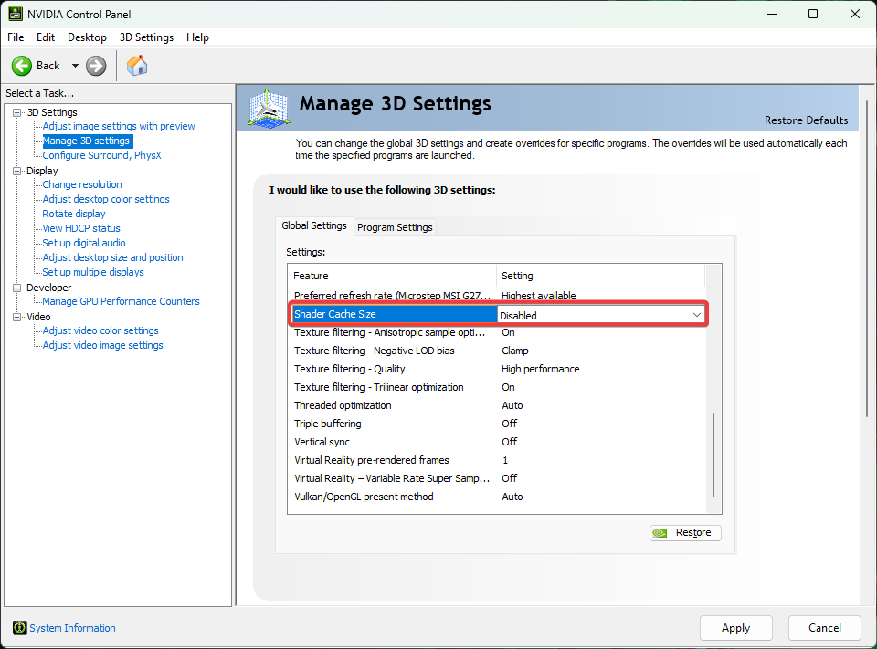

# DirectX Shader Cache

Clears the DirectX cache and NVIDIA caches used for shader compilation. Clearing the cache forces shaders to be recompiled the next time an application starts. Expect a short period of shader compilation stutter immediately after cleaning.

Remember to temporarily set `Shader Cache Size` to `Disabled`, use the option, then return it to `Unlimited` so the driver use the files.



Paths removed:
```c
%LOCALAPPDATA%\D3DSCache
%LOCALAPPDATA%\NVIDIA\DXCache
%LOCALAPPDATA%\NVIDIA\GLCache
%LOCALAPPDATA%\NVIDIA Corporation\NV_Cache
```

