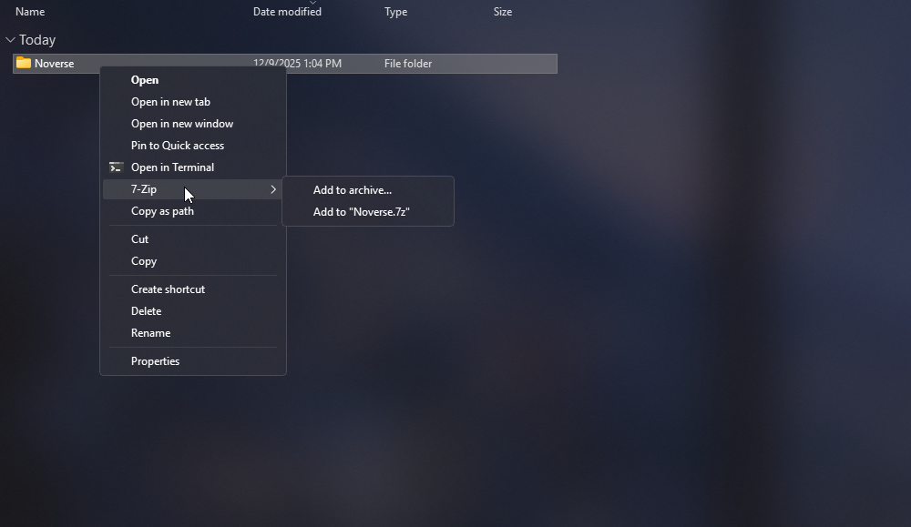
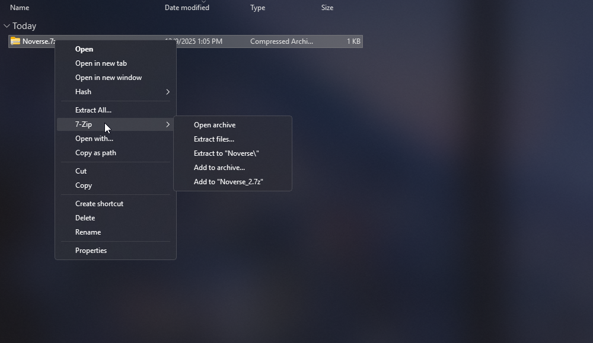

# 7-Zip Settings

7-Zip minimal context menu settings (if cascaded context menu enabled):




All *context menu items* are getting handled via `ContextMenu` (`HKCU\Software\7-Zip\Options`).

```c
// Cascaded context menu, 1 = enabled, 0 = disabled
7zFM.exe	RegSetValue	HKCU\Software\7-Zip\Options\CascadedMenu	Type: REG_DWORD, Length: 4, Data: 1

// Eliminate dublication of root folders, 1 = enabled, 0 = disabled
7zFM.exe	RegSetValue	HKCU\Software\7-Zip\Options\ElimDupExtract	Type: REG_DWORD, Length: 4, Data: 1

// Icons in context menu, 1 = enabled, 0 = disabled
7zFM.exe	RegSetValue	HKCU\Software\7-Zip\Options\MenuIcons	Type: REG_DWORD, Length: 4, Data: 1

// Propagate Zone.Id stream, delete = * No, 1 = Yes, 2 = For Office files
7zFM.exe	RegSetValue	HKCU\Software\7-Zip\Options\WriteZoneIdExtract	Type: REG_DWORD, Length: 4, Data: 1
```

A decent replacement would be [NanaZip](https://github.com/M2Team/NanaZip).

