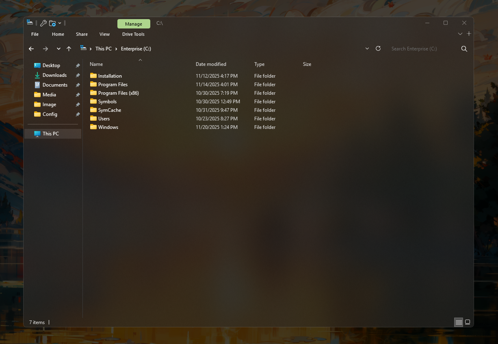

# Explorer Blur

Installs [ExplorerBlurMica](https://github.com/Maplespe/ExplorerBlurMica), which adds a background blur/acrylic/mica effect to the explorer:



## Configuration

Open `%LOCALAPPDATA%\Noverse\ExplorerBlur\Release` - `config.ini`:

```ini
[config]
; Effect type 
; 0 = Blur 
; 1 = Acrylic 
; 2 = Mica 
; 3 = Blur(Clear) 
; 4 =MicaAlt
; Blur is only available up to W11 22h2, Blur (Clear) is available in both W10 and W11, Mica is only available in W11.
effect=2

; Clear the background of the address bar.
clearAddress=true

; Clear the background color of the scrollbar.
; Note: Since the system scrollbar itself has a background color that cannot be removed, when this option is turned on, the scrollbar is drawn by the program and the style may be different from the system.
clearBarBg=true

; Remove the toolbar background color from the WinUI or XamlIslands section of Windows 11.
clearWinUIBg=true

; Show split line between TreeView and DUIView.
showLine=true

[light]
; The system color scheme is the color in Light mode.
; RGBA component of background blend color
r=255
g=255
b=255
a=200
[dark]
; The system color scheme is the color in Dark mode.
r=0
g=0
b=0
a=120
```

