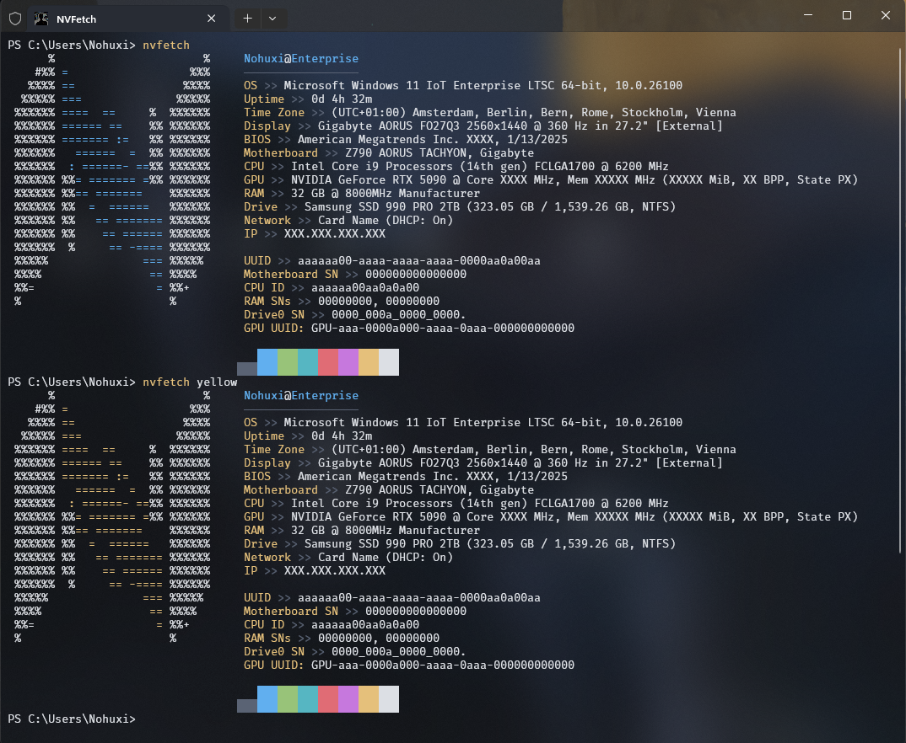

# NVFetch

Used to be my personal [`neofetch`](https://github.com/dylanaraps/neofetch)/[`fastfetch`](https://github.com/fastfetch-cli/fastfetch) replacement with more details. Some arguments will probably also get added like `ids`, so it doesn't display the serial numbers and miscellaneous HWIDs by default.



> https://github.com/nohuto/nvfetch

It currently gets most of the information using the [`Get-CimInstance`](https://learn.microsoft.com/en-us/powershell/module/cimcmdlets/get-ciminstance?view=powershell-7.5) cmdlet and [`nvidia-smi`](https://docs.nvidia.com/deploy/nvidia-smi/index.html) for NVIDIA GPUs.
```powershell
nvidia-smi -q
```
[`nvfetch-win32cimv2.txt`](https://github.com/nohuto/win-config/blob/main/misc/assets/reference/nvfetch-win32cimv2.txt) shows class names in the `root\CIMV2` namespace, filtered with `Win32*`.

| **Category** | **Query** | **Fields/Description** |
| ---- | ---- | ---- |
| **OS** | `Win32_OperatingSystem` | `Caption` - OS name, `OSArchitecture` - Architecture (32-bit or 64-bit), `Version` - OS version |
| **Time Zone** | `Get-TimeZone` | `DisplayName` - Name of the current time zone |
| **Uptime** | `Win32_OperatingSystem` | `LastBootUpTime` - Last system boot time |
| **Display** | `Win32_VideoController`, `WmiMonitorID`, `WmiMonitorBasicDisplayParams`, `WmiMonitorConnectionParams` | `Name` - Display name, `Resolution` - Screen resolution, `Refresh Rate` - Monitor refresh rate, `Size (inch)` - Monitor size in inches, `External/Internal` - Whether external or internal monitor |
| **BIOS** | `Win32_BIOS` | `Manufacturer` - BIOS manufacturer, `SMBIOSBIOSVersion` - BIOS version, `ReleaseDate` - BIOS release date |
| **Motherboard** | `Win32_BaseBoard` | `Product` - Motherboard product, `Manufacturer` - Manufacturer of the motherboard |
| **CPU** | `Win32_Processor` | `Name` - Processor name, `SocketDesignation` - Socket type, `MaxClockSpeed` - Maximum clock speed in MHz |
| **GPU** | If `nvidia-smi` is present: `gc nvidia-smi` | `Name` - GPU name, `Core Clock` - GPU core clock speed, `Memory Clock` - GPU memory clock speed, `VRAM` - VRAM size, `BPP` - Bits per pixel, `Performance State` - State (e.g., P0 to P12) |
| | If `nvidia-smi` isn't present (AMD): `Win32_VideoController` | `Name` - GPU name, `Caption` - GPU caption, `CurrentBitsPerPixel` - Bits per pixel, `qwMemorySize` - VRAM size |
| **RAM** | `Win32_PhysicalMemory` | `Capacity` - Total memory size, `ConfiguredClockSpeed` - Memory clock speed, `Manufacturer` - RAM manufacturer |
| **Drive** | `Win32_DiskDrive`, `Win32_LogicalDisk` | For `drive0` & `C:\`: `Size` - Total size, `FreeSpace` - Free space, `FileSystem` - Type of file system (e.g., NTFS, FAT32) |
| **Network** | `Win32_NetworkAdapterConfiguration` | `Description` - Network adapter description, `IPAddress` - IP address, `DHCPEnabled` - Whether DHCP is enabled |
| **HWIDs** | UUID | `Win32_ComputerSystemProduct` - `UUID` - Unique system identifier (UUID) |
| | Motherboard SN | `Win32_BaseBoard` - `SerialNumber` - Motherboard serial number |
| | CPU ID | `Win32_Processor` - `ProcessorId` - Processor ID |
| | RAM SNs | `Win32_PhysicalMemory` - `SerialNumber` - RAM serial number |
| | Drive0 SN | `Win32_DiskDrive`/`Win32_PhysicalMedia` - `SerialNumber` - Drive serial number |
| | GPU UUID | `nvidia-smi` - `--query-gpu=uuid` - GPU UUID if `nvidia-smi` is available |

A valid argument is the color name, default is `Blue`. It changes the color of the ASCII logo. Change it by simply adding a valid color name:
```powershell
nvfetch # Uses 'Blue'

nvfetch yellow
nvfetch red
```
Valid colors: `Black`, `Blue`, `Cyan`, `DarkBlue`, `DarkCyan`, `DarkGray`, `DarkGreen`, `DarkMagenta`, `DarkRed`, `DarkYellow`, `Gray`, `Green`, `Magenta`, `Red`, `White`, `Yellow`.

