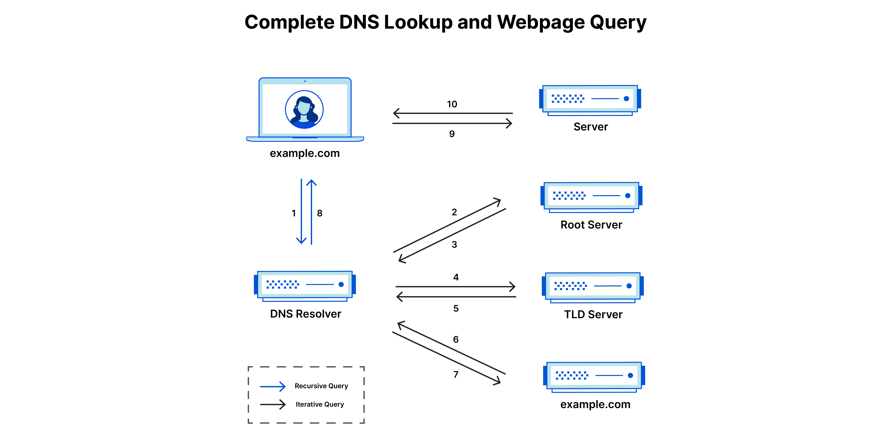
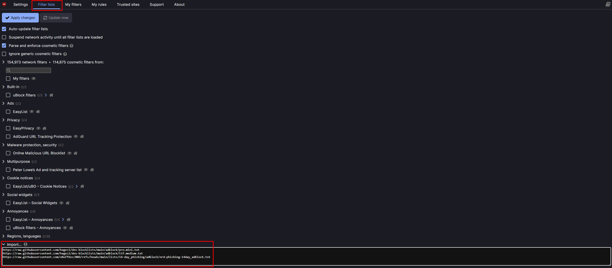

# Encrypted DNS

If you're wondering what `Family`/`Malware`/`Extended` etc. behind the provider names mean, see '[Mullvad](https://mullvad.net/en/help/dns-over-https-and-dns-over-tls#specifications)', '[Quad9](https://docs.quad9.net/services/)', '[AdGuard](https://adguard-dns.io/kb/general/dns-providers/)', '[Cloudflare](https://developers.cloudflare.com/1.1.1.1/setup/)' for details.

The DNS server is applied via registry (captured while applying it via the settings):
```c
HKLM\System\CurrentControlSet\Services\Tcpip\Parameters\Interfaces\{NetID}\NameServer  Type: REG_SZ, Length: 24, Data: 194.242.2.5
HKLM\System\CurrentControlSet\Services\Dnscache\InterfaceSpecificParameters\{NetID}\DohInterfaceSettings\Doh\194.242.2.5\DohTemplate  Type: REG_SZ, Data: https://extended.dns.mullvad.net/dns-query
HKLM\System\CurrentControlSet\Services\Dnscache\InterfaceSpecificParameters\{NetID}\DohInterfaceSettings\Doh\194.242.2.5\DohFlags  Type: REG_QWORD, Length: 8, Data: 2
```

`NetID` is saved in your network adapter GUID key (`{4d36e972-e325-11ce-bfc1-08002be10318}`) named `NetCfgInstanceId`.

## [`DNS_DOH_SERVER_SETTINGS`](https://learn.microsoft.com/en-us/windows/win32/api/netioapi/ns-netioapi-dns_doh_server_settings)

This is I guess used for the `DohFlags` value.

```cpp
typedef struct _DNS_DOH_SERVER_SETTINGS {
#if ...
  PWSTR   Template;
#else
  PWSTR   Template;
#endif
  ULONG64 Flags;
} DNS_DOH_SERVER_SETTINGS;
```

| Flag | Meaning |
| --- | --- |
| `DNS_DOH_SERVER_SETTINGS_ENABLE_AUTO (0x0001)` | If this option is present, then the DNS server that's referenced by this property will load its URI template from the system DNS-over-HTTPS system list. When this option is present, the Template field must be set to NULL. This option must not be used together with the `DNS_DOH_SERVER_SETTINGS_ENABLE` option. |
| `DNS_DOH_SERVER_SETTINGS_ENABLE (0x0002)` | If this option is present, then the Template field must point to a valid DNS-over-HTTPS URI template. This option must not be used together with the `DNS_DOH_SERVER_SETTINGS_ENABLE_AUTO` option. |
| `DNS_DOH_SERVER_SETTINGS_FALLBACK_TO_UDP (0x0004)` | This option indicates that the referenced server may fallback to unsecure name resolution (UDP/TCP) if the DNS-over-HTTPS query failed. This option can be used only in addition to `DNS_DOH_SERVER_SETTINGS_ENABLE_AUTO` or `DNS_DOH_SERVER_SETTINGS_ENABLE`. |
| `DNS_DOH_AUTO_UPGRADE_SERVER (0x0008)` | This option allows a DNS server present in an NRPT rule to use the DNS-over-HTTPS template if it has the same IP address as the server referenced by this property. This option can't be used by itself; it must be in addition to `DNS_DOH_SERVER_SETTINGS_ENABLE_AUTO` or `DNS_DOH_SERVER_SETTINGS_ENABLE`. |

## Providers Compared

| Provider | Encryption | DNSSEC | ECS | QNAME | Logging Policy | Filtering | Jurisdiction / Owner |
| --- | --- | --- | --- | --- | --- | --- | --- |
| [Quad9](https://quad9.net/) | DoH, DoT | Yes | Off (disabled) | Yes | No logs ([no IP stored](https://quad9.net/privacy/policy)) | Malware/phishing | Switzerland (nonprofit) |
| [Mullvad DNS](https://mullvad.net/en/help/dns-over-https-and-dns-over-tls) | DoH, DoT | Yes | Off | [Yes](https://mullvad.net/en/help/dns-over-https-and-dns-over-tls) | [No logs](https://mullvad.net/en/blog/clarifying-our-no-logging-policy) | Ads/trackers (optional) | Sweden (Mullvad AB) |
| [NextDNS](https://nextdns.io/) | DoH, DoT, DoQ | Yes | Off | [Yes](https://nextdns.io/privacy) | Opt-in ([default no-logs](https://nextdns.io/privacy)) | Ads/trackers/malware | US (NextDNS Inc.) |
| [Cloudflare 1.1.1.1](https://developers.cloudflare.com/1.1.1.1/) | DoH, DoT, DoQ | Yes | Off | Unspecified | [Minimal logs](https://developers.cloudflare.com/1.1.1.1/privacy/public-dns-resolver/) (IP truncated, deleted <25h) | Malware/family (optional) | US (Cloudflare) |
| [AdGuard DNS](https://adguard-dns.io/) | DoH, DoT, DoQ, DNSCrypt | Yes | Unspecified | Unspecified | No personal data on public DNS | Ads/malware blocking | EU (AdGuard team) |

`Quad9/Mullvad > AdGuard > NextDNS > Cloudflare` in my option based on my findings. I wouldn't recommend to use DNS resolvers like 'Google Public DNS', just read through their privacy policies and see if they support DNSSEC/QNAME minimalisation/encrypted DNS, disable ECS (EDNS Client Subnet), and don't collect identifiable query logs (that's how I created the table above, including some other facts like Mullvad supporting anycast).

## DNS Explained

DNS (domain name system) is the phonebook of the internet, which means that it translates domains to the corresponding IP addresses (DNS resolution). See [DNSimple comics](https://dnsimple.com/comics) for a very simple explanation/[DNSimple glossary](https://support.dnsimple.com/articles/dns-glossary/) and/or [Cloudflare DNS docs](https://www.cloudflare.com/learning/dns/what-is-dns/).

### Protocols

| Protocol  | Explanation |
| --- | --- |
| Cleartext | Traditional DNS over UDP/TCP 53 with no encryption, so anyone on the path can read or alter your queries. |
| DoH/3 | DNS sent inside HTTPS using HTTP/3 on port 443, encrypting lookups and making them look like normal web traffic. |
| DoT | DNS sent over a TLS encrypted connection on port 853, protecting queries in transit at the transport layer. |
| DoQ | DNS carried over QUIC with built in encryption and faster handshakes, improving reliability. |
| DNSCrypt | A non IETF protocol that encrypts and authenticates DNS between client and resolver, with more limited ecosystem support. |
| DoH | DNS sent inside HTTPS (typically HTTP/2) on port 443, providing encrypted lookups that blend in with regular HTTPS traffic. |

### Types of DNS servers

The **recursive resolver** sends requests to the other three nameservers (root -> TLD -> authoritative), if there's no cached data. It saves the data from the authoritative nameserver so the resolver can skip the requests and send back the IP from the domain to the client. If you're not using any specific DNS server, you're using the resolver from your ISP.

The resolver first queries a [**root nameserver**](https://root-servers.org/), which returns a referral to the [TLD](https://www.iana.org/domains/root/db) (extension or last segment), e.g. `.com`, `.org`, `.net`. If the extension ends with `.org`, the root server directs the resolver to the `.org` TLD nameservers.

The **TLD nameserver** provides referrals to a domain's authoritative nameservers, types of TLDs:  
- **gTLD** -> Generic, common domain names like `.com`, `.org`
- **ccTLD** -> Country code TLDs, like `.us`, `.de`, `.uk` etc.
- **sTLD** -> Sponsored domains serving defined communities, like [`.gov`](https://www.iana.org/domains/root/db/gov.html) and [`.edu`](https://www.iana.org/domains/root/db/edu.html)
- [**ARPA**](https://www.iana.org/domains/arpa) -> Infrastructural TLD, only contains `.arpa`. Used for reversed DNS lookups, you won't use it
- **ngTLD** -> New gTLD, used for branding, niches, etc.: `.shop`, `.online`, `.tech`
- **Reserved TLD** -> Used for testing, they cannot be used: `.localhost`, `.example`

The **authoritative nameserver** tells the resolver the IP address, from the [A record](https://support.dnsimple.com/articles/a-record/). [Records](https://www.cloudflare.com/learning/dns/dns-records/) are included in authoritative DNS servers and contain information like the IP address, TTL value and more.

Step 9 is the HTTP request from the browser to the IP from the resolver & step 10 returns the web page (mostly HTML data). 



Some additional info about HTTP request methods you may want to know:  
`GET` & `POST` HTTP request methods are the most common ones. `GET` request awaits data (read a web page), `POST` request means that the user is sending data. There more [request methods](https://developer.mozilla.org/en-US/docs/Web/HTTP/Reference/Methods), but I won't add them here. You're able to turn off `GET` requests in the DDG search engine settings, to hide search queries in the request body (queries aren't visible in browser history or logs), which is why I added this info. You can see request in the network tab (`F12`).

## Note for iOS users

I personally use [AdGuard](https://adguard-dns.io/), since it's possible to add custom blocklists/user rules (and it supports all lists of Hagezi while [NextDNS](https://my.nextdns.io/) only supports the main ones), while [NextDNS](https://my.nextdns.io/) only provides a specific set of blocklists and doesn't allow custom rules (there're also several other reasons why I wouldn't use their private DNS at the moment, e.g.: their TIF isn't public ([and many other ones](https://github.com/nextdns/metadata))), they didn't solve issues which got reported months ago (), they use lists that aren't actively maintained by default (they also don't update [obselete links](https://github.com/nextdns/blocklists/tree/main/blocklists), causing 10 empty blocklists), they don't look into their GitHub issues (e.g. nextdns/blocklists). Use 'Configuration Profile' instead of downloading the app, you can configure the profile using the links below.

## [Blocklist Manager](https://github.com/nohuto/win-config/blob/main/network/assets/scripts/Blocklist-Manger.ps1)

This is an old project of mine ([preview video](https://github.com/nohuto/win-config/blob/main/network/videos/blocklist-mgr/blocklist-mgr.mp4)), which lets you select one or more blocklists (hosts or URLs, for e.g. UBO). The hosts file is a local DNS override used to block domains or redirect websites (`C:\Windows\System32\drivers\etc\hosts`).

- Download: [Blocklist-Manager.ps1](https://github.com/nohuto/win-config/blob/main/network/assets/scripts/Blocklist-Manger.ps1)

Examples:

```
0.0.0.0 ads.com -> non routable address
127.0.0.1 ads.com -> loopback address

||ads.com^ -> filter (browser)
@@||ads.com^ -> exception
```

First numbers (IP address) is where the domain will be directed to, the second (domain name) is the site, which is getting redirected (blocked). 

- [`0.0.0.0`](https://en.wikipedia.org/wiki/0.0.0.0) blocks/drops the request instantly - making them "unreachable" (known as being faster than `127.0.0.1`, but may be incompatible on some systems)
- [`127.0.0.1`](https://en.wikipedia.org/wiki/localhost) redirects the domain to the localhost (your computer) - called "*loopback address*"
- [`||ads.com^`](https://adblockplus.org/filter-cheatsheet?DE_EXCEPTION=1) blocks the domain - wouldn't block `http://domain.com/redirect/http://ads.com/` -> can't be used within the hosts file
⠀
You should never use all blocklists, as it slows down your system by a lot (and also caused apps to not run as expected anymore). Applying all lists won't give you a better browsing experience, rather try to use at least lists as possible (or use the default preset). Using big lists system wide (hosts file) is also not recommended, if you're planning to use a big list, do that via e.g. uBO (even if the list is compatible with the hosts file).

My suggestion is to choose a specific provider instead of using lists from different ones (if they're meant to block the same things). As you might see, I would choose hagezi at the moment. It's also recommended to apply e.g. 'Native Microsoft' seperately (without 'Pro', 'TIF', etc. so it gets written into the hosts file).

### Issues after importing multiple lists

Open `cmd` and paste `del /f /q C:\Windows\System32\drivers\etc\hosts` into it, if it shows that the DNS client used it, flush your DNS cache (`ipconfig /flushdns`). If this didn't help, boot into safemode (`bcdedit /set safeboot minimal`) & remove the hosts file. This may be needed, if importing too many lists.

The hosts file is empty by default (only comments).

### GUI Buttons

The presets are just examples, use lists from the vendor you prefer.

| Button | Description |
| --- | --- |
| `Minimal` | Preset which can be used by anyone. |
| `Default` | Default preset, uses Pro/TIF without adding the extra lists that aren't included in them. |
| `Maximum` | Aggressive blocking, uses Pro++, TIF and all additional security related lists which aren't included in them (doesn't apply any protections for children). |
| `Import` | Imports the currently selected lists into the `hosts` file (if compatible). |
| `Copy Links` | Copies URLs of all selected lists. Add these links to the custom filter lists:<br> |
| `Restore` | Imports the backup from: `C:\Windows\System32\drivers\etc\hosts.noverse`. |
| `Open File` | Opens the file: `C:\Windows\System32\drivers\etc\hosts`. |

### Additional Features

- Click on the category name (blue) to open the source link
- Adjust the window size, to increase the size of the hosts/log box
- `hosts` preview refreshes itself automatically
- You can edit the hosts file via the panel in the GUI (doesn't create a backup)

