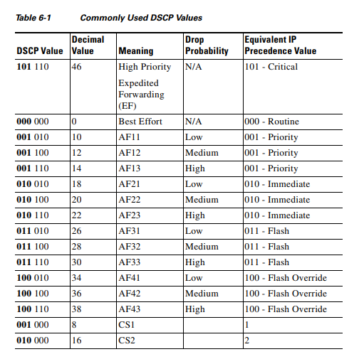

# QoS Policy

> "*The DSCP value provides network traffic classification at the Internet Protocol (IP) level, which routers use to decide traffic queuing behavior.*"
>
> "*A QoS policy that defines throttling limits determines the rate of outbound network traffic.*"
>
> — Microsoft, [Quality of Service (QoS) Policy](https://learn.microsoft.com/en-us/windows-server/networking/technologies/qos/qos-policy-top)

DSCP only helps when routers and switches on the path honor it, throttling works on the PC itself.



- [nexus1000v_qos/qos_6dscp_val.pdf](https://www.cisco.com/c/en/us/td/docs/switches/datacenter/nexus1000/sw/4_0/qos/configuration/guide/nexus1000v_qos/qos_6dscp_val.pdf)


## Policy-based QoS (LGPE) Capture

```powershell
HKLM\SOFTWARE\Policies\Microsoft\Windows\QoS\Fortnite\Version    Type: REG_SZ, Length: 8, Data: 1.0
HKLM\SOFTWARE\Policies\Microsoft\Windows\QoS\Fortnite\Application Name    Type: REG_SZ, Length: 68, Data: FortniteClient-Win64-Shipping.exe
HKLM\SOFTWARE\Policies\Microsoft\Windows\QoS\Fortnite\Protocol    Type: REG_SZ, Length: 4, Data: * # TCP and UDP
HKLM\SOFTWARE\Policies\Microsoft\Windows\QoS\Fortnite\Local Port    Type: REG_SZ, Length: 4, Data: * # Any source port
HKLM\SOFTWARE\Policies\Microsoft\Windows\QoS\Fortnite\Local IP    Type: REG_SZ, Length: 4, Data: * # Any source IP
HKLM\SOFTWARE\Policies\Microsoft\Windows\QoS\Fortnite\Local IP Prefix Length    Type: REG_SZ, Length: 4, Data: *
HKLM\SOFTWARE\Policies\Microsoft\Windows\QoS\Fortnite\Remote Port    Type: REG_SZ, Length: 4, Data: * # Any destination port
HKLM\SOFTWARE\Policies\Microsoft\Windows\QoS\Fortnite\Remote IP    Type: REG_SZ, Length: 4, Data: * # Any destination IP
HKLM\SOFTWARE\Policies\Microsoft\Windows\QoS\Fortnite\Remote IP Prefix Length    Type: REG_SZ, Length: 4, Data: *
HKLM\SOFTWARE\Policies\Microsoft\Windows\QoS\Fortnite\DSCP Value    Type: REG_SZ, Length: 6, Data: 46 # High Priority, Expedited Forwarding (EF)
HKLM\SOFTWARE\Policies\Microsoft\Windows\QoS\Fortnite\Throttle Rate    Type: REG_SZ, Length: 6, Data: -1 # Unspecified throttle rate (none), 'Data' would specify rate in KBps
```

Without `Do not use NLA` under `HKLM\SYSTEM\CurrentControlSet\Services\Tcpip\QoS`, `tcpip.sys` applies the policy only on domain networks:

```c
// EQoSCheckNLAUsageOverride (23H2)

  EQoSPolicyUseNLA = 1; // client SKU default
  RtlInitUnicodeString(&DestinationString, L"\\Registry\\Machine\\SYSTEM\\CurrentControlSet\\Services\\Tcpip\\QoS");

    RtlInitUnicodeString(&ValueName, L"Do not use NLA");

    if ( (v0 & 0x80000000) == 0LL && DWORD1(KeyValueInformation) == 1 ) // REG_SZ
    {
      v0 = RtlCompareMemory((char *)&KeyValueInformation + 12, L"1", 4uLL); // 1
      if ( v0 == 4 )
      {
        EQoSPolicyUseNLA = 0;
```

```c
// EQoSpProcessOnePolicy (23H2)

  v18 = HIDWORD(v35[23]) | 1; // domain profile

    if ( !BYTE3(v35[4]) ) // Version 1.0
    {
      v19 = &EQoSpV100SchemaTable;
      if ( !EQoSPolicyUseNLA ) // "Do not use NLA" = "1"
        HIDWORD(v35[23]) = v18 | 6; // adds private & public profiles
```

## Live Capture

Capturing the network activity after adding the policy using [network monitor](https://learn.microsoft.com/en-us/troubleshoot/windows-server/networking/network-monitor-3):
```powershell
+ Versions: IPv4, Internet Protocol, Header Length = 20
- DifferentiatedServicesField: DSCP: 46, ECN: 0 # Works
   DSCP: (101110..) Differentiated services codepoint 46
   ECT:  (......0.) ECN-Capable Transport not set
   CE:   (.......0) ECN-CE not set
  TotalLength: 132 (0x84)
  Identification: 28587 (0x6FAB)
```

