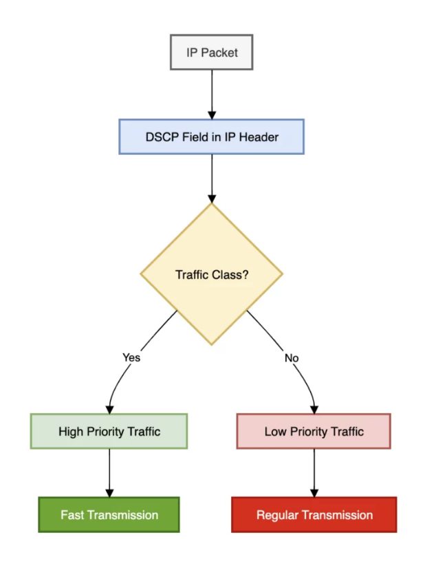

# QoS Policy

> "*Policy-based QoS lets Windows identify outgoing network traffic by application, user, computer, IP address, port, or protocol, and then either mark the traffic with a DSCP value for priority handling or limit it with an outbound throttle rate. It's most useful on a managed network where routers, switches, and wireless access points are configured to recognize DSCP markings and give matching traffic higher priority when the network is busy. Without QoS aware network equipment, DSCP marking may have little practical effect beyond the local device, while throttling still works because Windows enforces the send rate locally on outgoing traffic.*"
>
> — Microsoft, [Policy-based QoS](https://learn.microsoft.com/en-us/windows-server/networking/technologies/qos/qos-policy-top)


- [nexus1000v_qos/qos_6dscp_val.pdf](https://www.cisco.com/c/en/us/td/docs/switches/datacenter/nexus1000/sw/4_0/qos/configuration/guide/nexus1000v_qos/qos_6dscp_val.pdf)



## Policy-based QoS (LGPE) Capture

```powershell
HKLM\SOFTWARE\Policies\Microsoft\Windows\QoS\Fortnite\Version    Type: REG_SZ, Length: 8, Data: 1.0
HKLM\SOFTWARE\Policies\Microsoft\Windows\QoS\Fortnite\Application Name    Type: REG_SZ, Length: 68, Data: FortniteClient-Win64-Shipping.exe
HKLM\SOFTWARE\Policies\Microsoft\Windows\QoS\Fortnite\Protocol    Type: REG_SZ, Length: 4, Data: * # TCP and UDP
HKLM\SOFTWARE\Policies\Microsoft\Windows\QoS\Fortnite\Local Port    Type: REG_SZ, Length: 4, Data: * # Any source port
HKLM\SOFTWARE\Policies\Microsoft\Windows\QoS\Fortnite\Local IP    Type: REG_SZ, Length: 4, Data: * # Any source IP
HKLM\SOFTWARE\Policies\Microsoft\Windows\QoS\Fortnite\Local IP Prefix Length    Type: REG_SZ, Length: 4, Data: *
HKLM\SOFTWARE\Policies\Microsoft\Windows\QoS\Fortnite\Remote Port    Type: REG_SZ, Length: 4, Data: * # Any destination port
HKLM\SOFTWARE\Policies\Microsoft\Windows\QoS\Fortnite\Remote IP    Type: REG_SZ, Length: 4, Data: * # Any destination IP
HKLM\SOFTWARE\Policies\Microsoft\Windows\QoS\Fortnite\Remote IP Prefix Length    Type: REG_SZ, Length: 4, Data: *
HKLM\SOFTWARE\Policies\Microsoft\Windows\QoS\Fortnite\DSCP Value    Type: REG_SZ, Length: 6, Data: 46 # High Priority, Expedited Forwarding (EF)
HKLM\SOFTWARE\Policies\Microsoft\Windows\QoS\Fortnite\Throttle Rate    Type: REG_SZ, Length: 6, Data: -1 # Unspecified throttle rate (none), 'Data' would specify rate in KBps
```

## Live Capture

Capturing the network activity after adding the policy using [network monitor](https://learn.microsoft.com/en-us/troubleshoot/windows-server/networking/network-monitor-3):
```powershell
+ Versions: IPv4, Internet Protocol, Header Length = 20
- DifferentiatedServicesField: DSCP: 46, ECN: 0 # Works
   DSCP: (101110..) Differentiated services codepoint 46
   ECT:  (......0.) ECN-Capable Transport not set
   CE:   (.......0) ECN-CE not set
  TotalLength: 132 (0x84)
  Identification: 28587 (0x6FAB)
```

