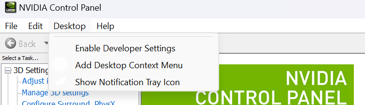

# Enable Developer Settings

Enables `Enable Developer Settings` in the NVIDIA control panel.

```c
//Profile info related
NV_REG_CPL_PERFCOUNT_RESTRICTION  "RmProfilingAdminOnly"
NV_REG_CPL_DEVTOOLS_VISIBLE       "NvDevToolsVisible"
```
```json
{
  "Name": "RmProfilingAdminOnly",
  "Comment": [
    "Type DWORD",
    "This regkey restricts profiling capabilities (creation of profiling objects",
    "and access to profiling-related registers) to admin only.",
    "0 - (default - disabled)",
    "1 - Enables admin check"
  ],
  "Elements": [
    {
      "Name": "FALSE",
      "Value": "0"
    },
    {
      "Name": "TRUE",
      "Value": "1"
    }
  ]
},
```



