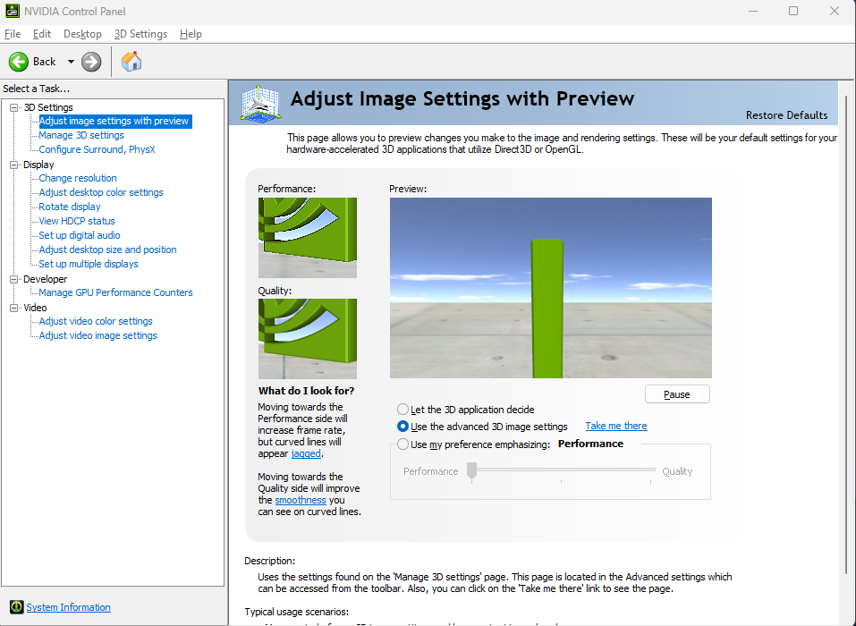
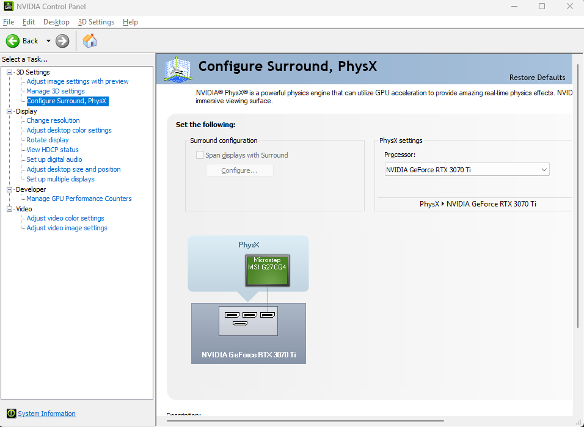
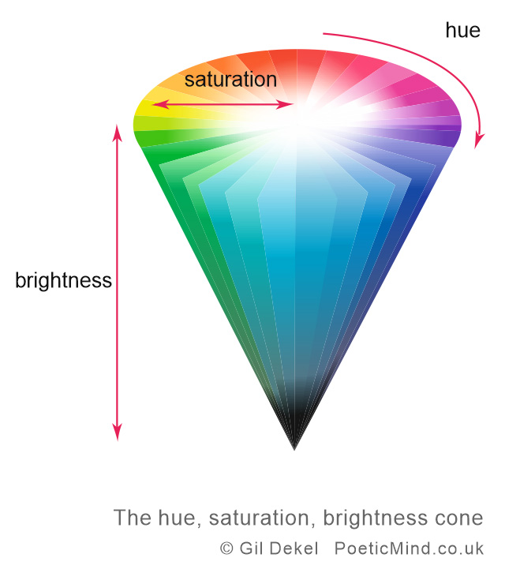
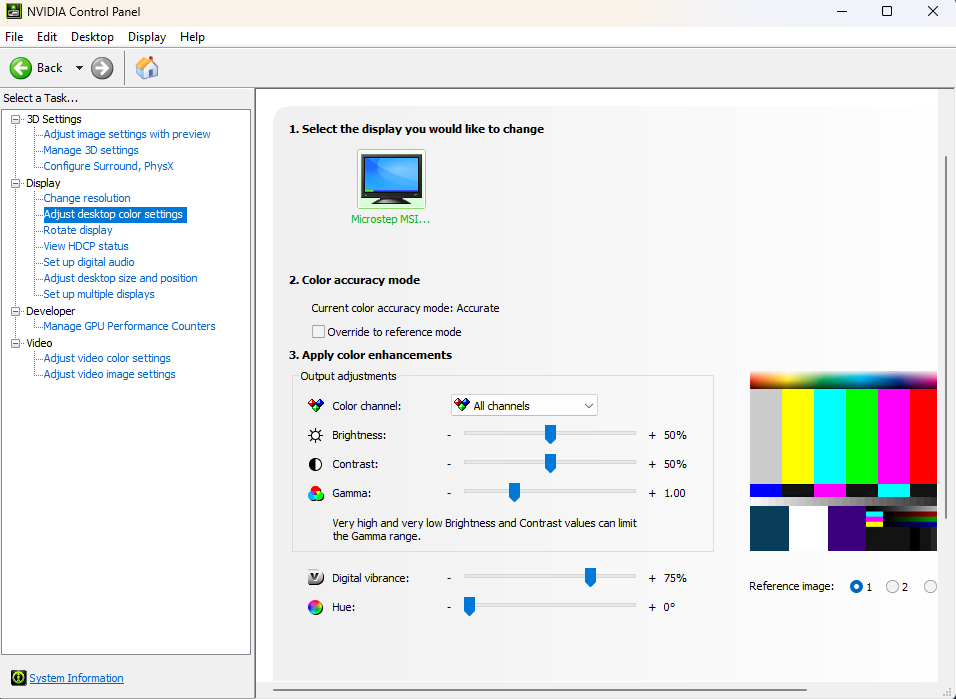
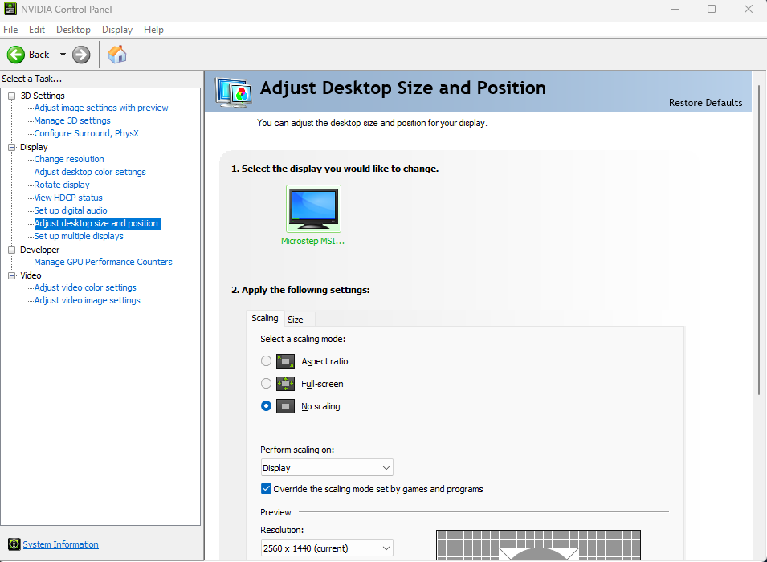
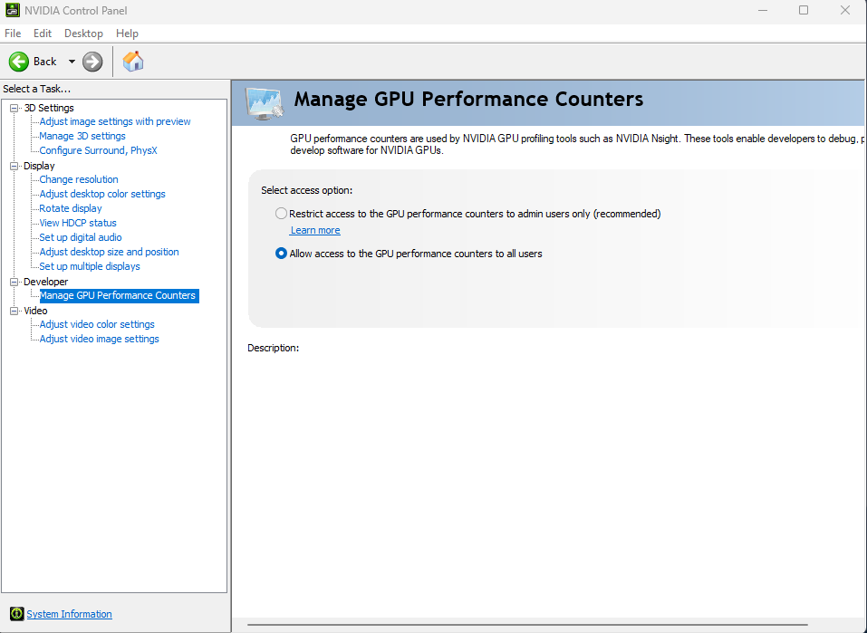
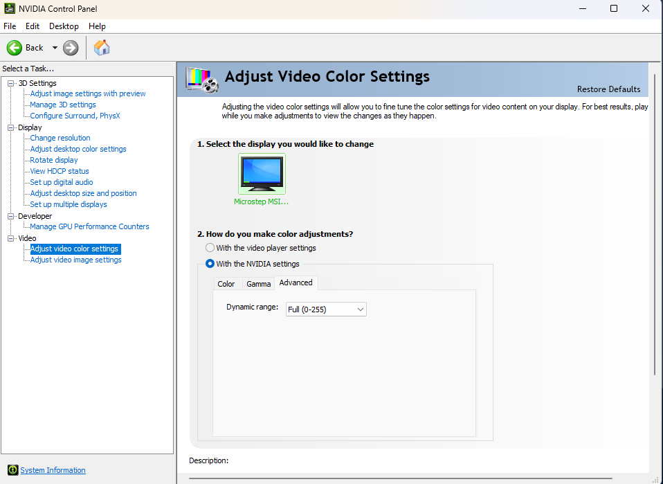
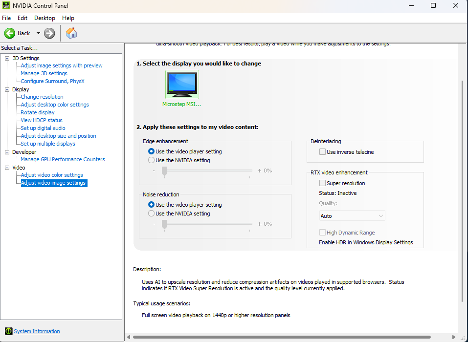

# NVCPL Settings

`Minimal` = Uses the configurations while turning off features like G-SYNC, Antialiasing, Sharpening, Ambient Occlusion, NIS, Ansel etc.  
`Compatible` = Uses the same configurations but keeps those features enabled/app-controlled

The sections below include details of how the nvcpl sets the changes and more, a lot of it is for informational purposes only.

## 3D Settings

### Adjust image settings with preview

```cpp
void    CAppSettingsBasic::mapApiRes()
{
    //Mapping API values to the resources string
    CplUiMap::value_type  eot( (UINT32)-1 , CplUi(0) ); // EOT, must be last in the array

    CplUiMap::value_type api2resImage[] = 
    {
        //============= Image Quality values->strings resource IDs =====================================================================
        CplUiMap::value_type(NVCPLAPI_VALUE_D3D_GESTALT_PERF     ,    CplUi(IDS_3DPREVIEW_EMPHASIZING_PERFORMANCE)),
        CplUiMap::value_type(NVCPLAPI_VALUE_D3D_GESTALT_BALANCED ,    CplUi(IDS_3DPREVIEW_EMPHASIZING_BALANCED)),
        CplUiMap::value_type(NVCPLAPI_VALUE_D3D_GESTALT_QUAL     ,    CplUi(IDS_3DPREVIEW_EMPHASIZING_QUALITY)),  
        //============= Image Quality values->strings resource IDs =====================================================================,
        eot
    };

    m_sliderGestalt.create(api2resImage,NVCPLAPI_SETTING_D3D_BASIC_GESTALT);
}
```



### Manage 3D settings

Note that many settings like '*Triple buffering*', '*OpenGL Rendering GPU*', '*Threaded optimization*', '*Vulkan/OpenGL present method*' etc. are used OpenGL/old DX games only, and e.g. '*Virtual Reality pre-rendered frames*' for VR applications.

I've created a folder [nv_params](https://github.com/nohuto/win-config/tree/main/nvidia/assets/reference/nv_params) that includes NVIDIA driver parameter references for D3D, OpenGL, display, DRS, GFE, nView, ShadowPlay, stereo components. See [d3d](https://github.com/nohuto/win-config/tree/main/nvidia/assets/reference/nv_params/d3d), [d3dogl](https://github.com/nohuto/win-config/tree/main/nvidia/assets/reference/nv_params/d3dogl), [opengl](https://github.com/nohuto/win-config/tree/main/nvidia/assets/reference/nv_params/opengl), [other](https://github.com/nohuto/win-config/tree/main/nvidia/assets/reference/nv_params/other) for source files and more details.

- [`parameters.txt`](https://github.com/nohuto/win-config/blob/main/nvidia/assets/reference/nv_params/parameters.txt) - all parameters exposed by [`d3dreg.exe`](https://github.com/nohuto/win-config/blob/main/nvidia/assets/reference/nv_params/d3dreg.exe)
- [`dump_parameters.py`](https://github.com/nohuto/win-config/blob/main/nvidia/assets/reference/nv_params/dump_parameters.py) - recreates the catalog (parameters.txt)

Examples (which proof the mentioned settings above), you might not find the param names by searching for the option names in here, if so look through the `*.def` files in the folders which will show a `*_STRING` for it (remove `_STRING` when searching in parameters):

```powershell
$ rg -i 'Virtual Reality pre-rendered frames' 'C:\Users\nohuto\Desktop\win\win-config\nvidia\assets\reference\nv_params'
C:\Users\nohuto\Desktop\win\win-config\nvidia\assets\reference\nv_params\other\g_drsfeaturesNVAPI.def
46:#define NVDRS_FEATURE_VRPRERENDER_LIMIT_STRING     L"Virtual Reality pre-rendered frames"

C:\Users\nohuto\Desktop\win\win-config\nvidia\assets\reference\nv_params\d3dogl\g_d3doglNVAPIPrivate.def
74:#define VRPRERENDERLIMIT_STRING                    L"Virtual Reality pre-rendered frames"

C:\Users\nohuto\Desktop\win\win-config\nvidia\assets\reference\nv_params\d3dogl\g_d3doglNVAPI.def
56:#define VRPRERENDERLIMIT_STRING                    L"Virtual Reality pre-rendered frames"

C:\Users\nohuto\Desktop\win\win-config\nvidia\assets\reference\nv_params\other\g_drsfeaturesNVAPIPrivate.def
46:#define NVDRS_FEATURE_VRPRERENDER_LIMIT_STRING     L"Virtual Reality pre-rendered frames"
```

```c
------------------------------------------------------------
VRPRERENDERLIMIT
------------------------------------------------------------
This key is of type DWORD
This key is defined all the time - even with release driver
You may assign it to one of the names listed below
but that is not required. You may also enter a number.

MIN             (= 0x00000000)
MAX             (= 0x000000ff)
APP_CONTROLLED  (= 0x00000000)  // The present limit will be controlled by application or driver adjustments.
DEFAULT         (= 0x00000001)

Default values for this setting:
DEFAULT:    DEFAULT

------------------------------------------------------------
OGL_TRIPLE_BUFFER
------------------------------------------------------------
This key is of type DWORD
This key is defined all the time - even with release driver
You may assign it to one of the names listed below
but that is not required. You may also enter a number.

DISABLED  (= 0x00000000)
ENABLED   (= 0x00000001)

Default values for this setting:
DEFAULT:    DISABLED

------------------------------------------------------------
OGL_THREAD_CONTROL
------------------------------------------------------------
This key is of type DWORD
This key is defined all the time - even with release driver
The key is a collection of Bitfields.
You may assign it to some combination of the names listed below
but that is not required. You may also enter a dword value directly.

ENABLE   (= 0x00000001)  // Force Enables threading
DISABLE  (= 0x00000002)  // Force Disable threading

Default values for this setting:
DEFAULT:    0x00000000
```

- [NVIDIA Profile Inspector](https://github.com/Orbmu2k/nvidiaProfileInspector)
- [Noverse-Minimal](https://github.com/nohuto/win-config/blob/main/nvidia/assets/profiles/NV-Minimal.nip)
- [Noverse-Compatible](https://github.com/nohuto/win-config/blob/main/nvidia/assets/profiles/NV-Compatible.nip)

### Configure Surround, PhysX

Select your GPU if supported (unless the physics workload of your game which uses PhysX is small, auto detect is usually the same as GPU anyway).

Note that NVIDIA PhysX is used by some old titles like *Borderlands 2* (2012)/*Assassin's Creed IV: Black Flag* (2013), modern games usually don't use it.

"NVIDIA PhysX is a powerful physics engine that can utilize GPU acceleration to provide amazing real-time physics effects. PhysX GPU acceleration is available on GeForce 8 series and later GPUs. In order to enable PhysX GPU acceleration, all the GPUs in your system must be PhysX-capable."

I'm unsure how the `physxGpuId` gets set, but it's not the same for everyone .It gets read in the NVAPI key and is a `REG_BINARY` type. If `CPU` is selected, it zeros itself (`00 00 00 00`), if `Auto` (supported)/`GPU` it changes the ID. `nvapi.h` includes some notes.

`Auto-select`:

```powershell
NVDisplay.Container.exe    RegSetValue    HKLM\System\CurrentControlSet\Services\nvlddmkm\Global\NVTweak\NvCplPhysxAuto    Type: REG_DWORD, Length: 4, Data: 1
```

`GPU`:

```powershell
NVDisplay.Container.exe    RegSetValue    HKLM\System\CurrentControlSet\Services\nvlddmkm\Global\NVTweak\NvCplPhysxAuto    Type: REG_DWORD, Length: 4, Data: 0
NVDisplay.Container.exe    RegSetValue    HKLM\System\CurrentControlSet\Services\nvlddmkm\NVAPI\physxGpuId    Type: REG_BINARY, Length: 4, Data: 00 07 00 00
```

`CPU`:

```powershell
NVDisplay.Container.exe    RegSetValue    HKLM\System\CurrentControlSet\Services\nvlddmkm\Global\NVTweak\NvCplPhysxAuto    Type: REG_DWORD, Length: 4, Data: 0
NVDisplay.Container.exe    RegSetValue    HKLM\System\CurrentControlSet\Services\nvlddmkm\NVAPI\physxGpuId    Type: REG_BINARY, Length: 4, Data: 00 00 00 00
```

- [nvidia/assets/reference | physx-nvapi.h](https://github.com/nohuto/win-config/blob/main/nvidia/assets/reference/physx-nvapi.h)



## Display

### Adjust desktop color settings 

Increase `Digital vibrance` up to a level you prefer.

```powershell
\Registry\Machine\SYSTEM\ControlSet001\Services\nvlddmkm\State\DisplayDatabase\MONITOR : SaturationRegistryKey
```

Location (the ID may differ):

```powershell
HKCU\Software\NVIDIA Corporation\Global\NVTweak\Devices\1364265386-0\Color
```

- `3538946`, `3538947`, `3538948` seem to handle the brightness (`100 Dec` = `50%`, `80 Dec` = `0%`, `120 Dec` = `100%`). 
- `3538949`, `3538950`, `3538951` handle the contrast, same value range as the brightness. 
- `3538952`, `3538953`, `3538954` handles the gamma value (`30-180 Dec`, `100 Dec = 1.00`). 
- `3538970` `1` = `Override to reference mode - Off`, `2` = `Override to reference mode - On`

[`NvCplGammaSet`](https://github.com/pbatard/nvBrightness/blob/8f4a183532f1048375608fc70ad03c38652fc140/src/nvDisplay.cpp#L293) is also located in the key, but seems to be at `1` all of the time (`DesktopColor.cpp`). If set to non zero, it uses the saved parameters (values from registry), if its `0` it'll use the default values?

```powershell
\Registry\Machine\SYSTEM\ControlSet001\Services\nvlddmkm\State\DisplayDatabase\MONITOR : SaturationRegistryKey
```

Controls the `Digital vibrance`, decimal value = percentage. `MONITOR` depends on your monitor.



```powershell
\Registry\Machine\SYSTEM\ControlSet001\Services\nvlddmkm\State\DisplayDatabase\MONITOR : HueRegistryKey
```

`HueRegistryKey` controls the `Hue` options, it is a `REG_BINARY` type ([`displayDB.cpp`](https://github.com/nohuto/win-config/blob/main/nvidia/assets/reference/color-displayDB.cpp)):

```c
// 0°
HKLM\System\CurrentControlSet\Services\nvlddmkm\State\DisplayDatabase\MSI3CB01222_2E_07E4_FF\HueRegistryKey    Type: REG_BINARY, Length: 20, Data: DB 01 00 00 14 00 00 00 10 27 00 00 00 00 00 00
```
```c
// 359°
HKLM\System\CurrentControlSet\Services\nvlddmkm\State\DisplayDatabase\MSI3CB01222_2E_07E4_FF\HueRegistryKey    Type: REG_BINARY, Length: 20, Data: DB 01 00 00 14 00 00 00 0E 27 00 00 52 FF FF FF
```

The calculation works via `cosHue_x10K` (cosinus), `sinHue_x10K` (sinus) and a checksum. `0°`:

```powershell
cos(0) = 1
1 * 10000 = 10000 = 0x00002710 hex
sin(0) = 0  = 0x00000000 hex
= last 2 bytes
```

- [nvidia/assets/reference | color-displayDB.cpp](https://github.com/nohuto/win-config/blob/main/nvidia/assets/reference/color-displayDB.cpp)
- [nvidia/assets/reference | color-DesktopColors.cpp](https://github.com/nohuto/win-config/blob/main/nvidia/assets/reference/color-DesktopColors.cpp)

```powershell
\Registry\Machine\SYSTEM\ControlSet001\Services\nvlddmkm\State\DisplayDatabase\ADAPTER_10DE_2482_00000007_00000000 : StereoPreferredTargetIdRegistryKey
\Registry\Machine\SYSTEM\ControlSet001\Services\nvlddmkm\State\DisplayDatabase\CONNECTOR_10DE_2482_00000007_00000000_7103 : ConnectorWarpResamplingMethod
\Registry\Machine\SYSTEM\ControlSet001\Services\nvlddmkm\State\DisplayDatabase : 1641970VRcontext
\Registry\Machine\SYSTEM\ControlSet001\Services\nvlddmkm\State\DisplayDatabase : EdidLockData
\Registry\Machine\SYSTEM\ControlSet001\Services\nvlddmkm\State\DisplayDatabase\ADAPTER_10DE_2482_00000007_00000000 : MergedDisplayDataRegistryKey
\Registry\Machine\SYSTEM\ControlSet001\Services\nvlddmkm\State\DisplayDatabase\ADAPTER_10DE_2482_00000007_00000000 : StreamCloneState
\Registry\Machine\SYSTEM\ControlSet001\Services\nvlddmkm\State\DisplayDatabase\CONNECTOR_10DE_2482_00000007_00000000_7100 : ConnectorAudioData
\Registry\Machine\SYSTEM\ControlSet001\Services\nvlddmkm\State\DisplayDatabase\CONNECTOR_10DE_2482_00000007_00000000_7100 : ConnectorAudioDpAddress
\Registry\Machine\SYSTEM\ControlSet001\Services\nvlddmkm\State\DisplayDatabase\CONNECTOR_10DE_2482_00000007_00000000_7100 : DEStateRegistryKey
\Registry\Machine\SYSTEM\ControlSet001\Services\nvlddmkm\State\DisplayDatabase\CONNECTOR_10DE_2482_00000007_00000000_7101 : ConnectorAudioData
\Registry\Machine\SYSTEM\ControlSet001\Services\nvlddmkm\State\DisplayDatabase\CONNECTOR_10DE_2482_00000007_00000000_7101 : ConnectorAudioDpAddress
\Registry\Machine\SYSTEM\ControlSet001\Services\nvlddmkm\State\DisplayDatabase\CONNECTOR_10DE_2482_00000007_00000000_7101 : DEStateRegistryKey
\Registry\Machine\SYSTEM\ControlSet001\Services\nvlddmkm\State\DisplayDatabase\CONNECTOR_10DE_2482_00000007_00000000_7102 : ConnectorAudioData
\Registry\Machine\SYSTEM\ControlSet001\Services\nvlddmkm\State\DisplayDatabase\CONNECTOR_10DE_2482_00000007_00000000_7102 : ConnectorAudioDpAddress
\Registry\Machine\SYSTEM\ControlSet001\Services\nvlddmkm\State\DisplayDatabase\CONNECTOR_10DE_2482_00000007_00000000_7102 : DEStateRegistryKey
\Registry\Machine\SYSTEM\ControlSet001\Services\nvlddmkm\State\DisplayDatabase\CONNECTOR_10DE_2482_00000007_00000000_7103 : ConnectorAudioData
\Registry\Machine\SYSTEM\ControlSet001\Services\nvlddmkm\State\DisplayDatabase\CONNECTOR_10DE_2482_00000007_00000000_7103 : ConnectorAudioDpAddress
\Registry\Machine\SYSTEM\ControlSet001\Services\nvlddmkm\State\DisplayDatabase\CONNECTOR_10DE_2482_00000007_00000000_7103 : DEStateRegistryKey
\Registry\Machine\SYSTEM\ControlSet001\Services\nvlddmkm\State\DisplayDatabase\CONNECTOR_10DE_2482_00000007_00000000_7104 : ConnectorAudioData
\Registry\Machine\SYSTEM\ControlSet001\Services\nvlddmkm\State\DisplayDatabase\CONNECTOR_10DE_2482_00000007_00000000_7104 : ConnectorAudioDpAddress
\Registry\Machine\SYSTEM\ControlSet001\Services\nvlddmkm\State\DisplayDatabase\CONNECTOR_10DE_2482_00000007_00000000_7104 : DEStateRegistryKey
\Registry\Machine\SYSTEM\ControlSet001\Services\nvlddmkm\State\DisplayDatabase\CONNECTOR_10DE_2482_00000007_00000000_7105 : ConnectorAudioData
\Registry\Machine\SYSTEM\ControlSet001\Services\nvlddmkm\State\DisplayDatabase\CONNECTOR_10DE_2482_00000007_00000000_7105 : ConnectorAudioDpAddress
\Registry\Machine\SYSTEM\ControlSet001\Services\nvlddmkm\State\DisplayDatabase\CONNECTOR_10DE_2482_00000007_00000000_7105 : DEStateRegistryKey
\Registry\Machine\SYSTEM\ControlSet001\Services\nvlddmkm\State\DisplayDatabase\CONNECTOR_10DE_2482_00000007_00000000_7106 : ConnectorAudioData
\Registry\Machine\SYSTEM\ControlSet001\Services\nvlddmkm\State\DisplayDatabase\CONNECTOR_10DE_2482_00000007_00000000_7106 : ConnectorAudioDpAddress
\Registry\Machine\SYSTEM\ControlSet001\Services\nvlddmkm\State\DisplayDatabase\CONNECTOR_10DE_2482_00000007_00000000_7106 : DEStateRegistryKey
\Registry\Machine\SYSTEM\ControlSet001\Services\nvlddmkm\State\DisplayDatabase\MONITORXXXXX_XX_XXXX_XX : BrightnessCalibrationDataRegistryKey
\Registry\Machine\SYSTEM\ControlSet001\Services\nvlddmkm\State\DisplayDatabase\MONITORXXXXX_XX_XXXX_XX : ColorformatConfig
\Registry\Machine\SYSTEM\ControlSet001\Services\nvlddmkm\State\DisplayDatabase\MONITORXXXXX_XX_XXXX_XX : ColorspaceConfig
\Registry\Machine\SYSTEM\ControlSet001\Services\nvlddmkm\State\DisplayDatabase\MONITORXXXXX_XX_XXXX_XX : DitherRegistryKey
\Registry\Machine\SYSTEM\ControlSet001\Services\nvlddmkm\State\DisplayDatabase\MONITORXXXXX_XX_XXXX_XX : DPLinkConfigDataRegistryKey
\Registry\Machine\SYSTEM\ControlSet001\Services\nvlddmkm\State\DisplayDatabase\MONITORXXXXX_XX_XXXX_XX : HueRegistryKey
\Registry\Machine\SYSTEM\ControlSet001\Services\nvlddmkm\State\DisplayDatabase\MONITORXXXXX_XX_XXXX_XX : MonitorAudioData
\Registry\Machine\SYSTEM\ControlSet001\Services\nvlddmkm\State\DisplayDatabase\MONITORXXXXX_XX_XXXX_XX : MonitorDataRegistryKey
\Registry\Machine\SYSTEM\ControlSet001\Services\nvlddmkm\State\DisplayDatabase\MONITORXXXXX_XX_XXXX_XX : SaturationRegistryKey
\Registry\Machine\SYSTEM\ControlSet001\Services\nvlddmkm\State\DisplayDatabase\MONITORXXXXX_XX_XXXX_XX : ScalingConfig
\Registry\Machine\SYSTEM\ControlSet001\Services\nvlddmkm\State\DisplayDatabase\MONITORXXXXX_XX_XXXX_XX : SmoothScalingData
\Registry\Machine\SYSTEM\ControlSet001\Services\nvlddmkm\State\DisplayDatabase\MONITORXXXXX_XX_XXXX_XX : SmoothScalingMultiplierData
\Registry\Machine\SYSTEM\ControlSet001\Services\nvlddmkm\State\DisplayDatabase\MONITORXXXXX_XX_XXXX_XX : UpScalingData
\Registry\Machine\SYSTEM\ControlSet001\Services\nvlddmkm\State\DisplayDatabase\MONITORXXXXX_XX_XXXX_XX : UpScalingMultiplierData
\Registry\Machine\SYSTEM\ControlSet001\Services\nvlddmkm\State\DisplayDatabase\ADAPTER_10DE_2482_00000007_00000000 : StereoPreferredTargetIdRegistryKey
\Registry\Machine\SYSTEM\ControlSet001\Services\nvlddmkm\State\DisplayDatabase\MONITORXXXXX_XX_XXXX_XX : ColorspaceConfig
\Registry\Machine\SYSTEM\ControlSet001\Services\nvlddmkm\State\DisplayDatabase\MONITORXXXXX_XX_XXXX_XX : MonitorDataRegistryKey
\Registry\Machine\SYSTEM\ControlSet001\Services\nvlddmkm\State\DisplayDatabase\MONITORXXXXX_XX_XXXX_XX : ScalingConfig
\Registry\Machine\SYSTEM\ControlSet001\Services\nvlddmkm\State\DisplayDatabase\MONITORXXXXX_XX_XXXX_XX : ScalingConfig
```



## Rotate display

You've to edit the `Rotation` value to change the orientation, `DefaultSettings.Orientation` gets reset to the `Rotation` state if changing it. The IDs will obviously not be the same for you.

```powershell
"dwm.exe","RegSetValue","HKLM\System\CurrentControlSet\Control\UnitedVideo\CONTROL\VIDEO\{0096AEE5-861E-11F0-896E-806E6F6E6963}\0000\DefaultSettings.Orientation","Type: REG_DWORD, Length: 4, Data: 0"
```

- `0` = Landscape
- `1` = Portrait
- `2` = Landscape (flipped)
- `3` = Portrait (flipped)

```powershell
"svchost.exe","RegSetValue","HKLM\System\CurrentControlSet\Control\GraphicsDrivers\Configuration\MSI3CB01222_2E_07E4_FF^28BF11A4ED9F56277B96046CA0884335\00\00\Rotation","Type: REG_DWORD, Length: 4, Data: 1"
```

- `1` = Landscape
- `2` = Portrait
- `3` = Landscape (flipped)
- `4` = Portrait (flipped)

`Landscape`:

```json
"HKLM\\System\\CurrentControlSet\\Control\\UnitedVideo\\CONTROL\\VIDEO\\{0096AEE5-861E-11F0-896E-806E6F6E6963}\\0000": {
  "DefaultSettings.Orientation": { "Type": "REG_DWORD", "Data": 0 }
},
"HKLM\\System\\CurrentControlSet\\Control\\GraphicsDrivers\\Configuration\\MSI3CB01222_2E_07E4_FF^28BF11A4ED9F56277B96046CA0884335\\00\\00": {
  "Rotation": { "Type": "REG_DWORD", "Data": 1 }
}
```

## View HDCP status

Seems to work via `NVCPLAPI_SETTING_HDCP_GET_STATUS_INFO`/`NVCPLAPI_SETTING_HDCP_GET_LINK_STATUS`/`NVCPLAPI_SETTING_HDCP_STATUS_REPORTING_SUPPORT` APIs.

```cpp
    // check HDCP status info to get UI messages and allerts res. IDs (see UI spec. for logic)
/** from spec, see bug #444176
    NVCPLAPI_SETTING_HDCP_GET_STATUS_INFO: retrieves the status info of whether HDCP is supported 
    on the current configuration or not, and if not, what the reasons are. 
    The possible values are (can be one or more):     
    
    A   NVCPLAPI_VALUE_HDCP_STATUS_INFO_AVAILABLE                   
    B   NVCPLAPI_VALUE_HDCP_STATUS_INFO_UNAVAILABLE                 
    C   NVCPLAPI_VALUE_HDCP_STATUS_INFO_INVALID_DISPLAY_ID          
    D   NVCPLAPI_VALUE_HDCP_STATUS_INFO_INVALID_DISPLAY             
    E   NVCPLAPI_VALUE_HDCP_STATUS_INFO_INVALID_DISPLAY_MODE        
    F   NVCPLAPI_VALUE_HDCP_STATUS_INFO_INVALID_GPU                 
//  G   NVCPLAPI_VALUE_HDCP_STATUS_INFO_INVALID_GPU_MODE    // not used           
    H   NVCPLAPI_VALUE_HDCP_STATUS_INFO_ABORT_UNTRUST               
    I   NVCPLAPI_VALUE_HDCP_STATUS_INFO_ABORT_LINK_FAILURES         
    J   NVCPLAPI_VALUE_HDCP_STATUS_INFO_ABORT_KSV_LENGTH            
    K   NVCPLAPI_VALUE_HDCP_STATUS_INFO_ABORT_KSV_SIGNATURE         
    L   NVCPLAPI_VALUE_HDCP_STATUS_INFO_ABORT_SRM_SIGNATURE         
    M   NVCPLAPI_VALUE_HDCP_STATUS_INFO_ABORT_SRM_REVOKED           
    N   NVCPLAPI_VALUE_HDCP_STATUS_INFO_ABORT_REPEATER_NO_READY     
    O   NVCPLAPI_VALUE_HDCP_STATUS_INFO_ABORT_TOPOLOGY_ERROR        
    P   NVCPLAPI_VALUE_HDCP_STATUS_INFO_ABORT_BAD_DISPLAY 

    NVCPLAPI_SETTING_HDCP_GET_LINK_STATUS: link status of the HDCP connection. Possible values are:     
    Q   NVCPLAPI_VALUE_HDCP_LINK_STATUS_REPEATER_PRESENT      
    R   NVCPLAPI_VALUE_HDCP_LINK_STATUS_DEBUGGER_DETECTED     
    S   NVCPLAPI_VALUE_HDCP_LINK_STATUS_HDCP_ON            
**/ 
```

> "*High-bandwidth Digital Content Protection (HDCP) is a copy-protection technology that prevents copying of digital audio and video content across DisplayPort, Digital Visual Interface (DVI), or High-Definition Multimedia Interface (HDMI) connections.*"
>
> — NVIDIA Control Panel Help, [HDCP Status](https://www.nvidia.com/content/Control-Panel-Help/vLatest/en-us/mergedProjects/Display/HDCP_Status.htm)

Whether your display supports HDCP you can practically make it unsupported using the value (can be edited using [bitmask-calc](https://github.com/nohuto/bitmask-calc)) shown below, causing:


```json
{
  "Name": "RMHdcpKeyglobZero",
  "Comment": [
    "Type DWORD",
    "Encoding: 1 means Keyglob will be forced to zero"
  ],
  "Elements": [
    {
      "Name": "TRUE",
      "Value": "1"
    },
    {
      "Name": "FALSE",
      "Value": "0"
    }
  ]
},
```
```js
AddArg("hdcp_keyglob_zero", VALI, "Registry.ResourceManager.RMHdcpKeyglobZero", null, OS_KERNELRM, "Forces hdcp keyglob to 0 if set to 1, useful to skip RM init breakpoints on hdcp key less SKUs");
```

## Adjust desktop size and position

Whenever you use your native resolution use `No scaling`, the two options below don't matter then, as no scaling happens anyway.

```powershell
\Registry\Machine\SYSTEM\ControlSet001\Services\nvlddmkm\State\DisplayDatabase\MONITORXXXXX : ScalingConfig
```

`ScalingConfig` = `Scaling Mode`, `Perform Scaling on`, `Override the scaling mode...` (includes all settings?)



## Developer

### Manage GPU Performance Counters

> "*GPU performance counters are used by NVIDIA GPU profiling tools such as NVIDIA Nsight. These tools enable developers debug, profile and develop software for NVIDIA GPUs.*"
>
> — NVIDIA Control Panel Help, [Manage GPU Performance Counters](https://www.nvidia.com/content/Control-Panel-Help/vLatest/en-us/index.htm#t=mergedProjects%2FDeveloper%2FManage_Performance_Counters_-_Reference.htm&rhsearch=counters)

```json
{
  "Name": "RmProfilingAdminOnly",
  "Comment": [
    "Type DWORD",
    "This regkey restricts profiling capabilities (creation of profiling objects",
    "and access to profiling-related registers) to admin only.",
    "0 - (default - disabled)",
    "1 - Enables admin check"
  ],
  "Elements": [
    {
      "Name": "FALSE",
      "Value": "0"
    },
    {
      "Name": "TRUE",
      "Value": "1"
    }
  ]
},
```

Changing it via NVCPL:

```powershell
NVDisplay.Container.exe    RegSetValue    HKLM\System\CurrentControlSet\Services\nvlddmkm\Global\NVTweak\RmProfilingAdminOnly    Type: REG_DWORD, Length: 4, Data: 1
NVDisplay.Container.exe    RegSetValue    HKLM\System\CurrentControlSet\Control\Class\{4d36e968-e325-11ce-bfc1-08002be10318}\0000\RmProfilingAdminOnly    Type: REG_DWORD, Length: 4, Data: 1
```

- Restrict access to the GPU performance counters to admin users only = `1`  
- Allow access to the GPU performance counters to all users = `0`



## Video

### Adjust video color settings

Personal preference.

```powershell
NVDisplay.Container.exe    RegSetValue    HKLM\System\CurrentControlSet\Control\Class\{4d36e968-e325-11ce-bfc1-08002be10318}\0000\_User_SUB0_DFP1_XALG_Color_Range    Type: REG_BINARY, Length: 8, Data: 00 00 00 00 00 00 00 00
NVDisplay.Container.exe    RegSetValue    HKLM\System\CurrentControlSet\Control\Class\{4d36e968-e325-11ce-bfc1-08002be10318}\0000\_User_SUB0_DFP1_XEN_Color_Range    Type: REG_DWORD, Length: 4, Data: 2147483649
```



### Adjust video image settings

```json
"HKLM\\SYSTEM\\CurrentControlSet\\Control\\Class\\{4d36e968-e325-11ce-bfc1-08002be10318}\\0000": {
  "_User_Global_VAL_SuperResolution": { "Type": "REG_DWORD", "Data": 0 }
}
```

`On` & `Auto`:

```powershell
NVDisplay.Container.exe    RegSetValue    HKLM\System\CurrentControlSet\Control\Class\{4d36e968-e325-11ce-bfc1-08002be10318}\0000\_User_Global_VAL_SuperResolution    Type: REG_DWORD, Length: 4, Data: 5
NVDisplay.Container.exe    RegSetValue    HKLM\System\CurrentControlSet\Control\Class\{4d36e968-e325-11ce-bfc1-08002be10318}\0000\_User_Global_DAT_SuperResolution    Type: REG_BINARY, Length: 128, Data: 00 00 00 00 00 00 00 00 00 00 00 00 00 00 00 00
NVDisplay.Container.exe    RegSetValue    HKLM\System\CurrentControlSet\Control\Class\{4d36e968-e325-11ce-bfc1-08002be10318}\0000\_User_Global_XEN_SuperResolution    Type: REG_DWORD, Length: 4, Data: 2147483649
```

`Off` = `_User_Global_VAL_SuperResolution` - `0`

Quality:

`Auto` = `_User_Global_VAL_SuperResolution` - `5`  
`1` = `_User_Global_VAL_SuperResolution` - `1`  
`2` = `_User_Global_VAL_SuperResolution` - `2`  
`3` = `_User_Global_VAL_SuperResolution` - `3`  
`4` = `_User_Global_VAL_SuperResolution` - `4`  

A system restart is required to see the changes in nvcpl.

#### Noise Reduction

Path (Change `XXXX` to the correct key name):

```powershell
HKLM\System\CurrentControlSet\Control\Class\{4d36e968-e325-11ce-bfc1-08002be10318}\XXXX
```

`Use the video player setting`:

```powershell
_User_SUB0_DFP1_XALG_Noise_Reduce    Type: REG_BINARY, Length: 8, Data: 00 00 00 00 00 00 00 00
_User_SUB0_DFP1_XEN_Noise_Reduce    Type: REG_DWORD, Length: 4, Data: 0
_User_SUB0_DFP1_VAL_Noise_Reduce    Type: REG_DWORD, Length: 4, Data: 0
_User_SUB0_DFP1_XALG_Cadence    Type: REG_BINARY, Length: 8, Data: 00 00 00 00 00 00 00 00
_User_SUB0_DFP1_XEN_Cadence    Type: REG_DWORD, Length: 4, Data: 2147483649
```

`Use NVIDIA setting`:

```powershell
_User_SUB0_DFP1_XALG_Noise_Reduce    Type: REG_BINARY, Length: 8, Data: 00 00 00 00 00 00 00 00
_User_SUB0_DFP1_VAL_Noise_Reduce    Type: REG_DWORD, Length: 4, Data: 5
_User_SUB0_DFP1_XEN_Noise_Reduce    Type: REG_DWORD, Length: 4, Data: 2147483649
_User_SUB0_DFP1_XALG_Cadence    Type: REG_BINARY, Length: 8, Data: 00 00 00 00 00 00 00 00
_User_SUB0_DFP1_XEN_Cadence    Type: REG_DWORD, Length: 4, Data: 2147483649
```

`_User_SUB0_DFP1_VAL_Noise_Reduce` controls the percentage, e.g. `5%` = `5 Dec` until `49%`. Nvcpl skips `50%`, which means that everything above `50` is `X - 1`, range `0-99`.



---

Miscellaneous notes:

`_User_SUB0_DFP1_VAL_Edge_Enhance`, `_User_SUB0_DFP1_VAL_Edge_Enhance`, `_User_SUB0_DFP1_XEN_Edge_Enhance`? = `Edge enhancment` (`Adjust video image settings` - `0`):

```powershell
NVDisplay.Container.exe    RegSetValue    HKLM\System\CurrentControlSet\Control\Class\{4d36e968-e325-11ce-bfc1-08002be10318}\0000\_User_SUB0_DFP1_VAL_Edge_Enhance    Type: REG_DWORD, Length: 4, Data: 0
NVDisplay.Container.exe    RegSetValue    HKLM\System\CurrentControlSet\Control\Class\{4d36e968-e325-11ce-bfc1-08002be10318}\0000\_User_SUB0_DFP1_XALG_Edge_Enhance    Type: REG_BINARY, Length: 8, Data: 00 00 00 00 00 00 00 00
NVDisplay.Container.exe    RegSetValue    HKLM\System\CurrentControlSet\Control\Class\{4d36e968-e325-11ce-bfc1-08002be10318}\0000\_User_SUB0_DFP1_XEN_Edge_Enhance    Type: REG_DWORD, Length: 4, Data: 2147483649
```

`ScalingConfig` = `Scaling Mode`, `Perform Scaling on`, `Override the scaling mode...` (includes all settings?)

Dynamic range `Full`:

```powershell
NVDisplay.Container.exe    RegSetValue    HKLM\System\CurrentControlSet\Control\Class\{4d36e968-e325-11ce-bfc1-08002be10318}\0000\_User_SUB0_DFP1_XALG_Color_Range    Type: REG_BINARY, Length: 8, Data: 00 00 00 00 00 00 00 00
NVDisplay.Container.exe    RegSetValue    HKLM\System\CurrentControlSet\Control\Class\{4d36e968-e325-11ce-bfc1-08002be10318}\0000\_User_SUB0_DFP1_XEN_Color_Range    Type: REG_DWORD, Length: 4, Data: 2147483649
```

Dynamic range `Limited`:

```powershell
NVDisplay.Container.exe    RegSetValue    HKLM\System\CurrentControlSet\Control\Class\{4d36e968-e325-11ce-bfc1-08002be10318}\0000\_User_SUB0_DFP1_XALG_Color_Range    Type: REG_BINARY, Length: 8, Data: 01 00 00 00 00 00 00 00
NVDisplay.Container.exe    RegSetValue    HKLM\System\CurrentControlSet\Control\Class\{4d36e968-e325-11ce-bfc1-08002be10318}\0000\_User_SUB0_DFP1_XEN_Color_Range    Type: REG_DWORD, Length: 4, Data: 2147483649
```

