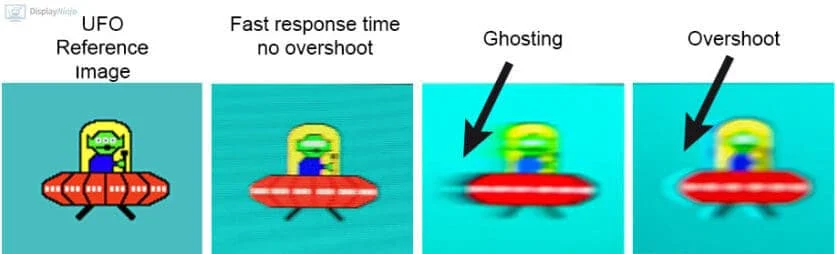
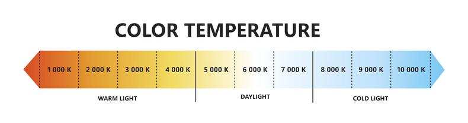
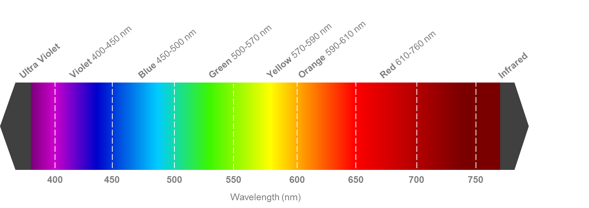

# Monitor Settings

Before starting the configuration, load your default settings, as many settings are already correctly configured by default.

### Game Mode - `User`  
Each profile has preconfigured settings. E.g. 'Read mode' is optimized for viewing documents, it probably decreases the [brightness](https://plano.co/does-screen-brightness-affect-your-eyes/) and lowers the color temperature (warmer). Choose the profile you're satisfied with, for example the sRGB profile if you're a editor, then configure the other settings.

### Overdrive/OD/Response Time - `Test`  
If you experience [ghosting](https://www.testufo.com/ghosting) (most noticeable in fast paced motions, e.g. FPS games), caused by a slow response time, which cannot keep up with the speed of the changing image, you should try to increase the OD option, which will decrease the response time of your monitor. Ghosting looks like a image artifact that appears as a trail of pixels behind a moving object (pixels can't change color fast enough when a new image appears, parts of the old image remain visible), which is why it gets called ghosting -> the trace looks like a ghost of the object. Increasing the overdrive setting can end up in overshooting/inverse ghosting, which is the opposite of ghosting and get's caused from a too high OD. Which means that pixels overshoot their target color, resulting in bright or dark trails. Ghosting (normally) ends up in a trace behind the object (like motion blur), inverse ghosting can cause artifacts in front and behind the object. Search for your monitor [here](https://www.rtings.com/), scroll down to the motion section and compare the response times, to see if your monitor even performs the best one the fastest option. And you may "see" a difference between them, if you experience inverse ghosting, renounce the lowest response time and decrease the OD (as ghosting makes the image unclear -> annoying), if you experience ghosting increase and test it.

### Sharpness - `0%`  
Personal preference. Increasing it too much will end up in [artificial sharpening](http://www.lagom.nl/lcd-test/sharpness.php) = exaggerated outlines.

### Dark Boost/Black Boost - `Off`  
Improved vision in [dark scenes](https://www.testufo.com/blacklevels) when increased, but can end up making black look gray, so don't increase it too much. 

### FreeSync, G-Sync... - `Disabled`  
G-Sync matches the monitor's refresh rate to the frame rate. The setting is used to eliminate screen tearing, if you don't experience [screen tearing](https://www.youtube.com/watch?v=5mWMP96UdGU&t=110s), leave it disabled. If you want to use it, set your framerate limit a bit lower (kind of a buffer, `freq-(freq*freq)/3600`) than your refresh rate. Optimally set the limit within the game. Never use pure V-Sync -> G-Sync + V-Sync + Reflex & limit. [Gsync/gsync101-input-lag-tests-and-settings](https://blurbusters.com/gsync/gsync101-input-lag-tests-and-settings/) can still be read. It is old, but most of it is still correct. If information from the text above and from the website text don't match, the channel information is correct.

### Color Temperature - `Warm`  
Using a warm temperature (lower Kelvin) -> less [blue light](https://eyesurgeryguide.org/debunking-the-blue-light-eye-damage-myth/). (read the text below for more information about [blue light](https://eyesurgeryguide.org/debunking-the-blue-light-eye-damage-myth/)) Default mostly is `6500K`.

### Brightness - `50-70`  
Depends on how much light there is in your room. If there's a lot of light, you'll have to increase the [brightness](https://plano.co/does-screen-brightness-affect-your-eyes/). If you mainly play in the dark, it's recommended to reduce the [brightness](https://plano.co/does-screen-brightness-affect-your-eyes/) to a level that is comfortable for your eyes. Remember: decreasing it *can* lower the [blue light](https://eyesurgeryguide.org/debunking-the-blue-light-eye-damage-myth/), depending on the display, therefore lower the [brightness](https://plano.co/does-screen-brightness-affect-your-eyes/) to reduce the intensity of [blue light](https://eyesurgeryguide.org/debunking-the-blue-light-eye-damage-myth/). For your general knowledge, [blue light](https://eyesurgeryguide.org/debunking-the-blue-light-eye-damage-myth/) has a short wavelength (~`450-500 nm`), which means that it carries more energy per photon than longer wavelength light. Don't dim it too much, or it may end up being harder to read.

### Contrast - `~60`  
It shouldn't be set too high, otherwise you will [not be able to see any details](https://www.testufo.com/whitelevels) and not too low, or it will be too dark. You'll have to test it yourself and find the best value.
