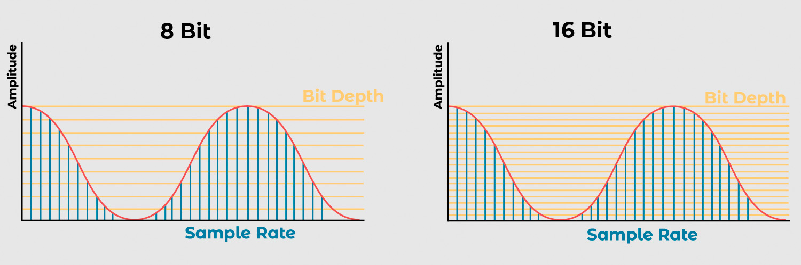

# Sample Rate

The values below are related to Default Format, see [property-sets](https://winsps-kb.readthedocs.io/en/latest/sources/property-sets/) for a list of more names.

The main option lists sample rates that are supported on both active endpoints, if you want to change them individually use the suboptions which list supported sample rates for render/capture endpoints.

Microsoft documents endpoint properties as values that clients can read but "*shouldn't set*". The supported way to inspect/validate formats is Core Audio / WASAPI, especially [`IAudioClient::GetMixFormat`](https://learn.microsoft.com/en-us/windows/win32/api/audioclient/nf-audioclient-iaudioclient-getmixformat) and [`IAudioClient::IsFormatSupported`](https://learn.microsoft.com/en-us/windows/win32/api/audioclient/nf-audioclient-iaudioclient-isformatsupported). Editing the registry can leave the UI, AudioEndpointBuilder, the audio engine, the driver, and APO/effects state out of sync (e.g., what happened to me while working on the doc: using the same for example `16` (`10 00`) multiplier for all even tho 2 of them use `32` (`20 00`) the playback device won't output audio, but will show the changes in the windows UI).

The structure is `HKLM\SOFTWARE\Microsoft\Windows\CurrentVersion\MMDevices\Audio\{Render\|Capture}\{Endpoint}`.

- `Render` = Playback
- `Capture` = Recording

You can use [`dumpAudioFormats.ps1`](https://github.com/nohuto/win-config/blob/main/peripheral/assets/scripts/dumpAudioFormats.ps1) to read the values listed below from `Render`/`Capture` endpoints & output the sample rate, channel count, bit depth, block align, and byte-rate consistency for each 48 byte `WAVEFORMATEXTENSIBLE` data.

## Registry Values

These are the values which include the single 48 byte `WAVEFORMATEXTENSIBLE` part, the first four ones are the ones which got changed while editing playback/record rates via `mmsys.cpl`, the last seems to be related to it.

| Value name | Meaning |
| --- | --- |
| `{f19f064d-082c-4e27-bc73-6882a1bb8e4c},0` | [`PKEY_AudioEngine_DeviceFormat`](https://learn.microsoft.com/en-us/windows/win32/coreaudio/pkey-audioengine-deviceformat) - "*The PKEY_AudioEngine_DeviceFormat property specifies the device format, which is the format that the user has selected for the stream that flows between the audio engine and the audio endpoint device when the device operates in shared mode. This format might not be the best default format for an exclusive-mode application to use.*" |
| `{e4870e26-3cc5-4cd2-ba46-ca0a9a70ed04},0` | PID 0 value under the same GUID as [`PKEY_AudioEngine_OEMFormat`](https://learn.microsoft.com/en-us/windows-hardware/drivers/audio/pkey-audioengine-oemformat). |
| `{3d6e1656-2e50-4c4c-8d85-d0acae3c6c68},3` | - |
| `{624f56de-fd24-473e-814a-de40aacaed16},3` | - |
| `{3d6e1656-2e50-4c4c-8d85-d0acae3c6c68},2` | - |

## Binary Data

The 48 byte values are serialized `PROPVARIANT` values including a 40 byte `WAVEFORMATEXTENSIBLE` structure.

### Practical Example

```ini
41 00 00 00 01 00 00 00 ; PROPVARIANT header
FE FF 08 00 80 BB 00 00 ; wFormatTag, nChannels, nSamplesPerSec
00 B8 0B 00 10 00 10 00 ; nAvgBytesPerSec, nBlockAlign, wBitsPerSample
16 00 10 00 3F 06 00 00 ; cbSize, valid bits, channel mask
01 00 00 00 00 00 10 00 ; SubFormat GUID
80 00 00 AA 00 38 9B 71 ; SubFormat GUID
```

| Offset | Field | Bytes | Value |
| --- | --- | --- | --- |
| `0x00` | Serialized property type/header | `41 00 00 00` | `VT_BLOB` (`65`) |
| `0x04` | Serialized property metadata | `01 00 00 00` | - |
| `0x08` | `Format.wFormatTag` | `FE FF` | `WAVE_FORMAT_EXTENSIBLE` |
| `0x0A` | `Format.nChannels` | `08 00` | `8` channels |
| `0x0C` | `Format.nSamplesPerSec` | `80 BB 00 00` | `48000` Hz |
| `0x10` | `Format.nAvgBytesPerSec` | `00 B8 0B 00` | `768000` bytes/sec |
| `0x14` | `Format.nBlockAlign` | `10 00` | `16` bytes per audio frame |
| `0x16` | `Format.wBitsPerSample` | `10 00` | `16` bit container |
| `0x18` | `Format.cbSize` | `16 00` | - |
| `0x1A` | `Samples.wValidBitsPerSample` | `10 00` | `16` valid bits |
| `0x1C` | `dwChannelMask` | `3F 06 00 00` | - |
| `0x20` | `SubFormat` | `01 00 ... 9B 71` | PCM GUID `00000001-0000-0010-8000-00aa00389b71` |

`41 00 00 00 01 00 00 00` isn't [`WAVEFORMATEX`](https://learn.microsoft.com/en-us/windows/win32/api/mmeapi/ns-mmeapi-waveformatex), the wave format starts at offset `0x08`.

### Required Field Consistency

For PCM or `WAVE_FORMAT_EXTENSIBLE`, these fields must match:

```
nBlockAlign = nChannels * wBitsPerSample / 8
nAvgBytesPerSec = nSamplesPerSec * nBlockAlign
```

`nBlockAlign` is bytes per complete interleaved audio frame:

| `nChannels` | `wBitsPerSample` | `nBlockAlign` |
| --- | --- | --- |
| 1 | 16 | 2 |
| 1 | 32 | 4 |
| 2 | 16 | 4 |
| 2 | 24 | 6 |
| 2 | 32 | 8 |
| 8 | 16 | 16 |
| 8 | 24 | 24 |
| 8 | 32 | 32 |

Sample rate table for common `nBlockAlign` values:

| Sample rate | `nSamplesPerSec` bytes | Avg bytes/sec if `align=16` | Bytes | Avg bytes/sec if `align=32` | Bytes |
| ---: | --- | ---: | --- | ---: | --- |
| 8000 | `40 1F 00 00` | 128000 | `00 F4 01 00` | 256000 | `00 E8 03 00` |
| 11025 | `11 2B 00 00` | 176400 | `10 B1 02 00` | 352800 | `20 62 05 00` |
| 16000 | `80 3E 00 00` | 256000 | `00 E8 03 00` | 512000 | `00 D0 07 00` |
| 22050 | `22 56 00 00` | 352800 | `20 62 05 00` | 705600 | `40 C4 0A 00` |
| 32000 | `00 7D 00 00` | 512000 | `00 D0 07 00` | 1024000 | `00 A0 0F 00` |
| 44100 | `44 AC 00 00` | 705600 | `40 C4 0A 00` | 1411200 | `80 88 15 00` |
| 48000 | `80 BB 00 00` | 768000 | `00 B8 0B 00` | 1536000 | `00 70 17 00` |
| 88200 | `88 58 01 00` | 1411200 | `80 88 15 00` | 2822400 | `00 11 2B 00` |
| 96000 | `00 77 01 00` | 1536000 | `00 70 17 00` | 3072000 | `00 E0 2E 00` |
| 176400 | `10 B1 02 00` | 2822400 | `00 11 2B 00` | 5644800 | `00 22 56 00` |
| 192000 | `00 EE 02 00` | 3072000 | `00 E0 2E 00` | 6144000 | `00 C0 5D 00` |
| 352800 | `20 62 05 00` | 5644800 | `00 22 56 00` | 11289600 | `00 44 AC 00` |
| 384000 | `00 DC 05 00` | 6144000 | `00 C0 5D 00` | 12288000 | `00 80 BB 00` |

If an endpoint uses `nBlockAlign = 24`, use `sampleRate * 24` instead.

## WAVEFORMAT* Structures

Offsets below are relative to the start of the `WAVEFORMATEXTENSIBLE` structure, in the registry data shown above, add `0x08` to get the absolute registry offset.

```cpp
// WAVEFORMATEX
typedef struct tWAVEFORMATEX {
  WORD  wFormatTag;       // +0x00, 2 bytes
  WORD  nChannels;        // +0x02, 2 bytes
  DWORD nSamplesPerSec;   // +0x04, 4 bytes
  DWORD nAvgBytesPerSec;  // +0x08, 4 bytes
  WORD  nBlockAlign;      // +0x0C, 2 bytes
  WORD  wBitsPerSample;   // +0x0E, 2 bytes
  WORD  cbSize;           // +0x10, 2 bytes
} WAVEFORMATEX, *PWAVEFORMATEX, *NPWAVEFORMATEX, *LPWAVEFORMATEX; // 18 bytes total

// WAVEFORMATEXTENSIBLE
typedef struct {
  WAVEFORMATEX Format; // +0x00, 18 bytes
  union {
    WORD wValidBitsPerSample; // +0x12, 2 bytes
    WORD wSamplesPerBlock;    // +0x12, 2 bytes
    WORD wReserved;           // +0x12, 2 bytes
  } Samples;
  DWORD        dwChannelMask; // +0x14, 4 bytes
  GUID         SubFormat;     // +0x18, 16 bytes
} WAVEFORMATEXTENSIBLE, *PWAVEFORMATEXTENSIBLE; // 40 bytes total
```

## General Knowledge

The sample rate is how many times per second an audio signal is measured. `44.1` kHz means `44,100` samples per second, `48` kHz means `48,000` samples per second.

Bit depth is how many bits are used to store each sample. More bits allow more possible sample values and a larger dynamic range.

| Bit depth | Possible values |
| --- | --- |
| 8 bit | 256 |
| 16 bit | 65,536 |
| 24 bit | 16,777,216 |

For general playback, `44.1` kHz or `48` kHz with `16` or `24` bit depth is normally enough, higher sample rates are mostly useful for specific production.

### 8 Bit / 16 Bit



