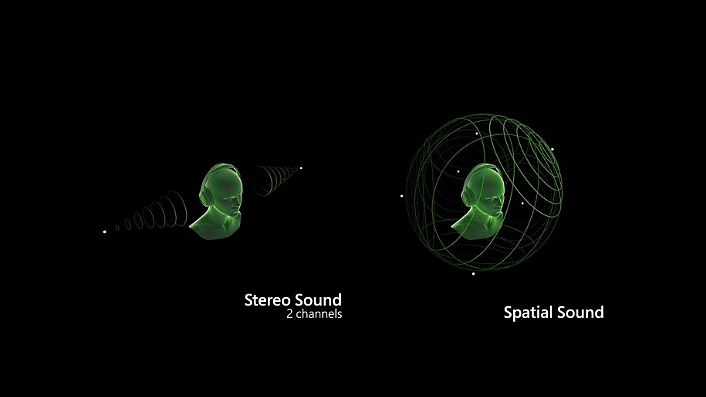

# Sound Mode

## Spatial Audio

> "*Microsoft Spatial Sound is Microsoft’s platform-level solution for spatial sound support on Xbox, Windows and HoloLens 2, enabling both surround and elevation (above or below the listener) audio cues. Spatial sound can be leveraged by Windows desktop (Win32) apps as well as Universal Windows Platform (UWP) apps on supported platforms. The spatial sound APIs allow developers to create audio objects that emit audio from positions in 3D space.*"
>
> — Microsoft, [Spatial Sound for app developers for Windows, Xbox, and Hololens 2](https://learn.microsoft.com/en-us/windows/win32/coreaudio/spatial-sound)



### Registry Values

See '[Audio Values](https://noverse.dev/docs/win-config/peripheral/audio-values/#registry-values)' for what the values do and other related values.

```c
"HKLM\\Software\\Microsoft\\Windows\\CurrentVersion\\Audio";
  "DisableSpatialAudioGlobal" = 0;
  "DisableSpatialAudioPerEndpoint" = 1;
  "DisableSpatialAudioVssFeature" = 0;
  "SpatialAudioHrtfOnByDefault" = 0;
  "DisableSpatialOnComboEndpoints" = 0;

"HKLM\\Software\\Microsoft\\Windows\\CurrentVersion\\Audio\\Policy\\Spatial";
  "SpatialAudioLicenseCheckStartDelay" = 5;
  "SpatialAudioLicenseCheckRequiresUserContext" = 0;
```

Disabling spatial sound via these values would gray out the option in the device properties, but Windows itself doesn't disable/enable it via them.


- [BlockSpatialAudioRegistryGates](https://github.com/nohuto/decompiled-pseudocode/blob/main/11-23H2/audiosrv/BlockSpatialAudioRegistryGates.c)
- [IsSpatialComboEndpointDeterminationDisabled](https://github.com/nohuto/decompiled-pseudocode/blob/main/11-23H2/audiosrv/IsSpatialComboEndpointDeterminationDisabled.c)
- [GetSpatialAudioLicenseGracePeriodInMs](https://github.com/nohuto/decompiled-pseudocode/blob/main/11-23H2/audiosrv/-GetSpatialAudioLicenseGracePeriodInMs@AtmosCheck@@CAHXZ.c)
- [IsMultiUserSKU](https://github.com/nohuto/decompiled-pseudocode/blob/main/11-23H2/audiosrv/-IsMultiUserSKU@@YA_NXZ.c)

## Mono/Stereo Audio

Mono combines left and right audio channels into one, stereo uses two channels.


### SystemSettings Capture

```c
// System > Sound : Mono audio

// Enabled
HKCU\Software\Microsoft\Multimedia\Audio\AccessibilityMonoMixState	Type: REG_DWORD, Length: 4, Data: 1

// Disabled
HKCU\Software\Microsoft\Multimedia\Audio\AccessibilityMonoMixState	Type: REG_DWORD, Length: 4, Data: 0
```
