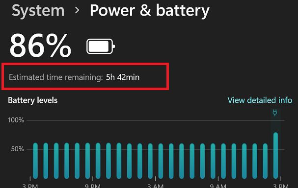

# Disable Energy Estimation

Energy estimation accounts for estimated power usage, components report modeled energy costs, which are tracked per process and used for battery and standby telemetry.

```c
"HKLM\\SYSTEM\\CurrentControlSet\\Control\\Power";
    "UserBatteryDischargeEstimator" = 0; // PopDisableBatteryDischargeEstimator, 0 allows WNF_PO_DISCHARGE_ESTIMATE updates, https://github.com/nohuto/decompiled-pseudocode/blob/main/11-23H2/ntoskrnl/PopBatteryWorker.c
    "UserBatteryChargeEstimator" = 0; // PopUserBatteryChargingEstimator, 0 clears WNF_PO_CHARGE_ESTIMATE, https://github.com/nohuto/decompiled-pseudocode/blob/main/11-23H2/ntoskrnl/PopBatteryWorker.c
    "EnergyEstimationEnabled" = 1; // PopEnergyEstimationEnabled, https://github.com/nohuto/decompiled-pseudocode/blob/main/11-23H2/ntoskrnl/PoEnergyEstimationEnabled.c
```

- [power/assets/pseudocode | PtInitializeTelemetry.c](https://github.com/nohuto/win-config/blob/main/power/assets/pseudocode/energyesti-PtInitializeTelemetry.c)



## Suboption

### Battery Capacity Section

Disables the battery capacity section on the battery saver page of the system settings app.

## IdleStatesNumber

These values are located in `partmgr.sys` and can be misunderstood. `IdleStatesNumber` just tells `partmgr` how many `IdleState\x` estimation "profiles" to load, example:

- `IdleStatesNumber = 1` -> read only `IdleState\1`
- `IdleStatesNumber = 3` -> read `IdleState\1`, `IdleState\2`, `IdleState\3`

So these values seem to change the estimated energy *math* part.

```powershell
\Registry\Machine\SYSTEM\ControlSet001\Control\Power\EnergyEstimation\Storage\NVME : IdleStatesNumber
\Registry\Machine\SYSTEM\ControlSet001\Control\Power\EnergyEstimation\Storage\NVME\IdleState\1 : IdleExitEnergyMicroJoules
\Registry\Machine\SYSTEM\ControlSet001\Control\Power\EnergyEstimation\Storage\NVME\IdleState\1 : IdleExitLatencyMs
\Registry\Machine\SYSTEM\ControlSet001\Control\Power\EnergyEstimation\Storage\NVME\IdleState\1 : IdlePowerMw
\Registry\Machine\SYSTEM\ControlSet001\Control\Power\EnergyEstimation\Storage\NVME\IdleState\1 : IdleTimeLengthMs
```

- [decompiled-pseudocode | PmPowerContextInitialization.c](https://github.com/nohuto/decompiled-pseudocode/blob/main/11-23H2/partmgr/-PmPowerContextInitialization@@YAJPEAU_DISK_POWER_CONTEXT@@W4_DISK_DEVICEPOWER_TYPE@@@Z.c)
