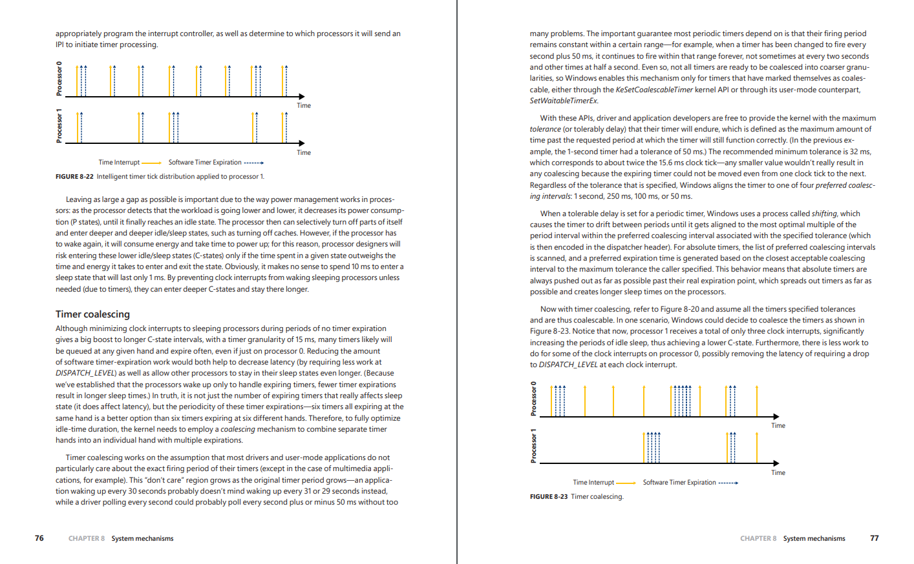

# Disable Timer Coalescing

## InitTimerCoalescing

`TimerCoalescing` (queried by [InitTimerCoalescing](https://github.com/nohuto/decompiled-pseudocode/blob/main/11-23H2/win32kfull/InitTimerCoalescing.c)) is a binary value (`v18 == 3`) with a size of 80 bytes (`v19 == 80`), interpreted as 20 DWORDs. The value is used to load two four entry timer coalescing tolerance blocks.

```c
// InitTimerCoalescing

if ( ZwQueryValueKey(
      KeyHandle,
      &DestinationString,
      KeyValuePartialInformation,
      KeyValueInformation,
      0x60u,
      &ResultLength) >= 0
&& v16 == 3 // registry Type must be REG_BINARY
&& v17 == 80 // data must be exactly 20 DWORDs
&& !v18 ) // DWORD 0 must be zero
```

### Data Formatting

```c
// InitTimerCoalescing

for ( i = &v19; !*(_DWORD *)i; i += 4 ) // DWORDs 1-3 must be zero
{
  if ( (unsigned int)++v2 >= 3 )
  {
    v4 = 0;
    for ( j = &v21; !*(_DWORD *)j; j += 4 ) // DWORDs 8-11 must be zero
    {
      if ( (unsigned int)++v4 >= 4 )
      {
        v6 = 0;
        for ( k = &v23; !*(_DWORD *)k; k += 4 ) // DWORDs 16-19 must be zero
        {
          if ( (unsigned int)++v6 >= 4 )
          {
            v8 = 0;
            for ( m = &v20; *(_DWORD *)m <= 0x7FFFFFF5u; m = (__int128 *)((char *)m + 4) ) // DWORDs 4-7 range
            {
              if ( (unsigned int)++v8 >= 4 )
              {
                for ( n = &v22; *(_DWORD *)n <= 0x7FFFFFF5u; n = (__int128 *)((char *)n + 4) ) // DWORDs 12-15 range
                {
                  if ( (unsigned int)++v0 >= 4 )
                  {
                    xmmword_1C035A178 = v20; // stores one four DWORD tolerance block
                    *(_OWORD *)&gTimerCoalescingSpec = v22; // stores the other four DWORD tolerance block
                    SetTimerCoalescingTolerance(0LL); // applies mode 0 after load
```

| DWORD | Data | Note |
| --- | --- | --- |
| `0` | `0` | Reserved value checked before the loop validation |
| `1-3` | all `0` | Reserved |
| `4-7` | each `<= 0x7FFFFFF5` | Four accepted tolerance values, copied as one block |
| `8-11` | all `0` | Reserved |
| `12-15` | each `<= 0x7FFFFFF5` | Four accepted tolerance values, copied to `gTimerCoalescingSpec` |
| `16-19` | all `0` | Reserved |

Note that this only shows the data range etc., there's more information in relation to [`SetTimerCoalescingTolerance`](https://github.com/nohuto/decompiled-pseudocode/blob/main/11-23H2/win32kfull/SetTimerCoalescingTolerance.c) (mode selection), `gCurrentTimerCoalescingTolerance`, [`InternalSetTimer`](https://github.com/nohuto/decompiled-pseudocode/blob/main/11-23H2/win32kfull/InternalSetTimer.c), coalescable timers (affected ones) etc. I might or might not add more details whenever I've time.

## InitTimerPowerSaving

```c
// 23H2
void InitTimerPowerSaving(void)
{
  FastGetProfileDword(0LL, 2LL, L"RITdemonTimerPowerSaveElapse", 43200000LL, &gdwRITdaemonTimerPowerSaveElapse); // 12H
  FastGetProfileDword(0LL, 2LL, L"RITdemonTimerPowerSaveCoalescing", 43200000LL, &gdwRITdaemonTimerPowerSaveCoalescing); // 12H
}

// 2004
void InitTimerPowerSaving(void)
{
  FastGetProfileDword(0LL, 2LL, L"RITdemonTimerPowerSaveElapse", 43200000LL, &gdwRITdemonTimerPowerSaveElapse);
  FastGetProfileDword(0LL, 2LL, L"RITdemonTimerPowerSaveCoalescing", 43200000LL, &gdwRITdemonTimerPowerSaveCoalescing);
}
```

Looks like a typo from MS (`demon` = `daemon`), which got probably fixed within the first W11 builds, see  [diff 2004 & 21H2](https://noverse.dev/diff?kind=pseudocode&left=2004&right=11-21H2&module=win32kfull&name=-InitTimerPowerSaving%40%40YAXXZ.c&mode=side-by-side) comparision (the value name didn't change).

### When TimerPowerSaving Applies

`RITdemonTimerPowerSaveElapse` is the base timer interval. `RITdemonTimerPowerSaveCoalescing` is passed as the timer coalescing value into the timer setup path.

At [RawInputThread](https://github.com/nohuto/decompiled-pseudocode/blob/main/11-23H2/win32kfull/RawInputThread.c) start it does call `InitTimerPowerSaving();` but also directly calls `ConfigureRITDelayableTimers(0);` which isn't the "TimerPowerSave" mode. So [`ConfigureRITDelayableTimers`](https://github.com/nohuto/decompiled-pseudocode/blob/main/11-23H2/win32kfull/-ConfigureRITDelayableTimers@@YAXW4RitTimerRate@@@Z.c) uses these values as we can see here:

```c
// ConfigureRITDelayableTimers (23H2)

if ( !a1 )
  goto LABEL_4;
if ( gnRITdaemonTimerId )
{
  if ( a1 != 1 )
  {
    v2 = InternalSetTimer(
           0,
           gnRITdaemonTimerId,
           gdwRITdaemonTimerPowerSaveElapse,
           (unsigned int)lambda_2bb7a2ff8864d6893c712a9e9ac801fb_::_lambda_invoker_cdecl_,
           gdwRITdaemonTimerPowerSaveCoalescing,
           4);
    goto LABEL_5;
  }
LABEL_4:
  v2 = SetRITTimer(gnRITdaemonTimerId, 1000LL, lambda_2bb7a2ff8864d6893c712a9e9ac801fb_::_lambda_invoker_cdecl_, 0LL); // a1 = 0 or 1, fixed 1000ms
LABEL_5:
  gnRITdaemonTimerId = v2;
}
```

This shows `a1 == 0` & `a1 == 1` don't use the TimerPowerSave values, so any other value uses them, but when does it get anything else than `0`/`1`?

```c
// SetTimerCoalescingTolerance (23H2)

if ( v3 != gServiceSessionId )
{
  if ( !(_DWORD)v1 )
  {
    gdwRITdaemonLockState = 0;
    v6 = 1LL;
    return ConfigureRITDelayableTimers(v6); // 1 goes to LABEL_4
  }
  v7 = 2; // either 2
  v8 = v1 - 2;
  if ( !v8 )
  {
    gdwRITdaemonLockState |= 1u;
    if ( (gdwRITdaemonLockState & 2) == 0
      && giScreenSaveTimeOutMs > 0
      && (gbLockConsoleActive || (*gpsi & 0x200) != 0) )
    {
      v7 = 1; // or 1
    }
    goto LABEL_11;
  }
  if ( v8 == 1 )
  {
    result = gdwRITdaemonLockState | 2u;
    gdwRITdaemonLockState = result;
    if ( (result & 1) != 0 ) // always 2 but only if bit 1 isnt 0
    {
LABEL_11:
      v6 = v7;
      return ConfigureRITDelayableTimers(v6);
    }
  }
}
```

Note that only applies to non service sessions (`if ( v3 != gServiceSessionId )`, [SetTimerCoalescingTolerance](https://github.com/nohuto/decompiled-pseudocode/blob/main/11-23H2/win32kfull/SetTimerCoalescingTolerance.c)).

So this TimerPowerSave part only applies when [`SetTimerCoalescingTolerance`](https://github.com/nohuto/decompiled-pseudocode/blob/main/11-23H2/win32kfull/SetTimerCoalescingTolerance.c) returns `ConfigureRITDelayableTimers(2)` which happens through lock/screensaver (`giScreenSaveTimeOutMs`)/session state transitions. This means that these values only apply while the console is locked or the screen saver runs, otherwise the RIT daemon timer runs every 1000ms. 

### Default Data

```c
lkd> dd win32kfull!gdwRITdaemonTimerPowerSaveElapse L1
fffff11d`f1289214  02932e00 // 43200000

lkd> dd win32kfull!gdwRITdaemonTimerPowerSaveCoalescing L1
fffffa1a`ab689210  02932e00 // 43200000
```

```c
// ConfigureRITDelayableTimers (23H2)

v2 = InternalSetTimer(
       0,
       gnRITdaemonTimerId,
       gdwRITdaemonTimerPowerSaveElapse, // a3
       (unsigned int)lambda_2bb7a2ff8864d6893c712a9e9ac801fb_::_lambda_invoker_cdecl_,
       gdwRITdaemonTimerPowerSaveCoalescing, // a5
       4);
```

```c
// InternalSetTimer (23H2)

v10 = 10;
if ( a3 >= 0xA )
  v10 = a3;
if ( v10 > 0x7FFFFFFF )
  v10 = 0x7FFFFFFF;

if ( a5 == -1 || !a5 && v14 && _bittest64((const signed __int64 *)(v14 + 648), 0x23u) ) // RITdemonTimerPowerSaveCoalescing
  v15 = a6 & 0xFFFFFDFF;
else
  v15 = a6 | 0x200;

*(_DWORD *)(v22 + 40) = v10;
*(_DWORD *)(v22 + 52) = v10;

if ( (v15 & 0x200) != 0 )
  *(_DWORD *)(v22 + 44) = a5;

*(_DWORD *)(v22 + 48) = v15 | 8;

v32 = *(_DWORD *)(v22 + 48);

if ( (v32 & 0x200) != 0 ) // false if bit 0x200 cleared
{
  v34 = *(_DWORD *)(v22 + 44);
  v35 = gCurrentTimerCoalescingTolerance;
  v36 = gCurrentTimerCoalescingTolerance;
  v37 = *(_DWORD *)(v22 + 52);
  if ( v34 > gCurrentTimerCoalescingTolerance )
    v36 = *(_DWORD *)(v22 + 44);
  if ( v37 + v36 >= 0x7FFFFFFF )
  {
    v38 = 0x7FFFFFFF;
  }
  else
  {
    if ( v34 > gCurrentTimerCoalescingTolerance )
      v35 = *(_DWORD *)(v22 + 44);
    v38 = v37 + v35;
  }
  v39 = *(_DWORD *)(*(_QWORD *)(*(_QWORD *)(v22 + 24) + 424LL) + 1056LL);
  if ( v39 )
  {
    v40 = v38 + v39;
    v38 = 0x7FFFFFFF;
    if ( v40 < 0x7FFFFFFF )
      v38 = v40;
  }
}
else
{
  v38 = *(_DWORD *)(v22 + 52);
}
```

### Range (& Meaning)

#### RITdemonTimerPowerSaveElapse

- Default = `43200000`
- Minimum = `10`
- Maximum = `0x7FFFFFFF`

#### RITdemonTimerPowerSaveCoalescing

- Default = `43200000`
- No min/max clamp (means `0-0xFFFFFFFF`)
- `0xFFFFFFFF` (`-1`) disables coalescing here, as it always clears bit `0x200`, means no coalescing value is written
- `0` could also disable coalescing, but only when the thread has bit `0x800000000` set in `GetAppCompatFlags2QuadWord` (saved in THREADINFO)

You can dump the bit via WinDbg:

```c
lkd> !process 0 0 csrss.exe
PROCESS ffffdb8b6da2f080
    SessionId: 0  Cid: 02e4    Peb: f56fc32000  ParentCid: 02b8
    DirBase: 10a790000  ObjectTable: ffffb587a746dc40  HandleCount: 299.
    Image: csrss.exe

PROCESS ffffdb8b6ec33140
    SessionId: 1  Cid: 036c    Peb: 83046d0000  ParentCid: 035c
    DirBase: 10ffb9000  ObjectTable: ffffb587aa7a2c40  HandleCount: 454.
    Image: csrss.exe

lkd> .process /p /r ffffdb8b6ec33140
Implicit process is now ffffdb8b`6ec33140
Loading User Symbols
.......................
lkd> dq win32kbase!gptiRit L1
fffff11d`f0e94028  ffffb587`aa7b9010
lkd> r @$t0 = poi(win32kbase!gptiRit)
lkd> dq @$t0+0x288 L1
ffffb587`aa7b9298  00000000`00000000
lkd> ? poi(@$t0+0x288) & 0x800000000 // tagTHREADINFO offset
Evaluate expression: 0 = 00000000`00000000 // not set
```

## Miscellaneous Values

| Prefix | Component |
| --- | --- |
| `Pop` | Power Manager |

See '[Power Values](https://noverse.dev/docs/win-config/power/power-values/#registry-values)' for types and readers.

```c
"HKLM\\SYSTEM\\CurrentControlSet\\Control\\Power";
    "CoalescingTimerInterval" = 1500;
    "DeepIoCoalescingEnabled" = 0;
```


## [Windows Internals](https://github.com/nohuto/Windows-Books/releases/download/7th-Edition/Windows-Internals-E7-P2.pdf)



