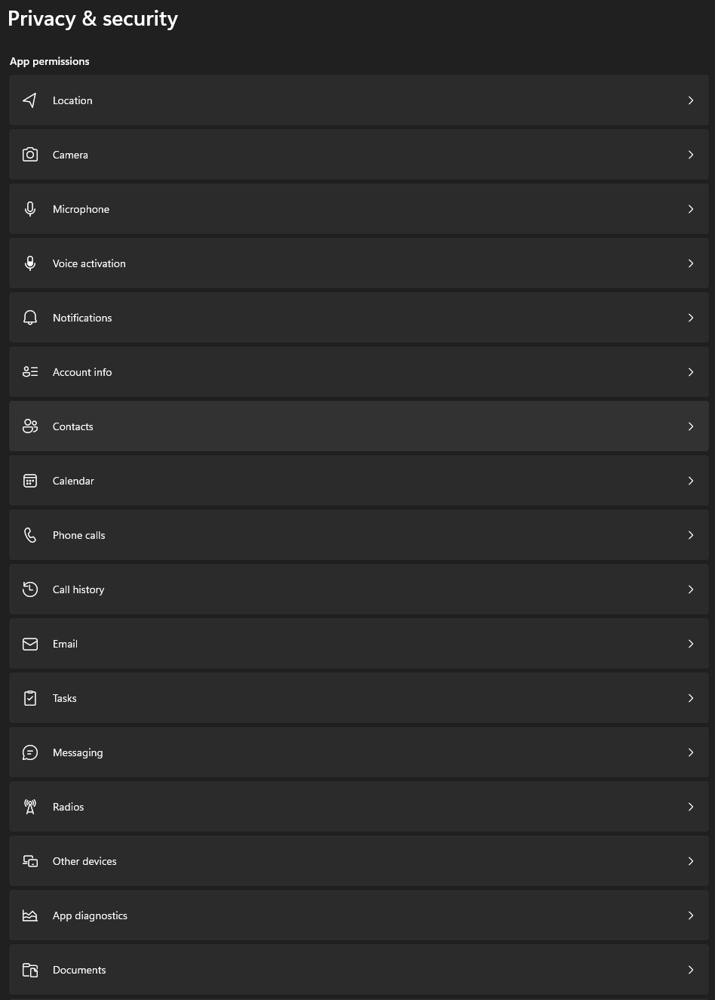

# Deny App Access

Denies the access for everything, only leaving the microphone enabled. Note `Deny 'User Info Access'` = prevents users from managing the ability to allow apps (not desktop apps) to access the user name, account picture, and domain information.

"Text and image generation" (`systemAIModels`, `LetAppsAccessSystemAIModels`) & "Passkeys" (`passkeys`, `passkeysEnumeration`) only exist on 24H2+, `CapabilityAccessManager.dll` has the names (23H2 e.g. doesn't).

Adding the `Deny` data in `HKLM` is probably enough, but the keys also exist in `HKCU` - Windows only edits it in `HKLM`, examples:

```c
// Notifications
svchost.exe	RegSetValue	HKLM\SOFTWARE\Microsoft\Windows\CurrentVersion\CapabilityAccessManager\ConsentStore\userNotificationListener\Value	Type: REG_SZ, Length: 10, Data: Deny

// Contacts
svchost.exe	RegSetValue	HKLM\SOFTWARE\Microsoft\Windows\CurrentVersion\CapabilityAccessManager\ConsentStore\contacts\Value	Type: REG_SZ, Length: 10, Data: Deny

// Pictures
svchost.exe	RegSetValue	HKLM\SOFTWARE\Microsoft\Windows\CurrentVersion\CapabilityAccessManager\ConsentStore\picturesLibrary\Value	Type: REG_SZ, Length: 10, Data: Deny
```



## [Windows Policies](https://noverse.dev/policies)

| Policy | Key Path | Value Name |
| --- | --- | --- |
| [Let Windows apps access account information](https://noverse.dev/policies?p=AppPrivacy*LetAppsAccessAccountInfo) | `HKLM\Software\Policies\Microsoft\Windows\AppPrivacy` | `LetAppsAccessAccountInfo` |
| [Let Windows apps access the calendar](https://noverse.dev/policies?p=AppPrivacy*LetAppsAccessCalendar) | `HKLM\Software\Policies\Microsoft\Windows\AppPrivacy` | `LetAppsAccessCalendar` |
| [Let Windows apps access call history](https://noverse.dev/policies?p=AppPrivacy*LetAppsAccessCallHistory) | `HKLM\Software\Policies\Microsoft\Windows\AppPrivacy` | `LetAppsAccessCallHistory` |
| [Let Windows apps access the camera](https://noverse.dev/policies?p=AppPrivacy*LetAppsAccessCamera) | `HKLM\Software\Policies\Microsoft\Windows\AppPrivacy` | `LetAppsAccessCamera` |
| [Let Windows apps access contacts](https://noverse.dev/policies?p=AppPrivacy*LetAppsAccessContacts) | `HKLM\Software\Policies\Microsoft\Windows\AppPrivacy` | `LetAppsAccessContacts` |
| [Let Windows apps access email](https://noverse.dev/policies?p=AppPrivacy*LetAppsAccessEmail) | `HKLM\Software\Policies\Microsoft\Windows\AppPrivacy` | `LetAppsAccessEmail` |
| [Let Windows apps make use of Text and image generation features of Windows](https://noverse.dev/policies?p=AppPrivacy*LetAppsAccessSystemAIModels) | `HKLM\Software\Policies\Microsoft\Windows\AppPrivacy` | `LetAppsAccessSystemAIModels` |
| [Let Windows apps take screenshots of various windows or displays](https://noverse.dev/policies?p=AppPrivacy*LetAppsAccessGraphicsCaptureProgrammatic) | `HKLM\Software\Policies\Microsoft\Windows\AppPrivacy` | `LetAppsAccessGraphicsCaptureProgrammatic` |
| [Let Windows apps turn off the screenshot border](https://noverse.dev/policies?p=AppPrivacy*LetAppsAccessGraphicsCaptureWithoutBorder) | `HKLM\Software\Policies\Microsoft\Windows\AppPrivacy` | `LetAppsAccessGraphicsCaptureWithoutBorder` |
| [Let Windows apps access presence sensing](https://noverse.dev/policies?p=AppPrivacy*LetAppsAccessHumanPresence) | `HKLM\Software\Policies\Microsoft\Windows\AppPrivacy` | `LetAppsAccessHumanPresence` |
| [Let Windows apps access location](https://noverse.dev/policies?p=AppPrivacy*LetAppsAccessLocation) | `HKLM\Software\Policies\Microsoft\Windows\AppPrivacy` | `LetAppsAccessLocation` |
| [Let Windows apps access messaging](https://noverse.dev/policies?p=AppPrivacy*LetAppsAccessMessaging) | `HKLM\Software\Policies\Microsoft\Windows\AppPrivacy` | `LetAppsAccessMessaging` |
| [Let Windows apps access the microphone](https://noverse.dev/policies?p=AppPrivacy*LetAppsAccessMicrophone) | `HKLM\Software\Policies\Microsoft\Windows\AppPrivacy` | `LetAppsAccessMicrophone` |
| [Let Windows apps access motion](https://noverse.dev/policies?p=AppPrivacy*LetAppsAccessMotion) | `HKLM\Software\Policies\Microsoft\Windows\AppPrivacy` | `LetAppsAccessMotion` |
| [Let Windows apps access notifications](https://noverse.dev/policies?p=AppPrivacy*LetAppsAccessNotifications) | `HKLM\Software\Policies\Microsoft\Windows\AppPrivacy` | `LetAppsAccessNotifications` |
| [Let Windows apps make phone calls](https://noverse.dev/policies?p=AppPrivacy*LetAppsAccessPhone) | `HKLM\Software\Policies\Microsoft\Windows\AppPrivacy` | `LetAppsAccessPhone` |
| [Let Windows apps control radios](https://noverse.dev/policies?p=AppPrivacy*LetAppsAccessRadios) | `HKLM\Software\Policies\Microsoft\Windows\AppPrivacy` | `LetAppsAccessRadios` |
| [Let Windows apps communicate with unpaired devices](https://noverse.dev/policies?p=AppPrivacy*LetAppsSyncWithDevices) | `HKLM\Software\Policies\Microsoft\Windows\AppPrivacy` | `LetAppsSyncWithDevices` |
| [Let Windows apps access Tasks](https://noverse.dev/policies?p=AppPrivacy*LetAppsAccessTasks) | `HKLM\Software\Policies\Microsoft\Windows\AppPrivacy` | `LetAppsAccessTasks` |
| [Let Windows apps access trusted devices](https://noverse.dev/policies?p=AppPrivacy*LetAppsAccessTrustedDevices) | `HKLM\Software\Policies\Microsoft\Windows\AppPrivacy` | `LetAppsAccessTrustedDevices` |
| [Let Windows apps access diagnostic information about other apps](https://noverse.dev/policies?p=AppPrivacy*LetAppsGetDiagnosticInfo) | `HKLM\Software\Policies\Microsoft\Windows\AppPrivacy` | `LetAppsGetDiagnosticInfo` |
| [Let Windows apps access an eye tracker device](https://noverse.dev/policies?p=AppPrivacy*LetAppsAccessGazeInput) | `HKLM\Software\Policies\Microsoft\Windows\AppPrivacy` | `LetAppsAccessGazeInput` |
| [Let Windows apps activate with voice](https://noverse.dev/policies?p=AppPrivacy*LetAppsActivateWithVoice) | `HKLM\Software\Policies\Microsoft\Windows\AppPrivacy` | `LetAppsActivateWithVoice` |
| [Let Windows apps activate with voice while the system is locked](https://noverse.dev/policies?p=AppPrivacy*LetAppsActivateWithVoiceAboveLock) | `HKLM\Software\Policies\Microsoft\Windows\AppPrivacy` | `LetAppsActivateWithVoiceAboveLock` |
| [Let Windows apps access user movements while running in the background](https://noverse.dev/policies?p=AppPrivacy*LetAppsAccessBackgroundSpatialPerception) | `HKLM\Software\Policies\Microsoft\Windows\AppPrivacy` | `LetAppsAccessBackgroundSpatialPerception` |
| [User management of sharing user name, account picture, and domain information with apps (not desktop apps)](https://noverse.dev/policies?p=UserProfiles*UserInfoAccessAction) | `HKLM\Software\Policies\Microsoft\Windows\System` | `AllowUserInfoAccess` |
| [Let Windows apps access cellular data](https://noverse.dev/policies?p=wwansvc*LetAppsAccessCellularData) | `HKLM\Software\Policies\Microsoft\Windows\WwanSvc\CellularDataAccess` | `LetAppsAccessCellularData` |

