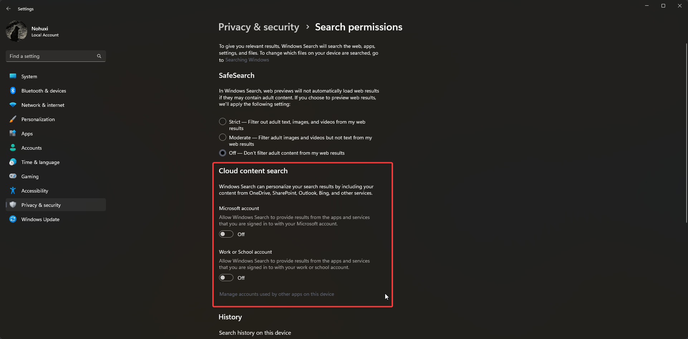

# Disable Cloud Content Search

> "*If you turn on the Microsoft account setting for Cloud content search, Windows Search will show results from items in your personal OneDrive, Outlook, and other Microsoft services. If you search the web or get web search suggestions with Windows Search, Bing will personalize your results.*
>
> *If you turn on the Work or School account setting for Cloud content search, Windows Search will show results from OneDrive for Business, Outlook, SharePoint, and more from Microsoft Search.*"
>
> — Microsoft, [Windows Search and privacy](https://support.microsoft.com/en-us/windows/privacy/windows-search-and-privacy)

`Settings > Privacy & security > Search permissions > Cloud content search`:

| Value | Account | Data |
| --- | --- | --- |
| `IsMSACloudSearchEnabled` | Microsoft account | `1` (default) = on, `0` = off |
| `IsAADCloudSearchEnabled` | Work/school account | `1` (default) = on, `0` = off |

```c
// SearchSettings::SearchSettingsHelper::GetSearchSettingAsBool (23H2)

return SearchSettings::SearchSettingsHelper::GetSearchSettingAsDWORD(a1, 1u) == 1; // 1 = fallback for a missing value
```

The option also sets the `AllowCloudSearch` policy to 0, which grays out both toggles:

```c
// SearchPolicySettings::get_IsMSACloudSearchEnabled (23H2)

if ( (unsigned int)SearchSettings::SearchSettingsHelper::GetCloudSearchPolicy() )
{
  SearchSettingAsBool = SearchSettings::SearchSettingsHelper::GetSearchSettingAsBool(L"IsMSACloudSearchEnabled", v5);
}
else
{
  IsMSACloudSearchEnabled = SearchSettings::SearchSettingsHelper::IsMSACloudSearchEnabled(0);
```

## [Windows Policies](https://noverse.dev/policies)

| Policy | Key Path | Value Name |
| --- | --- | --- |
| [Allow Cloud Search](https://noverse.dev/policies?p=Search*AllowCloudSearch) | `HKLM\SOFTWARE\Policies\Microsoft\Windows\Windows Search` | `AllowCloudSearch` |


