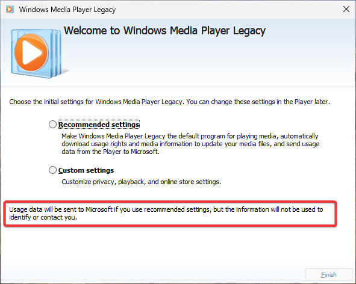

# Disable WMPlayer Telemetry

WMPlayer (Windows Media Player) sends player usage data by default, if using the "Recommended ". This option turns off the `Diagnistics and Feedback` option, use the suboptions for further configuration.



Note: I gathered all registry values via the legacy WMPlayer.

### setup_wm Capture

Registry values `setup_wm.exe` creates on first start, if unticking all options:
```powershell
HKCU\Software\Microsoft\MediaPlayer\Preferences\AcceptedPrivacyStatement	SUCCESS	Type: REG_DWORD, Length: 4, Data: 1
HKCU\Software\Microsoft\MediaPlayer\Setup\UserOptions\DesktopShortcut	SUCCESS	Type: REG_SZ, Length: 6, Data: no
HKCU\Software\Microsoft\MediaPlayer\Preferences\MetadataRetrieval	SUCCESS	Type: REG_DWORD, Length: 4, Data: 0
HKCU\Software\Microsoft\MediaPlayer\Preferences\SendUserGUID	SUCCESS	Type: REG_BINARY, Length: 1, Data: 00
HKCU\Software\Microsoft\MediaPlayer\Preferences\SilentAcquisition	SUCCESS	Type: REG_DWORD, Length: 4, Data: 0
HKCU\Software\Microsoft\MediaPlayer\Preferences\UsageTracking	SUCCESS	Type: REG_DWORD, Length: 4, Data: 0
HKCU\Software\Microsoft\MediaPlayer\Preferences\DisableMRUMusic	SUCCESS	Type: REG_DWORD, Length: 4, Data: 1
HKCU\Software\Microsoft\MediaPlayer\Preferences\DisableMRUPictures	SUCCESS	Type: REG_DWORD, Length: 4, Data: 1
HKCU\Software\Microsoft\MediaPlayer\Preferences\DisableMRUVideo	SUCCESS	Type: REG_DWORD, Length: 4, Data: 1
HKCU\Software\Microsoft\MediaPlayer\Preferences\DisableMRUPlaylists	SUCCESS	Type: REG_DWORD, Length: 4, Data: 1
HKLM\SOFTWARE\Microsoft\Windows NT\CurrentVersion\Notifications\Data\418A073AA3BC3475	SUCCESS	Type: REG_BINARY, Length: 650, Data: 7A 01 00 00 00 00 00 00 04 00 04 00 01 02 1C 00
HKLM\SOFTWARE\Microsoft\Windows NT\CurrentVersion\Notifications\Data\418A073AA3BC2475	SUCCESS	Type: REG_BINARY, Length: 3,056, Data: 3A 03 00 00 00 00 00 00 04 00 04 00 01 00 EF 01
HKLM\SOFTWARE\Microsoft\Windows NT\CurrentVersion\Notifications\Data\418A073AA3BC2475	SUCCESS	Type: REG_BINARY, Length: 3,064, Data: 3B 03 00 00 00 00 00 00 04 00 04 00 01 00 F1 01
```

All queried values in the `Player` section:
```powershell
HKCU\Software\Microsoft\MediaPlayer\Preferences\AlwaysOnTopVTenSkin	Type: REG_DWORD, Length: 4, Data: 0
HKCU\Software\Microsoft\MediaPlayer\Preferences\EnableScreensaver	Type: REG_DWORD, Length: 4, Data: 1
HKCU\Software\Microsoft\MediaPlayer\Preferences\AutoAddMusicToLibrary	Type: REG_DWORD, Length: 4, Data: 1
HKCU\Software\Microsoft\MediaPlayer\Preferences\AutoAddUNC	Type: REG_DWORD, Length: 4, Data: 0
HKCU\Software\Microsoft\MediaPlayer\Preferences\PromptLicenseBackup	Type: REG_DWORD, Length: 4, Data: 0
HKCU\Software\Microsoft\MediaPlayer\Preferences\ForceOnline	Type: REG_DWORD, Length: 4, Data: 0
HKCU\Software\Microsoft\MediaPlayer\Preferences\StopOnFastUserSwitch2	Type: REG_DWORD, Length: 4, Data: 0
HKCU\Software\Microsoft\MediaPlayer\Preferences\UsageLoggerCategories	Type: REG_DWORD, Length: 4, Data: 1
```

All queried values in the `Privacy` section:
```powershell
HKCU\Software\Microsoft\MediaPlayer\Preferences\MetadataRetrieval	Type: REG_DWORD, Length: 4, Data: 0
HKCU\Software\Microsoft\MediaPlayer\Preferences\SendUserGUID	Type: REG_BINARY, Length: 1, Data: 00
HKCU\Software\Microsoft\MediaPlayer\Preferences\SilentAcquisition	Type: REG_DWORD, Length: 4, Data: 0
HKCU\Software\Microsoft\MediaPlayer\Preferences\DisableLicenseRefresh	Type: REG_DWORD, Length: 4, Data: 0
HKCU\Software\Microsoft\MediaPlayer\Preferences\SilentDRMConfiguration	Type: REG_DWORD, Length: 4, Data: 0
HKCU\Software\Microsoft\MediaPlayer\Preferences\UsageTracking	Type: REG_DWORD, Length: 4, Data: 0
HKLM\SOFTWARE\WOW6432Node\Microsoft\MediaPlayer\PREFERENCES\HME\S-1-5-21-312647486-2989864140-179540406-1001\AcceptedPrivacyStatement	Type: REG_DWORD, Length: 4, Data: 1
HKLM\SOFTWARE\WOW6432Node\Microsoft\MediaPlayer\PREFERENCES\HME\S-1-5-21-312647486-2989864140-179540406-1001\UsageTracking	Type: REG_DWORD, Length: 4, Data: 0
HKLM\SOFTWARE\WOW6432Node\Microsoft\MediaPlayer\PREFERENCES\HME\S-1-5-21-312647486-2989864140-179540406-1001\ForceUsageTracking	Type: REG_DWORD, Length: 4, Data: 0
HKCU\Software\Microsoft\MediaPlayer\Preferences\DisableMRUMusic	Type: REG_DWORD, Length: 4, Data: 1
HKCU\Software\Microsoft\MediaPlayer\Preferences\DisableMRUPictures	Type: REG_DWORD, Length: 4, Data: 1
HKCU\Software\Microsoft\MediaPlayer\Preferences\DisableMRUVideo	Type: REG_DWORD, Length: 4, Data: 1
HKCU\Software\Microsoft\MediaPlayer\Preferences\DisableMRUPlaylists	Type: REG_DWORD, Length: 4, Data: 1
HKCU\Software\Microsoft\MediaPlayer\Preferences\PlayerScriptCommandsEnabled	Type: REG_DWORD, Length: 4, Data: 0
HKCU\Software\Microsoft\MediaPlayer\Preferences\HTMLViewAsk	Type: REG_DWORD, Length: 4, Data: 1
HKCU\Software\Microsoft\MediaPlayer\Preferences\LocalSAMIFilesEnabled	Type: REG_DWORD, Length: 4, Data: 0
HKCU\Software\Microsoft\MediaPlayer\Preferences\WebScriptCommandsEnabled	Type: REG_DWORD, Length: 4, Data: 1
HKCU\Software\Microsoft\MediaPlayer\Preferences\WebStreamsEnabled	Type: REG_DWORD, Length: 4, Data: 1
```

All queried values in the `Performance` section:
```powershell
HKCU\Software\Microsoft\MediaPlayer\Preferences\VideoSettings\DontUseFrameInterpolation	Type: REG_DWORD, Length: 4, Data: 1
HKCU\Software\Microsoft\MediaPlayer\Preferences\VideoSettings\UseFullScrMS	Type: REG_DWORD, Length: 4, Data: 1
HKCU\Software\Microsoft\MediaPlayer\Preferences\VideoSettings\DVDUseVMRFSCntrls	Type: REG_DWORD, Length: 4, Data: 1
HKCU\Software\Microsoft\MediaPlayer\Preferences\VideoSettings\IgnoreAVSync	Type: REG_DWORD, Length: 4, Data: 0
HKCU\Software\Microsoft\Scrunch\WMVideo\DXVA	Type: REG_DWORD, Length: 4, Data: 1
HKCU\Software\Microsoft\MediaPlayer\Preferences\VideoSettings\DontUseFrameInterpolation	Type: REG_DWORD, Length: 4, Data: 1
HKCU\Software\Microsoft\MediaPlayer\Preferences\VideoSettings\UseFullScrMS	Type: REG_DWORD, Length: 4, Data: 1
HKCU\Software\Microsoft\MediaPlayer\Preferences\VideoSettings\DVDUseVMRFSCntrls	Type: REG_DWORD, Length: 4, Data: 1
HKCU\Software\Microsoft\MediaPlayer\Preferences\VideoSettings\UseVMRFullScreenCntr	Type: REG_DWORD, Length: 4, Data: 1
HKCU\Software\Microsoft\MediaPlayer\Preferences\VideoSettings\IgnoreAVSync	Type: REG_DWORD, Length: 4, Data: 0
HKCU\Software\Microsoft\Scrunch\WMVideo\DXVA	Type: REG_DWORD, Length: 4, Data: 1
HKCU\Software\Microsoft\MediaPlayer\Preferences\UseDefaultBufferTime	Type: REG_DWORD, Length: 4, Data: 1
HKCU\Software\Microsoft\MediaPlayer\Preferences\CustomBufferTime	Type: REG_DWORD, Length: 4, Data: 5000
HKCU\Software\Microsoft\MediaPlayer\Preferences\MaxBandwidth	Type: REG_DWORD, Length: 4, Data: 2147483647
HKCU\Software\Microsoft\MediaPlayer\Preferences\PlayerScriptCommandsEnabled	Type: REG_DWORD, Length: 4, Data: 0
HKCU\Software\Microsoft\MediaPlayer\Preferences\HTMLViewAsk	Type: REG_DWORD, Length: 4, Data: 1
HKCU\Software\Microsoft\MediaPlayer\Preferences\LocalSAMIFilesEnabled	Type: REG_DWORD, Length: 4, Data: 0
HKCU\Software\Microsoft\MediaPlayer\Preferences\WebScriptCommandsEnabled	Type: REG_DWORD, Length: 4, Data: 1
HKCU\Software\Microsoft\MediaPlayer\Preferences\WebStreamsEnabled	Type: REG_DWORD, Length: 4, Data: 1
```

All queried values in the `Network` section:
```powershell
HKCU\Software\Microsoft\MediaPlayer\Preferences\UseUDP	Type: REG_DWORD, Length: 4, Data: 1
HKCU\Software\Microsoft\MediaPlayer\Preferences\UseCustomUDPPort	Type: REG_DWORD, Length: 4, Data: 0
HKCU\Software\Microsoft\MediaPlayer\Preferences\UseMulticast	Type: REG_DWORD, Length: 4, Data: 0
HKCU\Software\Microsoft\MediaPlayer\Preferences\UseTCP	Type: REG_DWORD, Length: 4, Data: 1
HKCU\Software\Microsoft\MediaPlayer\Preferences\UseHTTP	Type: REG_DWORD, Length: 4, Data: 1
HKCU\Software\Microsoft\MediaPlayer\Preferences\PlayerScriptCommandsEnabled	Type: REG_DWORD, Length: 4, Data: 0
HKCU\Software\Microsoft\MediaPlayer\Preferences\HTMLViewAsk	Type: REG_DWORD, Length: 4, Data: 1
HKCU\Software\Microsoft\MediaPlayer\Preferences\LocalSAMIFilesEnabled	Type: REG_DWORD, Length: 4, Data: 0
HKCU\Software\Microsoft\MediaPlayer\Preferences\WebScriptCommandsEnabled	Type: REG_DWORD, Length: 4, Data: 1
HKCU\Software\Microsoft\MediaPlayer\Preferences\WebStreamsEnabled	Type: REG_DWORD, Length: 4, Data: 1
```

## Suboptions

| Option | Description |
| ---- | ---- |
| `Disable History` | Disables storing and displaying a list of recent/frequently played music, videos, pictures, playlists (`UsageLoggerCategories` disables "Save recently used to the Jumplist instead of frequently used"). |
| `Prevent Send User ID` | Prevents sending a unique player ID to content providers. |
| `Disable Metadata Retrieval` | Disables displaying media information from the internet and updating music files by retrieving media info from the internet. |
| `Prevent Usage Rights Download` | Prevents downloading usage rights automatically when playing or syncing a file. |
| `Prevent Auto Clock` | Prevents setting the clock on devices automatically. |
| `Max Connection Speed` | Selects the `LAN (10 Mbps or more)` connection speed, which is the highest available. |
| `Prevent Frame Dropping` | Prevents dropping frames in order to keep audio and video synchronized. |
| `Disable Video Smoothing` | Disables the `Use video smoothing` option.|
| `Disable Multicast Streams` | Disallows the player from receiving multicast streams. |
| `Enable Screensaver` | Allows the screen saver to stay enabled during playback. |
| `Prevent Internet Connection` | Disables the `Connect to the Internet (overrides other commands)` option. |


## Miscellaneous Notes

```c
// Apps > Video playback

// Save network bandwidth by playing video at lower resolution
"HKCU\\Software\\Microsoft\\Windows\\CurrentVersion\\VideoSettings": "AllowLowResolution" = 0 // DWORD. 0 = Off (default), 1 = On

// Process video automatically to enhance it (depends on your device hardware)
"HKCU\\Software\\Microsoft\\Windows\\CurrentVersion\\VideoSettings": "EnableAutoEnhanceDuringPlayback" = 0 // DWORD, 0 = Off, 1 = On
```
