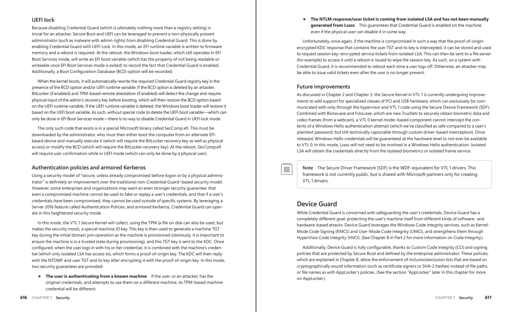

# Disable VBS (HVCI)

[VBS](https://learn.microsoft.com/en-us/windows-hardware/design/device-experiences/oem-vbs) won't work if the Windows hypervisor is disabled (via e.g. disabling `hypervisorlaunchtype`). HVCI = hypervisor-protected code integrity.

Hypervisor-Based Code Integrity (HVCI) and Kernel-Mode Code Integrity (KMCI) power `Device Guard`, LSA (Lsass.exe) and isolated LSA (LsaIso.exe) power [`Credential Guard`](https://learn.microsoft.com/en-us/windows/security/identity-protection/credential-guard/).

Note that everything that runs in it stops too, means memory integrity (HVCI), *Credential Guard* (`LsaCfgFlags`), *System Guard Secure Launch*, *KM Hardware-enforced Stack Protection* (needs HVCI) & *Machine Identity Isolation*.

> "*Virtualization-based security, or VBS, uses hardware virtualization and the Windows hypervisor to create an isolated virtual environment that becomes the root of trust of the OS that assumes the kernel can be compromised. Windows uses this isolated environment to host a number of security solutions, providing them with greatly increased protection from vulnerabilities in the operating system, and preventing the use of malicious exploits which attempt to defeat protections. VBS enforces restrictions to protect vital system and operating system resources, or to protect security assets such as authenticated user credentials.*
>
> *One such example security solution is [memory integrity](https://learn.microsoft.com/en-us/windows/security/hardware-security/enable-virtualization-based-protection-of-code-integrity?tabs=security), which protects and hardens Windows by running kernel mode code integrity within the isolated virtual environment of VBS. Kernel mode code integrity is the Windows process that checks all kernel mode drivers and binaries before they're started, and prevents unsigned or untrusted drivers or system files from being loaded into system memory. Memory integrity also restricts kernel memory allocations that could be used to compromise the system, ensuring that kernel memory pages are only made executable after passing code integrity checks inside the secure runtime environment, and executable pages themselves are never writable. That way, even if there are vulnerabilities like a buffer overflow that allow malware to attempt to modify memory, executable code pages cannot be modified, and modified memory cannot be made executable.*"

## OslGetVsmEnabled

Some miscellaneos notes on how Windows reads it for now.

VBS starts when any `Scenarios\<name>\Enabled` is non zero (`KernelShadowStacks` excluded) or `EnableVirtualizationBasedSecurity` is non zero, with neither set, VBS still starts when the hypervisor launches (`hypervisorlaunchtype Auto`) unless `HyperVVirtualizationBasedSecurityOptOut` is non zero.

```c
// OslGetVsmEnabled (23H2)

  if ( (int)OslGetControlSubkeyCell(a1, L"DeviceGuard", &v14) >= 0 )
  {
    if ( (v7 = v14, (int)OslGetSubkey(v6, v14, L"Scenarios", &v15) >= 0)
      && (v8 = OslpAreVsmScenariosEnabled(v6, v15, &v16), v5 = v16, v8) // any Scenarios\*\Enabled != 0 (KernelShadowStacks skipped)
      || (int)OslGetDWordValue(v6, v7, L"EnableVirtualizationBasedSecurity", &v17) >= 0 && v17 )
    {
      if ( !v5 && (int)OslGetDWordValue(v6, v7, L"Locked", &v17) >= 0 )
        v5 = v17 != 0; // UEFI lock
      *a2 = 100; // VBS on, >= 100 starts VBS in OslpSetVsmPolicy
      *a3 = v5;
      return 0LL;
    }
  }
  if ( (unsigned int)OslVsmGetHvciConfigurationFromCiPolicy(0LL) )
  {
    *a2 = 103; // VBS on, App Control policy asks for HVCI
    return 0LL;
  }
  result = BlGetBootOptionInteger(qword_180217578, 620757232LL, &v13); // 0x250000F0 = hypervisorlaunchtype (https://noverse.dev/docs/win-config/system/bcd-edits/#windows-boot-loader)
  v10 = v13;
  v11 = 1;
  if ( (int)result < 0 )
    v10 = 0LL;
  v13 = v10;
  if ( v10 == 1 ) // Auto
  {
    if ( (int)OslHiveReadWriteControlDword(v6, 0LL, L"DeviceGuard", L"HyperVVirtualizationBasedSecurityOptOut", &v12) < 0
      || !v12 )
    {
      v11 = 101; // VBS on as hypervisor runs
    }
    *a2 = v11; // 1 = opted out, VBS off
    return 0LL;
  }
  *a2 = 0;
```

## UEFI lock

If VBS/Credential Guard was turned on with UEFI lock, this option won't turn them off. `winload.efi` keeps the VBS policy in the UEFI variable `VbsPolicy` and Credential Guard in `Kernel_Lsa_Cfg_Flags`, which have priority over the registy value (`BlVsmSetSystemPolicy`, `OslpGetLsaIsoConfiguration`):

```c
// BlVsmSetSystemPolicy (23H2)

  if ( !(unsigned __int8)BlVsmCheckBootWinRE() )
  {
    if ( (int)BlSecureBootGetBootPrivateVariable(L"VbsPolicy", &v42, &v40) >= 0 && (v24 = v40, v40 == 8) ) // locked policy exists
    {
      v16 = v42;
      if ( *(_DWORD *)v42 == 2 )
      {
        v25 = a4;
        v17 = 1;
        BlVsmpSystemPolicy = *v42; // policy from the var
```

```c
// OslpGetLsaIsoConfiguration (23H2)

  result = EfiGetVariable((unsigned int)L"Kernel_Lsa_Cfg_Flags", (unsigned int)v7, 0, (unsigned int)&v8, (__int64)a2);
  if ( (int)result < 0 || v8 != 4 || (v5 = (*a2 & 0x80000003) == 0, v6 = *a2 & 0x80000003, *a2 = v6, v5) )
  {
    result = OslHiveReadWriteControlDword(a1, 0LL, L"Lsa", L"LsaCfgFlags", a2); // only without UEFI var
```

## Vulnerable Driver Blocklist

"Microsoft Vulnerable Driver Blocklist" toggle in Windows Security, `winload.efi` reads it at boot (`OslpLoadRevocationLists`) and ignores it while memory integrity, Smart App Control or S mode is on, so it only works together with the main option and with Smart App Control off.

```c
// OslpLoadRevocationLists (23H2)

  if ( (BlVsmpSystemPolicy & 0x18000000000LL) != 0 ) // VBS policy with HVCI
    return (unsigned int)BlSIPolicyLoadAndActivateTemporalPolicy(a1, &qword_1801D9320, 0xA00006C9D0000LL);
  if ( (unsigned __int8)SIPolicyIsPolicyActive(&qword_1801D92F0, 0LL) )
    return (unsigned int)BlSIPolicyLoadAndActivateTemporalPolicy(a1, &qword_1801D9320, 0xA00006C9D0000LL);
  if ( (int)OslGetCodeIntegrityCell(a2, &v10) >= 0
    && (int)OslGetSubkey(a2, v10, L"Config", &v6) >= 0
    && (int)OslGetDWordValue(a2, v6, L"VulnerableDriverBlocklistEnable", &v9) >= 0
    && v9 )
  {
    return (unsigned int)BlSIPolicyLoadAndActivateTemporalPolicy(a1, &qword_1801D9320, 0xA00006C9D0000LL); // blocklist loaded
  }
```

> "*Since the Windows 11 2022 update, the vulnerable driver blocklist is enabled by default for all devices, and can be turned on or off via the Windows Security app. Except on Windows Server 2016, the vulnerable driver blocklist is also enforced when either memory integrity, also known as hypervisor-protected code integrity (HVCI), Smart App Control, or S mode is active.*"
>
> — Microsoft, [Microsoft recommended driver block rules](https://learn.microsoft.com/en-us/windows/security/application-security/application-control/app-control-for-business/design/microsoft-recommended-driver-block-rules)

## [VBS Requirements](https://learn.microsoft.com/en-us/windows-hardware/design/device-experiences/oem-vbs)

| Hardware requirement | Details |
| --- | --- |
| 64-bit CPU | Virtualization-based security (VBS) requires the Windows hypervisor, which is only supported on 64-bit IA processors with virtualization extensions, including Intel VT-X and AMD-v. |
| Second Level Address Translation (SLAT) | VBS also requires that the processor's virtualization support includes Second Level Address Translation (SLAT), either Intel VT-X2 with Extended Page Tables (EPT), or AMD-v with Rapid Virtualization Indexing (RVI). |
| IOMMUs or SMMUs (Intel VT-D, AMD-Vi, Arm64 SMMUs) | All I/O devices capable of DMA must be behind an IOMMU or SMMU. An IOMMU can be used to enhance system resiliency against memory attacks. |
| Trusted Platform Module (TPM) 2.0 | For more information, see Trusted Platform Module (TPM) 2.0. |
| Firmware support for SMM protection | System firmware must adhere to the recommendations for hardening SMM code described in the Windows SMM Security Mitigations Table (WSMT) specification. The WSMT specification contains details of an ACPI table that was created for use with Windows operating systems that support VBS features. Firmware must implement the protections described in the WSMT specification, and set the corresponding protection flags as described in the specification to report compliance with these requirements to the operating system. |
| Unified Extensible Firmware Interface (UEFI)<br>Memory Reporting | UEFI firmware must adhere to the following memory map reporting format and memory allocation guidelines in order for firmware to ensure compatibility with VBS.<br><br UEFI v2.6 Memory Attributes Table (MAT) - To ensure compatibility with VBS, firmware must cleanly separate EFI runtime memory ranges for code and data, and report this to the operating system. Proper segregation and reporting of EFI runtime memory ranges allows VBS to apply the necessary page protections to EFI runtime services code pages within the VBS secure region.<br><br>Conveying this information to the OS is accomplished using the EFI_MEMORY_ATTRIBUTES_TABLE. To implement the UEFI MAT, follow these guidelines:<br><br>1. The entire EFI runtime must be described by this table.<br>2. All appropriate attributes for EfiRuntimeServicesData and EfiRuntimeServicesCode pages must be marked.<br>3. These ranges must be aligned on page boundaries (4KB), and can not overlap.<br><br> EFI Page Protections - All entries must include attributes EFI_MEMORY_RO, EFI_MEMORY_XP, or both. All UEFI memory that is marked executable must be read only. Memory marked writable must not be executable. Entries may not be left with neither of the attributes set, indicating memory that is both executable and writable. |
| Secure Memory Overwrite Request (MOR)<br>revision 2 | Secure MOR v2 is enhanced to protect the MOR lock setting using a UEFI secure variable. This helps guard against advanced memory attacks. For details, see Secure MOR implementation. |
| Memory integrity-compatible drivers | Ensure all system drivers have been tested and verified to be compatible with memory integrity. The Windows Driver Kit and Driver Verifier contain tests for driver compatibility with memory integrity. There are three steps to verify driver compatibility:<br><br>1. Use Driver Verifier with the Code Integrity compatibility checks enabled.<br>2. Run the Hypervisor Code Integrity Readiness Test in the Windows HLK.<br>3. Test the driver on a system with VBS and memory integrity enabled. This step is imperative to validate the driver's behavior with memory integrity, as static code analysis tools simply aren't capable of detecting all memory integrity violations possible at runtime. |
| Secure Boot | Secure Boot must be enabled on devices leveraging VBS. For more information, see Secure Boot |

You can disable VBS for a VM with:
```powershell
Set-VMSecurity -VMName <VMName> -VirtualizationBasedSecurityOptOut $true
```

## [Windows Internals](https://github.com/nohuto/Windows-Books/releases/download/7th-Edition/Windows-Internals-E7-P1.pdf)





## [Windows Policies](https://noverse.dev/policies)

| Policy | Key Path | Value Name |
| --- | --- | --- |
| [Turn On Virtualization Based Security](https://noverse.dev/policies?p=DeviceGuard*VirtualizationBasedSecurity) | `HKLM\SOFTWARE\Policies\Microsoft\Windows\DeviceGuard` | `EnableVirtualizationBasedSecurity`<br>`RequirePlatformSecurityFeatures`<br>`HypervisorEnforcedCodeIntegrity`<br>`HVCIMATRequired`<br>`LsaCfgFlags`<br>`MachineIdentityIsolation`<br>`ConfigureSystemGuardLaunch`<br>`ConfigureKernelShadowStacksLaunch` |

