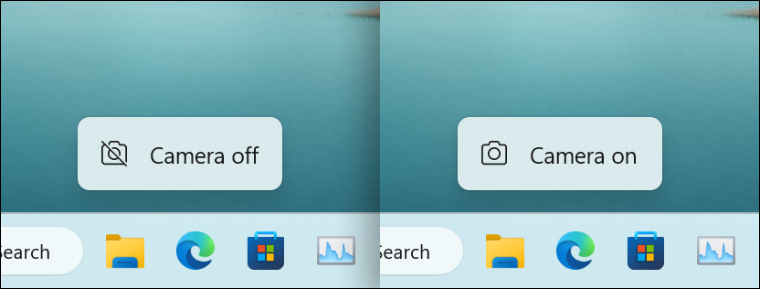

# Enable Camera OSD Indicator

> "*`NoPhysicalCameraLED` indicates that there is no physical LED for the device's camera. An example of a physical LED for a camera is the small blue light that turns on whenever the camera is streaming video. This setting is used to indicate to the shell component that it will need to provide a small indicator in the user interface (UI) to show when video frames are streaming or not streaming to replace the notification by physical LED.*"
>
> — Microsoft, [NoPhysicalCameraLED](https://learn.microsoft.com/en-us/windows-hardware/customize/desktop/unattend/microsoft-windows-coremmres-nophysicalcameraled)



| Data | Description |
| :---: | --- |
| 0 | Does not draw an indicator in the UI to show when the camera is on or off. Instead, a physical LED exists to show when video frames are streaming or not streaming. This is the default value. |
| 1 | Draws an indicator in the UI to show when video frames are streaming or not streaming. |

```
\Registry\Machine\SOFTWARE\Microsoft\OEM\Device\Capture : NoPhysicalCameraLED
```

