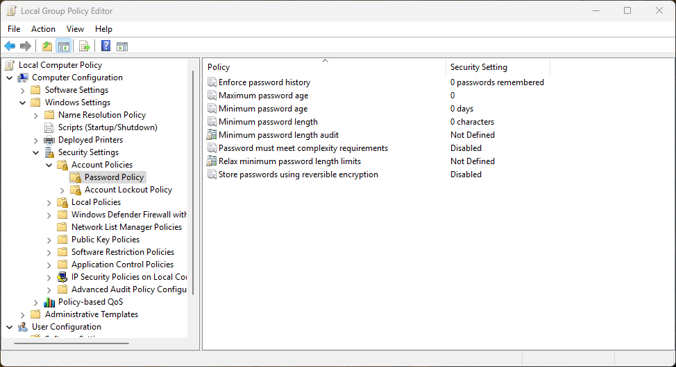

# Password Age

`/MAXPWAGE:{days | UNLIMITED}`:  
"Sets the maximum number of days that a password is valid. No limit is specified by using UNLIMITED. /MAXPWAGE can't be less than /MINPWAGE. The range is 1-999; the default is 90 days."

```powershell
NET ACCOUNTS  
[/FORCELOGOFF:{minutes | NO}]  
[/MINPWLEN:length]  
[/MAXPWAGE:{days | UNLIMITED}]  
[/MINPWAGE:days]  
[/UNIQUEPW:number] [/DOMAIN]
```

Configure the policy yourself via `Computer Configuration > Windows Settings > Security Settings > Account Policies > Password Policy`:



