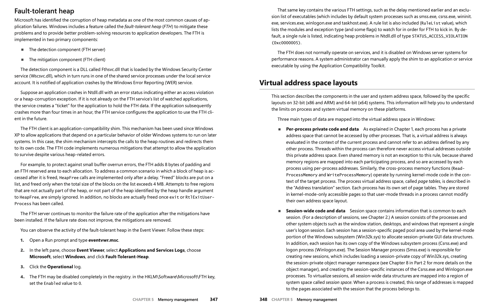

# Process Mitigations

Process mitigations are system or per process exploit protections for common memory corruption & control flow attack classes. These can improve exploit resistance, but some mitigations can break older software, drivers, game anti-cheat components, launchers, or injected overlays. The mitigation tables in the sections are copied from [Windows Internals E7 P1](https://github.com/nohuto/windows-books/releases/download/7th-Edition/Windows-Internals-E7-P1.pdf), 'Exploit mitigations'.

The option currently includes the [system-level mitigations](https://learn.microsoft.com/en-us/defender-endpoint/customize-exploit-protection#exploit-protection-mitigations).

These options are stored system wide in:
```ini
HKLM\System\CurrentControlSet\Control\Session Manager\kernel\MitigationOptions ; REG_BINARY, 24 bytes
HKLM\System\CurrentControlSet\Control\Session Manager\kernel\MitigationAuditOptions ; REG_BINARY, 24 bytes
```

The relevant 4 bit field uses `0` = default/not configured, `1` = force on, and `2` = force off.

| Option | [PS reference](https://learn.microsoft.com/en-us/defender-endpoint/customize-exploit-protection#powershell-reference-table) | `MitigationOptions` field | Enable bytes | Disable bytes |
| --- | --- | --- | --- | --- |
| DEP | `DEP`, `EmulateAtlThunks` | byte `0`, low 4 bits | `01 00 00 XX` | `02 00 00 XX` |
| SEHOP | `SEHOP`, `SEHOPTelemetry` | byte `0`, high 4 bits | `10 00 00 XX` | `20 00 00 XX` |
| Validate heap integrity | `TerminateOnError` | byte `1`, high 4 bits | `00 10 00 XX` | `00 20 00 XX` |
| Mandatory ASLR | `ForceRelocateImages` | byte `1`, low 4 bits | `00 01 00 XX` | `00 02 00 XX` |
| Bottom-up ASLR | `BottomUp`, `HighEntropy` | byte `2`, low 4 bits | `00 00 01 XX` | `00 00 02 XX` |
| High-entropy ASLR | `HighEntropy` suboption of Bottom-up ASLR | byte `2`, high 4 bits | `00 00 10 XX` | `00 00 20 XX` |
| CFG | `CFG`, `StrictCFG`, `SuppressExports` | byte `5` low 4 bits, byte `9` low 4 bits | `XX XX XX XX XX 01 XX XX XX 01` | `XX XX XX XX XX 02 XX XX XX 02` |

## CFG

> "*validating the target of any indirect `CALL` or `JMP` instruction against a list of valid expected target functions*"
>
> — Windows Internals, [E7, P1: 'Exploit mitigations'](https://github.com/nohuto/windows-books/releases/download/7th-Edition/Windows-Internals-E7-P1.pdf)

| Mitigation | Use case | Enabling mechanism |
| --- | --- | --- |
| Control Flow Guard (CFG) | Validates indirect `CALL` and `JMP` targets against expected valid functions, which helps stop control-flow hijacking after memory corruption. | Requires binaries compiled and linked with `/guard:cf`, or can be requested with the CFG process-creation mitigation flag for loaded images. |
| CFG Strict Mode | Blocks libraries that were not linked with `/guard:cf` from loading into the process. | Set through `SetProcessMitigationPolicy` or the strict CFG process-creation mitigation flag. |

## DEP

> "*Marking memory regions as non-executable means that code cannot be run from that region of memory*"
>
> — Microsoft, [Data Execution Prevention](https://learn.microsoft.com/en-us/windows/win32/memory/data-execution-prevention)

| Mitigation | Use case | Enabling mechanism |
| --- | --- | --- |
| DEP: Permanent | Prevents a process from disabling DEP for itself. It mainly applies to x86 and WoW64 processes. | Set through `SetProcessMitigationPolicy`, a process-creation attribute, or `SetProcessDEPPolicy`. |
| DEP: Disable ATL Thunk Emulation | Prevents legacy ATL thunk code from executing in heap memory, even where compatibility handling would otherwise allow it. | Set through `SetProcessMitigationPolicy`, a process-creation attribute, or `SetProcessDEPPolicy`. |

## Mandatory ASLR

> "*forces a rebase of all DLLs within the process*"
>
> "*this rebasing has no entropy, and can therefore be placed at a predictable location in memory*"
>
> — Microsoft, [Exploit protection reference](https://learn.microsoft.com/en-us/defender-endpoint/exploit-protection-reference)

| Mitigation | Use case | Enabling mechanism |
| --- | --- | --- |
| ASLR Force Relocate Images | Forces rebasing for images that were not linked with `/DYNAMICBASE`. | Set through `SetProcessMitigationPolicy` or the force-relocate process-creation mitigation flag. |
| ASLR Disallow Stripped Images | Blocks libraries without relocation data when forced relocation is required. | Set through `SetProcessMitigationPolicy` or the force-relocate and require-relocations mitigation flag. |

## Bottom-up ASLR

> "*adds entropy to relocations, so their location is randomized and therefore less predictable*"
>
> — Microsoft, [Exploit protection reference](https://learn.microsoft.com/en-us/defender-endpoint/exploit-protection-reference)

| Mitigation | Use case | Enabling mechanism |
| --- | --- | --- |
| ASLR Bottom Up Randomization | Randomizes bottom-up allocations such as `VirtualAlloc` and stack bases. | Set with the bottom-up ASLR process-creation mitigation flag. |

## High-entropy ASLR

> "*adds 24 bits of entropy (1 TB of variance) into the bottom-up allocation for 64-bit applications*"
>
> — Microsoft, [Exploit protection reference](https://learn.microsoft.com/en-us/defender-endpoint/exploit-protection-reference)

| Mitigation | Use case | Enabling mechanism |
| --- | --- | --- |
| High Entropy ASLR (HEASLR) | Adds much more address-space entropy for supported 64-bit images. | Requires `/HIGHENTROPYVA` at link time or the high-entropy ASLR process-creation mitigation flag. |

## SEHOP

> "*validates the SEH chain when an exception is invoked*"
>
> "*No exception handler pointers are pointing to the stack... The exception chain ends at a known final exception handler*"
>
> — Microsoft, [Exploit protection reference](https://learn.microsoft.com/en-us/defender-endpoint/exploit-protection-reference)

| Mitigation | Use case | Enabling mechanism |
| --- | --- | --- |
| SEH Overwrite Protection (SEHOP) | Validates structured exception handler chains so overwritten handlers cannot redirect exception dispatch. It mainly applies to 32-bit and WoW64 processes. | Set through SEHOP process creation mitigation flag or [process mitigation options](https://learn.microsoft.com/en-us/windows/security/operating-system-security/device-management/override-mitigation-options-for-app-related-security-policies) |

## Validate Heap Integrity

> "*causing the application to terminate if a heap corruption is detected*"
>
> — Microsoft, [Exploit protection reference](https://learn.microsoft.com/en-us/defender-endpoint/exploit-protection-reference)

| Mitigation | Use case | Enabling mechanism |
| --- | --- | --- |
| Heap Terminate On Corruption | Terminates the process on heap corruption instead of allowing a continuable heap exception path. This reduces exploit reliability for heap corruption bugs. | Set through `HeapSetInformation` or the heap terminate process-creation mitigation flag. |

### FTH

Used for preventing legacy or unstable applications from crashing, read through the picture below for more detailed information ([`Windows Internals 7th Edition, Part 1, Page 347`](https://github.com/nohuto/Windows-Books/releases/download/7th-Edition/Windows-Internals-E7-P1.pdf)).

In [Exploit Protection](https://learn.microsoft.com/en-us/defender-endpoint/customize-exploit-protection#powershell-reference-table) you can see the `Heap` mitigation with `TerminateOnError`, Windows Internals names the same heap termination behavior `Heap Terminate On Corruption`, so the FTH note below refers to that.

> "*causing the application to terminate if a heap corruption is detected*"
>
> — Microsoft, [Exploit protection reference](https://learn.microsoft.com/en-us/defender-endpoint/exploit-protection-reference)

> "*disables the Fault Tolerant Heap (FTH)... by terminating the process instead*"
>
> — Windows Internals, [E7, P1: 'Exploit mitigations'](https://github.com/nohuto/windows-books/releases/download/7th-Edition/Windows-Internals-E7-P1.pdf)

#### [Windows Internals](https://github.com/nohuto/Windows-Books/releases/download/7th-Edition/Windows-Internals-E7-P1.pdf)



[YouTube Video](https://www.youtube.com/watch?v=4SvNNXAwoqE).

## ProcessMitigation ValidValues

`(gcm set-processmitigation).Parameters.Disable.Attributes.ValidValues`:
```powershell
DEP
EmulateAtlThunks
ForceRelocateImages
RequireInfo
BottomUp
HighEntropy
StrictHandle
DisableWin32kSystemCalls
AuditSystemCall
DisableExtensionPoints
DisableFsctlSystemCalls
AuditFsctlSystemCall
BlockDynamicCode
AllowThreadsToOptOut
AuditDynamicCode
CFG
SuppressExports
StrictCFG
MicrosoftSignedOnly
AllowStoreSignedBinaries
AuditMicrosoftSigned
AuditStoreSigned
EnforceModuleDependencySigning
DisableNonSystemFonts
AuditFont
BlockRemoteImageLoads
BlockLowLabelImageLoads
PreferSystem32
AuditRemoteImageLoads
AuditLowLabelImageLoads
AuditPreferSystem32
EnableExportAddressFilter
AuditEnableExportAddressFilter
EnableExportAddressFilterPlus
AuditEnableExportAddressFilterPlus
EnableImportAddressFilter
AuditEnableImportAddressFilter
EnableRopStackPivot
AuditEnableRopStackPivot
EnableRopCallerCheck
AuditEnableRopCallerCheck
EnableRopSimExec
AuditEnableRopSimExec
SEHOP
AuditSEHOP
SEHOPTelemetry
TerminateOnError
DisallowChildProcessCreation
AuditChildProcess
UserShadowStack
UserShadowStackStrictMode
AuditUserShadowStack
```

