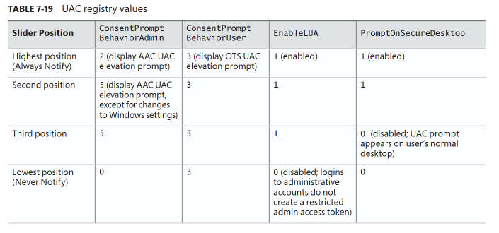
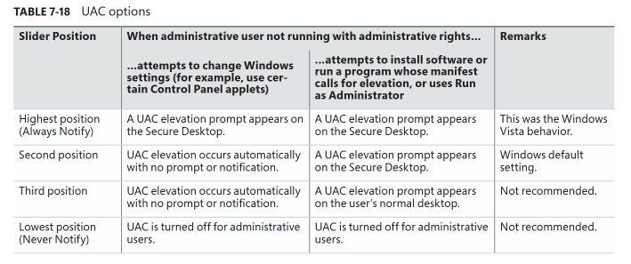

# UAC

Disabling UAC stops the prompts for administrative permissions, allowing programs and processes to run with elevated rights without user confirmation.

> *User Account Control (UAC) is meant to enable users to run with standard user rights as opposed to administrative rights. Without administrative rights, users cannot accidentally (or deliberately) modify system settings, malware can't normally alter system security settings or disable antivirus software, and users can't compromise the sensitive information of other users on shared computers. Running with standard user rights can thus mitigate the impact of malware and protect sensitive data on shared computers.*"
>
> — Windows Internals, [E7, P1: 'UAC'](https://github.com/nohuto/Windows-Books/releases/download/7th-Edition/Windows-Internals-E7-P1.pdf)




## [Registry Values](https://learn.microsoft.com/en-us/windows/security/application-security/application-control/user-account-control/settings-and-configuration?tabs=reg)

All of them are under `HKLM\SOFTWARE\Microsoft\Windows\CurrentVersion\Policies\System`.

The kernel reads `EnableLUA`, `EnableVirtualization` and `EnableInstallerDetection` once at the end of boot ([`PsBootPhaseComplete`](https://github.com/nohuto/decompiled-pseudocode/blob/main/11-23H2/ntoskrnl/PsBootPhaseComplete.c)) into `KUSER_SHARED_DATA`, missing value = enabled. The prompt values (`ConsentPromptBehaviorAdmin`, `ConsentPromptBehaviorUser`, `PromptOnSecureDesktop`) are read by `appinfo.dll` (`AipGetElevationPromptType`, `AiLaunchConsentUI`) on every elevation.

```c
// PsBootPhaseComplete (23H2)

        if ( v11 < 0 || HIDWORD(KeyValueInformation) || *(_QWORD *)((char *)&KeyValueInformation + 4) != 0x400000004LL ) // missing, not REG_DWORD, non zero
        {
          _interlockedbittestandset((volatile signed __int32 *)(MmWriteableSharedUserData + 752), *v10); // SharedDataFlags bit 1 EnableLUA, 2 EnableVirtualization, 3 EnableInstallerDetection
```

### FilterAdministratorToken

Admin Approval Mode for the built-in Administrator account.

| Value | Meaning |
| --- | --- |
| `0x00000001` (`Enabled`) | The built-in Administrator account uses Admin Approval Mode. By default, any operation that requires elevation of privilege prompts the user to prove the operation. |
| `0x00000000` (`Disabled`) | The built-in Administrator account runs all applications with full administrative privilege (default). |

### EnableUIADesktopToggle

Allow UIAccess applications to prompt for elevation without using the secure desktop.

| Value | Meaning |
| --- | --- |
| `0x00000001` (`Enabled`) | UIA programs, including Remote Assistance, automatically disable the secure desktop for elevation prompts. If you don't disable the **Switch to the secure desktop when prompting for elevation** policy setting, the prompts appear on the interactive user's desktop instead of the secure desktop. This setting allows the remote administrator to provide the appropriate credentials for elevation. This policy setting doesn't change the behavior of the UAC elevation prompt for administrators. If you plan to enable this policy setting, you should also review the effect of the **Behavior of the elevation prompt for standard users** policy setting; if configured as **Automatically deny elevation requests**, elevation requests aren't presented to the user. |
| `0x00000000` (`Disabled`) | The secure desktop can be disabled only by the user of the interactive desktop or by disabling the **Switch to the secure desktop when prompting for elevation** policy setting (default). |

### ConsentPromptBehaviorAdmin

Behavior of the elevation prompt for administrators in Admin Approval Mode.

| Value | Meaning |
| --- | --- |
| `0x00000000` (`Elevate without prompting`) | Allows privileged accounts to perform an operation that requires elevation without requiring consent or credentials. Use this option only in the most constrained environments. |
| `0x00000001` (`Prompt for credentials on the secure desktop`) | When an operation requires elevation of privilege, the user is prompted on the secure desktop to enter a privileged user name and password. If the user enters valid credentials, the operation continues with the user's highest available privilege. |
| `0x00000002` (`Prompt for consent on the secure desktop`) | When an operation requires elevation of privilege, the user is prompted on the secure desktop to select either Permit or Deny. If the user selects Permit, the operation continues with the user's highest available privilege. |
| `0x00000003` (`Prompt for credentials`) | When an operation requires elevation of privilege, the user is prompted to enter an administrative user name and password. If the user enters valid credentials, the operation continues with the applicable privilege. |
| `0x00000004` (`Prompt for consent`) | When an operation requires elevation of privilege, the user is prompted to select either Permit or Deny. If the user selects Permit, the operation continues with the user's highest available privilege. |
| `0x00000005` (`Prompt for consent for non-Windows binaries`) | When an operation for a non-Microsoft application requires elevation of privilege, the user is prompted on the secure desktop to select either Permit or Deny. If the user selects Permit, the operation continues with the user's highest available privilege (default). |

### ConsentPromptBehaviorUser

Behavior of the elevation prompt for standard users.

| Value | Meaning |
| --- | --- |
| `0x00000000` (`Automatically deny elevation requests`) | When an operation requires elevation of privilege, a configurable access denied error message is displayed. An enterprise that is running desktops as standard user might choose this setting to reduce help desk calls. |
| `0x00000001` (`Prompt for credentials on the secure desktop`) | When an operation requires elevation of privilege, the user is prompted on the secure desktop to enter a different user name and password. If the user enters valid credentials, the operation continues with the applicable privilege. |
| `0x00000003` (`Prompt for credentials`) | When an operation requires elevation of privilege, the user is prompted to enter an administrative user name and password. If the user enters valid credentials, the operation continues with the applicable privilege (default). |

### EnableInstallerDetection

Detect application installations and prompt for elevation.

| Value | Meaning |
| --- | --- |
| `0x00000001` (`Enabled`) | When an app installation package is detected that requires elevation of privilege, the user is prompted to enter an administrative user name and password. If the user enters valid credentials, the operation continues with the applicable privilege (default, the `lua-settings` manifest has `1`). |
| `0x00000000` (`Disabled`) | App installation packages aren't detected and prompted for elevation. Enterprises that are running standard user desktops and use delegated installation technologies, such as Microsoft Intune, should disable this policy setting. In this case, installer detection is unnecessary (enterprise default). |

### ValidateAdminCodeSignatures

Only elevate executables that are signed and validated.

| Value | Meaning |
| --- | --- |
| `0x00000001` (`Enabled`) | Enforces the certificate certification path validation for a given executable file before it's permitted to run. |
| `0x00000000` (`Disabled`) | Doesn't enforce the certificate certification path validation before a given executable file is permitted to run (default). |

### EnableSecureUIAPaths

Only elevate UIAccess applications that are installed in secure locations.

| Value | Meaning |
| --- | --- |
| `0x00000001` (`Enabled`) | If an app resides in a secure location in the file system, it runs only with UIAccess integrity (default). |
| `0x00000000` (`Disabled`) | An app runs with UIAccess integrity even if it doesn't reside in a secure location in the file system. |

### EnableLUA

Run all administrators in Admin Approval Mode.

| Value | Meaning |
| --- | --- |
| `0x00000001` (`Enabled`) | Admin Approval Mode is enabled. This policy must be enabled and related UAC settings configured. The policy allows the built-in Administrator account and members of the Administrators group to run in Admin Approval Mode (default). |
| `0x00000000` (`Disabled`) | Admin Approval Mode and all related UAC policy settings are disabled. If this policy setting is disabled, Windows Security notifies you that the overall security of the operating system is reduced. |

### PromptOnSecureDesktop

Switch to the secure desktop when prompting for elevation.

| Value | Meaning |
| --- | --- |
| `0x00000001` (`Enabled`) | All elevation requests go to the secure desktop regardless of prompt behavior policy settings for administrators and standard users (default). |
| `0x00000000` (`Disabled`) | All elevation requests go to the interactive user's desktop. Prompt behavior policy settings for administrators and standard users are used. |

### EnableVirtualization

Virtualize file and registry write failures to per-user locations.

| Value | Meaning |
| --- | --- |
| `0x00000001` (`Enabled`) | App write failures are redirected at run time to defined user locations for both the file system and registry (default). |
| `0x00000000` (`Disabled`) | Apps that write data to protected locations fail. |

