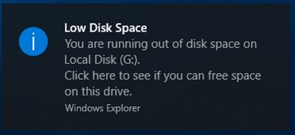

# Disable Notifications

The '*System Template*' won't disable all notifications, so e.g. critical Defender notifications will still be shown.

## (Sub)Options

| Option | Description |
| ---- | ---- |
| Main | Disables all kind of notifications completely. |
| Disable Low Disk Space Checks | Disables the `Low Disk Space` notification.  |
| Hide all Windows Security notifications | Disables all notifications via the `DisableNotifications`  policy (this probably overrides all other security notifications below). |
| Hide non-critical Windows Security notifications | Disables non-critical/enhanced notifications via the Windows Security and Microsoft Defender Antivirus `DisableEnhancedNotifications` policies. |
| Disable Enhanced Phishing Protection warnings | Disables the Enhanced Phishing Protection warning prompts for malicious sites, password reuse, and unsafe apps. |
| Disable Virus & threat protection notifications | Disables all in `Windows Security > Settings > Manage notifications: Virus & threat protection notifications` |
| Disable Account protection notifications | Disables all in `Windows Security > Settings > Manage notifications: Account protection notifications` |
| Disable Firewall & network protection notifications | Disables all in `Windows Security > Settings > Manage notifications: Firewall & network protection notifications` |
| Disable Security & Maintenance Notifications | Disables it via `SystemSettings > System > Notifications: Security and Maintenance` |
| Disable Sync Provider Notifications | Disables it via `Explorer > View > Options > View: Show sync provider notifications` |
| Disable account-related notifications | Disables it via `SystemSettings > Personalization > Start: Show account related notifications occasionally in Start` |
| Disable Clock Change notifications | Disables it via `Control Panel > Clock and Region > Date and Time: Notify me when the clock chanes` |
| Hide Notification Center | Works via `NoAutoTrayNotify`/`DisableNotificationCenter` policies and `SystemSettings > System > Notifications: Show notification bell icon` |
| Disable Notification Sound | Disables it via `SystemSettings > System > Notifications > Allow notifications to play sound` |
| Disable Lockscreen Notifications | Works via `DisableLockScreenAppNotifications` policy and `SystemSettings > System > Notifications: Show notifications on the lock screen + Show reminders and incoming VoIP calls on the lock screen` |
| Turn off access to the Store | `NoUseStoreOpenWith` policy - "*This policy setting specifies whether to use the Store service for finding an application to open a file with an unhandled file type or protocol association. When a user opens a file type or protocol that is not associated with any applications on the computer, the user is given the choice to select a local application or use the Store service to find an application. If you enable this policy setting, the "Look for an app in the Store" item in the Open With dialog is removed. If you disable or do not configure this policy setting, the user is allowed to use the Store service and the Store item is available in the Open With dialog.*" |
| Hide Time in Notification Center | Works via `SystemSettings > Time & language > Date & time: Show time and date in the System tray` |

## Miscellaneous Notes

### WnsEndpoint

"`WnsEndpoint` (`REG_SZ`) determines which Windows Notification Service (WNS) endpoint will be used to connect for Windows push notifications. If you disable or don't configure this setting, the push notifications will connect to the default endpoint of `client.wns.windows.com`. " Located in `HKLM\SOFTWARE\Policies\Microsoft\Windows\CurrentVersion\PushNotifications`. Block `client.wns.windows.com` via the hosts file.

### Registry Values

All `NOC_GLOBAL_SETTING_*` I found in `NotificationController.dll`:
```c
"HKLM\\SOFTWARE\\Microsoft\\WINDOWS\\CurrentVersion\\Notifications\\Settings"
  'NOC_GLOBAL_SETTING_SUPRESS_TOASTS_WHILE_DUPLICATING'; // Hide notifications when I'm duplicating my screen
  'NOC_GLOBAL_SETTING_ALLOW_TOASTS_ABOVE_LOCK'; // Show notifications on the lock screen
  'NOC_GLOBAL_SETTING_ALLOW_CRITICAL_TOASTS_ABOVE_LOCK'; // Show reminders and incoming VoIP calls on the lock screen
  'NOC_GLOBAL_SETTING_CORTANA_MANAGED_NOTIFICATIONS';
  'NOC_GLOBAL_SETTING_ALLOW_ACTION_CENTER_ABOVE_LOCK';
  'NOC_GLOBAL_SETTING_HIDE_NOTIFICATION_CONTENT';
  'NOC_GLOBAL_SETTING_TOASTS_ENABLED';
  'NOC_GLOBAL_SETTING_BADGE_ENABLED'; // Don't show number of notifications
  'NOC_GLOBAL_SETTING_GLEAM_ENABLED'; // App icons (Action Center)
  'NOC_GLOBAL_SETTING_ALLOW_HMD_NOTIFICATIONS'; // Show notifications on my head mounted display
  'NOC_GLOBAL_SETTING_ALLOW_CONTROL_CENTER_ABOVE_LOCK';
  'NOC_GLOBAL_SETTING_ALLOW_NOTIFICATION_SOUND'; // Allow notification to play sounds
```
The options I've commented on are included in the options under `System > Notifications`/right click menu of notification center.

Since `BackupReminderToastCount` isn't a well known value, I've done quick research where it exists and if it does exist. While doing so I found different values:
```c
"HKCU\\Software\\Microsoft\\Windows\\CurrentVersion\\StorageSense\\Parameters\\StoragePolicy";
    "StoragePoliciesNotified" = 0; // REG_DWORD, default 0 if missing, range: 0-1
    "StoragePoliciesChanged" = 0; // REG_DWORD, default 0 if missing, range: 0-1
    "OptinToastFired" = 0; // REG_DWORD, default 0 if missing, range: 0-1
    "FirstLaunchToastFired" = 0; // REG_DWORD, default 0 if missing, range: 0-1
    "CloudfilePolicyConsent" = 0; // REG_DWORD, default 0 if missing, range: 0-1
    "CloudConsentToastCount" = 0; // REG_DWORD, default 0 if missing, range: 0-3
    "OptOutButtonClicked" = 0; // REG_DWORD, default 0 if missing, range: 0-1

"HKCU\\Software\\Microsoft\\Windows\\CurrentVersion\\Explorer\\DiskSpaceChecking";
    "LastInstallTimeLowStorageNotify" = 0; // REG_QWORD FILETIME, range: FILETIME, ComparedTo: OneDay
    "NumWinOldLowStorageNotify" = 0; // REG_DWORD, default 0 if missing, range: 0-3

"HKLM\\Software\\Microsoft\\Windows NT\\CurrentVersion";
    "InstallTime" = 0; // REG_QWORD FILETIME, range: FILETIME, ComparedTo: TwoHours

"HKLM\\Software\\Microsoft\\Windows\\CurrentVersion\\StorageSense\\Parameters\\BackupReminder";
    "TestBackupReminderToast" = 0; // REG_DWORD, default 0 if missing, range: 0-2?

"HKCU\\Software\\Microsoft\\Windows\\CurrentVersion\\StorageSense\\Parameters\\BackupReminder";
    "FirstProfileSeenTime" = 0; // REG_QWORD FILETIME, default set to current system time if missing, range: FILETIME, ComparedTo: FourMinutes
    "BackupReminderToastCount" = 0; // REG_DWORD, default 0 if missing, range: 0-3
    "LastTimeBackupReminderNotify" = 0; // REG_QWORD FILETIME, range: FILETIME, ComparedTo: TwoMinutes

// FILETIME THRESHOLDS
"OneDay" = 0xC92A69C000; // Seconds: 86400, 1 day, LastInstallTimeLowStorageNotify
"TwoHours" = 0x10C388D000; // Seconds: 7200, 2 hours, InstallTime
"FourMinutes" = 0x8F0D1800; // Seconds: 240, 4 minutes, FirstProfileSeenTime
"TwoMinutes" = 0x47868C00; // Seconds: 120, 2 minutes, LastTimeBackupReminderNotify
```

See [system/assets/pseudocode | noti-CLowDiskSpaceUI_CanShowStorageSenseToast.c](https://github.com/nohuto/win-config/blob/main/system/assets/pseudocode/noti-CLowDiskSpaceUI_CanShowStorageSenseToast.c) for used pseudocode. Note that I added my chosen values to the `Disable Low Disk Space Checks` suboption for safety reasons.

```c
"HKCU\\Control Panel\\Accessibility";
  // Dismiss notifications after this amount of time
  "MessageDuration" = 5; // REG_DWORD, range 5-300(s) - According to pseudocode, it has a range from `0` to `0xFFFFFFFF`. Fallback of `5`, SystemSettings supports ranges from `5` (5 seconds) to `300` (5 minutes). Anything above/below will likely be limited (haven't tested it yet).

"HKCU\\Software\\Microsoft\\Windows\\MiracastDiscovery"
  "DisableNotification" = 0; // read on boot - "HKCU\Software\Microsoft\Windows\MiracastDiscovery\DisableNotification","Type: REG_DWORD, Length: 4, Data: 0"
  "NotificationCount" = 0; // read on boot - "HKCU\Software\Microsoft\Windows\MiracastDiscovery\NotificationCount","Type: REG_DWORD, Length: 4, Data: 0"

// miscellaneous procmon boot trace values
"HKCU\\Software\\Microsoft\\Windows\\CurrentVersion\\Notifications\\IsDebugEnabled","Length: 16"
"HKCU\\Software\\Microsoft\\Windows\\CurrentVersion\\Notifications\\SmartOptOut\\InitialTimerCooldown","Length: 20"
"HKCU\\Software\\Microsoft\\Windows\\CurrentVersion\\Notifications\\SmartOptOut\\PeriodicTimerCooldown","Length: 20"
"HKCU\\Software\\Microsoft\\Windows\\CurrentVersion\\Notifications\\SmartOptOut\\SmartOptOutRevision","Type: REG_QWORD, Length: 8, Data: "
"HKCU\\Software\\Microsoft\\Windows\\CurrentVersion\\Notifications\\TimestampWhenSeen","Length: 20"
```

## SystemSettings Captures

```c
// System > Notifications

// Get notifications from apps and other senders
// On = 1 or value missing
// Off = 0
HKCU\Software\Microsoft\Windows\CurrentVersion\PushNotifications\ToastEnabled // Type: REG_DWORD

// Allow notifications to play sounds
// On = delete
// Off = 0
HKCU\Software\Microsoft\Windows\CurrentVersion\Notifications\Settings\NOC_GLOBAL_SETTING_ALLOW_NOTIFICATION_SOUND // Type: REG_DWORD

// Show notifications on the lock screen
// On = NOC value deleted, LockScreenToastEnabled = 1
// Off = NOC value 0, LockScreenToastEnabled = 0
HKCU\Software\Microsoft\Windows\CurrentVersion\Notifications\Settings\NOC_GLOBAL_SETTING_ALLOW_TOASTS_ABOVE_LOCK // Type: REG_DWORD
HKCU\Software\Microsoft\Windows\CurrentVersion\PushNotifications\LockScreenToastEnabled // Type: REG_DWORD

// Show reminders and incoming VoIP calls on the lock screen
// On = delete
// Off = 0
HKCU\Software\Microsoft\Windows\CurrentVersion\Notifications\Settings\NOC_GLOBAL_SETTING_ALLOW_CRITICAL_TOASTS_ABOVE_LOCK // Type: REG_DWORD

// Show notification bell icon
// On = 1
// Off = 0
HKCU\Software\Microsoft\Windows\CurrentVersion\Explorer\Advanced\ShowNotificationIcon // Type: REG_DWORD

// Notifications from apps and other senders (examples since this depends on the installed apps)
// On = delete
// Off = 0
HKCU\Software\Microsoft\Windows\CurrentVersion\Notifications\Settings\Windows.ActionCenter.SmartOptOut\Enabled // Notification Suggestions
HKCU\Software\Microsoft\Windows\CurrentVersion\Notifications\Settings\Microsoft.Windows.Explorer\Enabled // File Explorer
HKCU\Software\Microsoft\Windows\CurrentVersion\Notifications\Settings\Windows.SystemToast.SecurityAndMaintenance\Enabled // Security and Maintenance
HKCU\Software\Microsoft\Windows\CurrentVersion\Notifications\Settings\Windows.SystemToast.PinConsent\Enabled // Apps
HKCU\Software\Microsoft\Windows\CurrentVersion\Notifications\Settings\windows.immersivecontrolpanel_cw5n1h2txyewy!microsoft.windows.immersivecontrolpanel\Enabled // Settings
HKCU\Software\Microsoft\Windows\CurrentVersion\Notifications\Settings\Windows.SystemToast.StartupApp\Enabled // Startup App Notification
```

## [Windows Policies](https://noverse.dev/policies)

| Policy | Key Path | Value Name |
| --- | --- | --- |
| [Turn off account notifications in Start](https://noverse.dev/policies?p=AccountNotifications*DisableAccountNotifications) | `HKCU\SOFTWARE\Policies\Microsoft\Windows\CurrentVersion\AccountNotifications` | `DisableAccountNotifications` |
| [Turn off access to the Store](https://noverse.dev/policies?p=ICM*ShellNoUseStoreOpenWith_2) | `HKLM\Software\Policies\Microsoft\Windows\Explorer` | `NoUseStoreOpenWith` |
| [Turn off app notifications on the lock screen](https://noverse.dev/policies?p=Logon*DisableLockScreenAppNotifications) | `HKLM\Software\Policies\Microsoft\Windows\System` | `DisableLockScreenAppNotifications` |
| [Remove Notifications and Action Center](https://noverse.dev/policies?p=Taskbar*DisableNotificationCenter) | `HKLM\Software\Policies\Microsoft\Windows\Explorer`<br>`HKCU\Software\Policies\Microsoft\Windows\Explorer` | `DisableNotificationCenter` |
| [Notify Malicious](https://noverse.dev/policies?p=WebThreatDefense*NotifyMalicious) | `HKLM\Software\Policies\Microsoft\Windows\WTDS\Components` | `NotifyMalicious` |
| [Notify Password Reuse](https://noverse.dev/policies?p=WebThreatDefense*NotifyPasswordReuse) | `HKLM\Software\Policies\Microsoft\Windows\WTDS\Components` | `NotifyPasswordReuse` |
| [Notify Unsafe App](https://noverse.dev/policies?p=WebThreatDefense*NotifyUnsafeApp) | `HKLM\Software\Policies\Microsoft\Windows\WTDS\Components` | `NotifyUnsafeApp` |
| [Turn off enhanced notifications](https://noverse.dev/policies?p=WindowsDefender*Reporting_DisableEnhancedNotifications) | `HKLM\Software\Policies\Microsoft\Windows Defender\Reporting` | `DisableEnhancedNotifications` |
| [Hide all notifications](https://noverse.dev/policies?p=WindowsDefenderSecurityCenter*Notifications_DisableNotifications) | `HKLM\SOFTWARE\Policies\Microsoft\Windows Defender Security Center\Notifications` | `DisableNotifications` |
| [Hide non-critical notifications](https://noverse.dev/policies?p=WindowsDefenderSecurityCenter*Notifications_DisableEnhancedNotifications) | `HKLM\SOFTWARE\Policies\Microsoft\Windows Defender Security Center\Notifications` | `DisableEnhancedNotifications` |
| [Turn off tile notifications](https://noverse.dev/policies?p=WPN*NoTileNotification) | `HKCU\SOFTWARE\Policies\Microsoft\Windows\CurrentVersion\PushNotifications` | `NoTileApplicationNotification` |
| [Turn on multiple expanded toast notifications in action center](https://noverse.dev/policies?p=WPN*ExpandedToastNotifications) | `HKCU\Software\Policies\Microsoft\Windows\CurrentVersion\PushNotifications` | `EnableExpandedToastNotifications` |
| [Turn off toast notifications](https://noverse.dev/policies?p=WPN*NoToastNotification) | `HKLM\SOFTWARE\Policies\Microsoft\Windows\CurrentVersion\PushNotifications`<br>`HKCU\SOFTWARE\Policies\Microsoft\Windows\CurrentVersion\PushNotifications` | `NoToastApplicationNotification` |
| [Turn off toast notifications on the lock screen](https://noverse.dev/policies?p=WPN*NoLockScreenToastNotification) | `HKCU\SOFTWARE\Policies\Microsoft\Windows\CurrentVersion\PushNotifications` | `NoToastApplicationNotificationOnLockScreen` |
| [Turn off notifications network usage](https://noverse.dev/policies?p=WPN*NoCloudNotification) | `HKLM\SOFTWARE\Policies\Microsoft\Windows\CurrentVersion\PushNotifications` | `NoCloudApplicationNotification` |
| [Turn off notification mirroring](https://noverse.dev/policies?p=WPN*NoNotificationMirroring) | `HKCU\SOFTWARE\Policies\Microsoft\Windows\CurrentVersion\PushNotifications` | `DisallowNotificationMirroring` |
| [Show notification bell icon](https://noverse.dev/policies?p=Taskbar*AlwaysShowNotificationIcon) | `HKCU\Software\Policies\Microsoft\Windows\Explorer` | `AlwaysShowNotificationIcon` |
| [Disable showing balloon notifications as toasts.](https://noverse.dev/policies?p=Taskbar*EnableLegacyBalloonNotifications) | `HKCU\Software\Policies\Microsoft\Windows\Explorer` | `EnableLegacyBalloonNotifications` |
| [Turn off notification area cleanup](https://noverse.dev/policies?p=StartMenu*NoAutoTrayNotify) | `HKCU\Software\Policies\Microsoft\Windows\Explorer` | `NoAutoTrayNotify` |
| [Turn off all balloon notifications](https://noverse.dev/policies?p=Taskbar*TaskbarNoNotification) | `HKCU\Software\Microsoft\Windows\CurrentVersion\Policies\Explorer` | `TaskbarNoNotification` |
| [Turn off feature advertisement balloon notifications](https://noverse.dev/policies?p=Taskbar*NoBalloonFeatureAdvertisements) | `HKCU\Software\Policies\Microsoft\Windows\Explorer` | `NoBalloonFeatureAdvertisements` |

