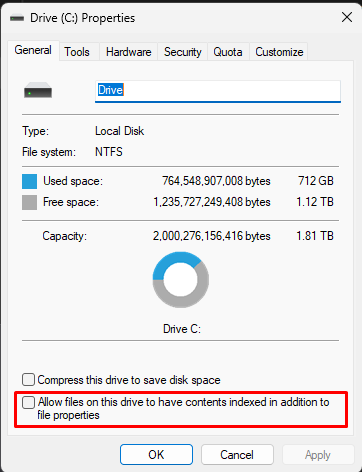

# Disable Windows Search

Windows search provides content indexing, property caching, and search results for files, e-mail, and other content. Instead of using the explorer/windows start menu to search for a file/folder/app, use [`Everything`](https://www.voidtools.com/downloads/) for searching for files/folders and [SAB](https://www.startallback.com/) ([manual activation](https://noverse.dev/docs/win-config/misc/startallback-config/#sab-activation)) as start menu. Note that enabling this option breaks the start menu, and apps like e.g. CmdPal (PowerToys) do need the `WSearch` service for the `File Search` extension to work.

### Search Indexing

[Search indexing](https://learn.microsoft.com/en-us/windows/win32/search/-search-indexing-process-overview) builds a database of file names, properties, and contents to speed up searches, runs as `SearchIndexer.exe`, updates automatically. Disabling it slows down searches, but as shows below you should use everything anyway. Additionally you can disable content and property indexing per drive, by right clicking on the drive, then unticking the box as shown in the picture:



## Suboptions

| Suboption | Description |
| ---- | ---- |
| Disable SafeSearch | Disables the SafeSearch filter for web search, preventing strict filtering of search results. |
| Prevent Index on Battery | Prevents Windows from indexing content while running on battery power, saving system resources. |
| Disable Index Usage for System File Search | Disables the use of the index when searching system files, requiring a full scan each time. |
| Find Partial Matches | Allows partial matches to be found when searching for files, enabling more flexible search results. |
| Exclude System Directories | Excludes system directories from search results, narrowing down the search to user files and folders. |
| Exclude Archived Files | Prevents archived files from being included in search results. |
| Disable Natural Language Search | Disables the use of natural language search, which allows more conversational queries for search results. |
| Search Only in Indexed Locations | Restricts searches in non-indexed locations to only file names, rather than searching both names and contents. |
| Exclude System Directories | Excludes system directories (e.g., Windows folders) in search results when searching non-indexed locations. |
| Exclude Compressed Files | Excludes compressed files (e.g., ZIP, CAB) in search results when searching non-indexed locations. |
| Search Only in Indexed Locations | Disables: "Ensures that file names and contents are always searched in non-indexed locations, which may take more time." |
| [Disallow Indexing of Encrypted Items](https://learn.microsoft.com/en-us/windows/client-management/mdm/policy-csp-search#allowindexingencryptedstoresoritems) | This policy setting allows encrypted items to be indexed. |
| [Disable Language Detection](https://learn.microsoft.com/en-us/windows/client-management/mdm/policy-csp-search#alwaysuseautolangdetection) | This policy setting determines when Windows uses automatic language detection results, and when it relies on indexing history. |
| [Prevent Querying Index Remotely](https://learn.microsoft.com/en-us/windows/client-management/mdm/policy-csp-search#preventremotequeries) | If enabled, clients will be unable to query this computer's index remotely. Thus, when they're browsing network shares that are stored on this computer, they won't search them using the index. If disabled, client search requests will use this computer's index. |
| [Disable Web Results in Search](https://learn.microsoft.com/en-us/windows/client-management/mdm/policy-csp-search#donotusewebresults) | This policy setting allows you to control whether or not Search can perform queries on the web, and if the web results are displayed in Search. |
| Disable Search Highlights | If enabled: "See content suggestions in the search boxi and in search home". |
| Disable Web Search | If disabled: "removes the option of searching the Web from Windows Desktop Search". |
| [Disallow Search to Use Location](https://learn.microsoft.com/en-us/windows/client-management/mdm/policy-csp-search#allowsearchtouselocation) | Search can't use the device location. |
| Hide Most Used Apps |  |
| Hide Recently Added Apps | |
| Hide Frequently Used Apps | |
| Hide New App Notifications | |
| Start Layout |  |

## Miscellaneous Notes

Exists in [Search Policies](https://learn.microsoft.com/en-us/windows/client-management/mdm/policy-csp-search), but isn't present anymore on 24H2 and probably versions above.

```c
// Disabling this setting turns off search highlights in the start menu search box and in search home. Enabling or not configuring this setting turns on search highlights in the start menu search box and in search home.
"Disable Search Highlights": {
  "HKLM\\SOFTWARE\\Policies\\Microsoft\\Windows\\Windows Search": {
    "EnableDynamicContentInWSB": { "Type": "REG_DWORD", "Data": 0 }
  }
}
```

It probably got replaced by:
```c
// Privacy & security > Search - Show search highlights
HKCU\Software\Microsoft\Windows\CurrentVersion\SearchSettings\IsDynamicSearchBoxEnabled	Type: REG_DWORD, Length: 4, Data: 0
```

## [Windows Policies](https://noverse.dev/policies)

| Policy | Key Path | Value Name |
| --- | --- | --- |
| [Prevent clients from querying the index remotely](https://noverse.dev/policies?p=Search*PreventRemoteQueries) | `HKLM\SOFTWARE\Policies\Microsoft\Windows\Windows Search` | `PreventRemoteQueries` |
| [Prevent indexing when running on battery power to conserve energy](https://noverse.dev/policies?p=Search*PreventIndexOnBattery) | `HKLM\SOFTWARE\Policies\Microsoft\Windows\Windows Search` | `PreventIndexOnBattery` |
| [Always use automatic language detection when indexing content and properties](https://noverse.dev/policies?p=Search*AlwaysUseAutoLangDetection) | `HKLM\SOFTWARE\Policies\Microsoft\Windows\Windows Search` | `AlwaysUseAutoLangDetection` |
| [Don't search the web or display web results in Search](https://noverse.dev/policies?p=Search*DoNotUseWebResults) | `HKLM\SOFTWARE\Policies\Microsoft\Windows\Windows Search` | `ConnectedSearchUseWeb` |
| [Don't search the web or display web results in Search over metered connections](https://noverse.dev/policies?p=Search*DoNotUseWebResultsOnMeteredConnections) | `HKLM\SOFTWARE\Policies\Microsoft\Windows\Windows Search` | `ConnectedSearchUseWebOverMeteredConnections` |
| [Do not allow web search](https://noverse.dev/policies?p=Search*DisableWebSearch) | `HKLM\SOFTWARE\Policies\Microsoft\Windows\Windows Search` | `DisableWebSearch` |
| [Set the SafeSearch setting for Search](https://noverse.dev/policies?p=Search*SafeSearch) | `HKLM\SOFTWARE\Policies\Microsoft\Windows\Windows Search` | `ConnectedSearchSafeSearch` |
| [Do not allow locations on removable drives to be added to libraries](https://noverse.dev/policies?p=Search*DisableRemovableDriveIndexing) | `HKLM\SOFTWARE\Policies\Microsoft\Windows\Windows Search` | `DisableRemovableDriveIndexing` |
| [Fully disable Search UI](https://noverse.dev/policies?p=Search*DisableSearch) | `HKLM\SOFTWARE\Policies\Microsoft\Windows\Windows Search` | `DisableSearch` |
| [Allow search and Cortana to use location](https://noverse.dev/policies?p=Search*AllowSearchToUseLocation) | `HKLM\SOFTWARE\Policies\Microsoft\Windows\Windows Search` | `AllowSearchToUseLocation` |
| [Show or hide "Most used" list from Start menu](https://noverse.dev/policies?p=StartMenu*ShowOrHideMostUsedApps) | `HKLM\Software\Policies\Microsoft\Windows\Explorer`<br>`HKCU\Software\Policies\Microsoft\Windows\Explorer` | `ShowOrHideMostUsedApps` |
| [Remove frequent programs list from the Start Menu](https://noverse.dev/policies?p=StartMenu*NoFrequentUsedPrograms) | `HKLM\Software\Microsoft\Windows\CurrentVersion\Policies\Explorer`<br>`HKCU\Software\Microsoft\Windows\CurrentVersion\Policies\Explorer` | `NoStartMenuMFUprogramsList` |
| [Turn off user tracking](https://noverse.dev/policies?p=StartMenu*NoInstrumentation) | `HKCU\Software\Microsoft\Windows\CurrentVersion\Policies\Explorer` | `NoInstrumentation` |
| [Remove "Recently added" list from Start Menu](https://noverse.dev/policies?p=StartMenu*HideRecentlyAddedApps) | `HKLM\Software\Policies\Microsoft\Windows\Explorer`<br>`HKCU\Software\Policies\Microsoft\Windows\Explorer` | `HideRecentlyAddedApps` |
| [Do not show the 'new application installed' notification](https://noverse.dev/policies?p=WindowsExplorer*NoNewAppAlert) | `HKLM\Software\Policies\Microsoft\Windows\Explorer` | `NoNewAppAlert` |

