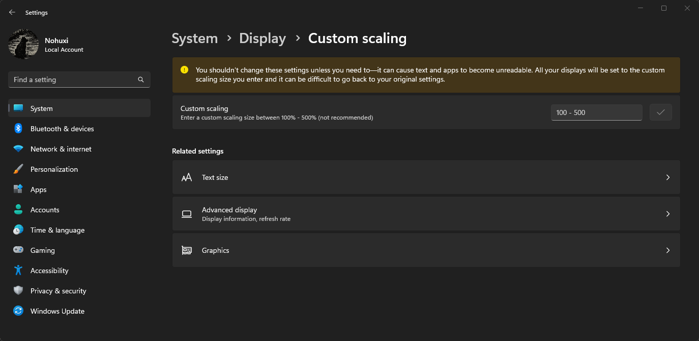

# Display Scaling

Changes the size of text, apps, and other items. Note that on laptops the default display scaling might not be `100%`. You can set a custom scaling size via `System > Display > Custom scaling`:



### SystemSettings Captures

This seems to be dependend on what the default scaling, means for some `0` might be `150%`.

```c
// 100%
HKLM\System\CurrentControlSet\Control\GraphicsDrivers\ScaleFactors\<MONITORID>\DpiValue	Type: REG_DWORD, Length: 4, Data: 0
HKCU\Control Panel\Desktop\PerMonitorSettings\<MONITORID>\DpiValue	Type: REG_DWORD, Length: 4, Data: 0

// 125%
HKLM\System\CurrentControlSet\Control\GraphicsDrivers\ScaleFactors\<MONITORID>\DpiValue	Type: REG_DWORD, Length: 4, Data: 1
HKCU\Control Panel\Desktop\PerMonitorSettings\<MONITORID>\DpiValue	Type: REG_DWORD, Length: 4, Data: 1

// 150%
HKLM\System\CurrentControlSet\Control\GraphicsDrivers\ScaleFactors\<MONITORID>\DpiValue	Type: REG_DWORD, Length: 4, Data: 2
HKCU\Control Panel\Desktop\PerMonitorSettings\<MONITORID>\DpiValue	Type: REG_DWORD, Length: 4, Data: 2

// 175%
HKLM\System\CurrentControlSet\Control\GraphicsDrivers\ScaleFactors\<MONITORID>\DpiValue	Type: REG_DWORD, Length: 4, Data: 3
HKCU\Control Panel\Desktop\PerMonitorSettings\<MONITORID>\DpiValue	Type: REG_DWORD, Length: 4, Data: 3

// 200%
HKLM\System\CurrentControlSet\Control\GraphicsDrivers\ScaleFactors\<MONITORID>\DpiValue	Type: REG_DWORD, Length: 4, Data: 4
HKCU\Control Panel\Desktop\PerMonitorSettings\<MONITORID>\DpiValue	Type: REG_DWORD, Length: 4, Data: 4

// 225%
HKLM\System\CurrentControlSet\Control\GraphicsDrivers\ScaleFactors\<MONITORID>\DpiValue	Type: REG_DWORD, Length: 4, Data: 5
HKCU\Control Panel\Desktop\PerMonitorSettings\<MONITORID>\DpiValue	Type: REG_DWORD, Length: 4, Data: 5
```

## Suboptions

### Prevent Window Minimization on Monitor Disconnection

```c
// System > Display : Minimize windows when a monitor is disconnected

// Enabled
HKCU\Control Panel\Desktop\MonitorRemovalRecalcBehavior	Type: REG_DWORD, Length: 4, Data: 0

// Disabled
HKCU\Control Panel\Desktop\MonitorRemovalRecalcBehavior	Type: REG_DWORD, Length: 4, Data: 1
```

### Forget Window Locations for Connected Monitors

```c
// System > Display : Remember windows locations based on monitor connection

// Enabled
HKCU\Control Panel\Desktop\RestorePreviousStateRecalcBehavior	Type: REG_DWORD, Length: 4, Data: 0

// Disabled
HKCU\Control Panel\Desktop\RestorePreviousStateRecalcBehavior	Type: REG_DWORD, Length: 4, Data: 1
```

