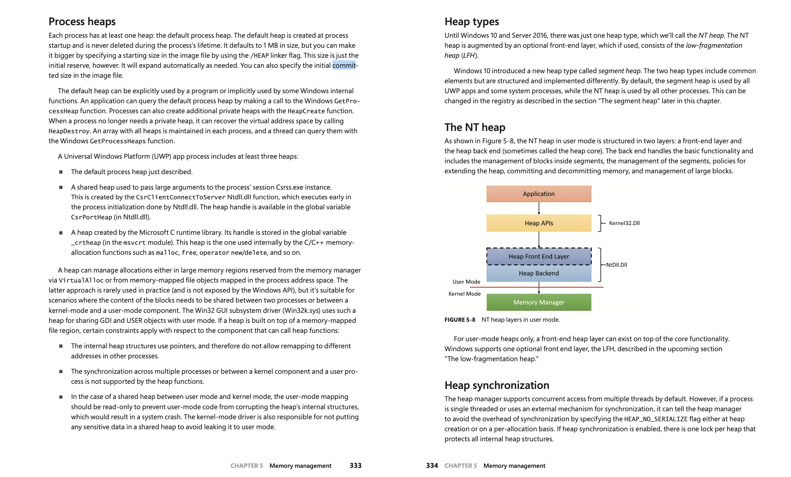
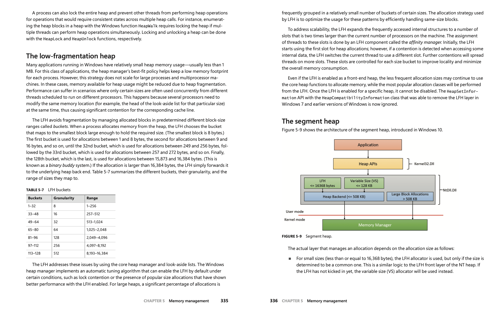
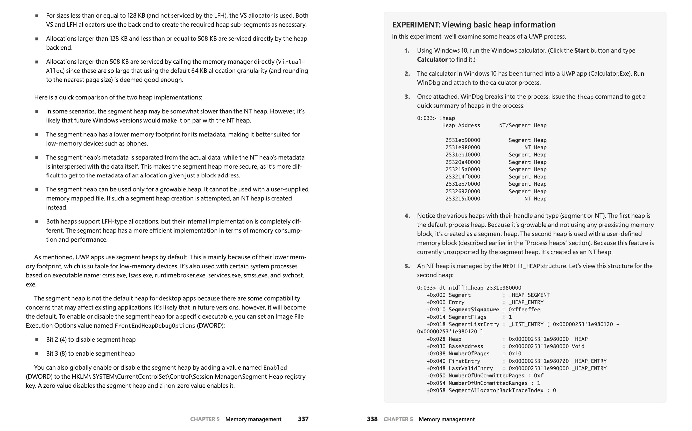
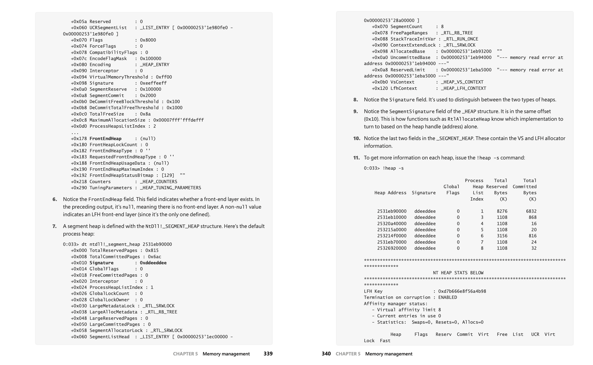
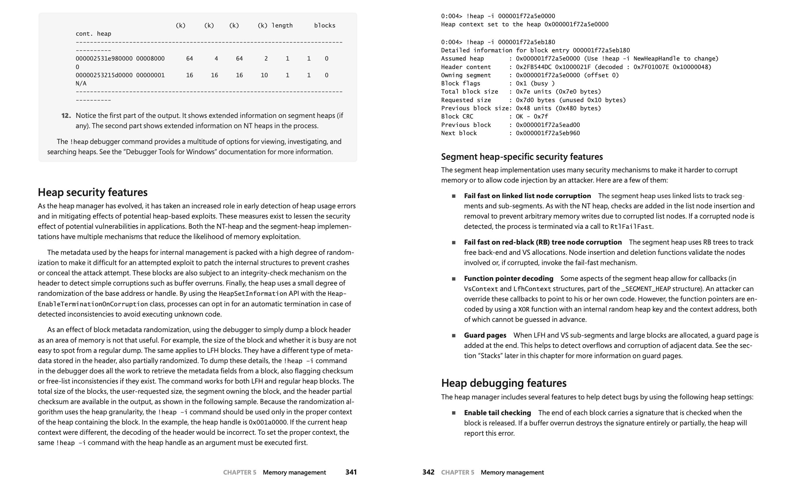

# Heap Type

> *A heap is a memory management structure inside a process thats used for dynamic allocation. When code requests memory through APIs such as [`HeapAlloc()`](https://learn.microsoft.com/en-us/windows/win32/api/heapapi/nf-heapapi-heapalloc) / [`RtlAllocateHeap()`](https://learn.microsoft.com/en-us/windows-hardware/drivers/ddi/ntifs/nf-ntifs-rtlallocateheap), the heap manager finds or creates a block inside the process address space and returns a pointer to it. When the code calls [`HeapFree()`](https://learn.microsoft.com/en-us/windows/win32/api/heapapi/nf-heapapi-heapfree) / [`RtlFreeHeap()`](https://learn.microsoft.com/en-us/windows/win32/devnotes/rtlfreeheap), that block is returned to the heaps internal free space so it can be reused.*

Windows has two UM (user mode) heap implementations, the older NT heap and the newer Segment Heap. UWP/modern apps and some system processes normally use Segment Heap, while traditional desktop processes keep NT heap behavior (unless opted in via values below for example).

Most normal software in my testing (`ida.exe`, `VSCodium.exe`, `mullvadbrowser.exe`, `Procmon.exe`, `powershell.exe`, `ripgrep.exe`, `steam.exe`) used NT Heap. Segment Heap was used by Windows components/service hosts (`audiodg.exe`, `svchost.exe`, `lsass.exe`, `winlogon.exe`, `dwm.exe`, `ShellExperienceHost.exe`, `sihost.exe`, `WindowsTerminal.exe`) and some VBox processes. Note that one process can use more than one heap type.

Changing it to Segment Heap for a game won't impact FPS, rather read '[W10 Segment Heap Internals](https://www.blackhat.com/docs/us-16/materials/us-16-Yason-Windows-10-Segment-Heap-Internals-wp.pdf)' (or [Windows Internals](https://noverse.dev/docs/win-config/system/heap-type/#windows-internals)) to understand differences between NT/Segment Heap.

## heapType GUI

[`heapType.ps1`](https://github.com/nohuto/win-config/blob/main/system/assets/scripts/heapType.ps1) is a small GUI for the values (read everything below/above before using it):


## heap_dump

[`heap_dump.exe`](https://github.com/nohuto/utils/releases/download/0.1.0/heap_dump.exe) queries all running processes and lists their heaps as `NT Heap`/`NT Heap (LFH)`/`Segment Heap`. You can either use the [prebuilt binary](https://github.com/nohuto/utils/releases/download/0.1.0/heap_dump.exe), or build it yourself from [source](https://github.com/nohuto/utils/tree/main/heap_dump):

```powershell
cmake -S . -B build
cmake --build build --config Release

.\build\Release\heap_dump.exe
.\build\Release\heap_dump.exe --heaps > heaps.csv
```

It uses `RtlQueryProcessDebugInformation` for the heap list, then reads heap offsets (I've taken the same as [System Informer](https://github.com/winsiderss/systeminformer/blob/master/SystemInformer/include/heapstruct.h) uses here) uses to get `LFH`/`Lookaside` (`FrontEndHeapType`) & `NT Heap`/`Segment Heap` (`SegmentSignature`). By default it shows heap type counts, `--heaps` shows process name + PID + heap.

## Registry Values

These are easier to understand if comparing them to the [`RTL_HEAP_PARAMETERS`](https://learn.microsoft.com/en-us/windows-hardware/drivers/ddi/ntifs/ns-ntifs-rtl_heap_parameters) structure, which is why I've added quotes from it to the parts below. The mentioned fallback in that MS doc also match with the default data I've found.

The `HeapSegment*` and `HeapDeCommit*` values are NT heap defaults (heap creation starts in [`RtlCreateHeap`](https://github.com/nohuto/decompiled-pseudocode/blob/main/11-23H2/ntdll/RtlCreateHeap.c), the Segment Heap path calls [`RtlpHpHeapCreate`](https://github.com/nohuto/decompiled-pseudocode/blob/main/11-23H2/ntdll/RtlpHpHeapCreate.c) before those NT heap defaults are loaded).

```c
typedef struct _RTL_HEAP_PARAMETERS {
  ULONG                    Length;
  SIZE_T                   SegmentReserve; // 1MB fallback
  SIZE_T                   SegmentCommit; // PAGE_SIZE * 2 fallback
  SIZE_T                   DeCommitFreeBlockThreshold; // PAGE_SIZE fallback
  SIZE_T                   DeCommitTotalFreeThreshold; // 65536 fallback
  SIZE_T                   MaximumAllocationSize;
  SIZE_T                   VirtualMemoryThreshold;
  SIZE_T                   InitialCommit;
  SIZE_T                   InitialReserve;
  PRTL_HEAP_COMMIT_ROUTINE CommitRoutine;
  SIZE_T                   Reserved[2];
} RTL_HEAP_PARAMETERS, *PRTL_HEAP_PARAMETERS;
```

See '[Kernel Values](https://noverse.dev/docs/win-config/system/kernel-values/#registry-values)' for types and ranges.

```c
"HKLM\\SYSTEM\\CurrentControlSet\\Control\\Session Manager";
    "HeapSegmentReserve" = 1048576;
    "HeapSegmentCommit" = 8192;
    "HeapDeCommitFreeBlockThreshold" = 4096;
    "HeapDeCommitTotalFreeThreshold" = 65536;

"HKLM\\SYSTEM\\CurrentControlSet\\Control\\Session Manager\\Segment Heap";
    "Enabled";

"HKLM\\SOFTWARE\\Microsoft\\Windows NT\\CurrentVersion\\Image File Execution Options\\<executable>";
    "FrontEndHeapDebugOptions" = 0; // REG_DWORD, see bitfield below
    "DisableHeapLookaside" = 0; // REG_DWORD (bitfield), looks like a legacy value used to prevent ActivateLowFragmentationHeap (LFH) if 1
    "GCInterval"; // REG_DWORD, range 0-4294967295 seconds, only used if FrontEndHeapDebugOptions bit 22 is set
```

Enabling Segment Heap globally [sets the `ntdll` process flag](https://github.com/nohuto/decompiled-pseudocode/blob/main/11-23H2/ntdll/RtlpHpApplySegmentHeapConfigurations.c) before the per process opt in part runs, this can impact traditional desktop processes that weren't intended to use Segment Heap and may cause compatibility errors (it's not recommended to enable it globally).

### HeapSegmentReserve

> "*Segment reserve size, in bytes. If this value is not specified, 1 MB is used.*"
>
> — Microsoft, [RTL_HEAP_PARAMETERS](https://learn.microsoft.com/en-us/windows-hardware/drivers/ddi/ntifs/ns-ntifs-rtl_heap_parameters)

Preferred reserve size for a new NT heap segment, the heap compares it with allocation size + `8192`, uses the larger value, then rounds/caps.

`1 MB` = `1048576` bytes (`1024 * 1024`).

```c
// RtlpExtendHeap
v8 = a2 + 0x2000; // minimum reserve
if ( v8 <= *(_QWORD *)(a1 + 160) )
  v8 = *(_QWORD *)(a1 + 160); // use HeapSegmentReserve if it's larger
v9 = (v8 + 0xFFFF) & 0xFFFFFFFFFFFF0000uLL; // round up to 65536
if ( v9 >= 0xFD0000 )
  v9 = 16580608LL; // cap
```

### HeapSegmentCommit

> "*Segment commit size, in bytes. If this value is not specified, PAGE_SIZE * 2 is used.*"
>
> — Microsoft, [RTL_HEAP_PARAMETERS](https://learn.microsoft.com/en-us/windows-hardware/drivers/ddi/ntifs/ns-ntifs-rtl_heap_parameters)

[`PAGE_SIZE` = `4096`](https://github.com/nohuto/decompiled-pseudocode/blob/main/11-23H2/ntdll/RtlpExtendHeap.c) bytes, so `PAGE_SIZE * 2` = `8192`.

```c
// RtlpExtendHeap
v11 = a2 + 4096; // minimum commit
if ( v11 <= *(_QWORD *)(a1 + 168) )
  v11 = *(_QWORD *)(a1 + 168); // use HeapSegmentCommit if it is larger
v16[0] = (v11 + 4095) & 0xFFFFFFFFFFFFF000uLL; // round up to 4096
RtlpHpHeapCheckCommitLimit(v16[0], v12, a1, (unsigned __int64 *)(a1 + 376));
ZwAllocateVirtualMemory((HANDLE)0xFFFFFFFFFFFFFFFFLL, &BaseAddress, 0LL, v16, 0x1000u, 4u);
```

### HeapDeCommitFreeBlockThreshold

> "*Decommit free block threshold, in bytes. If this value is not specified, PAGE_SIZE is used.*"
>
> — Microsoft, [RTL_HEAP_PARAMETERS](https://learn.microsoft.com/en-us/windows-hardware/drivers/ddi/ntifs/ns-ntifs-rtl_heap_parameters)

```c
// RtlCreateHeap
*((_QWORD *)v43 + 22) = v56 >> 4; // store in 16 byte steps
```

### HeapDeCommitTotalFreeThreshold

> "*Decommit total free threshold, in bytes. If this value is not specified, 65536 is used.*"
>
> — Microsoft, [RTL_HEAP_PARAMETERS](https://learn.microsoft.com/en-us/windows-hardware/drivers/ddi/ntifs/ns-ntifs-rtl_heap_parameters)

```c
// RtlCreateHeap
*((_QWORD *)v43 + 23) = *(_QWORD *)&v61[0] >> 4; // store in 16 byte steps
```

### Enabled

Global Segment Heap switch read by [`RtlpHpApplySegmentHeapConfigurations`](https://github.com/nohuto/decompiled-pseudocode/blob/main/11-23H2/ntdll/RtlpHpApplySegmentHeapConfigurations.c) during heap manager init, [`RtlInitializeHeapManager`](https://github.com/nohuto/decompiled-pseudocode/blob/main/11-23H2/ntdll/RtlInitializeHeapManager.c) uses those flags, `0x10` ([`RtlpHpOptIntoSegmentHeap`](https://github.com/nohuto/decompiled-pseudocode/blob/main/11-23H2/ntdll/RtlpHpOptIntoSegmentHeap.c)) enables Segment Heap, `8` clears it after the opt in part.

When setting that value to `0` it would "force" NT Heap, means it overrides per process `FrontEndHeapDebugOptions = 8` (segment heap) changes too.

```c
// RtlpHpApplySegmentHeapConfigurations
result = NtQueryValueKey();
if ( result >= 0 && v1 == 4 ) // data length
{
  if ( v2 )
    RtlpLowFragHeapGlobalFlags |= 0x10; // nonzero = enable
  else
    RtlpLowFragHeapGlobalFlags |= 8; // zero = disable
}
```

#### heap_dump Results

`CSRSS port` is a small Windows communication heap used for talking to CSRSS, it stays NT Heap even when the app uses Segment Heap (as [`CsrpConnectToServer`](https://github.com/nohuto/decompiled-pseudocode/blob/main/11-23H2/ntdll/CsrpConnectToServer.c) creates `HEAP_CLASS_8` on a fixed shared memory, means `HeapBase` =/ NULL).

Some requirements for Segment Heap (in [`RtlCreateHeap`](https://github.com/nohuto/decompiled-pseudocode/blob/main/11-23H2/ntdll/RtlCreateHeap.c)) also are that the heap is [`Growable` & `HeapBase` = NULL](https://learn.microsoft.com/en-us/windows-hardware/drivers/ddi/ntifs/nf-ntifs-rtlcreateheap), means that a heap would also use NT heap if this doesn't match (`HEAP_CLASS_7`/`HEAP_CLASS_8` aren't growable + don't have a `HeapBase` of NULL since they use a fixed shared memory).

```c
#define HEAP_CLASS_0 0x00000000 // Process heap
#define HEAP_CLASS_1 0x00001000 // Private heap
#define HEAP_CLASS_2 0x00002000 // Kernel heap
#define HEAP_CLASS_3 0x00003000 // GDI heap
#define HEAP_CLASS_4 0x00004000 // User heap
#define HEAP_CLASS_5 0x00005000 // Console heap
#define HEAP_CLASS_6 0x00006000 // User desktop heap
#define HEAP_CLASS_7 0x00007000 // CSR shared heap
#define HEAP_CLASS_8 0x00008000 // CSR port heap
```

- [processhacker.sourceforge.io/doc/ntrtl_8h_source](https://processhacker.sourceforge.io/doc/ntrtl_8h_source.html)

Use [heap_dump](https://noverse.dev/docs/win-config/system/heap-type/#heap_dump) to test it with your running processes. If the `Enabled` value is set *kind* of all types (process/private) went to Segement Heap, example:

```c
// Enabled = not present
"mullvadbrowser.exe",9616,1,0x000002184C9F0000,"NT Heap (LFH)","Process","Growable",0x2,1684,499712
"mullvadbrowser.exe",9616,2,0x000002184C9D0000,"NT Heap (LFH)","Process","Growable",0x2,22,36864
"mullvadbrowser.exe",9616,3,0x000002184C7D0000,"NT Heap","CSRSS port","-",0x0,3,4096
"mullvadbrowser.exe",9616,4,0x000002184C9C0000,"NT Heap (LFH)","Private","Growable",0x2,767,618496
"mullvadbrowser.exe",9968,1,0x0000020A76F40000,"NT Heap (LFH)","Process","Growable",0x2,28427,13340672
"mullvadbrowser.exe",9968,2,0x0000020A76DF0000,"NT Heap","CSRSS port","-",0x0,3,4096
"mullvadbrowser.exe",9968,3,0x0000020A77290000,"NT Heap (LFH)","Private","Growable",0x2,919,516096
"mullvadbrowser.exe",9968,4,0x0000020A00000000,"NT Heap","Private","Growable",0x2,12,8192
"mullvadbrowser.exe",9968,5,0x0000020A006D0000,"NT Heap","Process","Growable",0x2,3,8192
"mullvadbrowser.exe",9968,6,0x0000020A46690000,"NT Heap","Process","NoSerialize",0x1,7,16384

// Enabled = 1
"mullvadbrowser.exe",4436,1,0x00000215201A0000,"Segment Heap","Process","-",0x0,1630,536576
"mullvadbrowser.exe",4436,2,0x00000215201D0000,"Segment Heap","Process","-",0x0,5,16384
"mullvadbrowser.exe",4436,3,0x00000215200C0000,"NT Heap","CSRSS port","-",0x0,3,4096
"mullvadbrowser.exe",4436,4,0x0000021520550000,"Segment Heap","Private","-",0x0,310,262144
"mullvadbrowser.exe",8352,1,0x00000180998D0000,"Segment Heap","Process","-",0x0,14577,4730880
"mullvadbrowser.exe",8352,2,0x0000018099800000,"NT Heap","CSRSS port","-",0x0,3,4096
"mullvadbrowser.exe",8352,3,0x0000018099C50000,"Segment Heap","Private","-",0x0,43,45056
"mullvadbrowser.exe",8352,4,0x0000018099CC0000,"Segment Heap","Private","-",0x0,12,16384
"mullvadbrowser.exe",8352,5,0x000001809A710000,"Segment Heap","Process","-",0x0,3,16384
```

### FrontEndHeapDebugOptions

IFEO bitfield for one executable, bits `2`/`3` are the "meaningful" ones here which enable/disable Segement Heap (if both bits are set it would end in disable). I didn't search for actual behaviours for the flags beside them, therefore the "meaning" for the other ones is more likely only to show that they exist (for now).

```c
// LdrpInitializeExecutionOptions
RtlQueryApplicationKeyOption(v11, v9, (__int64)L"FrontEndHeapDebugOptions", 4u, (__int64)&v47, 4, v33, 0LL);
v10 = v47;

// RtlSetLowFragHeapGlobalFlags
RtlSetLowFragHeapGlobalFlags(v10, *(_DWORD *)(*(_QWORD *)(a2 + 32) + 8LL));
```

Some notes:
- enabling bit `4` enables heap stack tracing which allocates via [`RtlpHpStackDbAllocRoutine`](https://github.com/nohuto/decompiled-pseudocode/blob/main/11-23H2/ntdll/RtlpHpStackDbAllocRoutine.c), [`RtlpHpMetadataAlloc`](https://github.com/nohuto/decompiled-pseudocode/blob/main/11-23H2/ntdll/RtlpHpMetadataAlloc.c), [`RtlpHpMetadataHeapStart`](https://github.com/nohuto/decompiled-pseudocode/blob/main/11-23H2/ntdll/RtlpHpMetadataHeapStart.c), [`RtlpHpMetadataHeapCreate`](https://github.com/nohuto/decompiled-pseudocode/blob/main/11-23H2/ntdll/RtlpHpMetadataHeapCreate.c), [`RtlpHpHeapCreate`](https://github.com/nohuto/decompiled-pseudocode/blob/main/11-23H2/ntdll/RtlpHpHeapCreate.c)
  - [`RtlpHpHeapCreate`](https://github.com/nohuto/decompiled-pseudocode/blob/main/11-23H2/ntdll/RtlpHpHeapCreate.c) causes an extra segment heap here
- enabling bit `4` & `6` together causes a heap query error


| Bit | Meaning |
| --- | --- |
| `0` | LFH global flag `4` |
| `1` | LFH global flag `2` |
| `2` | disable Segment Heap (flag `8`) |
| `3` | enable Segment Heap (flag `16`) |
| `4` | enables heap stack trace ([`RtlpHpStackTraceEnable`](https://github.com/nohuto/decompiled-pseudocode/blob/main/11-23H2/ntdll/RtlpHpStackTraceEnable.c)) |
| `5` | `RtlpHpHeapFeatures \|= 4u`? |
| `6` | `RtlpHpAppCompatFlags \|= 11`? |
| `7` | `RtlpHpHeapFeatures \|= 8u`? |
| `8-15` | `RtlpHpLfhContentionLimit = BYTE1(a1)`? |
| `16-27` | `RtlpHpLfhPerfFlags = HIWORD(a1) & 4095`? |
| `22` | enables the `GCInterval` override |

## Validating Changes

You can see wether a program uses 'Segment Heap' or 'NT Heap' via for example [SI](https://github.com/winsiderss/systeminformer/) (Right Click > Miscellaneous > Heaps), it gets the heap list from `RtlQueryProcessDebugInformation`.

`HKLM\SOFTWARE\Microsoft\Windows NT\CurrentVersion\Image File Execution Options\mullvadbrowser.exe`, `FrontEndHeapDebugOptions` = `4`:


`HKLM\SOFTWARE\Microsoft\Windows NT\CurrentVersion\Image File Execution Options\mullvadbrowser.exe`, `FrontEndHeapDebugOptions` = `8`:


## [Windows Internals](https://github.com/nohuto/Windows-Books/releases/download/7th-Edition/Windows-Internals-E7-P1.pdf)







## Desktop Heap Logging

> "*It is meant to log information about desktop heap usage. This can be helpful when diagnosing issues where system resources for desktop objects might be strained.*"
>
> — Microsoft Community, [Question about some DWM registry settings](https://answers.microsoft.com/en-us/windows/forum/all/question-about-some-dwm-registry-settings/341cac5c-d85a-43e5-89d3-d9734f84da4e) (this isn't a verified answer, therefore can't be trusted)

```c
__int64 IsDesktopHeapLoggingOn(void)
{
  int v1 = 0; // default state
  int v4 = *(_DWORD *)(W32GetUserSessionState() + 62792);

  if ( v4 )
    v1 = 0; // fallback to the default when registry access fails
  return v1 != 0;
}
```

`DesktopHeapLogging` seems to have a fallback of `0`, but the value exists by default and is set to `1`. Means deleting it/setting it to `0` should do the same.

- [decompiled-pseudocode | IsDesktopHeapLoggingOn.c](https://github.com/nohuto/decompiled-pseudocode/blob/main/11-23H2/win32kbase/-IsDesktopHeapLoggingOn@@YAHXZ.c)

