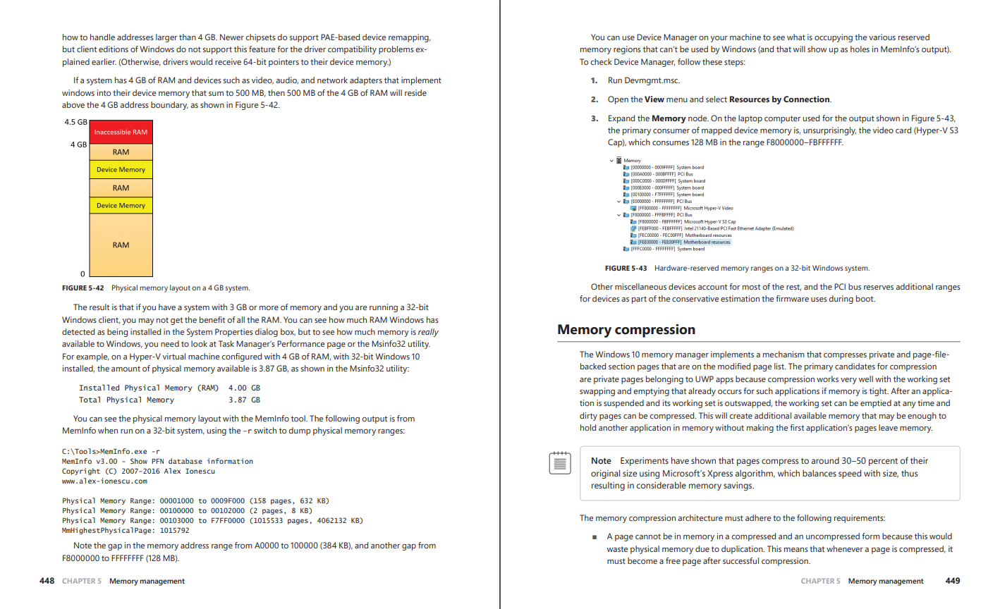
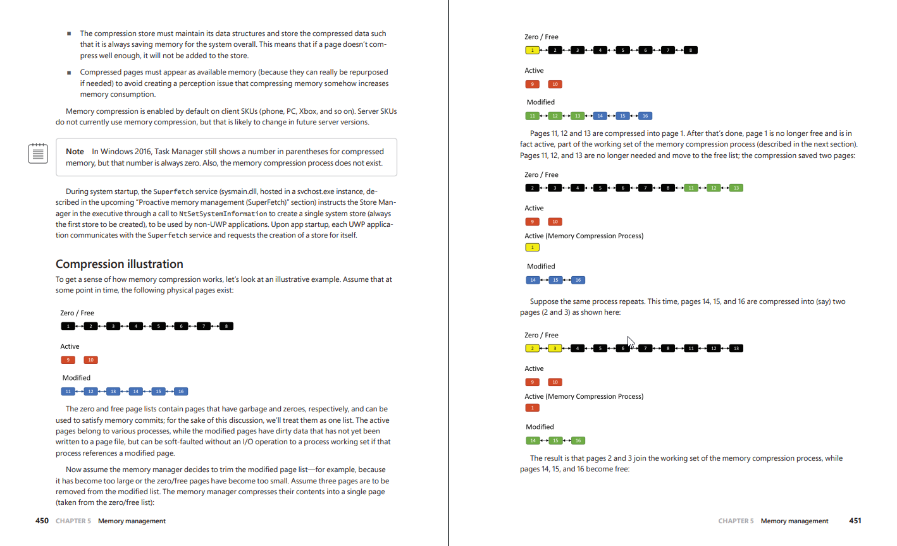
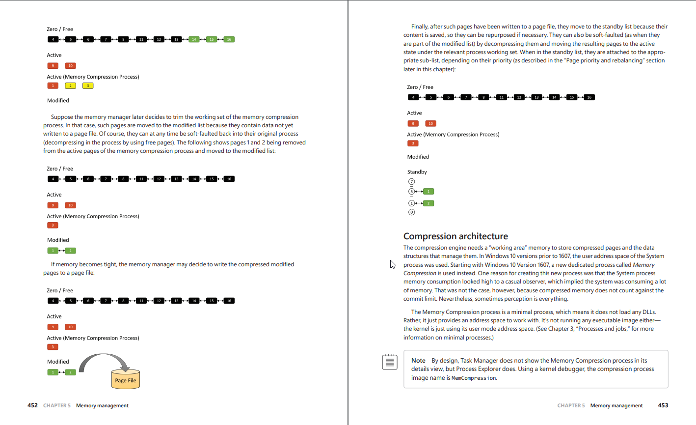

# Memory Compression

Memory compression stores infrequently accessed, private memory pages in compressed form so they occupy less physical memory, causing Windows to keep more data in RAM and reduce pagefile I/O. Whenever a process references a compressed page again, it gets decompressed which is normally faster than reading it from storage, although compression and decompression consume CPU time. 

Disable it whenever you want to avoid the `SysMain` (`Disable (SysMain Off)` suboption which causes other MMAgent features to not work too) background activity, or when your system has enough RAM (which you never completely use) as compression will unlikely happen then anyway as shown below. See '[Services/Drivers, SysMain](https://noverse.dev/docs/win-config/system/disable-services-drivers/#sysmain)' before using that suboption as it handles other features too, which are beneficial on slow disks.

Compressed pages are stored in a dedicated "Memory Compression" (`MemCompression`) process managed by the Store Manager. Note that `SysMain` includes config functions used by `MMAgent`, while the actual compression work is done by the kernel Store Manager, means for the MMAgent state to apply and report correctly, `SysMain` must be allowed to run (if not, `MemCompression` won't be created).

On systems with enough free memory, it may stay **almost** unused even when it's enabled, as it becomes more relevant when active/cold private pages would otherwise have to be paged out. Means its just a processes which consumes no resources, and has inactive threads:


See '[Thread Activity](https://noverse.dev/docs/windbg-notes/threads/examining-thread-activity/thread-activity/)' whenever you want to read a bit more about the column meanings.

### MMAgent Cmdlet

`Enable-MMAgent -MemoryCompression` calls the `PS_MMAgent` CIM provider in `sysmain.dll`, which goes to `MmaConfigure`, sets the memory compression admin bit in the Superfetch key, may set `SysMain` to automatic start and (re)starts `SysMain` so the component state can be applied.

```c
"HKLM\\SOFTWARE\\Microsoft\\Windows NT\\CurrentVersion\\Superfetch"
    AdminEnable & 0x200 // MemoryCompression requested enabled
    AdminDisable & 0x200 // MemoryCompression requested disabled
    StartedComponents & 0x200 // MemoryCompression started by SysMain
```

`0x200` = bit `9`, you can use my [bitmask calculator](https://noverse.dev/terminal#bitmask) to see whenever that bit is set in your current `StartedComponents` data, example:


See the current memory compression state via [MMAgent](https://learn.microsoft.com/en-us/powershell/module/mmagent/get-mmagent?view=windowsserver2025-ps):

```powershell
Get-MMAgent

ApplicationLaunchPrefetching : True
ApplicationPreLaunch         : True
MaxOperationAPIFiles         : 512
MemoryCompression            : True # Enabled
OperationAPI                 : True
PageCombining                : True
PSComputerName               :
```

### WinDbg

If memory compression was applied by `SysMain`, the process should exist:

```c
lkd> !process 0 0 MemCompression
PROCESS ffff9c06c430e040
    SessionId: none  Cid: 0654    Peb: 00000000  ParentCid: 0004
    DirBase: 121450000  ObjectTable: ffffb20888e79c00  HandleCount:   0.
    Image: MemCompression
```

On a 32GB RAM system without memory pressure, the process may exist but stay almost unused (different address as not executed in same session):

```c
lkd> !process ffff9c06c430e040 1
PROCESS ffff9c06c430e040
    SessionId: none  Cid: 0654    Peb: 00000000  ParentCid: 0004
    DirBase: 121450000  ObjectTable: ffffb20888e79c00  HandleCount:   0.
    Image: MemCompression
    VadRoot 0000000000000000 Vads 0 Clone 0 Private 5. Modified 0. Locked 0.
    DeviceMap 0000000000000000
    Token                             ffffb20888dd8040
    ElapsedTime                       00:39:09.121
    UserTime                          00:00:00.000
    KernelTime                        00:00:00.000
    QuotaPoolUsage[PagedPool]         4224
    QuotaPoolUsage[NonPagedPool]      0
    Working Set Sizes (now,min,max)  (5, 50, 345) (20KB, 200KB, 1380KB)
    PeakWorkingSetSize                0
    VirtualSize                       0 Mb
    PeakVirtualSize                   0 Mb
    PageFaultCount                    5
    MemoryPriority                    BACKGROUND
    BasePriority                      8
    CommitCharge                      10
```

After compression happened, the same process has actual private memory and a larger working set:

```c
lkd> !process ffffb4865f1cf040 1
PROCESS ffffb4865f1cf040
    SessionId: none  Cid: 06c0    Peb: 00000000  ParentCid: 0004
    DirBase: 1290ad000  ObjectTable: ffffe781db853b40  HandleCount:   0.
    Image: MemCompression
    VadRoot ffffb48667f8b020 Vads 2351 Clone 0 Private 75392. Modified 0. Locked 0.
    DeviceMap 0000000000000000
    Token                             ffffe781db893040
    ElapsedTime                       00:36:02.082
    UserTime                          00:00:00.000
    KernelTime                        00:00:00.078
    QuotaPoolUsage[PagedPool]         4224
    QuotaPoolUsage[NonPagedPool]      0
    Working Set Sizes (now,min,max)  (75392, 50, 345) (301568KB, 200KB, 1380KB)
    PeakWorkingSetSize                75459
    VirtualSize                       293 Mb
    PeakVirtualSize                   294 Mb
    PageFaultCount                    75680
    MemoryPriority                    BACKGROUND
    BasePriority                      8
    CommitCharge                      164
```

`75392` pages * `4096` bytes = `308,805,632` bytes, means the current size is about `294.5 MiB`.

The threads show whether the compression process is idle or doing work:

```c
lkd> !process ffff9c06c430e040 4
PROCESS ffff9c06c430e040
    SessionId: none  Cid: 0654    Peb: 00000000  ParentCid: 0004
    DirBase: 121450000  ObjectTable: ffffb20888e79c00  HandleCount:   0.
    Image: MemCompression

        THREAD ffff9c06c4327080  Cid 0654.0658  Teb: 0000000000000000 Win32Thread: 0000000000000000 WAIT
        THREAD ffff9c06c4326080  Cid 0654.065c  Teb: 0000000000000000 Win32Thread: 0000000000000000 WAIT
        THREAD ffff9c06c4321080  Cid 0654.0670  Teb: 0000000000000000 Win32Thread: 0000000000000000 WAIT
        THREAD ffff9c06c4320080  Cid 0654.0674  Teb: 0000000000000000 Win32Thread: 0000000000000000 WAIT
        THREAD ffff9c06c431e080  Cid 0654.067c  Teb: 0000000000000000 Win32Thread: 0000000000000000 WAIT
        THREAD ffff9c06c431d080  Cid 0654.0680  Teb: 0000000000000000 Win32Thread: 0000000000000000 WAIT
        THREAD ffff9c06c6e8e080  Cid 0654.11e4  Teb: 0000000000000000 Win32Thread: 0000000000000000 WAIT
        THREAD ffff9c06c708b0c0  Cid 0654.1008  Teb: 0000000000000000 Win32Thread: 0000000000000000 WAIT
        THREAD ffff9c06c495e080  Cid 0654.1e30  Teb: 0000000000000000 Win32Thread: 0000000000000000 WAIT
        THREAD ffff9c06c72cb080  Cid 0654.0758  Teb: 0000000000000000 Win32Thread: 0000000000000000 WAIT
```

A thread can also show the SM (store manager) routine it is waiting in:

```c
lkd> !thread ffff9c06c4327080
THREAD ffff9c06c4327080  Cid 0654.0658  Teb: 0000000000000000 Win32Thread: 0000000000000000 WAIT: (WrKernel) KernelMode Non-Alertable
    ffff9c06baff4530  NotificationEvent
Owning Process            ffff9c06c430e040       Image:         MemCompression
Wait Start TickCount      238            Ticks: 10642 (0:00:02:46.281)
UserTime                  00:00:00.000
KernelTime                00:00:00.000
Win32 Start Address nt!SMKM_STORE_MGR<SM_TRAITS>::SmCompressCtxBalancerThread (0xfffff8031b3b5460)
Priority 25  BasePriority 25  Priority Floor 25  IoPriority 2  PagePriority 5
```

## [Windows Internals](https://github.com/nohuto/Windows-Books/releases/download/7th-Edition/Windows-Internals-E7-P1.pdf)





