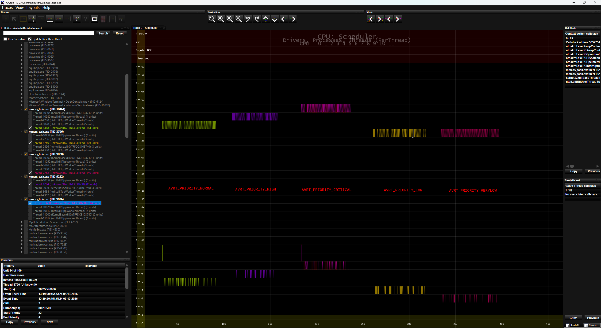

# MMCSS Values

Everything below is based on the 11-23H2 mmcss driver pseudocode (see [diff](https://noverse.dev/diff?kind=pseudocode&left=11-23H2&right=11-25H2&module=mmcss&name=CiConfigInitialize.c&mode=side-by-side) if you want to see changes on newer builds)/ WPR ([`Microsoft-Windows-MMCSS` provider](https://noverse.dev/docs/win-config/system/mmcss-values/#microsoft-windows-mmcss)). 

See [mmcss-functions.txt](https://github.com/nohuto/win-config/blob/main/system/assets/reference/mmcss-functions.txt) for a list of all named functions within the MMCSS driver. I guess `Cs` = 'Class Scheduler'? The `i` at the end in such prefixes stands for 'Internal'.

> "*The Multimedia Class Scheduler service (MMCSS) enables multimedia applications to ensure that their time-sensitive processing receives prioritized access to CPU resources. This service enables multimedia applications to utilize as much of the CPU as possible without denying CPU resources to lower-priority applications.*"
>
> — Microsoft, [Multimedia Class Scheduler Service](https://learn.microsoft.com/en-us/windows/win32/procthread/multimedia-class-scheduler-service)

The MMCSS scheduler thread is set to priority `27`, as it must preempt Pro Audio threads so it can lower them to the exhausted category when their guaranteed period is over.

```c
// CiSchedulerThreadFunction
CurrentThread = KeGetCurrentThread();
CiThreadsMovedUp = 1;
CiSchedulerThread = CurrentThread;
CiSchedulerInLazyMode = 0;
KeSetActualBasePriorityThread(CurrentThread, 27LL); // scheduler thread priority
```


You can practically also see the priority of `CiSchedulerThread` using WinDbg:

```c
lkd> dq mmcss!CiSchedulerThread L1
fffff800`3aee8298  ffffe409`67145040

lkd> !thread ffffe409`67145040
THREAD ffffe40967145040  Cid 0004.0a2c  Teb: 0000000000000000 Win32Thread: 0000000000000000 WAIT: (Executive) KernelMode Alertable
    ffffe409634683b0  Timer2SynchronizationObject
Not impersonating
DeviceMap                 ffff840575e1a610
Owning Process            ffffe4095d502080       Image:         System
Attached Process          N/A            Image:         N/A
Wait Start TickCount      224914         Ticks: 28 (0:00:00:00.437)
Context Switch Count      376449         IdealProcessor: 2             
UserTime                  00:00:00.000
KernelTime                00:00:00.000
Win32 Start Address 0xfffff8003aee2e60
Stack Init fffffa80b5f7fc30 Current fffffa80b5f7f350
Base fffffa80b5f80000 Limit fffffa80b5f79000 Call 0000000000000000
Priority 27  BasePriority 27  Priority Floor 27  IoPriority 2  PagePriority 5
```

## Registry Values

All values below are read via [`CiConfigReadDWORD`](https://github.com/nohuto/decompiled-pseudocode/blob/main/11-23H2/mmcss/CiConfigReadDWORD.c), means the accepted type is `REG_DWORD`.  The values shown below are fallbacks used when the value is missing/not in range/not a `REG_DWORD` (`SystemResponsiveness` = `20`, `NetworkThrottlingIndex` = `10` exist on a new installation, so beside these the data listed below is used).

```c
"HKLM\\SOFTWARE\\Microsoft\\Windows NT\\CurrentVersion\\Multimedia\\SystemProfile";
    "SystemResponsiveness" = 100; // clamped to 10-100, 100 disables MMCSS, <10 or >100 = 20
    "NetworkThrottlingIndex" = 10; // 0 = 1, 1-70 stay, 71-0xFFFFFFFE = 70, 0xFFFFFFFF disables MMCSS's override (NDIS_INDICATE_ALL_NBLS)
    "NoLazyMode" = 0; // bool
    "IdleDetectionCycles" = 2; // range 1-31
    "LazyModeTimeout" = 1000000; // 0 replaced with 1000000, no upper clamp?
    "SchedulerTimerResolution" = 10000; // values above 10000 capped to 10000
    "SchedulerPeriod" = 100000; // range 50000-1000000
    "MaxThreadsPerProcess" = 32; // range 8-128
    "MaxThreadsTotal" = 256; // range 64-65535
```

### DriverStart + RVAs

Everything below isn't needed when reloading the MMCSS module, simple way:

```c
lkd> .reload /f mmcss.sys
lkd> lm m mmcss
Browse full module list
start             end                 module name
fffff801`890e0000 fffff801`890f6000   mmcss      (pdb symbols)          C:\ProgramData\Dbg\sym\mmcss.pdb\9E36707273FDF82AB362DBA6ACCC09671\mmcss.pdb
lkd> dd mmcss!CiSystemResponsiveness L1
fffff801`890e82f8  00000014
lkd> dd mmcss!CiNetworkThrottlingIndex L1
fffff801`890e81c0  0000000a
lkd> db mmcss!CiSchedulerDisallowLazyMode L1
fffff801`890e82d5  00                                               .
lkd> dd mmcss!CiSchedulerIdleDetectionCycles L1
fffff801`890e828c  00000002
lkd> dd mmcss!CiSchedulerLazyModeTimeout L1
fffff801`890e81c4  000f4240
lkd> dd mmcss!CiSchedulerTimerResolution L1
fffff801`890e81c8  00002710
lkd> dd mmcss!CiSchedulerPeriod L1
fffff801`890e81cc  000186a0
lkd> dd mmcss!CiMaxThreadsTotal L1
fffff801`890e8090  00000100
lkd> dd mmcss!CiMaxThreadsPerProcess L1
fffff801`890e8094  00000020
```

A different way to read current values is via RVAs (*Relative Virtual Address*, means an address relative to the modules image base), to do so get the `DriverStart` address + the RVA of whatever you want to read.

```c
lkd> !drvobj MMCSS
Driver object (ffffb68b3754ba70) is for:
 \Driver\MMCSS

Driver Extension List: (id , addr)

Device Object list:
ffffb68b375dfca0  
lkd> dt nt!_DRIVER_OBJECT ffffb68b3754ba70 DriverStart
   +0x018 DriverStart : 0xfffff801`890e0000 Void

// or just via lm

lkd> lm m mmcss
Browse full module list
start             end                 module name
fffff801`890e0000 fffff801`890f6000   mmcss      (pdb symbols)          C:\ProgramData\Dbg\sym\mmcss.pdb\9E36707273FDF82AB362DBA6ACCC09671\mmcss.pdb
```

So for example you want to read the current value of `CiSystemResponsiveness` (IDA):

```asm
.data:00000001C00082F8 CiSystemResponsiveness dd 0
```

Get the current image base from `Edit > Segments > Rebase program` (`0x1C0000000` for me), and subtract it from the address above, means `0x1C00082F8 - 0x1C0000000 = 0x82F8` which is the RVA for `CiSystemResponsiveness`.

Then use the `DriverStart` address + RVA:

```c
lkd> dd 0xfffff801`890e82F8 L1
```

## NetworkThrottlingIndex

`NetworkThrottlingIndex` = maximum number of received [`NET_BUFFER_LIST`](https://learn.microsoft.com/en-us/windows-hardware/drivers/ddi/nbl/ns-nbl-net_buffer_list) structures (NBLs) that MMCSS can ask NDIS to allow a miniport to indicate in one receive DPC (runs after network interrupt), to reduce the processing time it spends at `DISPATCH_LEVEL`. Note that DPCs run at `DISPATCH_LEVEL` (higher than threads, means long DPCs harm performance, by blocking threads, see [interrupt-request-levels](https://noverse.dev/docs/windbg-notes/system-mechanisms/trap-dispatching/interrupt-request-levels/)).


Miniport drivers use [`NdisMIndicateReceiveNetBufferLists`](https://github.com/nohuto/decompiled-pseudocode/blob/main/11-23H2/ndis/NdisMIndicateReceiveNetBufferLists.c) to indicate received network data, its [`NetBufferList` argument](https://learn.microsoft.com/en-us/windows-hardware/drivers/ddi/ndis/nf-ndis-ndismindicatereceivenetbufferlists) points to a linked list of NBLs, and `NumberOfNetBufferLists` gives the number of NBLs in that list. Each [NBL contains a linked list of `NET_BUFFER` structures](https://learn.microsoft.com/en-us/windows-hardware/drivers/network/net-buffer-list-structure) & each [`NET_BUFFER`](https://learn.microsoft.com/en-us/windows-hardware/drivers/ddi/nbl/ns-nbl-net_buffer) represents one network packet, with its data stored in buffers.

```c
union _SLIST_HEADER// Size=0x10 (Id=223)
{
    unsigned long long Alignment;// Offset=0x0 Size=0x8
    unsigned long long Region;// Offset=0x8 Size=0x8
    struct <unnamed-type-HeaderX64>// Size=0x10 (Id=13423)
    {
        unsigned long long Depth:16;// Offset=0x0 Size=0x8 BitOffset=0x0 BitSize=0x10
        unsigned long long Sequence:48;// Offset=0x0 Size=0x8 BitOffset=0x10 BitSize=0x30
        unsigned long long Reserved:4;// Offset=0x8 Size=0x8 BitOffset=0x0 BitSize=0x4
        unsigned long long NextEntry:60;// Offset=0x8 Size=0x8 BitOffset=0x4 BitSize=0x3c
    };
    struct _SLIST_HEADER::<unnamed-type-HeaderX64> HeaderX64;// Offset=0x0 Size=0x10
};

struct _NET_BUFFER_LIST_DATA// Size=0x10 (Id=964)
{
    struct _NET_BUFFER_LIST * Next;// Offset=0x0 Size=0x8
    struct _NET_BUFFER * FirstNetBuffer;// Offset=0x8 Size=0x8
};

union _NET_BUFFER_LIST_HEADER// Size=0x10 (Id=933)
{
    struct _NET_BUFFER_LIST_DATA NetBufferListData;// Offset=0x0 Size=0x10, a NET_BUFFER_LIST_DATA structure
    union _SLIST_HEADER Link;// Offset=0x0 Size=0x10, reserved for NDIS
};

struct _NET_BUFFER_LIST// Size=0x180 (Id=164)
{
    union // Size=0x10 (Id=0)
    {
        struct _NET_BUFFER_LIST * Next;// Offset=0x0 Size=0x8, the next NET_BUFFER_LIST structure in the chain
        struct _NET_BUFFER * FirstNetBuffer;// Offset=0x8 Size=0x8, the first NET_BUFFER on this NET_BUFFER_LIST
        union _SLIST_HEADER Link;// Offset=0x0 Size=0x10, reserved for NDIS
        union _NET_BUFFER_LIST_HEADER NetBufferListHeader;// Offset=0x0 Size=0x10, a NET_BUFFER_LIST_HEADER structure
    };
    struct _NET_BUFFER_LIST_CONTEXT * Context;// Offset=0x10 Size=0x8
    struct _NET_BUFFER_LIST * ParentNetBufferList;// Offset=0x18 Size=0x8
    void * NdisPoolHandle;// Offset=0x20 Size=0x8
    void * NdisReserved[2];// Offset=0x30 Size=0x10
    void * ProtocolReserved[4];// Offset=0x40 Size=0x20
    void * MiniportReserved[2];// Offset=0x60 Size=0x10
    void * Scratch;// Offset=0x70 Size=0x8
    void * SourceHandle;// Offset=0x78 Size=0x8
    unsigned long NblFlags;// Offset=0x80 Size=0x4
    long ChildRefCount;// Offset=0x84 Size=0x4
    unsigned long Flags;// Offset=0x88 Size=0x4
    union // Size=0x4 (Id=0)
    {
        int Status;// Offset=0x8c Size=0x4
        unsigned long NdisReserved2;// Offset=0x8c Size=0x4
    };
    void * NetBufferListInfo[29];// Offset=0x90 Size=0xe8
};
```

See [diff](https://noverse.dev/diff?kind=type&left=11-23H2&right=11-24H2&module=ndis&name=_NET_BUFFER_LIST&mode=side-by-side) whenever you want to compare the type layout with different NDIS build versions, or to look at other layouts.

### CiConfigInitialize

```c
// CiConfigInitialize
v3 = CiConfigReadDWORD(KeyHandle, 0x1C00110A0LL, 10LL);
LODWORD(WPP_MAIN_CB.Dpc.DpcData) = v3; // 1-70 & 0xFFFFFFFF stay unchanged
v4 = v3;
if ( v3 )
{
  if ( (unsigned int)(v3 - 71) <= 0xFFFFFFB7 )
  {
    v4 = 70;
    LODWORD(WPP_MAIN_CB.Dpc.DpcData) = 70; // 71-0xFFFFFFFE = 70
  }
}
else
{
  v4 = 1;
  LODWORD(WPP_MAIN_CB.Dpc.DpcData) = 1; // 0 = 1
}
```

[`CsInitialize`](https://github.com/nohuto/decompiled-pseudocode/blob/main/11-23H2/mmcss/CsInitialize.c) allocates the NDIS work item and opens `\Device\Ndis` only when the value isn't `4294967295` and `SystemResponsiveness != 100`.

### Throttle State

Only scheduled threads whose task use a `Scheduling Category` of `Medium` or `High` are included in `CiScheduledThreadCount`. [`CiThreadIncrementScheduledCount`](https://github.com/nohuto/decompiled-pseudocode/blob/main/11-23H2/mmcss/CiThreadIncrementScheduledCount.c) and [`CiThreadDecrementScheduledCount`](https://github.com/nohuto/decompiled-pseudocode/blob/main/11-23H2/mmcss/CiThreadDecrementScheduledCount.c) update this count and call [`CiNdisUpdateThrottleState`](https://github.com/nohuto/decompiled-pseudocode/blob/main/11-23H2/mmcss/CiNdisUpdateThrottleState.c) when it changes from `0` to `1`/from `1` to `0`. When the work item runs, [`CiNdisThrottle`](https://github.com/nohuto/decompiled-pseudocode/blob/main/11-23H2/mmcss/CiNdisThrottle.c) sends `NetworkThrottlingIndex` when the count is nonzero, or `4294967295` when the count is zero.

[`CiNdisThrottle`](https://github.com/nohuto/decompiled-pseudocode/blob/main/11-23H2/mmcss/CiNdisThrottle.c) sends the request to the previously opened `\Device\Ndis` handle using [`ZwDeviceIoControlFile`](https://learn.microsoft.com/en-us/windows-hardware/drivers/ddi/ntddk/nf-ntddk-zwdeviceiocontrolfile).

```c
// CiNdisThrottle

v2 = ZwDeviceIoControlFile(CiNdisDeviceHandle, 0LL, 0LL, 0LL, &IoStatusBlock, 0x170040u, InputBuffer, 0x10u, 0LL, 0);
```

Using the [`CTL_CODE`](https://learn.microsoft.com/en-us/windows-hardware/drivers/kernel/defining-i-o-control-codes) layout, `0x170040` would mean ([FILE_DEVICE_PHYSICAL_NETCARD](https://learn.microsoft.com/en-us/windows-hardware/drivers/kernel/specifying-device-types), [METHOD_BUFFERED](https://learn.microsoft.com/en-us/windows-hardware/drivers/kernel/buffer-descriptions-for-i-o-control-codes), [FILE_ANY_ACCESS](https://learn.microsoft.com/en-us/windows-hardware/drivers/kernel/defining-i-o-control-codes#guidance-for-setting-the-access-bits)):


```c
// IOCTL hex = 0x00170040
// device type = 0x17
// access = 0
// function = 16
// method = 0
// function name = CiNdisThrottle

CTL_CODE(
    FILE_DEVICE_PHYSICAL_NETCARD, // device type 0x17
    0x10, // function 0x10
    METHOD_BUFFERED, // 0
    FILE_ANY_ACCESS // 0
) // 0x170040
```

Note that the `_NDIS_SET_RECEIVE_RATE` (recreated from pseudocode) type here is only used to understand the layout as public PDBs don't include it.

```c
typedef struct _NDIS_SET_RECEIVE_RATE {
  USHORT Type; // 1
  USHORT Size; // 16
  ULONG  MaxNblsToIndicate; // maximum NBL count or 0xFFFFFFFF
  LONGLONG Period; // -1
} NDIS_SET_RECEIVE_RATE;
```

When the [IOCTL](https://learn.microsoft.com/en-us/windows-hardware/drivers/kernel/introduction-to-i-o-control-codes) succeeds, `CiNdisThrottledDown` records whether the MMCSS maximum is active.

### NDIS Request

[`ndisHandlePnPRequest`](https://github.com/nohuto/decompiled-pseudocode/blob/main/11-23H2/ndis/-ndisHandlePnPRequest@@_Y2PAGENPNP@@AJPEAU_IRP@@@Z.c) receives [IOCTL](https://learn.microsoft.com/en-us/windows-hardware/drivers/kernel/introduction-to-i-o-control-codes) `0x170040`, which requires 16 input bytes, `Type = 1`, `Size = 16`, and a nonzero `MaxNblsToIndicate` (`Period` must also be nonzero unless `MaxNblsToIndicate = 0xFFFFFFFF`). That input is then passed to [`ndisConfigurePeriodicReceives`](https://github.com/nohuto/decompiled-pseudocode/blob/main/11-23H2/ndis/-ndisConfigurePeriodicReceives@@YAXPEAU_NDIS_SET_RECEIVE_RATE@@@Z.c).

> "*`MaxNblsToIndicate`*
>
> *The maximum number of [NET_BUFFER_LIST](https://learn.microsoft.com/en-us/windows-hardware/drivers/ddi/nbl/ns-nbl-net_buffer_list) structures that a miniport driver should include in a receive indication. If this value is NDIS_INDICATE_ALL_NBLS, the miniport can indicate all of the [NET_BUFFER_LIST](https://learn.microsoft.com/en-us/windows-hardware/drivers/ddi/nbl/ns-nbl-net_buffer_list) structures that it has.*"
>
> — Microsoft, [NDIS_RECEIVE_THROTTLE_PARAMETERS structure](https://learn.microsoft.com/en-us/windows-hardware/drivers/ddi/ndis/ns-ndis-_ndis_receive_throttle_parameters)

When MMCSS sends `1-70`, NDIS stores it as the MMCSS maximum and saves `Period = -1` (NDIS headers define `4294967295` as `NDIS_INDICATE_ALL_NBLS`, means when using it, MMCSS maximum is set to `4294967295` and `Period` gets cleared).

The NDIS maximum starts at 64 NBLs as [`ndisMInitializeAdapter`](https://github.com/nohuto/decompiled-pseudocode/blob/main/11-23H2/ndis/-ndisMInitializeAdapter@@YAHPEAU_NDIS_M_DRIVER_BLOCK@@PEAU_NDIS_MINIPORT_BLOCK@@PEAU_NDIS_WRAPPE.c) basically hard codes every per processor table index to `6` (`64`), which can also be read:

```c
lkd> dq ffffb605cc5fa030+ce0 L1 // _NDIS_MINIPORT_BLOCK PeriodicReceivesNblCountIndex
ffffb605`cc5fad10  ffffcc00`eb341170
lkd> dd ffffcc00eb341170 L1
ffffcc00`eb341170  00000006 // processor 0 RST index 6 = 64 NBLs
```

```c
// ndisMInitializeAdapter

PerProcessorSlot = ndisAllocatePerProcessorSlot(0x527374u);
a2->PeriodicReceivesNblCountIndex = PerProcessorSlot;
v20 = ndisMaxNumberOfProcessors;
for ( i = 0; i < v20; *(_DWORD *)((char *)a2->PeriodicReceivesNblCountIndex + v22) = 6 )
  v22 = i++ << 12;
```

[`ndisPeriodicReceivesLearning`](https://github.com/nohuto/decompiled-pseudocode/blob/main/11-23H2/ndis/-ndisPeriodicReceivesLearning@@YAXPEAU_NDIS_MINIPORT_BLOCK@@KPEAT_LARGE_INTEGER@@@Z.c) can change the current processors RST index using for example the number of received NBLs, the RST values are stored in `ndis!ndisPeriodicReceivesNblCounts`:

```c
lkd> dd ndis!ndisPeriodicReceivesNblCounts Lb
fffff801`78dbb6d0  00000001 00000002 00000004 00000008 // 1, 2, 4, 8
fffff801`78dbb6e0  00000010 00000020 00000040 00000080 // 16, 32, 64, 128
fffff801`78dbb6f0  00000100 00000200 00000400 // 256, 512, 1024
```

[`ndisMiniportDpc`](https://github.com/nohuto/decompiled-pseudocode/blob/main/11-23H2/ndis/ndisMiniportDpc.c) passes the result to an miniport as `MaxNblsToIndicate` in [`NDIS_RECEIVE_THROTTLE_PARAMETERS`](https://learn.microsoft.com/en-us/windows-hardware/drivers/ddi/ndis/ns-ndis-_ndis_receive_throttle_parameters), an MMCSS maximum of `10` would limit the values (`4294967295` obviously doesn't):

```c
RST values: 1, 2, 4, 8, 16, 32, 64, 128, 256, 512, 1024
With max: 1, 2, 4, 8, 10, 10, 10, 10, 10, 10, 10
```

Note that this only works whenever your miniport supports NDIS [RST (receive side throttle)](https://learn.microsoft.com/en-us/windows-hardware/drivers/network/receive-side-throttle-in-ndis-6-20), if not, NDIS can't pass that structure to it (fallback uses [`ndisMIndicateReceiveNblsWithThrottling`](https://github.com/nohuto/decompiled-pseudocode/blob/main/11-23H2/ndis/-ndisMIndicateReceiveNblsWithThrottling@@YAXPEAXPEAU_NET_BUFFER_LIST@@KKK@Z.c), haven't looked into that yet)..

> "*NDIS 6.20 introduces receive-side throttle (RST) enhancements to reduce the possibility of disruptions during media playback in multimedia applications. RST support is mandatory for NDIS 6.20 and later drivers.*
>
> *If an NDIS driver spends too much time at dispatch IRQ level in a deferred procedure call (DPC), it increases the scheduling latency for multimedia application threads and might cause disruptions during media playback. To improve media playback with NDIS 6.20 and later drivers, NDIS can control the number of packets that a miniport driver indicates in a receive DPC.*"
>
> — Microsoft, [Receive Side Throttle in NDIS 6.20](https://learn.microsoft.com/en-us/windows-hardware/drivers/network/receive-side-throttle-in-ndis-6-20)

This also explains why `ndis.sys` DPC execution times can be higher with `4294967295`, as with a maximum of `10` (and RST being supported), [`ndisInterruptDpc`](https://github.com/nohuto/decompiled-pseudocode/blob/main/11-23H2/ndis/ndisInterruptDpc.c) adds the miniport callback to a per processor NDIS receive worker queue and returns. [`ndisReceiveWorkerThread`](https://github.com/nohuto/decompiled-pseudocode/blob/main/11-23H2/ndis/ndisReceiveWorkerThread.c) would then later run the callback at `DISPATCH_LEVEL` with `MaxNblsToIndicate = 10`. Using `4294967295`, would cause NDIS to remove the MMCSS maximum and may run the callback before the current `ndisInterruptDpc` returns, means the callback work is included in that DPCs measured execution time.

### WinDbg

#### 0xA (Active MMCSS Threads)

```c
lkd> dd mmcss!CiNetworkThrottlingIndex L1
fffff801`867a81c0  0000000a // 10
lkd> dd mmcss!CiScheduledThreadCount L1
fffff801`867a8100  00000005 // 5 scheduled Medium/High (Scheduling Category) threads
lkd> db mmcss!CiNdisThrottledDown L1
fffff801`867a82b0  01 // MMCSS maximum is used
lkd> db mmcss!CiNdisThrottleInProgress L1
fffff801`867a82c0  00 // no NDIS update queued
lkd> dq mmcss!CiNdisDeviceHandle L1
fffff801`867a82a8  ffffffff`80001250 // open \Device\Ndis handle
lkd> dd ndis!ndisPeriodicReceives+4 L1
fffff801`78dd5204  0000000a // current MMCSS maximum
lkd> dd ndis!ndisPeriodicReceives+c L1
fffff801`78dd520c  00000000 // use the smaller of RST value & MMCSS maximum
lkd> dq ndis!ndisPeriodicReceives+28 L1
fffff801`78dd5228  ffffffff`ffffffff // Period = -1
```

#### 0xA (No Active MMCSS Threads)

```c
lkd> dd mmcss!CiNetworkThrottlingIndex L1
fffff805`a92c81c0  0000000a // 10
lkd> dd mmcss!CiScheduledThreadCount L1
fffff805`a92c8100  00000000 // no scheduled Medium/High threads
lkd> db mmcss!CiNdisThrottledDown L1
fffff805`a92c82b0  00 // MMCSS maximum inactive
lkd> db mmcss!CiNdisThrottleInProgress L1
fffff805`a92c82c0  00 // no NDIS update queued
lkd> dq mmcss!CiNdisDeviceHandle L1
fffff805`a92c82a8  ffffffff`80001248 // open \Device\Ndis handle
lkd> dq mmcss!CiNdisThrottleWorkItem L1
fffff805`a92c82c8  ffffc60c`321481e0 // NDIS update work item allocated
lkd> dd ndis!ndisPeriodicReceives+4 L1
fffff805`7cc65204  ffffffff // no MMCSS maximum
lkd> dq ndis!ndisPeriodicReceives+28 L1
fffff805`7cc65228  00000000`00000000 // Period = 0
```

#### 0xFFFFFFFF

```c
lkd> dd mmcss!CiNetworkThrottlingIndex L1
fffff803`af4581c0  ffffffff
lkd> dd mmcss!CiScheduledThreadCount L1
fffff803`af458100  00000003 // 3 scheduled Medium/High threads
lkd> db mmcss!CiNdisThrottledDown L1
fffff803`af4582b0  00 // MMCSS maximum inactive
lkd> db mmcss!CiNdisThrottleInProgress L1
fffff803`af4582c0  00 // no NDIS update queued
lkd> dq mmcss!CiNdisDeviceHandle L1
fffff803`af4582a8  00000000`00000000 // \Device\Ndis wasn't opened
lkd> dq mmcss!CiNdisThrottleWorkItem L1
fffff803`af4582c8  00000000`00000000 // NDIS work item not allocated
lkd> dd ndis!ndisPeriodicReceives+4 L1
fffff803`855c5204  ffffffff // no MMCSS maximum
lkd> dq ndis!ndisPeriodicReceives+28 L1
fffff803`855c5228  00000000`00000000 // Period = 0
```

## SystemResponsiveness

Used to split each scheduler period (`SchedulerPeriod`) between MMCSS & ordinary system work.

For other values than 100, [`CiSchedulerInitialize`](https://github.com/nohuto/decompiled-pseudocode/blob/main/11-23H2/mmcss/CiSchedulerInitialize.c) splits `SchedulerPeriod` with `CiSystemResponsiveness`, see [`SchedulerPeriod`](https://noverse.dev/docs/win-config/system/mmcss-values/#schedulerperiod) section for more details on that. If `SystemResponsiveness == 100`, [`CiConfigInitialize`](https://github.com/nohuto/decompiled-pseudocode/blob/main/11-23H2/mmcss/CiConfigInitialize.c) returns before the rest of the values and the `Tasks` key are read, it also prevents scheduler initialization later in [`CsInitialize`](https://github.com/nohuto/decompiled-pseudocode/blob/main/11-23H2/mmcss/CsInitialize.c), means it disables MMCSS.

```c
exhausted = SchedulerPeriod * CiSystemResponsiveness / 100
boosted = SchedulerPeriod - (SchedulerPeriod * CiSystemResponsiveness / 100)
```

During the boosted duration, scheduled MMCSS threads run at their task priority & during the exhausted duration, [`CiSchedulerSetPriority`](https://github.com/nohuto/decompiled-pseudocode/blob/main/11-23H2/mmcss/CiSchedulerSetPriority.c) lowers them to their exhausted priority (`1-7`), which gives lower priority work a chance to run.

`CiSystemResponsiveness` is also used later by [`CiSchedulerWait`](https://github.com/nohuto/decompiled-pseudocode/blob/main/11-23H2/mmcss/CiSchedulerWait.c) when checking idle/starvation state, so the value affects more than just the initial boosted/exhausted split.


```c
// CiConfigInitialize
DWORD = CiConfigReadDWORD(KeyHandle, 0x1C0011090LL, 100LL); // SystemResponsiveness, fallback = 100
if ( DWORD - 10 > 0x5A )
  v2 = 20; // <10 or >100
else
  v2 = 10 * (DWORD / 0xA); // round down to multiple of 10
CiSystemResponsiveness = v2;

if ( CiSystemResponsiveness == 100 )
{
  v0 = -1073741696; // STATUS_SERVER_DISABLED
}
else
{
// values and Tasks
}
```

### Calculation

```c
CiSystemResponsiveness = 10 * (value / 10);

< 10 -> 20 // fallback since not in range
10-19 -> 10
20-29 -> 20
30-39 -> 30
40-49 -> 40
50-59 -> 50
60-69 -> 60
70-79 -> 70
80-89 -> 80
90-99 -> 90
== 100 -> 100 // STATUS_SERVER_DISABLED
> 100 -> 20 // fallback since not in range
```

## SchedulerPeriod

As the name says it's the MMCSS scheduler period where registered multimedia threads run at their category priority for a guaranteed part, then get lowered (`1-7`) so other threads can run. Means for example a larger period = fewer scheduler transitions but longer uninterrupted boosted/exhausted switches.

```c
// CiConfigInitialize
v9 = CiConfigReadDWORD(KeyHandle, 0x1C00110E0LL, 100000LL); // SchedulerPeriod, fallback = 100000
*(&WPP_MAIN_CB.ActiveThreadCount + 1) = v9;
if ( (unsigned int)(v9 - 50000) > 0xE7EF0 )
  *(&WPP_MAIN_CB.ActiveThreadCount + 1) = 100000; // range 50000-1000000
```

Used by [`CiSchedulerInitialize`](https://github.com/nohuto/decompiled-pseudocode/blob/main/11-23H2/mmcss/CiSchedulerInitialize.c), where `SystemResponsiveness` splits the period into two durations:

```c
// CiSchedulerInitialize
HIDWORD(WPP_MAIN_CB.SecurityDescriptor) =
  SchedulerPeriod * CiSystemResponsiveness / 100; // exhausted duration

LODWORD(WPP_MAIN_CB.SecurityDescriptor) =
  SchedulerPeriod - SchedulerPeriod * CiSystemResponsiveness / 100; // boosted duration
```

With `SchedulerPeriod = 50000` & `SystemResponsiveness = 30`, this would mean:

```c
exhausted duration = 50000 * 30 / 100 = 15000
boosted duration = 50000 - (50000 * 30 / 100) = 35000
```

You can see that split (when `NoLazyMode` is 1) in `Scheduler_Sleep` via `Realtime` (boosted)/`SleepResponsiveness` (exhausted) reasons:


### Calculation Examples

> "*By default, multimedia threads get 80 percent of the CPU time available, while other threads receive 20 percent. (Based on a sample of 10 ms, that would be 8 ms and 2 ms, respectively.)*"
>
> — Windows Internals, [E7, P1: 'Priority boosts for multimedia applications and games'](https://github.com/nohuto/Windows-Books/releases/download/7th-Edition/Windows-Internals-E7-P1.pdf)

The "*10 ms*" in that quote = `SchedulerPeriod = 100000`.

```c
// SchedulerPeriod = 100000 (default)
SystemResponsiveness = 10
exhausted = 100000 * 10 / 100 = 10000 // 1ms
boosted = 100000 - 10000 = 90000 // 9ms

// Windows Internals example (both default data)
SystemResponsiveness = 20
exhausted = 100000 * 20 / 100 = 20000 // 2ms
boosted = 100000 - 20000 = 80000 // 8ms

// SchedulerPeriod = 50000 (min)
SystemResponsiveness = 20
exhausted = 50000 * 20 / 100 = 10000 // 1ms
boosted = 50000 - 10000 = 40000 // 4ms

// SchedulerPeriod = 1000000 (max)
SystemResponsiveness = 20
exhausted = 1000000 * 20 / 100 = 200000 // 20ms
boosted = 1000000 - 200000 = 800000 // 80ms
```

## NoLazyMode

Controls whether [`CiSchedulerWait`](https://github.com/nohuto/decompiled-pseudocode/blob/main/11-23H2/mmcss/CiSchedulerWait.c) does CPU idle/starvation detection and updates `CiProcessorIdleHistoryBits`, any nonzero registry value sets `CiSchedulerDisallowLazyMode` to `1`.

- `NoLazyMode = 0` = MMCSS samples processor idle state and total cycle counters after its boosted sleep, when no (potentially) starved processor is found, it updates the idle history as `(history << 1 | 1) & CiSchedulerIdleCycleBitMask`. A nonzero history below the mask causes an `IdleDetection` sleep for `SchedulerPeriod`, reaching the mask sets `CiSchedulerInLazyMode` and creates `IdleDetectionLazy` sleeps for `LazyModeTimeout`.
- `NoLazyMode = 1` = sampling/history update is skipped, configuration is read before the scheduler starts, while `CiProcessorIdleHistoryBits` and `CiSchedulerInLazyMode` are clear, so normal startup cannot enter lazy mode. Active MMCSS threads therefore use `Realtime` boosted sleep & `SleepResponsiveness` exhausted sleep (doesn't disable normal sleeps/`DeepSleep`).

`SleepRealtimeLazy` isn't used with `NoLazyMode = 1`.

You can see that in the picture of the [SchedulerPeriod](https://noverse.dev/docs/win-config/system/mmcss-values/#schedulerperiod) section.

```c
// CiConfigInitialize
v5 = (unsigned __int8)CiConfigReadDWORD(KeyHandle, 0x1C0011080LL, 0LL) != 0;
CiSchedulerDisallowLazyMode = v5; // '!= 0' = DisallowLazyMode
```

```c
// CiSchedulerWait
if ( !CiSchedulerDisallowLazyMode )
{
// CPU idle stats, update CiProcessorIdleHistoryBits
}
```

### Scheduler_Sleep Reasons

| Reason | Meaning | Duration |
| --- | --- | --- |
| `Realtime` | boosted sleep | boosted duration `SchedulerPeriod - (SchedulerPeriod * SystemResponsiveness / 100)` |
| `SleepResponsiveness` | exhausted sleep | exhausted duration `SchedulerPeriod * SystemResponsiveness / 100` |
| `SleepRealtimeLazy` | when `CiSchedulerInLazyMode` was already set before the normal boosted sleep | `LazyModeTimeout` |
| `IdleDetection` | idle history exists but hasn't reached `CiSchedulerIdleCycleBitMask` | `SchedulerPeriod` |
| `IdleDetectionLazy` | idle history reached `CiSchedulerIdleCycleBitMask` | `LazyModeTimeout` |
| `DeepSleep` | [`CiSchedulerDeepSleep`](https://github.com/nohuto/decompiled-pseudocode/blob/main/11-23H2/mmcss/CiSchedulerDeepSleep.c) | ETW shows `0xFFFFFFFF`, means the wait is indefinite (`Timeout = NULL`) |

For `DeepSleep`, `0xFFFFFFFF` is a kind of placeholder written into the `Scheduler_Sleep.Duration` field, [`CiSchedulerDeepSleep`](https://github.com/nohuto/decompiled-pseudocode/blob/main/11-23H2/mmcss/CiSchedulerDeepSleep.c) calls `KeWaitForSingleObject` with a null timeout and continues to sleep until a scheduler wakeup happens.

#### Microsoft-Windows-MMCSS

Some additional notes on the provider, I might extend that section soon.

| Task ID | Event ID | Task | Fields |
| --- | --- | --- | --- |
| 100 | 1 | `Scheduler_Priority_Change` | `ProcessID`, `ThreadID`, `Priority`, `TaskIndex` |
| 101 | 2 | `Scheduler_Wakeup` | `Reason` |
| 102 | 3 | `Scheduler_Sleep` | `Reason`, `Duration` |
| 104 | 5 | `Service_Start` | - |
| 105 | 6 | `Service_Stop` | - |
| 106 | 7 | `Thread_Join` | `ThreadID`, `MediumPriority`, `LowPriority`, `UberLowPriority`, `TaskName`, `TaskIndex`, `Category`, `Flags` |
| 107 | 8 | `Thread_Leave` | `ThreadID`, `OriginalBasePriority` |
| 111 | 12 | `TaskIndex_Yield` | `TaskIndex`, `Duration`, `PreDuration` |
| 112 | 13 | `TaskIndex_YieldCancel` | `TaskIndex` |
| 113 | 14 | `Set_MultimediaMode` | `TaskIndex`, `ThreadTag` |
| 114 | 15 | `TaskIndex_DeadlineExpired` | `TaskIndex` |
| 115 | 16 | `TurboEngaged` | `TurboEngaged` |
| 116 | 17, 18 | `ThreadBuffering (Start/Stop)` | `ThreadID` |
| 117 | 19 | `TaskIndex_PreDeadlineExpired` | `TaskIndex` |
| 118 | 20 | `Thread_SetChars` | `TaskIndex`, `TaskName1`, `TaskName2` |

## IdleDetectionCycles

[`CiSchedulerWait`](https://github.com/nohuto/decompiled-pseudocode/blob/main/11-23H2/mmcss/CiSchedulerWait.c) compares `CiProcessorIdleHistoryBits` against `CiSchedulerIdleCycleBitMask`, so larger values need more idle detection passes before lazy mode can be entered. While the history is nonzero but still below the mask, it logs `IdleDetection` and sleeps for `SchedulerPeriod`. Once the history reaches the mask, it logs `IdleDetectionLazy` and sleeps for `LazyModeTimeout`.

This can be seen in `Scheduler_Sleep` (usually `IdleDetectionCycles - 1`, as `IdleDetectionLazy` is only logged on the pass where `CiProcessorIdleHistoryBits` first reaches the full mask):


```c
// CiConfigInitialize
v6 = CiConfigReadDWORD(KeyHandle, 0x1C00110B0LL, 2LL); // fallback = 2
CiSchedulerIdleDetectionCycles = v6;
if ( (unsigned int)(v6 - 1) > 0x1E )
  CiSchedulerIdleDetectionCycles = 2; // range 1-31

CiSchedulerIdleCycleBitMask = (1 << CiSchedulerIdleDetectionCycles) - 1;
```

## LazyModeTimeout

Sleep duration used when MMCSS is in lazy mode. This is used for `IdleDetectionLazy` (or `SleepRealtimeLazy`):


```c
// CiConfigInitialize
HIDWORD(WPP_MAIN_CB.Dpc.DpcData) =
  CiConfigReadDWORD(KeyHandle, 0x1C00110C0LL, 1000000LL); // LazyModeTimeout, fallback = 1000000

if ( !HIDWORD(WPP_MAIN_CB.Dpc.DpcData) )
  HIDWORD(WPP_MAIN_CB.Dpc.DpcData) = 1000000; // 0 replaced
```

[`CiSchedulerWait`](https://github.com/nohuto/decompiled-pseudocode/blob/main/11-23H2/mmcss/CiSchedulerWait.c) passes this value to [`CiSchedulerSleep`](https://github.com/nohuto/decompiled-pseudocode/blob/main/11-23H2/mmcss/CiSchedulerSleep.c) when `CiSchedulerInLazyMode` is true.

```c
// CiSchedulerWait
if ( CiSchedulerInLazyMode )
{
  DpcData_high = HIDWORD(WPP_MAIN_CB.Dpc.DpcData); // LazyModeTimeout
  v4 = 2;
}

CiSchedulerSleep(v4, DpcData_high, v2);
```

## SchedulerTimerResolution

Clamps the requested yield/deadline times so they aren't shorter than this value (unrelated to system timer resolution). With `SchedulerTimerResolution = 10000` (`1 ms`), a request like `0.5 ms` is raised to `1 ms`, so the deadline/yield part won't schedule the thread back to its higher priority sooner than `1 ms` after the yield request.

This is used by [`CiSchedulerTaskIndexYield`](https://github.com/nohuto/decompiled-pseudocode/blob/main/11-23H2/mmcss/CiSchedulerTaskIndexYield.c), the requested `Duration` and `PreDuration` are raised to `SchedulerTimerResolution` if they're smaller (changed values are logged by `TaskIndex_Yield`).

While doing several captures I didn't see any request below `1 ms` so from my current state I would say that this has no actual use.

> "*MMCSS also supports a feature called deadline scheduling. The idea is that an audio-playing program does not always need the highest priority level in its category. If such a program uses buffering (obtaining audio data from disk or network) and then plays the buffer while building the next buffer, deadline scheduling allows a client thread to indicate a time when it must get the high priority level to avoid glitches, but live with a slightly lower priority (within its category) in the meantime. A thread can use the AvTaskIndexYield function to indicate the next time it must be allowed to run, specifying the time it needs to get the highest priority within its category. Until that time arrives, it gets the lowest priority within its category, potentially freeing more CPU time to the system*"
>
> — Windows Internals, [E7, P1: 'Priority boosts for multimedia applications and games'](https://github.com/nohuto/Windows-Books/releases/download/7th-Edition/Windows-Internals-E7-P1.pdf)

```c
// CiConfigInitialize
WPP_MAIN_CB.ActiveThreadCount =
  CiConfigReadDWORD(KeyHandle, 0x1C00110D0LL, 10000LL); // SchedulerTimerResolution, fallback = 10000

if ( WPP_MAIN_CB.ActiveThreadCount > 0x2710 ) // 0x2710 = 10000
  WPP_MAIN_CB.ActiveThreadCount = 10000; // upper clamp
```

```c
// CiSchedulerTaskIndexYield
if ( a2 < WPP_MAIN_CB.ActiveThreadCount )
  ActiveThreadCount = WPP_MAIN_CB.ActiveThreadCount;

if ( a3 < WPP_MAIN_CB.ActiveThreadCount )
  v4 = WPP_MAIN_CB.ActiveThreadCount;
```

## MaxThreadsPerProcess / MaxThreadsTotal

Limits how many MMCSS threads can exist, `MaxThreadsTotal` is checked against `CiTotalThreads` (MMCSS threads of all processes), `MaxThreadsPerProcess` after that against the MMCSS thread count of the current process.

```c
// CiConfigInitialize
v10 = CiConfigReadDWORD(KeyHandle, 0x1C00110F0LL, 32LL); // MaxThreadsPerProcess, fallback = 32
CiMaxThreadsPerProcess = v10;
if ( (unsigned int)(v10 - 8) > 0x78 )
  CiMaxThreadsPerProcess = 32; // range 8-128

v11 = CiConfigReadDWORD(KeyHandle, 0x1C0011100LL, 256LL); // MaxThreadsTotal, fallback = 256
CiMaxThreadsTotal = v11;
if ( (unsigned int)(v11 - 64) > 0xFFBF )
  CiMaxThreadsTotal = 256; // range 64-65535
```

[`CiTryIncrementTotalThreadCount`](https://github.com/nohuto/decompiled-pseudocode/blob/main/11-23H2/mmcss/CiTryIncrementTotalThreadCount.c) would return an error (`STATUS_TOO_MANY_THREADS`) whenever the count is at or above the maximum.

```c
// CiThreadCreate
v9 = CiTryIncrementTotalThreadCount(&CiTotalThreads, CiMaxThreadsTotal);

v9 = CiTryIncrementTotalThreadCount((volatile signed __int32 *)(v8 + 92), CiMaxThreadsPerProcess);
```

You can use WinDbg to see the current total:

```c
lkd> dd mmcss!CiTotalThreads L1
fffff800`3aee82d0  00000004
```

You can also get MMCSS thread counts from processes via WinDbg but thats not as simple which is why I won't add it here.

## Tasks

> *MMCSS uses information stored in the registry to identify supported tasks and determine the relative priority of threads performing these tasks. Each thread that is performing work related to a particular task calls the [AvSetMmMaxThreadCharacteristics](https://learn.microsoft.com/en-us/windows/win32/api/avrt/nf-avrt-avsetmmmaxthreadcharacteristicsa) or [AvSetMmThreadCharacteristics](https://learn.microsoft.com/en-us/windows/win32/api/avrt/nf-avrt-avsetmmthreadcharacteristicsa) function to inform MMCSS that it is working on that task.*"
>
> — Microsoft, [Multimedia Class Scheduler Service](https://learn.microsoft.com/en-us/windows/win32/procthread/multimedia-class-scheduler-service)

Task keys are read only if `SystemResponsiveness != 100` as already shown above. These are the default tasks:

- `Audio`
- `Capture`
- `Distribution`
- `Games`
- `Playback`
- `Pro Audio`
- `Window Manager`
- `DisplayPostProcessing`

You can see in `Thread_SetChars` (or `Thread_Join`) which task a thread registered with. I didn't see any app registering with other tasks than `Audio`/`Pro Audio` yet.


### [Task Values](https://github.com/MicrosoftDocs/win32/blob/docs/desktop-src/ProcThread/multimedia-class-scheduler-service.md#registry-settings)

| Value | Format | Possible values |
| --- | --- | --- |
| **Affinity** | `REG_DWORD` | A bitmask that indicates the processor affinity. Both `0x00` and `0xFFFFFFFF` indicate that processor affinity is not used. |
| **Background Only** | `REG_SZ` | Indicates whether this is a background task (no user interface). The threads of a background task do not change because of a change in window focus. This value can be set to `True` or `False`. |
| **BackgroundPriority** | `REG_DWORD` | The background priority. The range of values is `1-8`. |
| **Clock Rate** | `REG_DWORD` | A hint used by MMCSS to determine the granularity of processor resource scheduling. **Windows Server 2008 and Windows Vista:** The maximum guaranteed clock rate the system uses if a thread joins this task, in 100-nanosecond intervals. Starting with Windows 7 and Windows Server 2008 R2, this guarantee was removed to reduce system power consumption.<br/> |
| **GPU Priority** | `REG_DWORD` | The GPU priority. The range of values is `0-31`. This priority is not yet used. |
| **Priority** | `REG_DWORD` | The task priority. The range of values is `1` (low) to `8` (high). For tasks with a **Scheduling Category** of High, this value is always treated as `2`. |
| **Scheduling Category** | `REG_SZ` | The scheduling category. This value can be set to High, Medium, or Low. |
| **SFIO Priority** | `REG_SZ` | The scheduled I/O priority. This value can be set to Idle, Low, Normal, or High. This value is not used. |

Some additional notes:
- `Clock Rate` range `5000-10000`, default of `10000` (not used anymore)
- `Latency Sensitive` (`REG_SZ`, can be `True`/`False`) also exists (is visible in logging), but I didn't find any point where this is used
- `Priority When Yielded` (`REG_DWORD`) range `1-19`, default of `16`
- MS adding "not used" to `GPU Priority`/`SFIO Priority` isn't really accurate, as mmcss driver doesn't read them at all
- `Background Only` isn't used

### Boosted/Exhausted Priorities

This part `For tasks with a Scheduling Category of High, this value is always treated as 2.` doesn't refer to the exhausted priority, only to the boosted priority. `Priority` gets stored as `prio - 1`, means 2 = 1, 3 = 2 etc., value 1 (which would be 0) gets clamped to 1 when calculating the exhausted priority. This doesn't mean that 1 and 2 are the same (they've the same exhaused priority), but boosted priority still differs.

The boosted priority gets calculated using the `Scheduling Category` and the `Priority` value (after subtraction), so if using category `Medium` + priority of `6` the boosted priority would be `16 + 5 = 21`. If using category `High` and `Priority = 6`, the exhausted priority would be `5`, but the boosted base is forced to `24` (by [`CiConfigTaskPolicy`](https://github.com/nohuto/decompiled-pseudocode/blob/main/11-23H2/mmcss/CiConfigTaskPolicy.c)). Relative priority can then move that boosted value within `23-26` (see [relative-priorities](https://noverse.dev/docs/win-config/system/mmcss-values/#relative-priorities)), means:

```c
// Low
boosted = 8 + (backgroundPriority - 1);

// Medium
boosted = categoryBase + (Priority - 1) + relativePriority

// High
boosted = 24 + relativePriority // with relative priority it can be 23-26
```

### [Thread Priorities](https://github.com/MicrosoftDocs/win32/blob/docs/desktop-src/ProcThread/multimedia-class-scheduler-service.md#thread-priorities)

The MMCSS boosts the priority of threads that are working on high-priority multimedia tasks. MMCSS determines the priority of a thread using the following factors:

- The base priority of the task.
- The *Priority* parameter of the [**AvSetMmThreadPriority**](https://learn.microsoft.com/en-us/windows/win32/api/avrt/nf-avrt-avsetmmthreadpriority) function.
- Whether the application is in the foreground.
- How much CPU time is being consumed by the threads in each category.

MMCSS sets the priority of client threads depending on their scheduling category.

| Category | Priority | Description |
| --- | --- | --- |
| High | 23-26 | These threads run at a thread priority that is lower than only certain system-level tasks. This category is designed for Pro Audio tasks. |
| Medium | 16-22 | These threads are part of the application that is in the foreground. |
| Low | 8-15 | This category contains the remainder of the threads. They are guaranteed a minimum percentage of the CPU resources if required. |
| | 1-7 | These threads have used their quota of CPU resource. They can continue to run if no low-priority threads are ready to run. |

## Watching the MMCSS Boost

> "*The main mechanism behind MMCSS boosts the priority of threads inside a registered process to the priority level matching their scheduling category and relative priority within this category for a guaranteed period. It then lowers those threads to the exhausted category so that other, non-multimedia threads on the system can also get a chance to execute.*"
>
> *As discussed, changing the relative thread priorities within a process does not usually make sense, and no tool allows this because only developers understand the importance of the various threads in their programs. On the other hand, because applications must manually register with MMCSS and provide it with information about what kind of thread this is, MMCSS does have the necessary data to change these relative thread priorities, and developers are well aware that this will happen.*
>
> — Windows Internals, [E7, P1: 'Priority boosts for multimedia applications and games'](https://github.com/nohuto/Windows-Books/releases/download/7th-Edition/Windows-Internals-E7-P1.pdf)

[`mmcss_task`](https://github.com/nohuto/utils/tree/main/mmcss_task) calls [`AvSetMmThreadCharacteristicsW`](https://learn.microsoft.com/en-us/windows/win32/api/avrt/nf-avrt-avsetmmthreadcharacteristicsw) for the used MMCSS task, optionally calls [`AvSetMmThreadPriority`](https://learn.microsoft.com/en-us/windows/win32/api/avrt/nf-avrt-avsetmmthreadpriority), then keeps the thread busy (loop), this also means that the examples below make it easy to see the changes, but when capturing Spotify/audiodg it won't look the same.

This follows the `EXPERIMENT: MMCSS priority boosting` guide of [Windows Internals E7, P1](https://github.com/nohuto/Windows-Books/releases/download/7th-Edition/Windows-Internals-E7-P1.pdf), but uses `mmcss_task` instead of Media Player/CPUSTRES.

Perfmon has a minumum sample rate of 1 second which isn't optimal for looking at priority switches, as the default MMCSS scheduler period is `10 ms` (`SchedulerPeriod = 100000`, means one PerfMon point can cover ~100 MMCSS cycles), which is why I used WPA & MXA to show examples. You can still use it but don't use the graph as "accurate priority changes".

1. Download [mmcss_task](https://github.com/nohuto/utils/releases/download/0.1.0/mmcss_task.exe), or build it yourself from [source](https://github.com/nohuto/utils/tree/main/mmcss_task):

```powershell
cmake -S . -B build
cmake --build build --config Release

.\build\Release\mmcss_task.exe
```

2. Run it with the MMCSS task you want to test, e.g.:

```powershell
.\mmcss_task.exe Audio
```

3. Start Performance Monitor & set it's priority class to `Realtime`
4. In Performance Monitor, click `Add Counter` or press `Ctrl+I`
5. Select the `Thread` object, then add `Priority Current`
6. In `Instances`, search for `mmcss_task` and select `mmcss_task/0`
7. Open graph properties and set the maximum vertical scale to `32`
8. Watch `Priority Current`

You can also change the relative priority by adding an argument (the number):

```c
// avrt.h

typedef enum _AVRT_PRIORITY
{
    AVRT_PRIORITY_VERYLOW = -2,
    AVRT_PRIORITY_LOW, // -1
    AVRT_PRIORITY_NORMAL, // 0 or nothing
    AVRT_PRIORITY_HIGH, // 1
    AVRT_PRIORITY_CRITICAL // 2
} AVRT_PRIORITY, *PAVRT_PRIORITY;
```

[MS doc](https://learn.microsoft.com/en-us/windows/win32/api/avrt/nf-avrt-avsetmmthreadpriority) doesn't define `-2`, SDK does and it works so I'll leave it.

```powershell
.\mmcss_task.exe Audio 1 # AVRT_PRIORITY_HIGH
.\mmcss_task.exe Audio -1 # AVRT_PRIORITY_LOW
```

### Relative Priorities

Spotify/audiodg seem to use `AVRT_PRIORITY_HIGH`.

Example using `Scheduling Category = High` and `Priority = 6` (this would normally always use boosted priority of 24):

| Relative priority | Range |
| --- | --- |
| `-2` | `3-23` |
| `-1` | `4-23` |
| `0` | `5-24` |
| `1` | `6-25` |
| `2` | `7-26` |

`-2` and `-1` have the same boosted priority as *High category* is clamped to `23`.



### Scheduling Category / Priority

| Color | Scheduling Category | Priority | Range |
| --- | --- | --- | --- |
| Green | `Medium` | `2` | `1-17` |
| Red | `Medium` | `3` | `2-18` |
| Purple | `Medium` | `5` | `4-20` |
| Yellow | `High` | `1` | `1-24` |


