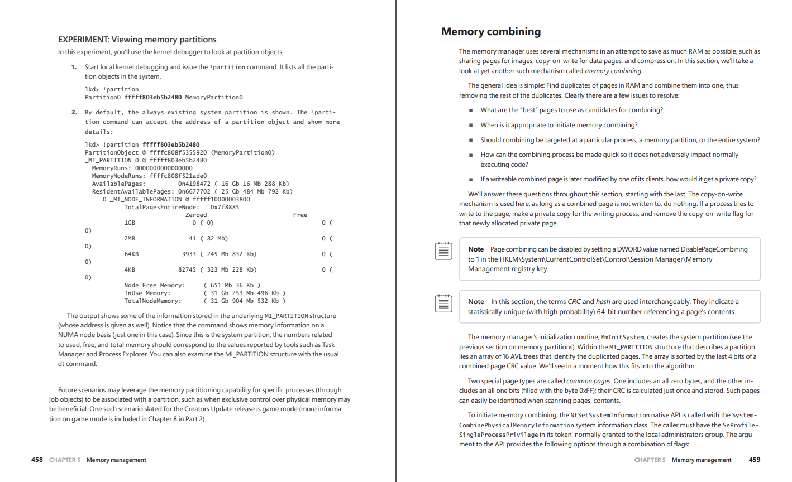
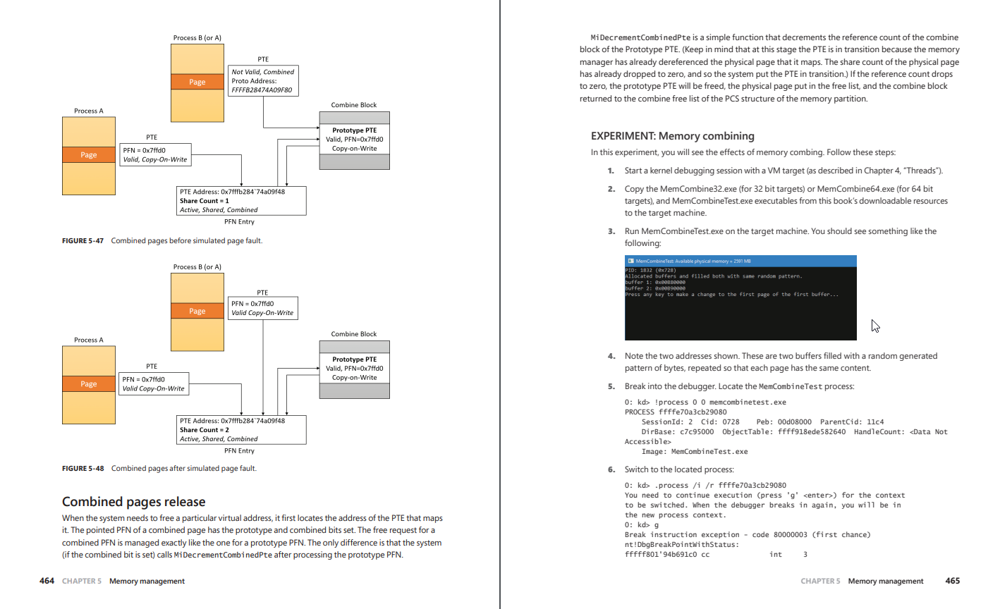
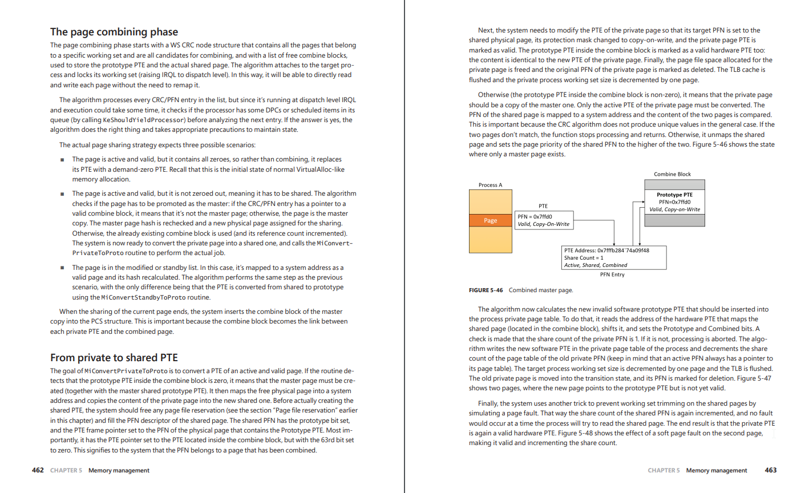

# Page Combining

Memory combining finds duplicate pages in RAM and replaces them with one shared physical page. All processes using those pages then reference the shared copy, and if a process modifies it, Windows creates a private copy for that process through `copy-on-write`.


The purpose of this memory management feature is to save physical memory, but on modern systems with 32-64GB of RAM the impact of page combining is often minimal (a page has a size of 4KB = 4096 byte).


```powershell
$ .\memcombine64 # while having several similar apps opened
Combining pages, please wait...
Success. Total pages combined: 284535 # 284535 * 4096 = 1,165,455,360 bytes = 1165.46 MB = 1.1655 GB

$ .\memcombine64
Combining pages, please wait...
Success. Total pages combined: 29490 # 29490 * 4096 = 120,791,040 bytes = 120.79 MB = 0.120791 GB
```

The amount of pages that can be combined is obviously not always same as it depends on how many identical private pages exist. See '[MemCombineTest](https://noverse.dev/docs/win-config/system/page-combining/#memcombinetest)' for notes on what memcombine64 does.

There's no separate process for page combining (like `MemCompression`), SysMain requests the work and the kernel Memory Manager does the combine work.

Disable it whenever you want to avoid the `SysMain` (`Disable (SysMain Off)` suboption which causes other MMAgent features to not work too) background activity, or when your system has enough RAM (which you never completely use) even tho the state of this memory managment feature is unrelated to RAM usage. See '[Services/Drivers, SysMain](https://noverse.dev/docs/win-config/system/disable-services-drivers/#sysmain)' before using that suboption as it handles other features too, which are beneficial on slow disks.

`Disable (MMAgent only)` won't set `DisablePageCombining = 1`, causing e.g. `MemCombine64.exe` to still be able to ask the memory manager to combine pages, if that value is set (bit `0`) the feature won't work at all ([`STATUS_NOT_SUPPORTED`](https://learn.microsoft.com/en-us/openspecs/windows_protocols/ms-erref/596a1078-e883-4972-9bbc-49e60bebca55)):

```powershell
$ .\memcombine64
Combining pages, please wait...
Error: C00000BB # STATUS_NOT_SUPPORTED
```

### DisablePageCombining

> "*Page combining can be disabled by setting a DWORD value named `DisablePageCombining` to `1` in the `HKLM\System\CurrentControlSet\Control\Session Manager\Memory Management` registry key.*"
>
> — Windows Internals, [E7, P1: 'Memory combining'](https://github.com/nohuto/Windows-Books/releases/download/7th-Edition/Windows-Internals-E7-P1.pdf)

That value is read from the `Memory Management` registry key into `nt!MmRegistryState+0x8` and read by `MiCombineIdenticalPages`, if bit 0 is set, the combine request returns [`STATUS_NOT_SUPPORTED`](https://learn.microsoft.com/en-us/openspecs/windows_protocols/ms-erref/596a1078-e883-4972-9bbc-49e60bebca55) (not used by MMAgent obviously).

```asm
INIT:0000000140B9C340                 dq offset aSessionManager_7 ; "Session Manager\\Memory Management"
INIT:0000000140B9C348                 dq offset aDisablepagecom ; "DisablePageCombining"
INIT:0000000140B9C350                 dq offset dword_140D1D1C8

ALMOSTRO:0000000140D1D1C8 dword_140D1D1C8 dd 0                    ; DATA XREF: MiCombineIdenticalPages:loc_1407F7E3A↑r
```

```c
lkd> dd nt!MmRegistryState+8 L1
fffff803`1bd1d1c8  00000000
```

### MMAgent Cmdlet

`Enable-MMAgent -PageCombining` calls the `PS_MMAgent` CIM provider in `sysmain.dll`, which goes to `MmaConfigure`, sets the page combining admin bit in the Superfetch key, and relies on `SysMain` to apply the component state.

```c
"HKLM\\SOFTWARE\\Microsoft\\Windows NT\\CurrentVersion\\Superfetch"
    AdminEnable & 0x100 // PageCombining requested enabled
    AdminDisable & 0x100 // PageCombining requested disabled
    StartedComponents & 0x100 // PageCombining started by SysMain
```

`0x100` = bit `8`, you can use my [bitmask calculator](https://noverse.dev/terminal#bitmask) to see whenever that bit is set in your current `StartedComponents` data, example:


See the requested page combining state via [MMAgent](https://learn.microsoft.com/en-us/powershell/module/mmagent/get-mmagent?view=windowsserver2025-ps):

```powershell
Get-MMAgent

ApplicationLaunchPrefetching : True
ApplicationPreLaunch         : True
MaxOperationAPIFiles         : 512
MemoryCompression            : True
OperationAPI                 : True
PageCombining                : True # Enabled
PSComputerName               :
```

### MemCombineTest

Start by downloading the [Windows Internals tools](https://github.com/zodiacon/WindowsInternals/releases/download/1.1/x64.zip) which include the two binaries we need & [VMMap](https://live.sysinternals.com/vmmap.exe).

[`MemCombineTest.exe`](https://github.com/zodiacon/WindowsInternals/blob/master/MemCombineTest/MemCombineTest.cpp) allocates two same content private buffers and waits, [`MemCombine64.exe`](https://github.com/zodiacon/WindowsInternals/blob/master/MemCombine/MemCombine.cpp) enables `SeProfileSingleProcessPrivilege` and calls `NtSetSystemInformation(SystemCombinePhysicalMemoryInformation = 130)`, which asks the memory manager to combine pages now instead of waiting for the normal background pass.

1. Start `MemCombineTest.exe` and leave it open
2. Open VMMap as admin and select the PID shown by `MemCombineTest` 
3. Take first VMMap screenshot of the process address space and note the two private buffers


4. Run `MemCombine64.exe` as admin
5. Refresh VMMap and compare the private/shared working set


6. Press a key in `MemCombineTest.exe` to modify one byte in the first buffer
7. Refresh VMMap again, the modified page should become private again cause of `copy-on-write`


## [Windows Internals](https://github.com/nohuto/Windows-Books/releases/download/7th-Edition/Windows-Internals-E7-P1.pdf)






