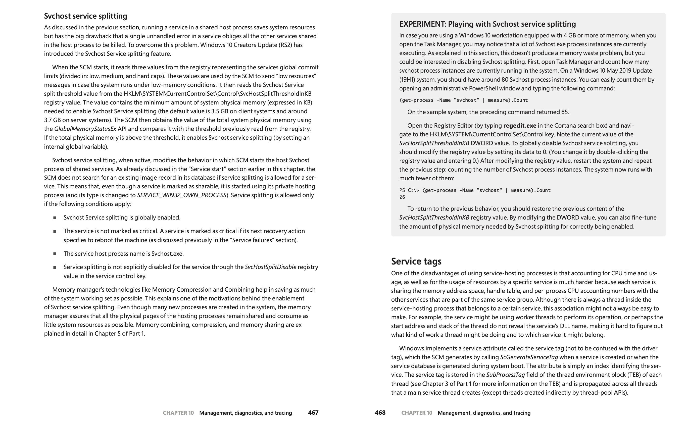

# Service Splitting

Prevents services hosted by `svchost.exe` from being split into separate host processes. This reduces the amount of `svchost.exe` instances, but also reduces service isolation, just be aware of what negative impact grouping has before chaning the option, the template therefore keeps the client default. If you've less than 3.5GB of RAM splitting is disabled by default.

```c
"HKLM\\SYSTEM\\CurrentControlSet\\Control";
    "SvcHostSplitThresholdInKB" = 3670016; // REG_DWORD, client default = ~3.5 GB, server default = ~3.7 GB
    "SvcHostDebug" = 0; // REG_DWORD

"HKLM\\SYSTEM\\CurrentControlSet\\Services\\<service>";
    "SvcHostSplitDisable" = 0; // REG_DWORD, per service disable
```

`SvcHostSplitThresholdInKB` = global memory threshold, during SCM startup, it gets read and compared against total physical memory from `GlobalMemoryStatusEx`. If physical memory is greater than or equal to the threshold, SCM enables the `g_fSplitSvcHost` flag (`0` would prevent splitting). `SvcHostDebug` is a fallback override, which is only read whenever `SvcHostSplitThresholdInKB` didn't enable splitting. If its set to `1` it causes `g_fSplitSvcHost = 1`.

```c
// SvcHostSplitThresholdInKB = 3670016 (while having 32GB)
lkd> dd services!g_fSplitSvcHost L1
00007ff7`21586374  00000001

// SvcHostSplitThresholdInKB = 4294967295 (4TB)
lkd> dd services!g_fSplitSvcHost L1
00007ff7`40976374  00000000

// SvcHostSplitThresholdInKB = 0, SvcHostDebug = 0
lkd> dd services!g_fSplitSvcHost L1
00007ff6`5ce06374  00000000

// SvcHostSplitThresholdInKB = 0, SvcHostDebug = 1
lkd> dd services!g_fSplitSvcHost L1
00007ff6`820a6374  00000001
```

Get the current amount of `svchost.exe` process instances via:

```powershell
(Get-Process -Name "svchost" | Measure-Object).Count
```

> "*When the SCM starts, it reads three values from the registry representing the services global commit limits (divided in: low, medium, and hard caps). These values are used by the SCM to send “low resources” messages in case the system runs under low-memory conditions. It then reads the Svchost Service split threshold value from the `HKLM\SYSTEM\CurrentControlSet\Control\SvcHostSplitThresholdInKB` registry value. The value contains the minimum amount of system physical memory (expressed in KB) needed to enable Svchost Service splitting (the default value is 3.5 GB on client systems and around 3.7 GB on server systems). The SCM then obtains the value of the total system physical memory using the GlobalMemoryStatusEx API and compares it with the threshold previously read from the registry. If the total physical memory is above the threshold, it enables Svchost service splitting (by setting an internal global variable). Svchost service splitting, when active, modifies the behavior in which SCM starts the host Svchost process of shared services. As already discussed in the “Service start” section earlier in this chapter, the SCM does not search for an existing image record in its database if service splitting is allowed for a service. This means that, even though a service is marked as sharable, it is started using its private hosting process (and its type is changed to SERVICE_WIN32_OWN_PROCESS). Service splitting is allowed only if the following conditions apply:*  
> *- Svchost Service splitting is globally enabled.*  
> *- The service is not marked as critical. A service is marked as critical if its next recovery action specifies to reboot the machine (as discussed previously in the “Service failures” section).*  
> *- The service host process name is Svchost.exe.*  
> *- Service splitting is not explicitly disabled for the service through the SvcHostSplitDisable registry value in the service control key*  
>
> — Windows Internals, [E7, P2: 'Svchost service splitting'](https://github.com/nohuto/windows-books/releases/download/7th-Edition/Windows-Internals-E7-P2.pdf)

## [Windows Internals](https://github.com/nohuto/Windows-Books/releases/download/7th-Edition/Windows-Internals-E7-P2.pdf)



