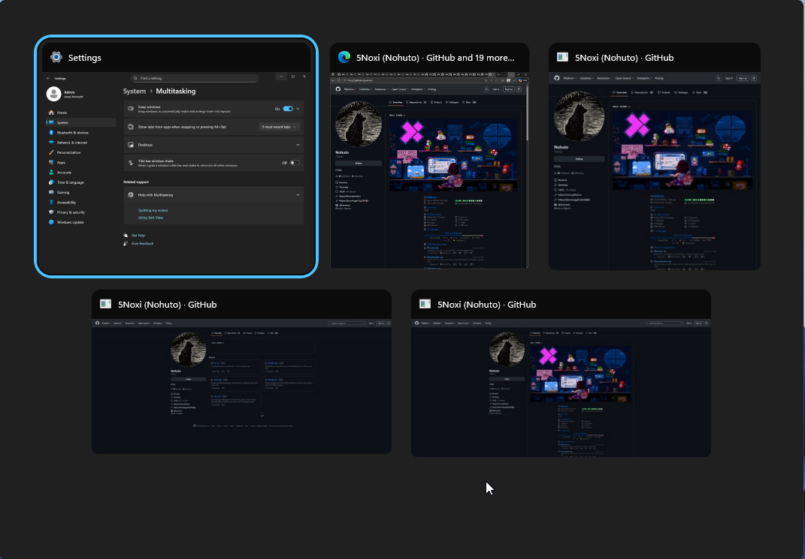
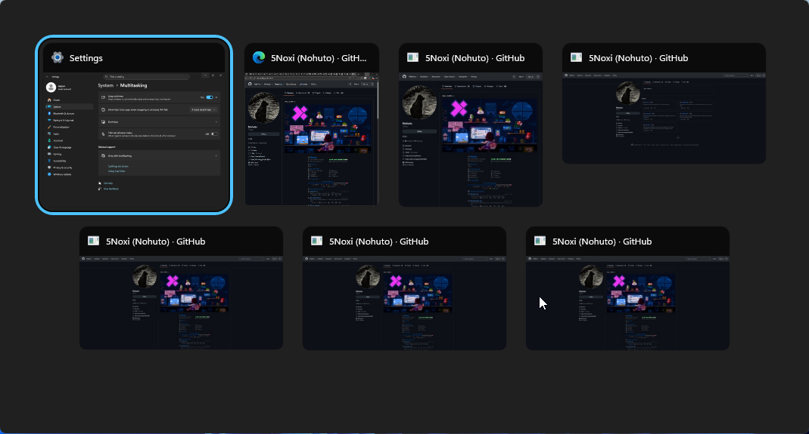
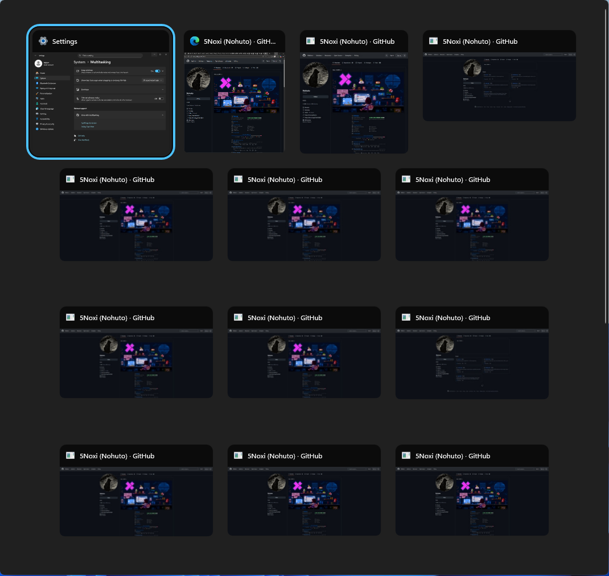

# Alt-Tab App Tabs

Select the amount of recent tabs from apps in the alt+tab menu.

### Don't show tabs

### 3 Tabs

### 5 Tabs

### 20 Tabs

## [Windows Policies](https://noverse.dev/policies)

| Policy | Key Path | Value Name |
| --- | --- | --- |
| [Configure the inclusion of app tabs into Alt-Tab](https://noverse.dev/policies?p=Multitasking*BrowserAltTabBlowout) | `HKCU\Software\Policies\Microsoft\Windows\Explorer` | `MultiTaskingAltTabFilter` |

The option changes it via `HKCU\\Software\\Microsoft\\Windows\\CurrentVersion\\Explorer\\Advanced`.

## Classic Task Switcher

Restarting the explorer is enough to apply the changes.

### New

### Classic

