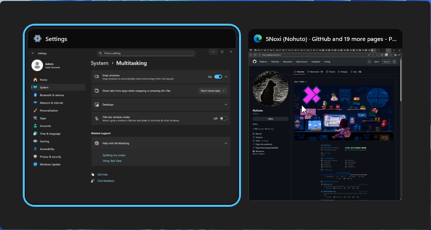
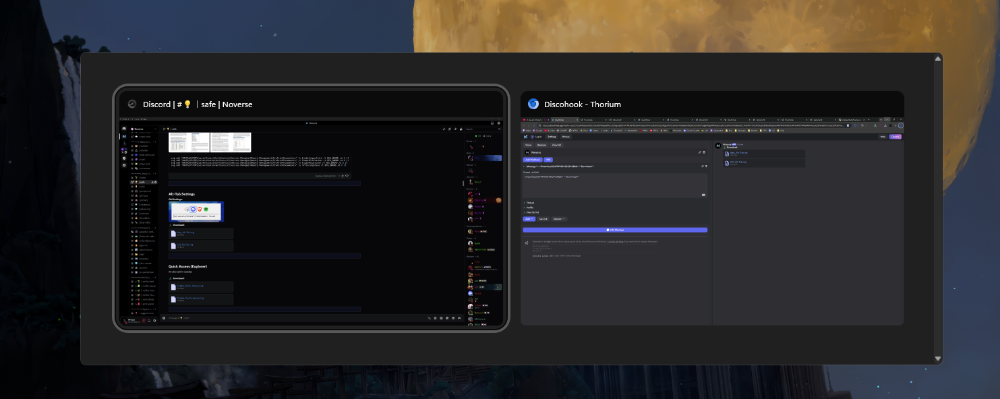
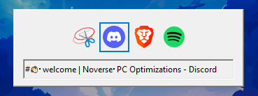

# Alt-Tab App Tabs

Select the amount of recent tabs from apps in the alt+tab menu.

### Don't show tabs



### 3 Tabs


### 5 Tabs


### 20 Tabs


## Registry Value

```c
"HKCU\\Software\\Microsoft\\Windows\\CurrentVersion\\Explorer\\Advanced";
    "MultiTaskingAltTabFilter" = 2; // REG_DWORD
                                    // 0 = open windows and 20 most recent tabs
                                    // 1 = 5 tabs
                                    // 2 = 3 tabs
                                    // 3 = open windows only
                                    // 
                                    // Settings rejects 4+
```

```c
// WindowTabHost::UpdateAltTabFilterSetting (twinui.pcshell, 25H2)

  v8 = 0;
  v9 = 4;
  if ( (int)SHWindowsPolicyGetValue(&POLID_MultiTaskingAltTabFilter, &v8, &v9) >= 0 && v8 )
  {
    v5 = --v8; // policy 1-4 = preference 0-3
  }
```

## [Windows Policies](https://noverse.dev/policies)

| Policy | Key Path | Value Name |
| --- | --- | --- |
| [Configure the inclusion of app tabs into Alt-Tab](https://noverse.dev/policies?p=Multitasking*BrowserAltTabBlowout) | `HKCU\Software\Policies\Microsoft\Windows\Explorer` | `MultiTaskingAltTabFilter` |


## Classic Task Switcher

```c
"HKCU\\Software\\Microsoft\\Windows\\CurrentVersion\\Explorer";
    "AltTabSettings" = 0; // REG_DWORD
                          // 1 = classic task switcher
                          // 2 = new
                          // 0 = new unless debugger is attached
                          // missing/above 2 = 0
```

### New



### Classic



