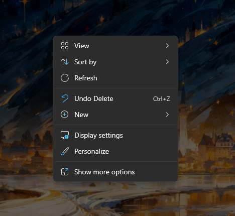
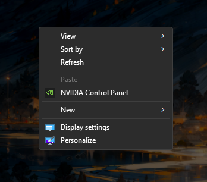
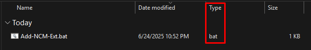
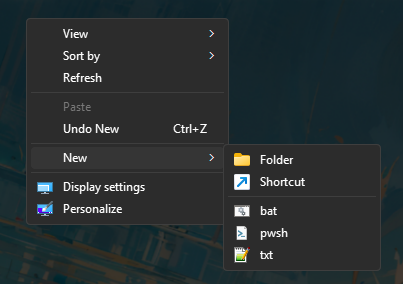

# Classic Context Menu

Use it on W11, unless you like the new menu. This works via causing COM to not load the DLL for the `{86ca1aa0-34aa-4e8b-a509-50c905bae2a2}` CLSID by making [ImprocServer32](https://learn.microsoft.com/en-us/windows/win32/com/inprocserver32) empty.

```powershell
[HKEY_CLASSES_ROOT\CLSID\{86ca1aa0-34aa-4e8b-a509-50c905bae2a2}]
@="File Explorer Context Menu"

[HKEY_CLASSES_ROOT\CLSID\{86ca1aa0-34aa-4e8b-a509-50c905bae2a2}\InProcServer32]
@="C:\\Windows\\System32\\Windows.UI.FileExplorer.dll" // enabling would caus it to be empty
```

### Default



### Old



## 'New' Context Menu

Instead of creating a `.txt` file, then renaming it to e.g. `.bat` / `.ps1`, you can add these options to the 'new' context menu. This may also change the `Type` shown in the explorer (only `.bat` is affected of the three).





