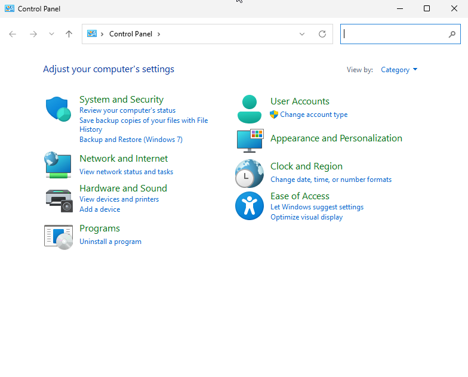
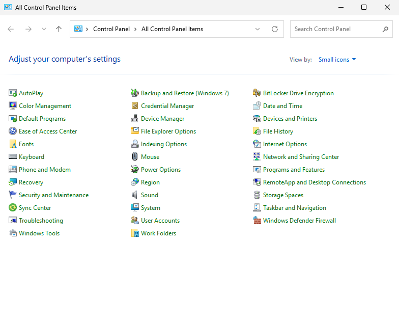

# Classic Control Panel

> "*This policy setting controls the default Control Panel view, whether by category or icons. If this policy setting is enabled, the Control Panel opens to the icon view. If this policy setting is disabled, the Control Panel opens to the category view.*"

### Icon View

### Category View

## [Windows Policies](https://noverse.dev/policies)

| Policy | Key Path | Value Name |
| --- | --- | --- |
| [Always open All Control Panel Items when opening Control Panel](https://noverse.dev/policies?p=ControlPanel*ForceClassicControlPanel) | `HKCU\Software\Microsoft\Windows\CurrentVersion\Policies\Explorer` | `ForceClassicControlPanel` |

