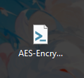
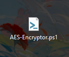

# Desktop Icon Spacing

Location:

```c
\Registry\User\S-ID\Control Panel\Desktop\WindowMetrics : IconSpacing // horizontal
\Registry\User\S-ID\Control Panel\Desktop\WindowMetrics : IconVerticalSpacing // vertical
```

- Default: `75px` (`-1125`)
- Min: `32px` (`-480`)
- Max: `182px` (`-2730`)

Value gets calculated with:

```c
-15*px

-15*75 = -1125 // default
```

I created a small [tool](https://github.com/nohuto/win-config/blob/main/visibility/assets/scripts/iconSpacing.ps1) for fun, since it's a lot easier to quickly change and test the different icon spacing. You've to log out after applying, otherwise it won't update instantly (the images show vertical `75px` & `100px` difference). I personally use `110px Horizonzal - 60px Vertical` for a more vertical compact view and more space horizontally (see suboption).

### `75px`



### `100px`



---

Desktop icon size:

```c
"HKCU\\Software\\Microsoft\\Windows\\Shell\\Bags\\1\\Desktop";
  "IconSize" = 32 // 32 = Small, 48 = Medium, 96 = Large
```

