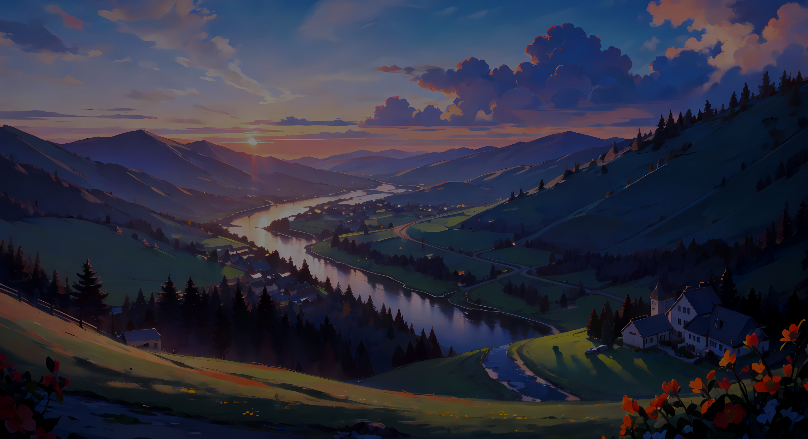
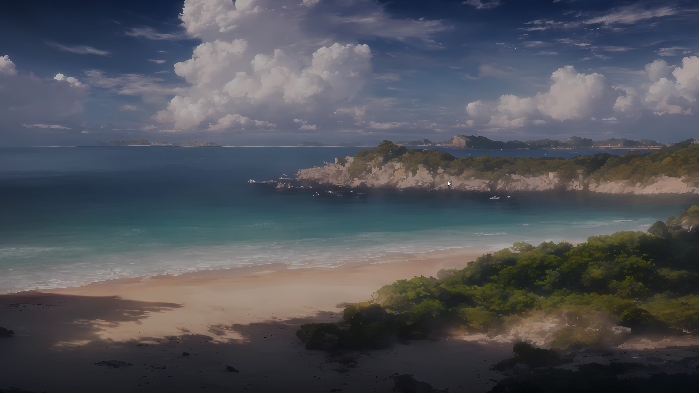
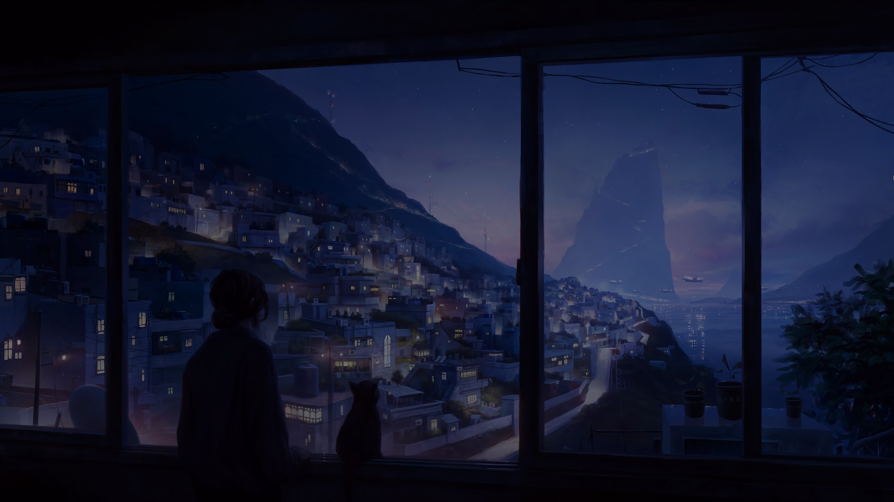
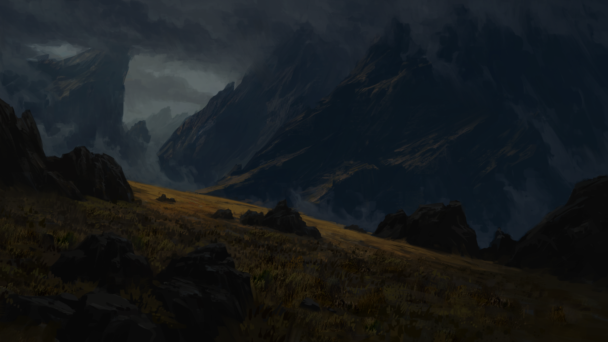
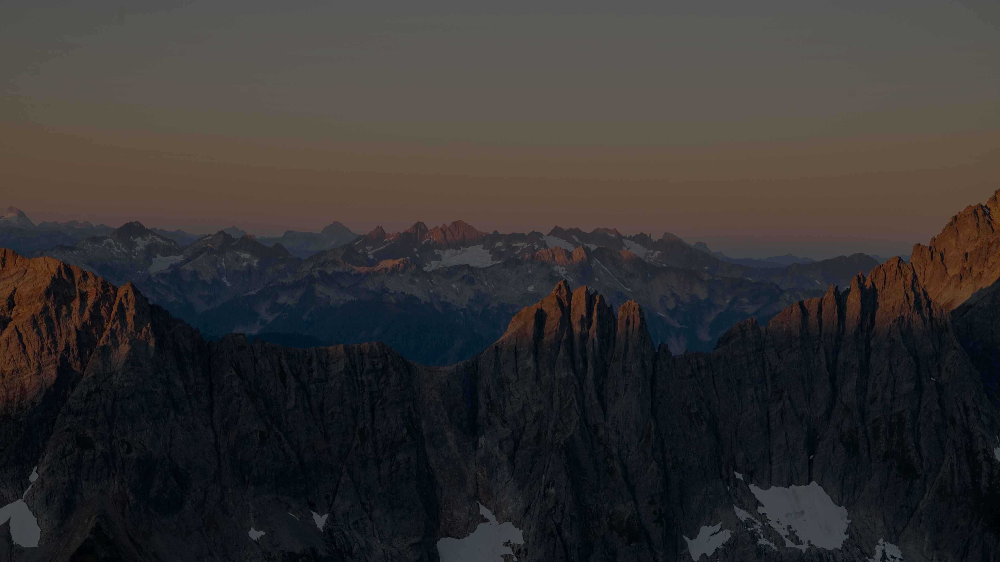
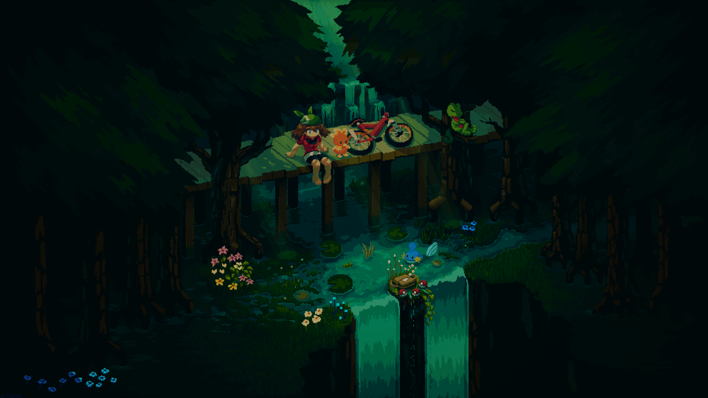
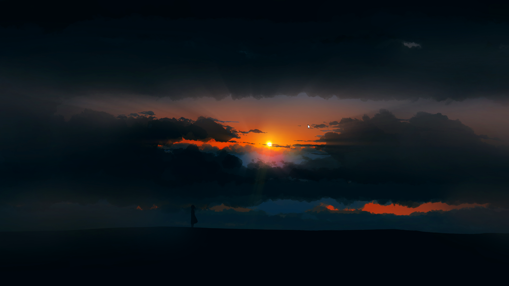

# Desktop Wallpaper

This is a collection of some wallpapers that I've found over time. Added for people who may never have spent time changing their background, or for anyone else.

Note that the policy which is used to apply it locks the background, `Windows Default` would revert that.

### Asia


### Austria



### Beach



### Blue Flowers


### Bones


### Castle


### Cat



### City


### Cloudy Village


### Dark Sunset


### Dry Landscape


### Earth Gruvbox


### Fall


### Field Sunset


### Field Sunset 2


### Fishing Frogs


### Flowers


### Flowers Sunset


### Forst Clouds


### Girl Clouds


### Golden Hour


### Heaven


### Lake


### Mac


### Magic Forest


### Man Landscape


### Meadow Sunset


### Moon


### Moon Castle


### Moon Rose


### Mountains


### Mountains Art



### Mountains Sunset



### Plants Room


### Pokemon



### Rain


### Relax Landscape


### Sea


### Sea Art


### Sea Road


### Shop


### Stars


### Stars Lake 1


### Stars Lake 2


### Stars Lake 3


### Sunset



### Village


### Violet Night


### Witcher Landscape


### Workplace


### World


### Zelda


## JPEG Reduction

`shell32` reencodes an image when you set it as desktop background (`TranscodeImage`), PNG stays a lossless PNG, every other format is saved as JPEG with the quality from `JPEGImportQuality` (this option has wallpapers in PNG format so this won't do anything for them).

### [TranscodeImage](https://github.com/nohuto/win-config/blob/main/system/assets/pseudocode/jpeg-TranscodeImage.c)

```c
// TranscodeImage (shell32)

if ( ((int (__fastcall *)(struct IWICBitmapDecoder *, __int128 *))v48->lpVtbl->GetContainerFormat)(v48, &v64) >= 0
  && (unsigned __int8)_(&v64, &GUID_ContainerFormatPng) )
{
  v10 = 1; // PNG source
}

v29 = &GUID_ContainerFormatPng;
if ( !v10 )
  v29 = &GUID_ContainerFormatJpeg; // every other source is saved as JPEG

v30 = *(float *)&dword_180735394; // 0 until first read, then cached quality
if ( *(float *)&dword_180735394 == 0.0 )
{
  LODWORD(ppIDst) = 0;
  if ( (int)SHRegGetDWORD(
              HKEY_CURRENT_USER,
              L"Control Panel\\Desktop",
              L"JPEGImportQuality",
              (unsigned int *)&ppIDst) < 0 )
  {
    v30 = FLOAT_85_0;
  }
  else
  {
    v30 = fmaxf((float)(int)ppIDst, 60.0);
    if ( v30 > 100.0 )
      v30 = FLOAT_100_0;
  }
  dword_180735394 = LODWORD(v30);
}
```

## [Windows Policies](https://noverse.dev/policies)

| Policy | Key Path | Value Name |
| --- | --- | --- |
| [Desktop Wallpaper](https://noverse.dev/policies?p=Desktop*Wallpaper) | `HKCU\Software\Microsoft\Windows\CurrentVersion\Policies\System` | `Wallpaper`<br>`WallpaperStyle` |

