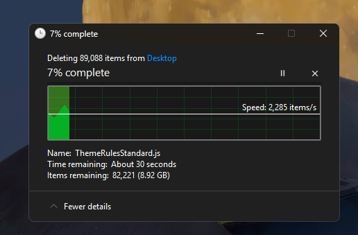

# Detailed File Transfer

When you copy, move, or delete a file or folder, a progress dialog appears. You can switch between `More details`/`Fewer details`, by default, the dialog opens in the same view you last used.

```c
"HKCU\\Software\\Microsoft\\Windows\\CurrentVersion\\Explorer\\OperationStatusManager";
    "EnthusiastMode" = 0; // REG_DWORD, 1 = more details
```

```c
// COperationStatusService::_InitializeDisplayMode (shell32)

  v2 = 0;
  v6 = 0;
  if ( (int)SHRegGetBOOLWithREGSAM(
              HKEY_CURRENT_USER,
              L"Software\\Microsoft\\Windows\\CurrentVersion\\Explorer\\OperationStatusManager",
              L"EnthusiastMode",
              0,
              &v6) >= 0 )
    v2 = v6 != 0; // missing = 0, fewer details
```

### EnthusiastMode Disabled


### EnthusiastMode Enabled



