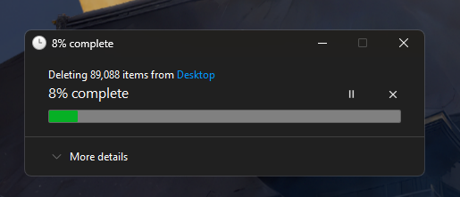

# Detailed File Transfer

When you copy, move, or delete a file or folder, a progress dialog appears. You can switch between `More details` and `Fewer details`. By default, the dialog opens in the same view you last used (if you didn't switch it yet, `0` is used).

### EnthusiastMode Disabled

### EnthusiastMode Enabled

