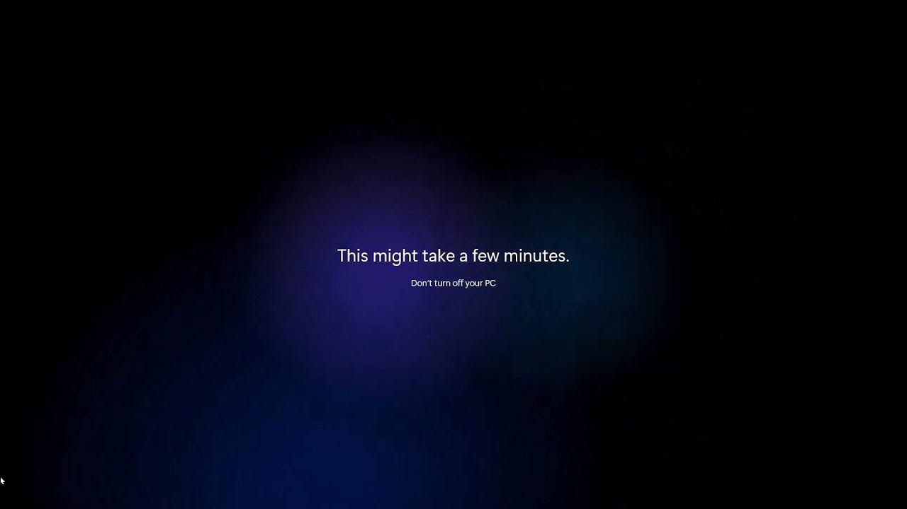

# Disable Animations

Minimize, maximize, taskbar animations / first sign-in animations etc.

First sign-in animation:

## [Windows Policies](https://noverse.dev/policies)

| Policy | Key Path | Value Name |
| --- | --- | --- |
| [Do not allow window animations](https://noverse.dev/policies?p=DWM*DwmDisallowAnimations_1) | `HKCU\SOFTWARE\Policies\Microsoft\Windows\DWM` | `DisallowAnimations` |
| [Do not allow window animations](https://noverse.dev/policies?p=DWM*DwmDisallowAnimations_2) | `HKLM\SOFTWARE\Policies\Microsoft\Windows\DWM` | `DisallowAnimations` |
| [Turn off common control and window animations](https://noverse.dev/policies?p=Explorer*TurnOffSPIAnimations) | `HKCU\Software\Microsoft\Windows\CurrentVersion\Policies\Explorer` | `TurnOffSPIAnimations` |
| [Show first sign-in animation](https://noverse.dev/policies?p=Logon*EnableFirstLogonAnimation) | `HKLM\Software\Microsoft\Windows\CurrentVersion\Policies\System` | `EnableFirstLogonAnimation` |

