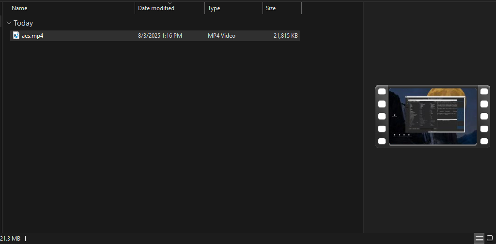
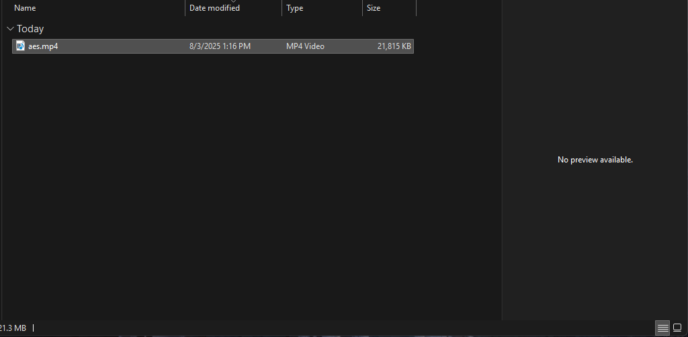

# Disable Audio / Video Preview

Disables thumbnails for these extensions (explorer shows the file type icon instead):

```
3gp avi flac m4a m4v mkv mod mov mp3 mp4 mpeg mpg ogg ts vob wav webm wma wmv
```

[`{E357FCCD-A995-4576-B01F-234630154E96}`](https://learn.microsoft.com/en-us/windows/win32/shell/handlers#handler-names) = Thumbnail image handler (`IThumbnailProvider`) subkey
[`{BB2E617C-0920-11D1-9A0B-00C04FC2D6C1}`](https://learn.microsoft.com/en-us/windows/win32/shell/handlers#handler-names) = Image handler (`IExtractImage`) subkey
`{9DBD2C50-62AD-11D0-B806-00C04FD706EC}` = `Property Thumbnail Handler`, handler both subkeys name

### Enabled



### Disabled



