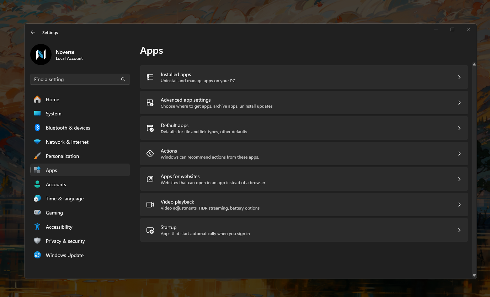

# Disable Transparency

See [DWM, `BackdropBlurCachingThrottleMs`](https://noverse.dev/docs/win-config/system/dwm-values/#backdropblurcachingthrottlems) for information on the minimum time before cached blur outputs are marked dirty again. The default is `25ms`, and values are clamped to a maximum of `1000ms`.

### Transparency Enabled

### Transparency Disabled

