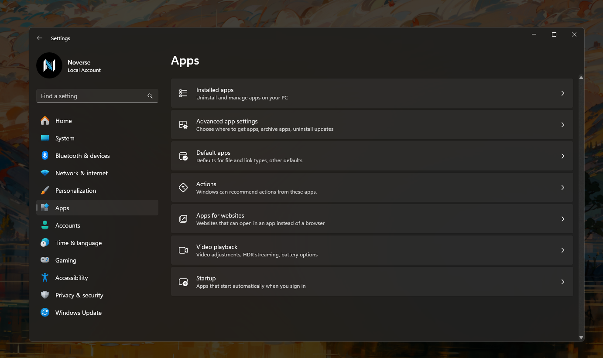

# Disable Transparency

See [DWM, `BackdropBlurCachingThrottleMs`](https://noverse.dev/docs/win-config/system/dwm-values/#backdropblurcachingthrottlems) for information on the minimum time before cached blur outputs are marked dirty again.

```c
"HKCU\\Software\\Microsoft\\Windows\\CurrentVersion\\Themes\\Personalize";
    "EnableTransparency" = 1; // REG_DWORD, 0 = solid BG
    "EnableBlurBehind" = 0; // REG_DWORD, SharedUtilities.dll BatteryService::IsBlurEnabled
```

### Transparency Enabled



### Transparency Disabled


