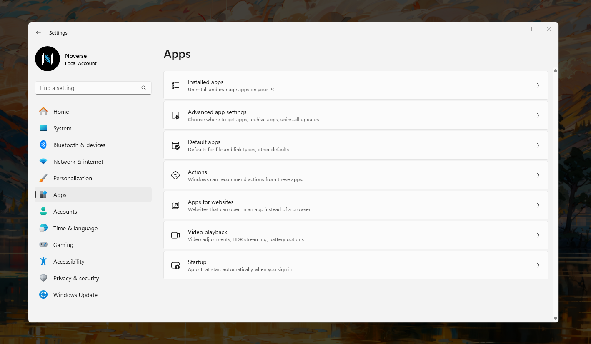
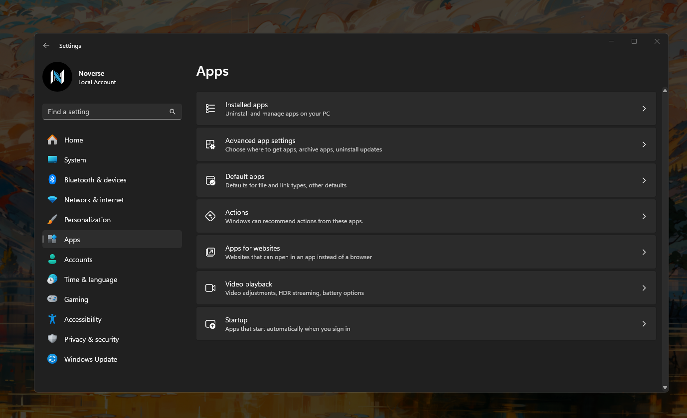

# Enable Dark Theme

## Registry Values

Values below are based on `RegGetValueW`/`SHRegGetDWORD`/`SHRegGetUSDWORDW` xrefs within `uxtheme.dll`. Since there weren't many, I added others that have nothing to do with dark mode too.

```c
"HKLM\\Software\\Policies\\Microsoft\\Windows\\Personalization";
  "PersonalColors_Background" = ?; // REG_SZ, #RRGGBB
  "PersonalColors_Accent" = ?; // REG_SZ, #RRGGBB
  "NoChangingStartMenuBackground" = 0; // REG_DWORD (bool)

"HKCU\\Software\\Microsoft\\Windows\\DWM";
  // _NCWNDMET::GetCaptionColor
  "ColorPrevalence" = 0; // REG_DWORD, range 0-5

"HKCU\\Software\\Microsoft\\Windows\\CurrentVersion\\Explorer\\Accent";
  "StartColorMenu" = 4288563712; // REG_DWORD, range 0-4294967295, fallback to ColorSet_Version3, then DefaultStartColor
  "AccentColorMenu" = 4292319232; // REG_DWORD, range 0-4294967295, ^
  "ColorSet_Version3" = ?; // REG_DWORD, range 0-49
  "AccentPalette" = ?; // REG_BINARY, length 32 bytes, 8 DWORD colors
  "UseNewAutoColorAccentAlgorithm" = 1; // REG_DWORD (bool)
  "MinSaturation" = 150; // REG_DWORD, divided by 1000, means default 0.15

"HKLM\\Software\\Microsoft\\Windows\\CurrentVersion\\Explorer\\Accent";
  "DefaultStartColor" = 4288563712; // REG_DWORD, range 0-4294967295
  "DefaultAccentColor" = 4292319232; // REG_DWORD, range 0-4294967295

"HKCU\\Control Panel\\Desktop";
  "AutoColorization" = 0; // REG_DWORD or REG_SZ "0"/"1" (bool)

"HKCU\\SOFTWARE\\Microsoft\\Windows\\CurrentVersion\\Themes\\Personalize";
  "AppsUseLightTheme" = 1; // REG_DWORD or REG_SZ "0"/"1" (bool)
                           // 0 = dark mode
                           // 1 = light mode
                           // invalid/missing fallback to HKLM UWPAppsUseLightTheme then 1
  "SystemUsesLightTheme" = ?; // REG_DWORD or REG_SZ "0"/"1" (bool)
                             // 0 = dark mode
                             // 1 = light mode
                             // invalid/missing fallback to HKLM SystemUsesLightTheme then IsOS_OS_PERSONAL
  "ColorPrevalence" = 0; // REG_DWORD, range 0-4294967295

"HKLM\\Software\\Microsoft\\Windows\\CurrentVersion\\Themes";
  "UWPAppsUseLightTheme" = 1; // REG_DWORD or REG_SZ "0"/"1" (bool), fallback for AppsUseLightTheme
  "SystemUsesLightTheme" = ?; // REG_DWORD or REG_SZ "0"/"1" (bool), fallback for HKCU SystemUsesLightTheme

"HKCU\\Software\\Microsoft\\Accessibility";
  "TextScaleFactor" = 100; // REG_DWORD, range 0-4294967295 (percent)
```

### Light Theme



### Dark Theme



