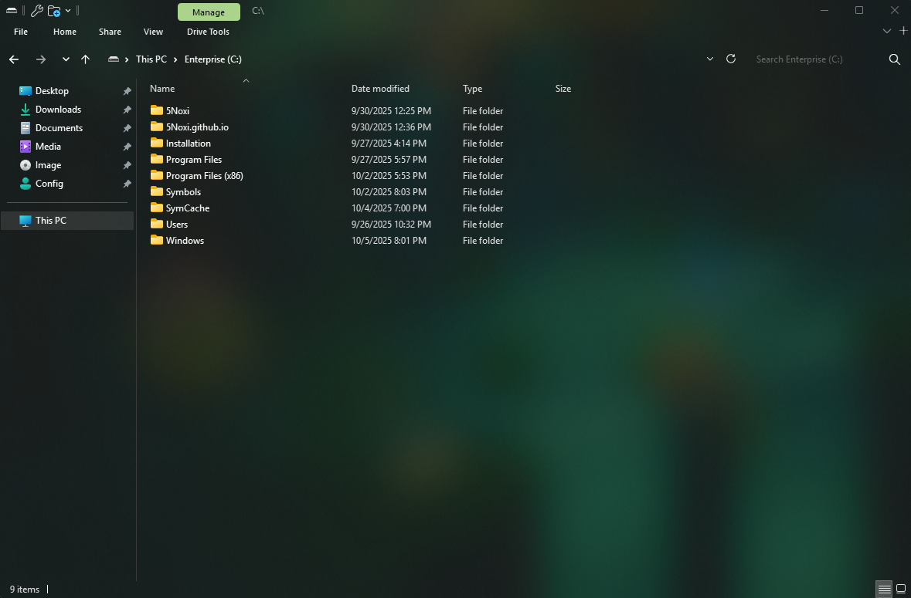

# Explorer Options

It changes every setting which is shown in the `Folder Options` window, and more explorer related things. Some are personal preference, see suboptions below for customization, and configurations that aren't made in the main option.



## ShellState

`ShellState` is a little endian `REG_BINARY`, its data starts with a `DWORD` followed by the 32 byte [`SHELLSTATE`](https://learn.microsoft.com/en-us/windows/win32/api/shlobj_core/ns-shlobj_core-shellstatea) structure.

```cpp
typedef struct {
  BOOL  fShowAllObjects : 1;
  BOOL  fShowExtensions : 1;
  BOOL  fNoConfirmRecycle : 1;
  BOOL  fShowSysFiles : 1;
  BOOL  fShowCompColor : 1;
  BOOL  fDoubleClickInWebView : 1;
  BOOL  fDesktopHTML : 1;
  BOOL  fWin95Classic : 1;
  BOOL  fDontPrettyPath : 1;
  BOOL  fShowAttribCol : 1;
  BOOL  fMapNetDrvBtn : 1;
  BOOL  fShowInfoTip : 1;
  BOOL  fHideIcons : 1;
  BOOL  fWebView : 1;
  BOOL  fFilter : 1;
  BOOL  fShowSuperHidden : 1;
  BOOL  fNoNetCrawling : 1;
  DWORD dwWin95Unused;
  UINT  uWin95Unused;
  LONG  lParamSort;
  int   iSortDirection;
  UINT  version;
  UINT  uNotUsed;
  BOOL  fSepProcess : 1;
  BOOL  fStartPanelOn : 1;
  BOOL  fShowStartPage : 1;
  BOOL  fAutoCheckSelect : 1;
  BOOL  fIconsOnly : 1;
  BOOL  fShowTypeOverlay : 1;
  BOOL  fShowStatusBar : 1;
  UINT  fSpareFlags : 9;
} SHELLSTATEA, *LPSHELLSTATEA;
```

Whenever the same settings are available in `ShellState`, but also have their own value in `Explorer\Advanced`, the state in `Advanced` seems to be used, changing a setting via e.g. explorer causes both values to get edited:

```powershell
ShellState	REG_BINARY	24 00 00 00 3e 20 00 00 00 00 00 00 00 00 00 00 00 00 00 00 01 00 00 00 13 00 00 00 00 00 00 00 52 00 00 00			36 # IconsOnly = 1
ShellState	REG_BINARY	24 00 00 00 3e 20 00 00 00 00 00 00 00 00 00 00 00 00 00 00 01 00 00 00 13 00 00 00 00 00 00 00 42 00 00 00			36 # IconsOnly = 0
```

Means whenever modifying the value manually, the related value in `Explorer\Advanced` must also be changed.

| Offset | Size | Field | Meaning |
| --- | --- | --- | --- |
| `0x00` | 4 | `dwSize` | Value size |
| `0x04` | 4 | Primary flags | Bits `0-16` below, bits `17-31` padding |
| `0x08` | 4 | `dwWin95Unused` | Unused |
| `0x0C` | 4 | `uWin95Unused` | Unused |
| `0x10` | 4 | `lParamSort` | Sort column |
| `0x14` | 4 | `iSortDirection` | `1` ascending, `-1` descending |
| `0x18` | 4 | `version` | Unused |
| `0x1C` | 4 | `uNotUsed` | Unused |
| `0x20` | 4 | Secondary flags | Bits `0-6` below, bits `7-15` fSpareFlags & bits `16-31` padding |

All members within the primary & secondary flags are bools.

### Primary Flags

| Bit | Member | Meaning | `Explorer\Advanced` Value |
| --- | --- | --- | --- |
| 0 | `fShowAllObjects` | Show hidden objects | `Hidden` (if `= 1`) |
| 1 | `fShowExtensions` | Show file extensions | `HideFileExt` (inverted) |
| 2 | `fNoConfirmRecycle` | Skip recycle bin confirmation | - |
| 3 | `fShowSysFiles` | Show system files | `Hidden` (if `> 1`) |
| 4 | `fShowCompColor` | Color compressed/encrypted files | `ShowCompColor` |
| 5 | `fDoubleClickInWebView` | Require double click to open | - |
| 6 | `fDesktopHTML` | Use active desktop | - |
| 7 | `fWin95Classic` | Enforce Windows 95 Shell behavior & restrictions | - |
| 8 | `fDontPrettyPath` | Prevent paths from being converted to lowercase | `DontPrettyPath` |
| 9 | `fShowAttribCol` | Unused | `ShowAttribCol` |
| 10 | `fMapNetDrvBtn` | Show the map network drive button | `MapNetDrvBtn` |
| 11 | `fShowInfoTip` | Show item popup descriptions | `ShowInfoTip` |
| 12 | `fHideIcons` | Hide desktop icons | `HideIcons` |
| 13 | `fWebView` | Use web view | `WebView` |
| 14 | `fFilter` | Unused | `Filter` |
| 15 | `fShowSuperHidden` | Show protected operating system files | `ShowSuperHidden` |
| 16 | `fNoNetCrawling` | Disable automatic searches for network folders & printers | `NoNetCrawling` |

### Secondary Flags

| Bit | Member | Meaning | `Explorer\Advanced` Value |
| --- | --- | --- | --- |
| 0 | `fSepProcess` | Launch folder windows in a separate process | `SeparateProcess` |
| 1 | `fStartPanelOn` | Use the Windows XP style start menu | - |
| 2 | `fShowStartPage` | Unused | - |
| 3 | `fAutoCheckSelect` | Use check boxes to select items | `AutoCheckSelect` |
| 4 | `fIconsOnly` | Always show icons, never thumbnails | `IconsOnly` |
| 5 | `fShowTypeOverlay` | Display file type icon on thumbnails | `ShowTypeOverlay` |
| 6 | `fShowStatusBar` | Show the status bar | `ShowStatusBar` |

## Explorer Captures

Based on `Explorer > View > Options`.

### General

```c
// Open File Explorer to
// Home
HKCU\Software\Microsoft\Windows\CurrentVersion\Explorer\Advanced\LaunchTo	Type: REG_DWORD, Length: 4, Data: 2
// This PC
HKCU\Software\Microsoft\Windows\CurrentVersion\Explorer\Advanced\LaunchTo	Type: REG_DWORD, Length: 4, Data: 1

// Browse folders
// Open each folder in the same window
HKCU\Software\Microsoft\Windows\CurrentVersion\Explorer\CabinetState\Settings	Type: REG_BINARY, Length: 12, Data: 0C 00 02 00 0A 01 00 00 60 00 00 00
// Open each folder in its own window
HKCU\Software\Microsoft\Windows\CurrentVersion\Explorer\CabinetState\Settings	Type: REG_BINARY, Length: 12, Data: 0C 00 02 00 2A 01 00 00 60 00 00 00

// Click items as follows
// Single-click to open an item (point to select)
HKCU\Software\Microsoft\Windows\CurrentVersion\Explorer\ShellState Type: REG_BINARY, Length: 36, Data: 24 00 00 00 1E 20 00 00 00 00 00 00 00 00 00 00
// Double-click to open an item (singe-click to select)
HKCU\Software\Microsoft\Windows\CurrentVersion\Explorer\ShellState Type: REG_BINARY, Length: 36, Data: 24 00 00 00 3E 20 00 00 00 00 00 00 00 00 00 00

// Privacy
  // Show recently used files
  // Enabled
  HKCU\Software\Microsoft\Windows\CurrentVersion\Explorer\ShowRecent	Type: REG_DWORD, Length: 4, Data: 1
  // Disabled
  HKCU\Software\Microsoft\Windows\CurrentVersion\Explorer\ShowRecent	Type: REG_DWORD, Length: 4, Data: 0

  // Show frequently used folders
  // Enabled
  HKCU\Software\Microsoft\Windows\CurrentVersion\Explorer\ShowFrequent	Type: REG_DWORD, Length: 4, Data: 1
  // Disabled
  HKCU\Software\Microsoft\Windows\CurrentVersion\Explorer\ShowFrequent	Type: REG_DWORD, Length: 4, Data: 0

  // Show files from Office.com
  // Enabled
  HKCU\Software\Microsoft\Windows\CurrentVersion\Explorer\ShowCloudFilesInQuickAccess	Type: REG_DWORD, Length: 4, Data: 1
  // Disabled
  HKCU\Software\Microsoft\Windows\CurrentVersion\Explorer\ShowCloudFilesInQuickAccess	Type: REG_DWORD, Length: 4, Data: 0
```

### View

```c
// Always show icons, never thumbnails
// Enabled
HKCU\Software\Microsoft\Windows\CurrentVersion\Explorer\Advanced\IconsOnly	Type: REG_DWORD, Length: 4, Data: 1
// Disabled
HKCU\Software\Microsoft\Windows\CurrentVersion\Explorer\Advanced\IconsOnly	Type: REG_DWORD, Length: 4, Data: 0

// Decrease space between items (compact view)
// Enabled
HKCU\Software\Microsoft\Windows\CurrentVersion\Explorer\Advanced\UseCompactMode	Type: REG_DWORD, Length: 4, Data: 1
// Disabled
HKCU\Software\Microsoft\Windows\CurrentVersion\Explorer\Advanced\UseCompactMode	Type: REG_DWORD, Length: 4, Data: 0

// Display file icon on thumbnails
// Enabled
HKCU\Software\Microsoft\Windows\CurrentVersion\Explorer\Advanced\ShowTypeOverlay	Type: REG_DWORD, Length: 4, Data: 1
// Disabled
HKCU\Software\Microsoft\Windows\CurrentVersion\Explorer\Advanced\ShowTypeOverlay	Type: REG_DWORD, Length: 4, Data: 0

// Display file size information in folder tips
// Enabled
HKCU\Software\Microsoft\Windows\CurrentVersion\Explorer\Advanced\FolderContentsInfoTip	Type: REG_DWORD, Length: 4, Data: 1
// Disabled
HKCU\Software\Microsoft\Windows\CurrentVersion\Explorer\Advanced\FolderContentsInfoTip	Type: REG_DWORD, Length: 4, Data: 0

// Dispay the full path in the title bar
// Enabled
HKCU\Software\Microsoft\Windows\CurrentVersion\Explorer\CabinetState\FullPath	Type: REG_DWORD, Length: 4, Data: 1
// Disabled
HKCU\Software\Microsoft\Windows\CurrentVersion\Explorer\CabinetState\FullPath	Type: REG_DWORD, Length: 4, Data: 0

// Hidden files and folders
// Don't show hidden files, folders, or drives
HKCU\Software\Microsoft\Windows\CurrentVersion\Explorer\Advanced\Hidden	Type: REG_DWORD, Length: 4, Data: 2
// SHow hidden files, folders, and drives
HKCU\Software\Microsoft\Windows\CurrentVersion\Explorer\Advanced\Hidden	Type: REG_DWORD, Length: 4, Data: 1

// Hide empty drives
// Enabled
HKCU\Software\Microsoft\Windows\CurrentVersion\Explorer\Advanced\HideDrivesWithNoMedia	Type: REG_DWORD, Length: 4, Data: 1
// Disabled
HKCU\Software\Microsoft\Windows\CurrentVersion\Explorer\Advanced\HideDrivesWithNoMedia	Type: REG_DWORD, Length: 4, Data: 0

// Hide file extensions for known file types
// Enabled
HKCU\Software\Microsoft\Windows\CurrentVersion\Explorer\Advanced\HideFileExt	Type: REG_DWORD, Length: 4, Data: 1
// Disabled
HKCU\Software\Microsoft\Windows\CurrentVersion\Explorer\Advanced\HideFileExt	Type: REG_DWORD, Length: 4, Data: 0

// Hide folder merge conflicts
// Enabled
HKCU\Software\Microsoft\Windows\CurrentVersion\Explorer\Advanced\HideMergeConflicts	Type: REG_DWORD, Length: 4, Data: 1
// Disabled
HKCU\Software\Microsoft\Windows\CurrentVersion\Explorer\Advanced\HideMergeConflicts	Type: REG_DWORD, Length: 4, Data: 0

// Hide protected operating system files (Recommended)
// Enabled
HKCU\Software\Microsoft\Windows\CurrentVersion\Explorer\Advanced\ShowSuperHidden	Type: REG_DWORD, Length: 4, Data: 0
// Disabled
HKCU\Software\Microsoft\Windows\CurrentVersion\Explorer\Advanced\ShowSuperHidden	Type: REG_DWORD, Length: 4, Data: 1

// Launch folder windows in a seperate process
// Enabled
HKCU\Software\Microsoft\Windows\CurrentVersion\Explorer\Advanced\SeparateProcess	Type: REG_DWORD, Length: 4, Data: 1
// Disabled
HKCU\Software\Microsoft\Windows\CurrentVersion\Explorer\Advanced\SeparateProcess	Type: REG_DWORD, Length: 4, Data: 0

// Restore previous folder windows at logon
// Enabled
HKCU\Software\Microsoft\Windows\CurrentVersion\Explorer\Advanced\PersistBrowsers	Type: REG_DWORD, Length: 4, Data: 1
// Disabled
HKCU\Software\Microsoft\Windows\CurrentVersion\Explorer\Advanced\PersistBrowsers	Type: REG_DWORD, Length: 4, Data: 0

// Show drive letters
// Enabled
HKCU\Software\Microsoft\Windows\CurrentVersion\Explorer\ShowDriveLettersFirst	Type: REG_DWORD, Length: 4, Data: 0
// Disabled
HKCU\Software\Microsoft\Windows\CurrentVersion\Explorer\ShowDriveLettersFirst	Type: REG_DWORD, Length: 4, Data: 2

// Show encrypted or compressed NTFS files in color
// Enabled
HKCU\Software\Microsoft\Windows\CurrentVersion\Explorer\Advanced\ShowEncryptCompressedColor	Type: REG_DWORD, Length: 4, Data: 1
// Disabled
HKCU\Software\Microsoft\Windows\CurrentVersion\Explorer\Advanced\ShowEncryptCompressedColor	Type: REG_DWORD, Length: 4, Data: 0

// Show pop-up description for folder and desktop items
// Enabled
HKCU\Software\Microsoft\Windows\CurrentVersion\Explorer\Advanced\ShowInfoTip	Type: REG_DWORD, Length: 4, Data: 1
// Disabled
HKCU\Software\Microsoft\Windows\CurrentVersion\Explorer\Advanced\ShowInfoTip	Type: REG_DWORD, Length: 4, Data: 0

// Show preview handlers in preview pane
// Enabled
HKCU\Software\Microsoft\Windows\CurrentVersion\Explorer\Advanced\ShowPreviewHandlers	Type: REG_DWORD, Length: 4, Data: 1
// Disabled
HKCU\Software\Microsoft\Windows\CurrentVersion\Explorer\Advanced\ShowPreviewHandlers	Type: REG_DWORD, Length: 4, Data: 0

// Show status bar
// Enabled
HKCU\Software\Microsoft\Windows\CurrentVersion\Explorer\Advanced\ShowStatusBar	Type: REG_DWORD, Length: 4, Data: 1
// Disabled
HKCU\Software\Microsoft\Windows\CurrentVersion\Explorer\Advanced\ShowStatusBar	Type: REG_DWORD, Length: 4, Data: 0

// Show sync provider notifications
// Enabled
HKCU\Software\Microsoft\Windows\CurrentVersion\Explorer\Advanced\ShowSyncProviderNotifications	Type: REG_DWORD, Length: 4, Data: 1
// Disabled
HKCU\Software\Microsoft\Windows\CurrentVersion\Explorer\Advanced\ShowSyncProviderNotifications	Type: REG_DWORD, Length: 4, Data: 0

// Use check boxes to select items
// Enabled
HKCU\Software\Microsoft\Windows\CurrentVersion\Explorer\Advanced\AutoCheckSelect	Type: REG_DWORD, Length: 4, Data: 1
// Disabled
HKCU\Software\Microsoft\Windows\CurrentVersion\Explorer\Advanced\AutoCheckSelect	Type: REG_DWORD, Length: 4, Data: 0

// Use Sharing Wizard (Recommended)
// Enabled
HKCU\Software\Microsoft\Windows\CurrentVersion\Explorer\Advanced\SharingWizardOn	Type: REG_DWORD, Length: 4, Data: 1
// Disabled
HKCU\Software\Microsoft\Windows\CurrentVersion\Explorer\Advanced\SharingWizardOn	Type: REG_DWORD, Length: 4, Data: 0

// When typing into list view
// Automatically type into the Search Box
HKCU\Software\Microsoft\Windows\CurrentVersion\Explorer\Advanced\TypeAhead	Type: REG_DWORD, Length: 4, Data: 1
// Select the typed item in the view
HKCU\Software\Microsoft\Windows\CurrentVersion\Explorer\Advanced\TypeAhead	Type: REG_DWORD, Length: 4, Data: 0

// Navigation pane
  // Always show availability status
  // Enabled
  HKCU\Software\Microsoft\Windows\CurrentVersion\Explorer\Advanced\NavPaneShowAllCloudStates	Type: REG_DWORD, Length: 4, Data: 1
  // Disabled
  HKCU\Software\Microsoft\Windows\CurrentVersion\Explorer\Advanced\NavPaneShowAllCloudStates	Type: REG_DWORD, Length: 4, Data: 0

  // Expand to open folders
  // Enabled
  HKCU\Software\Microsoft\Windows\CurrentVersion\Explorer\Advanced\NavPaneExpandToCurrentFolder	Type: REG_DWORD, Length: 4, Data: 1
  // Disabled
  HKCU\Software\Microsoft\Windows\CurrentVersion\Explorer\Advanced\NavPaneExpandToCurrentFolder	Type: REG_DWORD, Length: 4, Data: 0

  // Show all folders
  // Enabled
  HKCU\Software\Microsoft\Windows\CurrentVersion\Explorer\Advanced\NavPaneShowAllFolders	Type: REG_DWORD, Length: 4, Data: 1
  // Disabled
  HKCU\Software\Microsoft\Windows\CurrentVersion\Explorer\Advanced\NavPaneShowAllFolders	Type: REG_DWORD, Length: 4, Data: 0

  // Show libraries
  // Enabled
  HKCU\Software\Classes\CLSID\{031E4825-7B94-4dc3-B131-E946B44C8DD5}\System.IsPinnedToNameSpaceTree	Type: REG_DWORD, Length: 4, Data: 1
  // Disabled
  HKCU\Software\Classes\CLSID\{031E4825-7B94-4dc3-B131-E946B44C8DD5}\System.IsPinnedToNameSpaceTree	Type: REG_DWORD, Length: 4, Data: 0
```

### Search

```c
// Don't use the index when searching in file folders for system files (searches might take longer)
// Enabled
HKCU\Software\Microsoft\Windows\CurrentVersion\Explorer\Search\Preferences\WholeFileSystem	Type: REG_DWORD, Length: 4, Data: 1
// Disabled
HKCU\Software\Microsoft\Windows\CurrentVersion\Explorer\Search\Preferences\WholeFileSystem	Type: REG_DWORD, Length: 4, Data: 0

// Include system directories
// Enabled
HKCU\Software\Microsoft\Windows\CurrentVersion\Explorer\Search\Preferences\SystemFolders Type: REG_DWORD, Length: 4, Data: 1
// Disabled
HKCU\Software\Microsoft\Windows\CurrentVersion\Explorer\Search\Preferences\SystemFolders Type: REG_DWORD, Length: 4, Data: 0

// Include compress files (ZIP, CAB...)
// Enabled
HKCU\Software\Microsoft\Windows\CurrentVersion\Explorer\Search\Preferences\ArchivedFiles Type: REG_DWORD, Length: 4, Data: 1
// Disabled
HKCU\Software\Microsoft\Windows\CurrentVersion\Explorer\Search\Preferences\ArchivedFiles Type: REG_DWORD, Length: 4, Data: 0

// Always search file names and contents (this might take several minutes)
// Enabled
HKCU\Software\Microsoft\Windows\CurrentVersion\Explorer\Search\PrimaryProperties\UnindexedLocations\SearchOnly Type: REG_DWORD, Length: 4, Data: 0
// Disabled
HKCU\Software\Microsoft\Windows\CurrentVersion\Explorer\Search\PrimaryProperties\UnindexedLocations\SearchOnly Type: REG_DWORD, Length: 4, Data: 1
```

## [Windows Policies](https://noverse.dev/policies)

| Policy | Key Path | Value Name |
| --- | --- | --- |
| [Hide and disable all items on the desktop](https://noverse.dev/policies?p=Desktop*NoDesktop) | `HKLM\Software\Microsoft\Windows\CurrentVersion\Policies\Explorer`<br>`HKCU\Software\Microsoft\Windows\CurrentVersion\Policies\Explorer` | `NoDesktop` |
| [Do not keep history of recently opened documents](https://noverse.dev/policies?p=StartMenu*NoRecentDocsHistory) | `HKLM\Software\Microsoft\Windows\CurrentVersion\Policies\Explorer`<br>`HKCU\Software\Microsoft\Windows\CurrentVersion\Policies\Explorer` | `NoRecentDocsHistory` |
| [Prohibit access of the Windows Connect Now wizards](https://noverse.dev/policies?p=WindowsConnectNow*WCN_DisableWcnUi_2) | `HKLM\Software\Policies\Microsoft\Windows\WCN\UI` | `DisableWcnUi` |
| [Turn off account-based insights, recent, favorite, and recommended files in File Explorer](https://noverse.dev/policies?p=Explorer*DisableGraphRecentItems) | `HKLM\Software\Policies\Microsoft\Windows\Explorer` | `DisableGraphRecentItems` |

