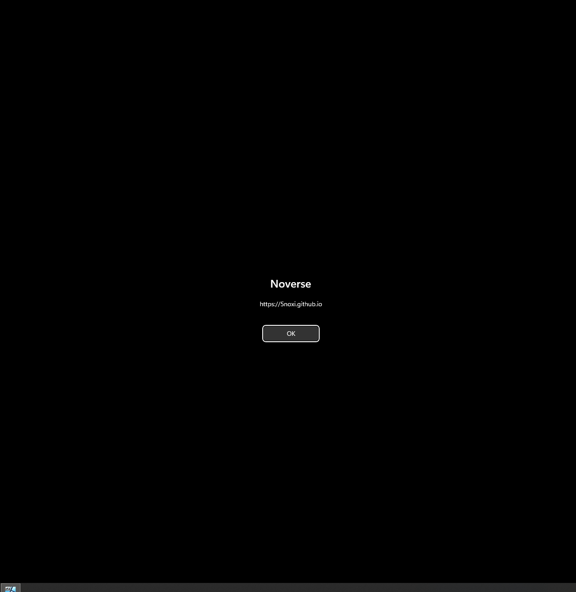

# Hide Lock Screen

Disables the lock screen, causing locking/starting to go straight to the sign-in screen:

```c
// IsLockScreenDisabled (winlogon.exe, 25H2)

v12 = 0;
if ( !CMachine::RegQueryDWORD(
        v8,
        L"Software\\Policies\\Microsoft\\Windows\\Personalization",
        L"NoLockScreen",
        0,
        &v12)
  && v12 )
{
  return 1LL; // no lock screen
}
```

Add a custom text to the sign in screen via:

```c
HKLM\SOFTWARE\Microsoft\Windows\CurrentVersion\Policies\System
// legalnoticecaption -	Type: REG_SZ - Data: Noverse
// legalnoticetext	- Type: REG_SZ - Data: https://noverse.dev
```

By adding them, you'll have to click `OK` every time you boot/log in:



### Accounts Captures

`Accounts > Sign-in options` - `Automatically save my restartable apps and restart them when I sign back in`:
```c
// Off
HKCU\Software\Microsoft\Windows NT\CurrentVersion\Winlogon\RestartApps    Type: REG_DWORD, Length: 4, Data: 0

// On
HKCU\Software\Microsoft\Windows NT\CurrentVersion\Winlogon\RestartApps    Type: REG_DWORD, Length: 4, Data: 1
```

`Accounts > Sign-in options` - `Show account details such as my email address on the sign-in screen`:
```c
// On
HKLM\SOFTWARE\Microsoft\Windows\CurrentVersion\SystemProtectedUserData\S-{ID}\AnyoneRead\Logon\ShowEmail	Type: REG_DWORD, Length: 4, Data: 1

// Off
HKLM\SOFTWARE\Microsoft\Windows\CurrentVersion\SystemProtectedUserData\S-{ID}\AnyoneRead\Logon\ShowEmail	Type: REG_DWORD, Length: 4, Data: 0
```

### Personalization Captures

`Personalization > Lock screen` - `Personalize your lock screen`:
```c
// Windows spotlight
HKCU\Software\Microsoft\Windows\CurrentVersion\ContentDeliveryManager\RotatingLockScreenEnabled	Type: REG_DWORD, Length: 4, Data: 1
HKLM\SOFTWARE\Microsoft\Windows\CurrentVersion\Authentication\LogonUI\Creative\S-{ID}\RotatingLockScreenEnabled	Type: REG_DWORD, Length: 4, Data: 1
HKCU\Software\Microsoft\Windows\CurrentVersion\ContentDeliveryManager\Subscriptions\338387\SubscriptionContext	Type: REG_SZ, Length: 20, Data: sc-mode=0
HKCU\Software\Microsoft\Windows\CurrentVersion\Lock Screen\SlideshowEnabled	Type: REG_DWORD, Length: 4, Data: 0
HKCU\Control Panel\Desktop\LockScreenAutoLockActive	Type: REG_SZ, Length: 4, Data: 0

// Picture
HKCU\Software\Microsoft\Windows\CurrentVersion\ContentDeliveryManager\RotatingLockScreenEnabled	Type: REG_DWORD, Length: 4, Data: 0
HKLM\SOFTWARE\Microsoft\Windows\CurrentVersion\Authentication\LogonUI\Creative\S-{ID}\RotatingLockScreenEnabled	Type: REG_DWORD, Length: 4, Data: 0
HKCU\Software\Microsoft\Windows\CurrentVersion\ContentDeliveryManager\Subscriptions\338387\SubscriptionContext	Type: REG_SZ, Length: 20, Data: sc-mode=1
HKCU\Software\Microsoft\Windows\CurrentVersion\Lock Screen\SlideshowEnabled	Type: REG_DWORD, Length: 4, Data: 0
HKCU\Control Panel\Desktop\LockScreenAutoLockActive	Type: REG_SZ, Length: 4, Data: 0
HKCU\Control Panel\Desktop\DelayLockInterval // deletevalue

// Slideshow
HKCU\Control Panel\Desktop\SCRNSAVE.EXE	// deletevalue
HKCU\Control Panel\Desktop\LockScreenAutoLockActive	Type: REG_SZ, Length: 4, Data: 1
HKCU\Control Panel\Desktop\DelayLockInterval	Type: REG_DWORD, Length: 4, Data: 0
HKCU\Software\Microsoft\Windows\CurrentVersion\Lock Screen\SlideshowEnabled	Type: REG_DWORD, Length: 4, Data: 1
// Include camera roll folders from this PC and OneDrive (Slideshow only)
// Enabled
HKCU\Software\Microsoft\Windows\CurrentVersion\Lock Screen\SlideshowIncludeCameraRoll	Type: REG_DWORD, Length: 4, Data: 1
// Disabled
HKCU\Software\Microsoft\Windows\CurrentVersion\Lock Screen\SlideshowIncludeCameraRoll	Type: REG_DWORD, Length: 4, Data: 0
// Only use pictures that fit my screen
// Enabled
HKCU\Software\Microsoft\Windows\CurrentVersion\Lock Screen\SlideshowOptimizePhotoSelection	Type: REG_DWORD, Length: 4, Data: 1
// Disabled
HKCU\Software\Microsoft\Windows\CurrentVersion\Lock Screen\SlideshowOptimizePhotoSelection	Type: REG_DWORD, Length: 4, Data: 0
// When my PC is inactive, show the lock screen instead of turning off the screen
// Enabled
HKCU\Software\Microsoft\Windows\CurrentVersion\Lock Screen\SlideshowAutoLock	Type: REG_DWORD, Length: 4, Data: 1
HKCU\Control Panel\Desktop\LockScreenAutoLockActive	Type: REG_SZ, Length: 4, Data: 1
// Disabled
HKCU\Software\Microsoft\Windows\CurrentVersion\Lock Screen\SlideshowAutoLock	Type: REG_DWORD, Length: 4, Data: 0
HKCU\Control Panel\Desktop\LockScreenAutoLockActive	Type: REG_SZ, Length: 4, Data: 0
// Turn off the screen after the slidshow has played for
// Don't turn off
HKCU\Software\Microsoft\Windows\CurrentVersion\Lock Screen\SlideshowDuration	Type: REG_DWORD, Length: 4, Data: 0
// 3H
HKCU\Software\Microsoft\Windows\CurrentVersion\Lock Screen\SlideshowDuration	Type: REG_DWORD, Length: 4, Data: 10800000
// 1H
HKCU\Software\Microsoft\Windows\CurrentVersion\Lock Screen\SlideshowDuration	Type: REG_DWORD, Length: 4, Data: 3600000
// 30min
HKCU\Software\Microsoft\Windows\CurrentVersion\Lock Screen\SlideshowDuration	Type: REG_DWORD, Length: 4, Data: 1800000

// Get fun facts, tips, tricks, and more on your lock screen (for Picture/Slideshow)
// Disabled
HKCU\Software\Microsoft\Windows\CurrentVersion\ContentDeliveryManager\RotatingLockScreenOverlayEnabled	Type: REG_DWORD, Length: 4, Data: 0
HKLM\SOFTWARE\Microsoft\Windows\CurrentVersion\Authentication\LogonUI\Creative\S-{ID}\RotatingLockScreenOverlayEnabled	Type: REG_DWORD, Length: 4, Data: 0
HKCU\Software\Microsoft\Windows\CurrentVersion\ContentDeliveryManager\SubscribedContent-338387Enabled	Type: REG_DWORD, Length: 4, Data: 0
// Enabled
HKCU\Software\Microsoft\Windows\CurrentVersion\ContentDeliveryManager\RotatingLockScreenOverlayEnabled	Type: REG_DWORD, Length: 4, Data: 1
HKLM\SOFTWARE\Microsoft\Windows\CurrentVersion\Authentication\LogonUI\Creative\S-{ID}\RotatingLockScreenOverlayEnabled	Type: REG_DWORD, Length: 4, Data: 1
HKCU\Software\Microsoft\Windows\CurrentVersion\ContentDeliveryManager\SubscribedContent-338387Enabled	Type: REG_DWORD, Length: 4, Data: 1
HKCU\Software\Microsoft\Windows\CurrentVersion\ContentDeliveryManager\Subscriptions\338387\SubscriptionContext	Type: REG_SZ, Length: 20, Data: sc-mode=1
```

## [Windows Policies](https://noverse.dev/policies)

| Policy | Key Path | Value Name |
| --- | --- | --- |
| [Do not display the lock screen](https://noverse.dev/policies?p=ControlPanelDisplay*CPL_Personalization_NoLockScreen) | `HKLM\Software\Policies\Microsoft\Windows\Personalization` | `NoLockScreen` |
| [Prevent changing lock screen and logon image](https://noverse.dev/policies?p=ControlPanelDisplay*CPL_Personalization_NoChangingLockScreen) | `HKLM\Software\Policies\Microsoft\Windows\Personalization` | `NoChangingLockScreen` |
| [Prevent lock screen background motion](https://noverse.dev/policies?p=ControlPanelDisplay*CPL_Personalization_AnimateLockScreenBackground) | `HKLM\Software\Policies\Microsoft\Windows\Personalization` | `AnimateLockScreenBackground` |
| [Prevent enabling lock screen slide show](https://noverse.dev/policies?p=ControlPanelDisplay*CPL_Personalization_NoLockScreenSlideshow) | `HKLM\Software\Policies\Microsoft\Windows\Personalization` | `NoLockScreenSlideshow` |
| [Prevent enabling lock screen camera](https://noverse.dev/policies?p=ControlPanelDisplay*CPL_Personalization_NoLockScreenCamera) | `HKLM\Software\Policies\Microsoft\Windows\Personalization` | `NoLockScreenCamera` |
| [Force a specific default lock screen and logon image](https://noverse.dev/policies?p=ControlPanelDisplay*CPL_Personalization_ForceDefaultLockScreen) | `HKLM\Software\Policies\Microsoft\Windows\Personalization` | `LockScreenImage`<br>`LockScreenOverlaysDisabled` |
| [Show clear logon background](https://noverse.dev/policies?p=Logon*DisableAcrylicBackgroundOnLogon) | `HKLM\Software\Policies\Microsoft\Windows\System` | `DisableAcrylicBackgroundOnLogon` |
