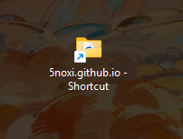
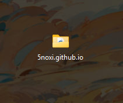

# Hide Shortcut Icon

Removes the `- Shortcut` text, hides the shortcut & compression arrows by pointing both icons to a [blank image](https://github.com/nohuto/Files/releases/download/miscellaneous/Blank.ico). Compressed files explorer has shown before keep their blue arrows, until the icon cache is rebuilt.

### Before

### After

