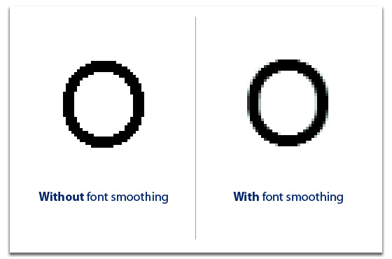

# Minimal Visual Effects

Disables all kind of animations, while leaving font smoothing + window content while dragging + thumbnails instead of icons enabled.

## UserPreferencesMask

Anything written as "- *text*" behind the linked name equals the source where the option can be toggled (and where I recorded the bit differences), "(untested)" means that I didn't find the Windows UI toggle for the bit yet, means that the meaning is currently based on pseudocode, or on [SystemParametersInfo (`SPI_*`)](https://learn.microsoft.com/en-us/windows/win32/api/winuser/nf-winuser-systemparametersinfow) naming. All meanings have a link to the win32k pseudocode function where the bit is read.

| Bit | Hex | Meaning |
| --- | --- | --- |
| 0 | `0x00000001` | [Active window tracking (untested)](https://github.com/nohuto/decompiled-pseudocode/blob/main/11-23H2/win32kfull/-xxxTrackingActivateWindow@@YA_NPEAUtagWND@@@Z.c) |
| 1 | `0x00000002` | [Fade or slide menus into view](https://github.com/nohuto/decompiled-pseudocode/blob/main/11-23H2/win32kfull/xxxMenuWindowProc.c) - *Performance Options* |
| 2 | `0x00000004` | [Slide open combo boxes](https://github.com/nohuto/decompiled-pseudocode/blob/main/11-23H2/win32kfull/xxxSystemParametersInfoWorker.c) - *Performance Options* |
| 3 | `0x00000008` | [Smooth-scroll list boxes](https://github.com/nohuto/decompiled-pseudocode/blob/main/11-23H2/win32kfull/xxxSystemParametersInfoWorker.c) - *Performance Options* |
| 4 | `0x00000010` | [Caption/gradient visual effects (untested)](https://github.com/nohuto/decompiled-pseudocode/blob/main/11-23H2/win32kfull/-xxxAnimateCaption@@YAXPEAUtagWND@@PEAUHDC__@@PEAUtagRECT@@2@Z.c) - "When set, each window title bar has a gradient effect (changes from one color or shade to another along the length of the title bar)." |
| 5 | `0x00000020` | [Keyboard cues / menu underlines (untested)](https://github.com/nohuto/decompiled-pseudocode/blob/main/11-23H2/win32kfull/-xxxDrawMenuItemText@@YAXAEBV-$SmartObjStackRef@UtagMENU@@@@PEAUtagITEM@@PEAUHDC__@@HHPEAGHH@Z.c) |
| 6 | `0x00000040` | [Active window tracking Z-order (untested)](https://github.com/nohuto/decompiled-pseudocode/blob/main/11-23H2/win32kfull/-xxxTrackingActivateWindow@@YA_NPEAUtagWND@@@Z.c) |
| 7 | `0x00000080` | [Hot tracking (untested)](https://github.com/nohuto/decompiled-pseudocode/blob/main/11-23H2/win32kfull/xxxTrackMouseMove.c) |
| 9 | `0x00000200` | [Menu fade (untested)](https://github.com/nohuto/decompiled-pseudocode/blob/main/11-23H2/win32kfull/ShouldHaveShadow.c), requires bit `1` to be set |
| 10 | `0x00000400` | [Fade out menu items after clicking](https://github.com/nohuto/decompiled-pseudocode/blob/main/11-23H2/win32kfull/-zzzMNFadeSelection@@YAHAEBV-$SmartObjStackRef@UtagMENU@@@@PEAUtagITEM@@@Z.c) - *Performance Options* |
| 11 | `0x00000800` | [Fade or slide ToolTips into view](https://github.com/nohuto/decompiled-pseudocode/blob/main/11-23H2/win32kfull/-xxxShowTooltip@@YAHPEAUtagTOOLTIPWND@@@Z.c) - *Performance Options* |
| 12 | `0x00001000` | [Tooltip fade (untested)](https://github.com/nohuto/decompiled-pseudocode/blob/main/11-23H2/win32kfull/xxxTooltipWndProc.c), required bit `11` to be set |
| 13 | `0x00002000` | [Show shadows under mouse pointer](https://github.com/nohuto/decompiled-pseudocode/blob/main/11-23H2/win32kfull/-FCursorShadowed@@YA_NPEAU_CURSINFO@@@Z.c) - *Performance Options* |
| 14 | `0x00004000` | [Show location of pointer when I press the CTRL key](https://github.com/nohuto/decompiled-pseudocode/blob/main/11-23H2/win32kfull/EditionHandleSonarKeyEvent.c) - *Mouse Properties* |
| 15 | `0x00008000` | [Turn on ClickLock](https://github.com/nohuto/decompiled-pseudocode/blob/main/11-23H2/win32kbase/-ProcessMouseButton@CMouseProcessor@@AEAAXAEBVCButtonEvent@1@@Z.c) - *Mouse Properties* |
| 16 | `0x00010000` | [Hide pointer while typing](https://github.com/nohuto/decompiled-pseudocode/blob/main/11-23H2/win32kfull/NtUserHideCursorNoCapture.c) - *Mouse Properties* |
| 17 | `0x00020000` | [Flat menus (untested)](https://github.com/nohuto/decompiled-pseudocode/blob/main/11-23H2/win32kfull/xxxDrawMenuBarUnderlines.c) |
| 18 | `0x00040000` | [Show shadows under windows](https://github.com/nohuto/decompiled-pseudocode/blob/main/11-23H2/win32kfull/ShouldHaveShadow.c) - *Performance Options* |
| 31 | `0x80000000` | [Master UI effects (untested)](https://github.com/nohuto/decompiled-pseudocode/blob/main/11-23H2/win32kfull/xxxSystemParametersInfoWorker.c) - "When enabled, all user interface effects (combo box animation, cursor shadow, gradient captions, hot tracking, list box smooth scrolling, menu animation, menu underlines, selection fade, tool tip animation) are enabled." |
| 33 | `0x00000002` in high dword | Animate controls and elements inside windows |
| 39 | `0x00000080` in high dword | [Suppress/apply global input-settings updates on focus/delegation changes (untested)](https://github.com/nohuto/decompiled-pseudocode/blob/main/11-23H2/win32kfull/EditionKeyboardInputDelegationChanged.c) |
| 41 | `0x00000200` in high dword | [Pen button yield / pen quick-launch hotkey (untested)](https://github.com/nohuto/decompiled-pseudocode/blob/main/11-23H2/win32kfull/-NotifyISMPenButtonYieldSettingChange@@YAXXZ.c) |

### Font Smoothing

