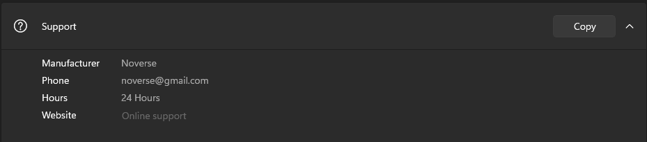

# OEM Information

Set your own support information, it shows in `Settings > System > About` under 'Support' (`Control Panel > System and Security > System` opens the same on W11). All values are saved in:

```
HKLM\SOFTWARE\Microsoft\Windows\CurrentVersion\OEMInformation
```

You used to change the logo via:

```json
"HKLM\\SOFTWARE\\Microsoft\\Windows\\CurrentVersion\\OEMInformation": {
  "Logo": { "Type": "REG_SZ", "Data": "path\\OEM.bmp" }
}
```

But it seems deprecated (doesn't work for me), limits were `120x120` pixels, `.bmp` file & `32-bit` color depth.

Edit registered owner/orga (visible in `winver`) via:

```json
"HKLM\\SOFTWARE\\Microsoft\\Windows NT\\CurrentVersion": {
  "RegisteredOwner": { "Type": "REG_SZ", "Data": "Nohuto" },
  "RegisteredOrganization": { "Type": "REG_SZ", "Data": "Noverse" }
}
```

Edit miscellaneous things in `winver.exe` using (`basebrd.dll`/`basebrd.dll.mui`) [resourcehacker](https://www.angusj.com/resourcehacker/).

### Example

```json
"HKLM\\SOFTWARE\\Microsoft\\Windows\\CurrentVersion\\OEMInformation": {
  "Manufacturer": { "Type": "REG_SZ", "Data": "Noverse" },
  "Model": { "Type": "REG_SZ", "Data": "Windows 11" },
  "SupportHours": { "Type": "REG_SZ", "Data": "24H" },
  "SupportPhone": { "Type": "REG_SZ", "Data": "+X XXX XXXX" },
  "SupportURL": { "Type": "REG_SZ", "Data": "https://discord.noverse.dev" }
}
```



