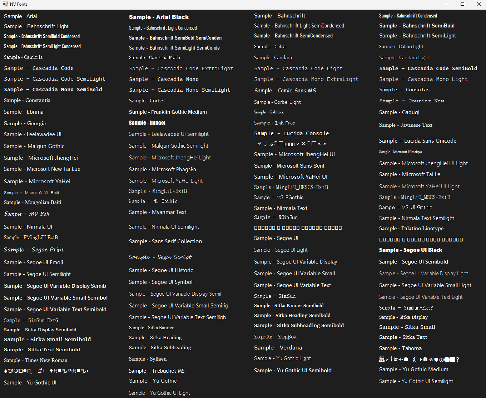

# System Fonts

W11 uses `Segoe UI` by default. You can change it via registry edits, the selected font will be used for desktop interfaces, explorer, some apps (`StartAllBack` will use it), but won't get applied for e.g., `SystemSettings.exe` and app fonts in general. Some fonts will cause issues - `Yu Gothic UI Light` uses `¥` instead of `\` (picture).

Either select a installed font with the command shown below or install new fonts via e.g. [nerdfonts](https://www.nerdfonts.com/font-downloads).

List all available font families on your system with the `Open` option, or via `Personalization > Fonts`:

```powershell
Add-Type -AssemblyName System.Drawing;[System.Drawing.FontFamily]::Families | % {$_.Name}
```




### Manually Adding Custom Fonts

The option lists the default fonts, add your own custom font via:

```json
"HKLM\\SOFTWARE\\Microsoft\\Windows NT\\CurrentVersion\\Fonts": {
  "Segoe UI (TrueType)": { "Type": "REG_SZ", "Data": "" },
  "Segoe UI Black (TrueType)": { "Type": "REG_SZ", "Data": "" },
  "Segoe UI Black Italic (TrueType)": { "Type": "REG_SZ", "Data": "" },
  "Segoe UI Bold (TrueType)": { "Type": "REG_SZ", "Data": "" },
  "Segoe UI Bold Italic (TrueType)": { "Type": "REG_SZ", "Data": "" },
  "Segoe UI Historic (TrueType)": { "Type": "REG_SZ", "Data": "" },
  "Segoe UI Italic (TrueType)": { "Type": "REG_SZ", "Data": "" },
  "Segoe UI Light (TrueType)": { "Type": "REG_SZ", "Data": "" },
  "Segoe UI Light Italic (TrueType)": { "Type": "REG_SZ", "Data": "" },
  "Segoe UI Semibold (TrueType)": { "Type": "REG_SZ", "Data": "" },
  "Segoe UI Semibold Italic (TrueType)": { "Type": "REG_SZ", "Data": "" },
  "Segoe UI Semilight (TrueType)": { "Type": "REG_SZ", "Data": "" },
  "Segoe UI Semilight Italic (TrueType)": { "Type": "REG_SZ", "Data": "" },
  "Segoe UI Symbol (TrueType)": { "Type": "REG_SZ", "Data": "" }
}
// "Font Name" = Replace with the font name
"HKLM\\SOFTWARE\\Microsoft\\Windows NT\\CurrentVersion\\FontSubstitutes": {
  "Segoe UI": { "Type": "REG_SZ", "Data": "Font Name" }
}
```

Revert the changes:

```json
"HKLM\\SOFTWARE\\Microsoft\\Windows NT\\CurrentVersion\\Fonts": {
  "Segoe UI (TrueType)": { "Type": "REG_SZ", "Data": "segoeui.ttf" },
  "Segoe UI Black (TrueType)": { "Type": "REG_SZ", "Data": "seguibl.ttf" },
  "Segoe UI Black Italic (TrueType)": { "Type": "REG_SZ", "Data": "seguibli.ttf" },
  "Segoe UI Bold (TrueType)": { "Type": "REG_SZ", "Data": "segoeuib.ttf" },
  "Segoe UI Bold Italic (TrueType)": { "Type": "REG_SZ", "Data": "segoeuiz.ttf" },
  "Segoe UI Historic (TrueType)": { "Type": "REG_SZ", "Data": "seguihis.ttf" },
  "Segoe UI Italic (TrueType)": { "Type": "REG_SZ", "Data": "segoeuii.ttf" },
  "Segoe UI Light (TrueType)": { "Type": "REG_SZ", "Data": "segoeuil.ttf" },
  "Segoe UI Light Italic (TrueType)": { "Type": "REG_SZ", "Data": "seguili.ttf" },
  "Segoe UI Semibold (TrueType)": { "Type": "REG_SZ", "Data": "seguisb.ttf" },
  "Segoe UI Semibold Italic (TrueType)": { "Type": "REG_SZ", "Data": "seguisbi.ttf" },
  "Segoe UI Semilight (TrueType)": { "Type": "REG_SZ", "Data": "segoeuisl.ttf" },
  "Segoe UI Semilight Italic (TrueType)": { "Type": "REG_SZ", "Data": "seguisli.ttf" },
  "Segoe UI Symbol (TrueType)": { "Type": "REG_SZ", "Data": "seguisym.ttf" }
},
"HKLM\\SOFTWARE\\Microsoft\\Windows NT\\CurrentVersion\\FontSubstitutes": {
  "Segoe UI": { "Action": "deletevalue" }
}
```

## Suboptions

| Option | Description |
| --- | --- |
| Hide fonts based on language settings | "Windows can hide fonts that are not designed for your input language settings. If you choose this option, only fonts that are designed for your language settings will be listed in your programs." |
| Allow fonts to be installed using a shortcut | To save space on your computer, you can choose to install a shortcut to a font file instead of the file itself. If the font file becomes unavailable, you might not be able to use the font. |

## Notes on System Text Size

Edit text sizes via [`TextScaleFactor`](https://learn.microsoft.com/en-us/uwp/api/windows.ui.viewmanagement.uisettings.textscalefactor?view=winrt-26100#windows-ui-viewmanagement-uisettings-textscalefactor), valid ranges are `100-225` (DWORD).

```c
// anonymous_namespace_::TextScaleDialogTemplate (shell32.dll)

  v10 = 0;
  if ( (int)SHRegGetDWORD(HKEY_CURRENT_USER, L"Software\\Microsoft\\Accessibility", L"TextScaleFactor", &v10) < 0
    || (v6 = v10, v10 - 101 > 0x7C) ) // valid range: [101, 225] -> v10 - 101 > 124  -> v10 > 225
  {
    v6 = 100LL; // fallback to 100 if missing or out of range (<100 / >225)
  }
```

- [visibility/assets/pseudocode | textsize-TextScaleDialogTemplate.c](https://github.com/nohuto/win-config/blob/main/visibility/assets/pseudocode/textsize-TextScaleDialogTemplate.c)

Applying changes via `Accessibility > Text size`:
```c
// 100%
HKCU\Software\Microsoft\Accessibility\TextScaleFactor    Type: REG_DWORD, Length: 4, Data: 100

// 225%
HKCU\Software\Microsoft\Accessibility\TextScaleFactor    Type: REG_DWORD, Length: 4, Data: 225
```

Depending on the selected size, `CaptionFont`, `SmCaptionFont`, `MenuFont`, `StatusFont`, `MessageFont`, `IconFont` (located in `HKCU\Control Panel\Desktop\WindowMetrics`) will also change. Not every % increase will edit them, I may add exact data soon. Example of `100%`/`225%`:

```c
// 100%
IconFont    Type: REG_BINARY, Length: 92, Data: F4 FF FF FF 00 00 00 00 00 00 00 00 00 00 00 00
CaptionFont    Type: REG_BINARY, Length: 92, Data: F4 FF FF FF 00 00 00 00 00 00 00 00 00 00 00 00
SmCaptionFont    Type: REG_BINARY, Length: 92, Data: F4 FF FF FF 00 00 00 00 00 00 00 00 00 00 00 00
MenuFont    Type: REG_BINARY, Length: 92, Data: F4 FF FF FF 00 00 00 00 00 00 00 00 00 00 00 00
StatusFont    Type: REG_BINARY, Length: 92, Data: F4 FF FF FF 00 00 00 00 00 00 00 00 00 00 00 00
MessageFont    Type: REG_BINARY, Length: 92, Data: F4 FF FF FF 00 00 00 00 00 00 00 00 00 00 00 00

// 225%
CaptionFont    Type: REG_BINARY, Length: 92, Data: E5 FF FF FF 00 00 00 00 00 00 00 00 00 00 00 00
SmCaptionFont    Type: REG_BINARY, Length: 92, Data: E5 FF FF FF 00 00 00 00 00 00 00 00 00 00 00 00
MenuFont    Type: REG_BINARY, Length: 92, Data: E5 FF FF FF 00 00 00 00 00 00 00 00 00 00 00 00
StatusFont    Type: REG_BINARY, Length: 92, Data: E5 FF FF FF 00 00 00 00 00 00 00 00 00 00 00 00
MessageFont    Type: REG_BINARY, Length: 92, Data: E5 FF FF FF 00 00 00 00 00 00 00 00 00 00 00 00
IconFont    Type: REG_BINARY, Length: 92, Data: E5 FF FF FF 00 00 00 00 00 00 00 00 00 00 00 00
```

