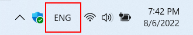
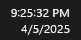

# Taskbar Settings

Hides the search box, the *Task View* button and widgets, aligns the taskbar to the left, turns off badges, flashing, "Share any window from my taskbar" and the far corner show desktop, locks the taskbar, adds '*End Task*' to the taskbar menu, and hides the bluetooth icon, the pen menu and the language bar. See details about the `Add 'End Task' to Taskbar Context Menu` option [here](https://www.youtube.com/watch?v=5HWyyNep6t0).

### SystemSettings Captures

```c
// SystemSettings > Personalization > Taskbar

  // Taskbar items
    // Search
    // Hide
    HKCU\Software\Microsoft\Windows\CurrentVersion\Search\SearchboxTaskbarMode	Type: REG_DWORD, Length: 4, Data: 0
    // Search icon only
    HKCU\Software\Microsoft\Windows\CurrentVersion\Search\SearchboxTaskbarMode	Type: REG_DWORD, Length: 4, Data: 1
    // Search icon and label
    HKCU\Software\Microsoft\Windows\CurrentVersion\Search\SearchboxTaskbarMode	Type: REG_DWORD, Length: 4, Data: 3
    // Search box
    HKCU\Software\Microsoft\Windows\CurrentVersion\Search\SearchboxTaskbarMode	Type: REG_DWORD, Length: 4, Data: 2

    // Task view
    // Enabled
    HKCU\Software\Microsoft\Windows\CurrentVersion\Explorer\Advanced\ShowTaskViewButton	Type: REG_DWORD, Length: 4, Data: 1
    // Disabled
    HKCU\Software\Microsoft\Windows\CurrentVersion\Explorer\Advanced\ShowTaskViewButton	Type: REG_DWORD, Length: 4, Data: 0

    // Widgets
    // Enabled
    HKCU\Software\Microsoft\Windows\CurrentVersion\Explorer\Advanced\TaskbarDa	Type: REG_DWORD, Length: 4, Data: 1
    // Disabled
    HKCU\Software\Microsoft\Windows\CurrentVersion\Explorer\Advanced\TaskbarDa	Type: REG_DWORD, Length: 4, Data: 0

  // System Tray icons
    // Emoji and more
    // Never
    HKCU\Software\Microsoft\TabletTip\1.7\EmojiAndMoreIconVisibilityState	Type: REG_DWORD, Length: 4, Data: 0
    // While typing
    HKCU\Software\Microsoft\TabletTip\1.7\EmojiAndMoreIconVisibilityState	Type: REG_DWORD, Length: 4, Data: 1
    // Always
    HKCU\Software\Microsoft\TabletTip\1.7\EmojiAndMoreIconVisibilityState	Type: REG_DWORD, Length: 4, Data: 2

    // Pen menu
    // Enabled
    HKCU\Software\Microsoft\Windows\CurrentVersion\PenWorkspace\PenWorkspaceButtonDesiredVisibility	Type: REG_DWORD, Length: 4, Data: 1
    // Disabled
    HKCU\Software\Microsoft\Windows\CurrentVersion\PenWorkspace\PenWorkspaceButtonDesiredVisibility	Type: REG_DWORD, Length: 4, Data: 0

    // Touch keyboard
    // Never
    HKCU\Software\Microsoft\TabletTip\1.7\TipbandDesiredVisibility	Type: REG_DWORD, Length: 4, Data: 0
    // Always
    HKCU\Software\Microsoft\TabletTip\1.7\TipbandDesiredVisibility	Type: REG_DWORD, Length: 4, Data: 1
    // When no keyboard attached
    HKCU\Software\Microsoft\TabletTip\1.7\TipbandDesiredVisibility	Type: REG_DWORD, Length: 4, Data: 2

  // Other system tray icons
    // Hidden icon menu
    // Enabled
    HKCU\Software\Classes\Local Settings\Software\Microsoft\Windows\CurrentVersion\TrayNotify\SystemTrayChevronVisibility	Type: REG_DWORD, Length: 4, Data: 1
    // Disabled
    HKCU\Software\Classes\Local Settings\Software\Microsoft\Windows\CurrentVersion\TrayNotify\SystemTrayChevronVisibility	Type: REG_DWORD, Length: 4, Data: 0

    // Microsoft OneDrive
    // Enabled
    HKCU\Control Panel\NotifyIconSettings\1393818165748543931\IsPromoted	Type: REG_DWORD, Length: 4, Data: 1
    // Disabled
    HKCU\Control Panel\NotifyIconSettings\1393818165748543931\IsPromoted	Type: REG_DWORD, Length: 4, Data: 0

    // Windows Security notification icon
    // Enabled
    HKCU\Control Panel\NotifyIconSettings\9970533644875679773\IsPromoted	Type: REG_DWORD, Length: 4, Data: 1
    // Disabled
    HKCU\Control Panel\NotifyIconSettings\9970533644875679773\IsPromoted	Type: REG_DWORD, Length: 4, Data: 0

  // Taskbar behaviours
    // Taskbar alignment
    // Left
    HKCU\Software\Microsoft\Windows\CurrentVersion\Explorer\Advanced\TaskbarAl	Type: REG_DWORD, Length: 4, Data: 0
    // Center
    HKCU\Software\Microsoft\Windows\CurrentVersion\Explorer\Advanced\TaskbarAl	Type: REG_DWORD, Length: 4, Data: 1

    // Show badges on taskbar apps
    // Enabled
    HKCU\Software\Microsoft\Windows\CurrentVersion\Explorer\Advanced\TaskbarBadges	Type: REG_DWORD, Length: 4, Data: 1
    // Disabled
    HKCU\Software\Microsoft\Windows\CurrentVersion\Explorer\Advanced\TaskbarBadges	Type: REG_DWORD, Length: 4, Data: 0

    // Show flashing on taskbar apps
    // Enabled
    HKCU\Software\Microsoft\Windows\CurrentVersion\Explorer\Advanced\TaskbarFlashing	Type: REG_DWORD, Length: 4, Data: 1
    // Disabled
    HKCU\Software\Microsoft\Windows\CurrentVersion\Explorer\Advanced\TaskbarFlashing	Type: REG_DWORD, Length: 4, Data: 0

    // Share any window from my taskbar
    // Enabled
    HKCU\Software\Microsoft\Windows\CurrentVersion\Explorer\Advanced\TaskbarSn	Type: REG_DWORD, Length: 4, Data: 1
    // Disabled
    HKCU\Software\Microsoft\Windows\CurrentVersion\Explorer\Advanced\TaskbarSn	Type: REG_DWORD, Length: 4, Data: 0

    // Select the far corner of the taskbar to show the desktop
    // Enabled
    HKCU\Software\Microsoft\Windows\CurrentVersion\Explorer\Advanced\TaskbarSd	Type: REG_DWORD, Length: 4, Data: 1
    // Disabled
    HKCU\Software\Microsoft\Windows\CurrentVersion\Explorer\Advanced\TaskbarSd	Type: REG_DWORD, Length: 4, Data: 0

    // Combine taskbar buttons and hide labels (same for the one below but it uses value name MMTaskbarGlomLevel)
    // Always
    HKCU\Software\Microsoft\Windows\CurrentVersion\Explorer\Advanced\TaskbarGlomLevel	Type: REG_DWORD, Length: 4, Data: 0
    // When taskbar is full
    HKCU\Software\Microsoft\Windows\CurrentVersion\Explorer\Advanced\TaskbarGlomLevel	Type: REG_DWORD, Length: 4, Data: 1
    // Never
    HKCU\Software\Microsoft\Windows\CurrentVersion\Explorer\Advanced\TaskbarGlomLevel	Type: REG_DWORD, Length: 4, Data: 2

    // Show smaller taskbar buttons
    // Always
    HKCU\Software\Microsoft\Windows\CurrentVersion\Explorer\Advanced\IconSizePreference	Type: REG_DWORD, Length: 4, Data: 0
    // When taskbar is full
    HKCU\Software\Microsoft\Windows\CurrentVersion\Explorer\Advanced\IconSizePreference	Type: REG_DWORD, Length: 4, Data: 2
    // Never
    HKCU\Software\Microsoft\Windows\CurrentVersion\Explorer\Advanced\IconSizePreference	Type: REG_DWORD, Length: 4, Data: 1


// SystemSettings > Time & language > Date & time

  // Show time and date in the System tray
  // Enabled
  HKCU\Software\Microsoft\Windows\CurrentVersion\Explorer\Advanced\ShowSystrayDateTimeValueName	Type: REG_DWORD, Length: 4, Data: 1
    // Show seconds in system tray clock (uses more power)
    // Enabled
    HKCU\Software\Microsoft\Windows\CurrentVersion\Explorer\Advanced\ShowSecondsInSystemClock	Type: REG_DWORD, Length: 4, Data: 1
    // Disabled
    HKCU\Software\Microsoft\Windows\CurrentVersion\Explorer\Advanced\ShowSecondsInSystemClock	Type: REG_DWORD, Length: 4, Data: 0

  // Disabled
  HKCU\Software\Microsoft\Windows\CurrentVersion\Explorer\Advanced\ShowSystrayDateTimeValueName	Type: REG_DWORD, Length: 4, Data: 0

// Taskbar

  // Lock the taskbar
  // Enabled
  HKCU\Software\Microsoft\Windows\CurrentVersion\Explorer\Advanced\TaskbarSizeMove	Type: REG_DWORD, Length: 4, Data: 0
  // Disabled
  HKCU\Software\Microsoft\Windows\CurrentVersion\Explorer\Advanced\TaskbarSizeMove	Type: REG_DWORD, Length: 4, Data: 1

// SystemSettings > System > Advanced

  // End Task
  // Enabled
  HKCU\Software\Microsoft\Windows\CurrentVersion\Explorer\Advanced\TaskbarDeveloperSettings\TaskbarEndTask	Type: REG_DWORD, Length: 4, Data: 1
  // Disabled
  HKCU\Software\Microsoft\Windows\CurrentVersion\Explorer\Advanced\TaskbarDeveloperSettings\TaskbarEndTask	Type: REG_DWORD, Length: 4, Data: 0


```

## Suboptions

### Hide Language Bar



#### Text Services and Input Languages Captures

`Time & language > Typing > Advanced keyboard settings > Language bar options`:
```c
// Floating On Desktop
HKCU\Software\Microsoft\CTF\LangBar\ShowStatus	Type: REG_DWORD, Length: 4, Data: 0

// Hidden
HKCU\Software\Microsoft\CTF\LangBar\ShowStatus	Type: REG_DWORD, Length: 4, Data: 3

// Docked in the taskbar
HKCU\Software\Microsoft\CTF\LangBar\ShowStatus	Type: REG_DWORD, Length: 4, Data: 4
```

`Show the Language bar as transparent when inactive`:
```c
// Enabled
HKCU\Software\Microsoft\CTF\LangBar\Transparency	Type: REG_DWORD, Length: 4, Data: 64

// Disabled
HKCU\Software\Microsoft\CTF\LangBar\Transparency	Type: REG_DWORD, Length: 4, Data: 255
```

`Show additional Language bar icons in the taskbar`:
```c
// Enabled
HKCU\Software\Microsoft\CTF\LangBar\ExtraIconsOnMinimized	Type: REG_DWORD, Length: 4, Data: 1

// Disabled
HKCU\Software\Microsoft\CTF\LangBar\ExtraIconsOnMinimized	Type: REG_DWORD, Length: 4, Data: 0
```

`Show text labels on the Language bar`:
```c
// Enabled
HKCU\Software\Microsoft\CTF\LangBar\Label	Type: REG_DWORD, Length: 4, Data: 1

// Disabled
HKCU\Software\Microsoft\CTF\LangBar\Label	Type: REG_DWORD, Length: 4, Data: 0
```

### System Clock Seconds

"*Uses more power*" (in relation to laptops).



## [Windows Policies](https://noverse.dev/policies)

Note that the widget policies here are inverted.

| Policy | Key Path | Value Name |
| --- | --- | --- |
| [Allow widgets](https://noverse.dev/policies?p=NewsAndInterests*AllowNewsAndInterests) | `HKLM\SOFTWARE\Policies\Microsoft\Dsh` | `AllowNewsAndInterests` |
| [Disable Widgets On Lock Screen](https://noverse.dev/policies?p=NewsAndInterests*DisableWidgetsOnLockScreen) | `HKLM\SOFTWARE\Policies\Microsoft\Dsh` | `DisableWidgetsOnLockScreen` |
| [Disable Widgets Board](https://noverse.dev/policies?p=NewsAndInterests*DisableWidgetsBoard) | `HKLM\SOFTWARE\Policies\Microsoft\Dsh` | `DisableWidgetsBoard` |
| [Remove the People Bar from the taskbar (Windows 10)](https://noverse.dev/policies?p=StartMenu*HidePeopleBar) | `HKCU\Software\Policies\Microsoft\Windows\Explorer` | `HidePeopleBar` |
| [Hide the TaskView button](https://noverse.dev/policies?p=Taskbar*HideTaskViewButton) | `HKLM\Software\Policies\Microsoft\Windows\Explorer`<br>`HKCU\Software\Policies\Microsoft\Windows\Explorer` | `HideTaskViewButton` |
| [Configures search on the taskbar](https://noverse.dev/policies?p=Search*ConfigureSearchOnTaskbarMode) | `HKLM\Software\Policies\Microsoft\Windows\Windows Search` | `SearchOnTaskbarMode` |
